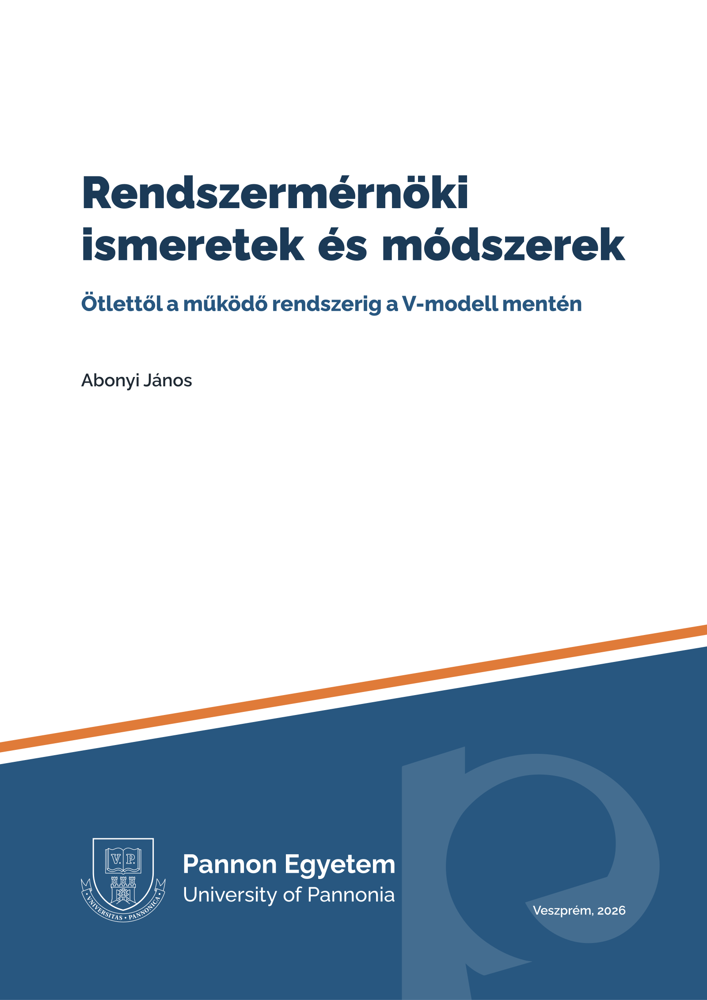
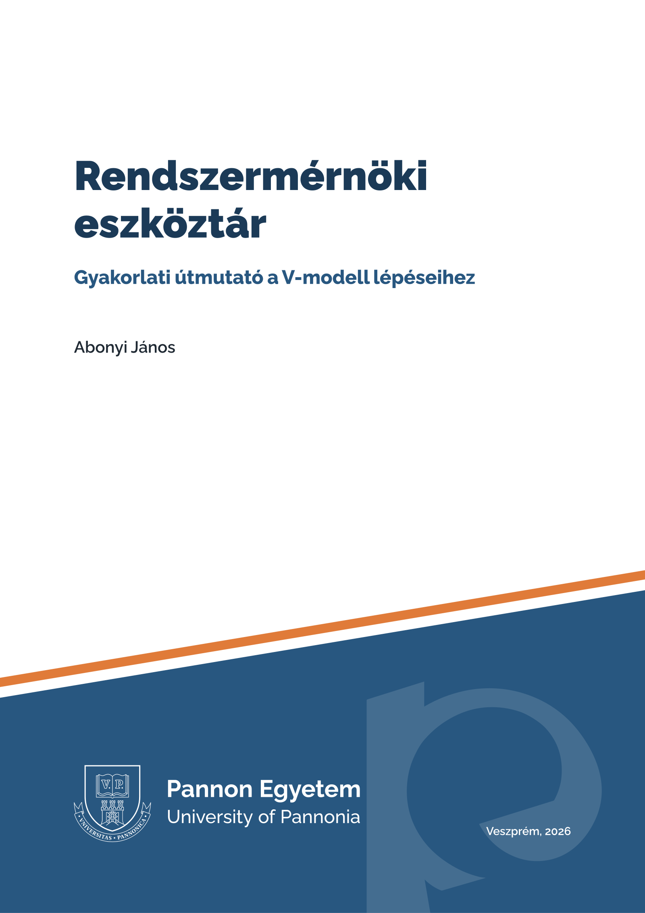
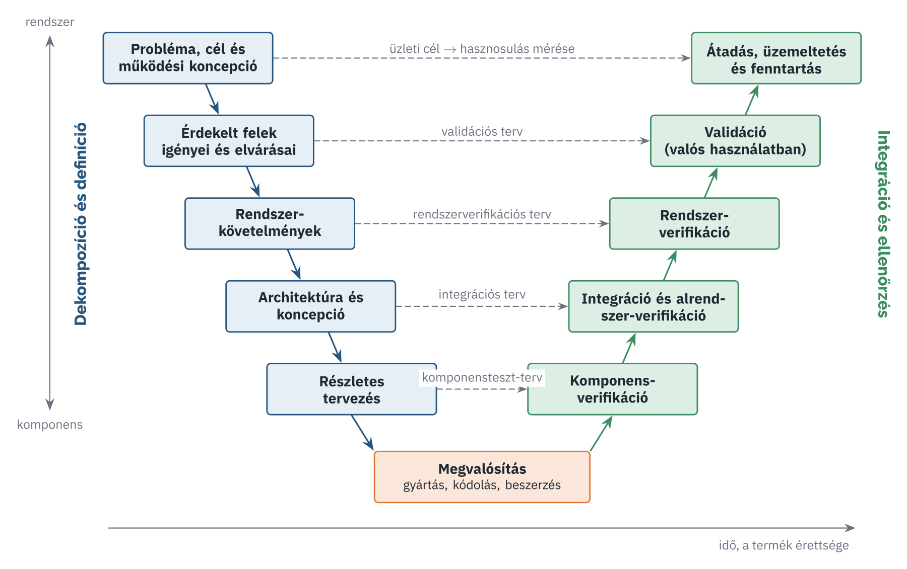
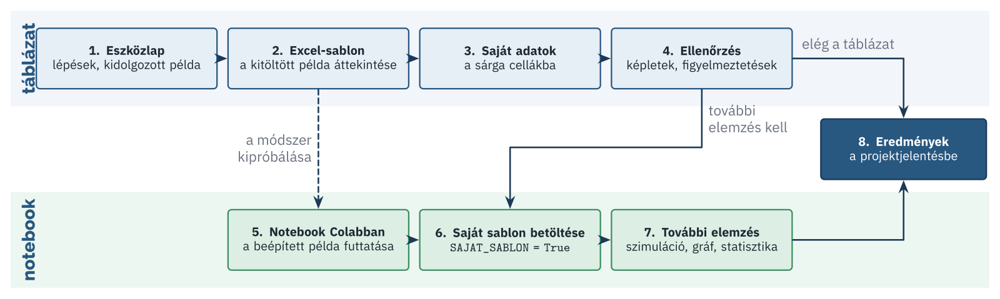

<p align="left">
  <a href="https://uni-pannon.hu/"><picture>
    <source media="(prefers-color-scheme: dark)" srcset="_shared/logo/PE_cimer_nevjel_fekvo_feher.svg">
    
  </picture></a>
</p>

# Rendszermérnöki ismeretek és módszerek

<!-- DOI-JELVENY -->

**Ötlettől a működő rendszerig a V-modell mentén – kézikönyv és gyakorlati útmutató**  
Abonyi János · Pannon Egyetem, Veszprém, 2026

Nyílt hozzáférésű, magyar nyelvű rendszermérnöki tankönyv és gyakorlati útmutató mérnöki alapszakos hallgatóknak. A kézikönyv azt mutatja meg, hogyan lesz egy homályos igényből működő, biztonságos, használható és gazdaságos rendszer: az érdekelt felek igényeinek feltárásától a követelményeken, a koncepciókon és a terveken át a megvalósításig, az integrációig, az ellenőrzésig és az üzemeltetésig. Elméleti gerincét a rendszermérnökség nemzetközi szabványai (ISO/IEC/IEEE 15288:2023, 24748-1, 29148), az INCOSE rendszermérnöki kézikönyve és a SEBoK tudástár adják; az egyes módszereket eredeti szakirodalmuk és a rájuk vonatkozó szabványok alapján tárgyalja. A gyakorlati útmutató egységes eszközlapokkal, letölthető Excel-sablonokkal, Google Colab-notebookokkal és mintapromptokkal teszi alkalmazhatóvá a módszereket.

| Olvasás és gyakorlás | |
|:--|:--|
| A webhely nyitóoldala | <https://complexsystemsintelligence.github.io/rendszermernokseg/> |
| Kézikönyv – webkönyv (kereshető) | <https://complexsystemsintelligence.github.io/rendszermernokseg/kezikonyv/> |
| Kézikönyv – PDF (nyomtatható, A4) | [rendszermernokseg-kezikonyv.pdf](https://complexsystemsintelligence.github.io/rendszermernokseg/kezikonyv/rendszermernokseg-kezikonyv.pdf) |
| Kézikönyv – EPUB (e-könyv-olvasóra) | [rendszermernokseg-kezikonyv.epub](https://complexsystemsintelligence.github.io/rendszermernokseg/kezikonyv/rendszermernokseg-kezikonyv.epub) |
| Gyakorlati útmutató – webkönyv | <https://complexsystemsintelligence.github.io/rendszermernokseg/gyakorlat/> |
| Gyakorlati útmutató – PDF | [rendszermernokseg-gyakorlat.pdf](https://complexsystemsintelligence.github.io/rendszermernokseg/gyakorlat/rendszermernokseg-gyakorlat.pdf) |
| Gyakorlati útmutató – EPUB | [rendszermernokseg-gyakorlat.epub](https://complexsystemsintelligence.github.io/rendszermernokseg/gyakorlat/rendszermernokseg-gyakorlat.epub) |
| Excel-sablonok (54) | [gyakorlat/sablonok/](gyakorlat/sablonok/README.md) – Excelben, LibreOffice Calcban és Google Táblázatokban |
| Python-notebookok (46) | [gyakorlat/notebookok/](gyakorlat/notebookok/README.md) – egy kattintással futtathatók Google Colabban |

<p><a href="https://complexsystemsintelligence.github.io/rendszermernokseg/kezikonyv/"></a>&nbsp;&nbsp;&nbsp;<a href="https://complexsystemsintelligence.github.io/rendszermernokseg/gyakorlat/"></a></p>

## Kinek szól a könyv?

Elsősorban mérnöki alapszakos hallgatóknak: műszaki menedzsereknek, mechatronikai mérnököknek és mindazoknak, akik informatikai fejlesztésben vesznek részt. A könyv önálló tanulásra készült: a fogalmakat lépésről lépésre vezeti be, minden módszert kidolgozott példán mutat be, a fejezetek végén önellenőrző kérdések (lenyitható megoldással) és projektfeladatok állnak. A tanulási eredményeket a kézikönyv előszava a Magyar Képesítési Keretrendszer négy dimenziójában rögzíti. A gyakorló mérnökök kézikönyvként is használhatják, egy-egy módszer gyors felidézésére; a fejezetek egyenként is feldolgozhatók.

## Három végigvitt eset

A módszereket három esettanulmány kapcsolja össze, amelyek fejezetről fejezetre továbbépülnek:

- **A – KoboCella** (mechatronika, gyártás): kollaboratív robotos összeszerelő cella egy elektromos kerékpárokhoz agymotort gyártó beszállítónál – emberi rendszerintegráció, funkciómegosztás, biztonságkritikus tervezés, FMEA és berendezéshatékonyság.
- **B – VárosiBringa** (szolgáltatás, infrastruktúra): közösségi elektromos kerékpárrendszer egy kitalált, dombos egyetemi városban – érdekeltfél-elemzés, Kano-modell, QFD, többszempontú döntés és szolgáltatásfolyamatok.
- **C – ForgácsTech** (szervezet, folyamatok): egy egyedi és kis sorozatú CNC-megmunkálással foglalkozó alkatrészgyártó üzem digitális átállása – folyamatelemzés, Little-törvény, szűk keresztmetszet, OEE, BPMN-modellezés, ütemezés és folyamatos fejlesztés.

Az esetek leírása a kézikönyv [A. függelékében](https://complexsystemsintelligence.github.io/rendszermernokseg/kezikonyv/fuggelek/a-esettanulmanyok.html) olvasható.

## A kézikönyv felépítése



A könyv a V-modellt követi: a bal ágon a problémától a tervig, a csúcson a megvalósításig és a folyamattervezésig, a jobb ágon az integrációtól az üzemeltetésig, végül az egész életcikluson átívelő technikai menedzsmentig vezet.

| Fejezet | Kapcsolódó eszközlapok |
|:--|:--|
| **I. rész – Alapok** | |
| 1. [Rendszerek és rendszerszemlélet](https://complexsystemsintelligence.github.io/rendszermernokseg/kezikonyv/fejezetek/01-rendszerek.html) |  |
| 2. [A rendszerfejlesztés életciklusa és a V-modell](https://complexsystemsintelligence.github.io/rendszermernokseg/kezikonyv/fejezetek/02-v-modell.html) | [A projekt V-terve](https://complexsystemsintelligence.github.io/rendszermernokseg/gyakorlat/eszkozok/01-v-terv.html) · [Technikai felülvizsgálat lebonyolítása](https://complexsystemsintelligence.github.io/rendszermernokseg/gyakorlat/eszkozok/54-felulvizsgalat.html) |
| 3. [Modellek és modellalapú rendszermérnökség](https://complexsystemsintelligence.github.io/rendszermernokseg/kezikonyv/fejezetek/03-modellek.html) | [Kontextusdiagram és interfészlista](https://complexsystemsintelligence.github.io/rendszermernokseg/gyakorlat/eszkozok/02-kontextusdiagram.html) |
| **II. rész – A V bal ága: a problémától a tervig** | |
| 4. [A probléma meghatározása és a működési koncepció](https://complexsystemsintelligence.github.io/rendszermernokseg/kezikonyv/fejezetek/04-problema.html) | [Interjú és megfigyelés](https://complexsystemsintelligence.github.io/rendszermernokseg/gyakorlat/eszkozok/05-interju.html) · [Működési koncepció és forgatókönyvek](https://complexsystemsintelligence.github.io/rendszermernokseg/gyakorlat/eszkozok/07-conops.html) |
| 5. [Érdekelt felek elemzése](https://complexsystemsintelligence.github.io/rendszermernokseg/kezikonyv/fejezetek/05-erdekelt-felek.html) | [Érdekelt felek azonosítása](https://complexsystemsintelligence.github.io/rendszermernokseg/gyakorlat/eszkozok/03-erdekelt-azonositas.html) · [Hatalom–érdekeltség és fontossági elemzés](https://complexsystemsintelligence.github.io/rendszermernokseg/gyakorlat/eszkozok/04-hatalom-erdekeltseg.html) · [Interjú és megfigyelés](https://complexsystemsintelligence.github.io/rendszermernokseg/gyakorlat/eszkozok/05-interju.html) · [Kano-elemzés](https://complexsystemsintelligence.github.io/rendszermernokseg/gyakorlat/eszkozok/06-kano.html) · [A siker mérőszámai: MOE, MOP, TPM](https://complexsystemsintelligence.github.io/rendszermernokseg/gyakorlat/eszkozok/09-moe-mop-tpm.html) |
| 6. [Követelmények meghatározása](https://complexsystemsintelligence.github.io/rendszermernokseg/kezikonyv/fejezetek/06-kovetelmenyek.html) | [Követelményírás és -ellenőrzés](https://complexsystemsintelligence.github.io/rendszermernokseg/gyakorlat/eszkozok/08-kovetelmeny-iras.html) · [A siker mérőszámai: MOE, MOP, TPM](https://complexsystemsintelligence.github.io/rendszermernokseg/gyakorlat/eszkozok/09-moe-mop-tpm.html) · [Nyomonkövethetőség](https://complexsystemsintelligence.github.io/rendszermernokseg/gyakorlat/eszkozok/10-nyomonkovetes.html) |
| 7. [A vevő hangja a tervezésben: QFD és a minőségház](https://complexsystemsintelligence.github.io/rendszermernokseg/kezikonyv/fejezetek/07-qfd.html) | [Minőségfunkció-telepítés (QFD)](https://complexsystemsintelligence.github.io/rendszermernokseg/gyakorlat/eszkozok/11-qfd.html) |
| 8. [Funkció, forma, koncepció: a rendszer architektúrája](https://complexsystemsintelligence.github.io/rendszermernokseg/kezikonyv/fejezetek/08-architektura.html) | [Funkciófa és allokációs táblázat](https://complexsystemsintelligence.github.io/rendszermernokseg/gyakorlat/eszkozok/12-funkciofa.html) · [N²-diagram és DSM](https://complexsystemsintelligence.github.io/rendszermernokseg/gyakorlat/eszkozok/13-n2-dsm.html) |
| 9. [Koncepciógenerálás és kreatív problémamegoldás](https://complexsystemsintelligence.github.io/rendszermernokseg/kezikonyv/fejezetek/09-kreativitas.html) | [Morfológiai doboz](https://complexsystemsintelligence.github.io/rendszermernokseg/gyakorlat/eszkozok/14-morfologiai-doboz.html) · [TRIZ: ellentmondások és feltalálói elvek](https://complexsystemsintelligence.github.io/rendszermernokseg/gyakorlat/eszkozok/15-triz.html) · [Hat gondolkodó kalap](https://complexsystemsintelligence.github.io/rendszermernokseg/gyakorlat/eszkozok/16-hat-kalap.html) · [Ötletroham, névleges csoporttechnika, Delphi](https://complexsystemsintelligence.github.io/rendszermernokseg/gyakorlat/eszkozok/17-otletroham.html) |
| 10. [Koncepció-kiválasztás és döntéstámogatás](https://complexsystemsintelligence.github.io/rendszermernokseg/kezikonyv/fejezetek/10-dontes.html) | [Pugh-módszer](https://complexsystemsintelligence.github.io/rendszermernokseg/gyakorlat/eszkozok/18-pugh.html) · [Súlyozott értékelés (trade study)](https://complexsystemsintelligence.github.io/rendszermernokseg/gyakorlat/eszkozok/19-trade-study.html) · [Hasznossági függvények (MAUT)](https://complexsystemsintelligence.github.io/rendszermernokseg/gyakorlat/eszkozok/20-maut.html) · [AHP – páros összehasonlítás](https://complexsystemsintelligence.github.io/rendszermernokseg/gyakorlat/eszkozok/21-ahp.html) · [Dominancia és Pareto-front](https://complexsystemsintelligence.github.io/rendszermernokseg/gyakorlat/eszkozok/22-pareto-front.html) · [Költség–haszon elemzés](https://complexsystemsintelligence.github.io/rendszermernokseg/gyakorlat/eszkozok/23-koltseg-haszon.html) |
| 11. [Emberközpontú tervezés és emberi rendszerintegráció (HSI)](https://complexsystemsintelligence.github.io/rendszermernokseg/kezikonyv/fejezetek/11-emberkozpontu.html) | [Hierarchikus feladatelemzés (HTA)](https://complexsystemsintelligence.github.io/rendszermernokseg/gyakorlat/eszkozok/24-hta.html) · [Terhelés- és használhatóságmérés (NASA-TLX, SUS)](https://complexsystemsintelligence.github.io/rendszermernokseg/gyakorlat/eszkozok/26-tlx-sus.html) · [Használhatósági teszt](https://complexsystemsintelligence.github.io/rendszermernokseg/gyakorlat/eszkozok/46-hasznalhatosagi-teszt.html) |
| 12. [Funkciómegosztás és automatizálás](https://complexsystemsintelligence.github.io/rendszermernokseg/kezikonyv/fejezetek/12-automatizalas.html) | [Funkciómegosztás és automatizálási szint](https://complexsystemsintelligence.github.io/rendszermernokseg/gyakorlat/eszkozok/25-funkciomegosztas.html) |
| 13. [Emberi teljesítmény és emberi hiba](https://complexsystemsintelligence.github.io/rendszermernokseg/kezikonyv/fejezetek/13-emberi-hiba.html) |  |
| 14. [Kockázatkezelés](https://complexsystemsintelligence.github.io/rendszermernokseg/kezikonyv/fejezetek/14-kockazat.html) | [Kockázati mátrix](https://complexsystemsintelligence.github.io/rendszermernokseg/gyakorlat/eszkozok/27-kockazati-matrix.html) · [Előzetes veszélyelemzés (PHA)](https://complexsystemsintelligence.github.io/rendszermernokseg/gyakorlat/eszkozok/28-pha.html) |
| 15. [Hibamód- és hatáselemzés (FMEA)](https://complexsystemsintelligence.github.io/rendszermernokseg/kezikonyv/fejezetek/15-fmea.html) | [FMEA](https://complexsystemsintelligence.github.io/rendszermernokseg/gyakorlat/eszkozok/29-fmea.html) |
| 16. [Megbízhatóság és rendelkezésre állás](https://complexsystemsintelligence.github.io/rendszermernokseg/kezikonyv/fejezetek/16-megbizhatosag.html) | [Megbízhatósági blokkdiagram](https://complexsystemsintelligence.github.io/rendszermernokseg/gyakorlat/eszkozok/30-rbd.html) · [Hibafa-elemzés](https://complexsystemsintelligence.github.io/rendszermernokseg/gyakorlat/eszkozok/31-hibafa.html) · [Eseményfa-elemzés](https://complexsystemsintelligence.github.io/rendszermernokseg/gyakorlat/eszkozok/32-esemenyfa.html) · [OEE-számítás](https://complexsystemsintelligence.github.io/rendszermernokseg/gyakorlat/eszkozok/39-oee.html) |
| 17. [Biztonságkritikus rendszerek](https://complexsystemsintelligence.github.io/rendszermernokseg/kezikonyv/fejezetek/17-biztonsag.html) | [STPA – rendszerelméleti veszélyelemzés](https://complexsystemsintelligence.github.io/rendszermernokseg/gyakorlat/eszkozok/33-stpa.html) |
| 18. [Robusztus tervezés és tűrések](https://complexsystemsintelligence.github.io/rendszermernokseg/kezikonyv/fejezetek/18-robusztus.html) | [Tűréslánc-számítás](https://complexsystemsintelligence.github.io/rendszermernokseg/gyakorlat/eszkozok/34-turesek.html) · [Kísérlettervezés (DoE)](https://complexsystemsintelligence.github.io/rendszermernokseg/gyakorlat/eszkozok/35-doe.html) |
| **III. rész – A V csúcsa: megvalósítás és folyamattervezés** | |
| 19. [Folyamatelemzés és hatékonyság](https://complexsystemsintelligence.github.io/rendszermernokseg/kezikonyv/fejezetek/19-folyamatelemzes.html) | [Folyamatábra és értékáram-térkép](https://complexsystemsintelligence.github.io/rendszermernokseg/gyakorlat/eszkozok/36-folyamatabra-vsm.html) · [Kapacitás és szűk keresztmetszet](https://complexsystemsintelligence.github.io/rendszermernokseg/gyakorlat/eszkozok/37-kapacitas.html) · [Ütemidő és sorkiegyenlítés](https://complexsystemsintelligence.github.io/rendszermernokseg/gyakorlat/eszkozok/38-sorkiegyenlites.html) · [OEE-számítás](https://complexsystemsintelligence.github.io/rendszermernokseg/gyakorlat/eszkozok/39-oee.html) |
| 20. [Folyamatmodellezés BPMN-nel](https://complexsystemsintelligence.github.io/rendszermernokseg/kezikonyv/fejezetek/20-bpmn.html) | [BPMN-modellezés](https://complexsystemsintelligence.github.io/rendszermernokseg/gyakorlat/eszkozok/40-bpmn.html) · [Folyamatbányászat alapjai](https://complexsystemsintelligence.github.io/rendszermernokseg/gyakorlat/eszkozok/52-folyamatbanyaszat.html) |
| 21. [Ütemezés, készlet és sorbanállás](https://complexsystemsintelligence.github.io/rendszermernokseg/kezikonyv/fejezetek/21-utemezes.html) | [Gantt-diagram és ütemezés](https://complexsystemsintelligence.github.io/rendszermernokseg/gyakorlat/eszkozok/41-gantt.html) · [ABC-elemzés és készlethatékonyság](https://complexsystemsintelligence.github.io/rendszermernokseg/gyakorlat/eszkozok/42-abc.html) · [Sorbanállási modellek](https://complexsystemsintelligence.github.io/rendszermernokseg/gyakorlat/eszkozok/43-sorbanallas.html) |
| **IV. rész – A V jobb ága: integrációtól az üzemeltetésig** | |
| 22. [Integráció és interfészmenedzsment](https://complexsystemsintelligence.github.io/rendszermernokseg/kezikonyv/fejezetek/22-integracio.html) | [Integrációs terv és interfészmátrix](https://complexsystemsintelligence.github.io/rendszermernokseg/gyakorlat/eszkozok/44-integracios-terv.html) |
| 23. [Verifikáció](https://complexsystemsintelligence.github.io/rendszermernokseg/kezikonyv/fejezetek/23-verifikacio.html) | [Követelmény-verifikációs mátrix](https://complexsystemsintelligence.github.io/rendszermernokseg/gyakorlat/eszkozok/45-rvm.html) |
| 24. [Validáció](https://complexsystemsintelligence.github.io/rendszermernokseg/kezikonyv/fejezetek/24-validacio.html) | [Használhatósági teszt](https://complexsystemsintelligence.github.io/rendszermernokseg/gyakorlat/eszkozok/46-hasznalhatosagi-teszt.html) |
| 25. [Átadás, üzemeltetés és folyamatos fejlesztés](https://complexsystemsintelligence.github.io/rendszermernokseg/kezikonyv/fejezetek/25-uzemeltetes.html) | [Pareto-diagram](https://complexsystemsintelligence.github.io/rendszermernokseg/gyakorlat/eszkozok/47-pareto-diagram.html) · [Ok-okozati (halszálka-) diagram](https://complexsystemsintelligence.github.io/rendszermernokseg/gyakorlat/eszkozok/48-halszalka.html) · [Kontrollkártya (SPC)](https://complexsystemsintelligence.github.io/rendszermernokseg/gyakorlat/eszkozok/49-kontrollkartya.html) · [Hisztogram, szórás- és rétegzett diagram](https://complexsystemsintelligence.github.io/rendszermernokseg/gyakorlat/eszkozok/50-hisztogram-szoras.html) · [PDCA, 8D és DMAIC](https://complexsystemsintelligence.github.io/rendszermernokseg/gyakorlat/eszkozok/51-pdca-8d-dmaic.html) · [Folyamatbányászat alapjai](https://complexsystemsintelligence.github.io/rendszermernokseg/gyakorlat/eszkozok/52-folyamatbanyaszat.html) |
| **V. rész – Átívelő technikai menedzsment** | |
| 26. [Technikai tervezés és irányítás](https://complexsystemsintelligence.github.io/rendszermernokseg/kezikonyv/fejezetek/26-menedzsment.html) | [Munkalebontási struktúra (WBS)](https://complexsystemsintelligence.github.io/rendszermernokseg/gyakorlat/eszkozok/53-wbs.html) · [Technikai felülvizsgálat lebonyolítása](https://complexsystemsintelligence.github.io/rendszermernokseg/gyakorlat/eszkozok/54-felulvizsgalat.html) · [Konfigurációkezelés és változáskérelem](https://complexsystemsintelligence.github.io/rendszermernokseg/gyakorlat/eszkozok/55-konfiguracio.html) |

**Függelékek:** [A. A futó esettanulmányok](https://complexsystemsintelligence.github.io/rendszermernokseg/kezikonyv/fuggelek/a-esettanulmanyok.html) · [B. Magyar–angol szószedet](https://complexsystemsintelligence.github.io/rendszermernokseg/kezikonyv/fuggelek/b-szoszedet.html) · [Irodalomjegyzék](https://complexsystemsintelligence.github.io/rendszermernokseg/kezikonyv/irodalom.html)

Minden fejezet tanulási eredményekkel indul; a módszereket kidolgozott példák és a futó esetek mutatják be; a végén összefoglaló, önellenőrző feladatok, projektlépés és továbbolvasási javaslatok állnak.

## A gyakorlati útmutató

A kézikönyv párja: 55 egységes eszközlap a V-modell lépéseinek sorrendjében, és a féléves csapatprojekt teljes útmutatója. Minden eszközlap kártyával indul (mire való, tanulási eredmény, V-lépés, bemenet, kimenet, időigény, kézikönyvi fejezet, és ahol van, továbbolvasás), majd azt tárgyalja, mikor érdemes használni, milyen lépésekből áll; kidolgozott példát, sablont és notebookot, előnyöket és korlátokat, mintapromptokat és egy feladatot tartalmaz.



| Rész | Eszközlapok |
|:--|:--|
| **Projekt** | [A féléves projekt](https://complexsystemsintelligence.github.io/rendszermernokseg/gyakorlat/00-projekt.html) |
| **I. rész – Projektindítás** | [A projekt V-terve](https://complexsystemsintelligence.github.io/rendszermernokseg/gyakorlat/eszkozok/01-v-terv.html) · [Kontextusdiagram és interfészlista](https://complexsystemsintelligence.github.io/rendszermernokseg/gyakorlat/eszkozok/02-kontextusdiagram.html) |
| **II. rész – A V bal ága** | [Érdekelt felek azonosítása](https://complexsystemsintelligence.github.io/rendszermernokseg/gyakorlat/eszkozok/03-erdekelt-azonositas.html) · [Hatalom–érdekeltség és fontossági elemzés](https://complexsystemsintelligence.github.io/rendszermernokseg/gyakorlat/eszkozok/04-hatalom-erdekeltseg.html) · [Interjú és megfigyelés](https://complexsystemsintelligence.github.io/rendszermernokseg/gyakorlat/eszkozok/05-interju.html) · [Kano-elemzés](https://complexsystemsintelligence.github.io/rendszermernokseg/gyakorlat/eszkozok/06-kano.html) · [Működési koncepció és forgatókönyvek](https://complexsystemsintelligence.github.io/rendszermernokseg/gyakorlat/eszkozok/07-conops.html) · [Követelményírás és -ellenőrzés](https://complexsystemsintelligence.github.io/rendszermernokseg/gyakorlat/eszkozok/08-kovetelmeny-iras.html) · [A siker mérőszámai: MOE, MOP, TPM](https://complexsystemsintelligence.github.io/rendszermernokseg/gyakorlat/eszkozok/09-moe-mop-tpm.html) · [Nyomonkövethetőség](https://complexsystemsintelligence.github.io/rendszermernokseg/gyakorlat/eszkozok/10-nyomonkovetes.html) · [Minőségfunkció-telepítés (QFD)](https://complexsystemsintelligence.github.io/rendszermernokseg/gyakorlat/eszkozok/11-qfd.html) · [Funkciófa és allokációs táblázat](https://complexsystemsintelligence.github.io/rendszermernokseg/gyakorlat/eszkozok/12-funkciofa.html) · [N²-diagram és DSM](https://complexsystemsintelligence.github.io/rendszermernokseg/gyakorlat/eszkozok/13-n2-dsm.html) · [Morfológiai doboz](https://complexsystemsintelligence.github.io/rendszermernokseg/gyakorlat/eszkozok/14-morfologiai-doboz.html) · [TRIZ: ellentmondások és feltalálói elvek](https://complexsystemsintelligence.github.io/rendszermernokseg/gyakorlat/eszkozok/15-triz.html) · [Hat gondolkodó kalap](https://complexsystemsintelligence.github.io/rendszermernokseg/gyakorlat/eszkozok/16-hat-kalap.html) · [Ötletroham, névleges csoporttechnika, Delphi](https://complexsystemsintelligence.github.io/rendszermernokseg/gyakorlat/eszkozok/17-otletroham.html) · [Pugh-módszer](https://complexsystemsintelligence.github.io/rendszermernokseg/gyakorlat/eszkozok/18-pugh.html) · [Súlyozott értékelés (trade study)](https://complexsystemsintelligence.github.io/rendszermernokseg/gyakorlat/eszkozok/19-trade-study.html) · [Hasznossági függvények (MAUT)](https://complexsystemsintelligence.github.io/rendszermernokseg/gyakorlat/eszkozok/20-maut.html) · [AHP – páros összehasonlítás](https://complexsystemsintelligence.github.io/rendszermernokseg/gyakorlat/eszkozok/21-ahp.html) · [Dominancia és Pareto-front](https://complexsystemsintelligence.github.io/rendszermernokseg/gyakorlat/eszkozok/22-pareto-front.html) · [Költség–haszon elemzés](https://complexsystemsintelligence.github.io/rendszermernokseg/gyakorlat/eszkozok/23-koltseg-haszon.html) · [Hierarchikus feladatelemzés (HTA)](https://complexsystemsintelligence.github.io/rendszermernokseg/gyakorlat/eszkozok/24-hta.html) · [Funkciómegosztás és automatizálási szint](https://complexsystemsintelligence.github.io/rendszermernokseg/gyakorlat/eszkozok/25-funkciomegosztas.html) · [Terhelés- és használhatóságmérés (NASA-TLX, SUS)](https://complexsystemsintelligence.github.io/rendszermernokseg/gyakorlat/eszkozok/26-tlx-sus.html) · [Kockázati mátrix](https://complexsystemsintelligence.github.io/rendszermernokseg/gyakorlat/eszkozok/27-kockazati-matrix.html) · [Előzetes veszélyelemzés (PHA)](https://complexsystemsintelligence.github.io/rendszermernokseg/gyakorlat/eszkozok/28-pha.html) · [FMEA](https://complexsystemsintelligence.github.io/rendszermernokseg/gyakorlat/eszkozok/29-fmea.html) · [Megbízhatósági blokkdiagram](https://complexsystemsintelligence.github.io/rendszermernokseg/gyakorlat/eszkozok/30-rbd.html) · [Hibafa-elemzés](https://complexsystemsintelligence.github.io/rendszermernokseg/gyakorlat/eszkozok/31-hibafa.html) · [Eseményfa-elemzés](https://complexsystemsintelligence.github.io/rendszermernokseg/gyakorlat/eszkozok/32-esemenyfa.html) · [STPA – rendszerelméleti veszélyelemzés](https://complexsystemsintelligence.github.io/rendszermernokseg/gyakorlat/eszkozok/33-stpa.html) · [Tűréslánc-számítás](https://complexsystemsintelligence.github.io/rendszermernokseg/gyakorlat/eszkozok/34-turesek.html) · [Kísérlettervezés (DoE)](https://complexsystemsintelligence.github.io/rendszermernokseg/gyakorlat/eszkozok/35-doe.html) |
| **III. rész – A V csúcsa** | [Folyamatábra és értékáram-térkép](https://complexsystemsintelligence.github.io/rendszermernokseg/gyakorlat/eszkozok/36-folyamatabra-vsm.html) · [Kapacitás és szűk keresztmetszet](https://complexsystemsintelligence.github.io/rendszermernokseg/gyakorlat/eszkozok/37-kapacitas.html) · [Ütemidő és sorkiegyenlítés](https://complexsystemsintelligence.github.io/rendszermernokseg/gyakorlat/eszkozok/38-sorkiegyenlites.html) · [OEE-számítás](https://complexsystemsintelligence.github.io/rendszermernokseg/gyakorlat/eszkozok/39-oee.html) · [BPMN-modellezés](https://complexsystemsintelligence.github.io/rendszermernokseg/gyakorlat/eszkozok/40-bpmn.html) · [Gantt-diagram és ütemezés](https://complexsystemsintelligence.github.io/rendszermernokseg/gyakorlat/eszkozok/41-gantt.html) · [ABC-elemzés és készlethatékonyság](https://complexsystemsintelligence.github.io/rendszermernokseg/gyakorlat/eszkozok/42-abc.html) · [Sorbanállási modellek](https://complexsystemsintelligence.github.io/rendszermernokseg/gyakorlat/eszkozok/43-sorbanallas.html) |
| **IV. rész – A V jobb ága** | [Integrációs terv és interfészmátrix](https://complexsystemsintelligence.github.io/rendszermernokseg/gyakorlat/eszkozok/44-integracios-terv.html) · [Követelmény-verifikációs mátrix](https://complexsystemsintelligence.github.io/rendszermernokseg/gyakorlat/eszkozok/45-rvm.html) · [Használhatósági teszt](https://complexsystemsintelligence.github.io/rendszermernokseg/gyakorlat/eszkozok/46-hasznalhatosagi-teszt.html) · [Pareto-diagram](https://complexsystemsintelligence.github.io/rendszermernokseg/gyakorlat/eszkozok/47-pareto-diagram.html) · [Ok-okozati (halszálka-) diagram](https://complexsystemsintelligence.github.io/rendszermernokseg/gyakorlat/eszkozok/48-halszalka.html) · [Kontrollkártya (SPC)](https://complexsystemsintelligence.github.io/rendszermernokseg/gyakorlat/eszkozok/49-kontrollkartya.html) · [Hisztogram, szórás- és rétegzett diagram](https://complexsystemsintelligence.github.io/rendszermernokseg/gyakorlat/eszkozok/50-hisztogram-szoras.html) · [PDCA, 8D és DMAIC](https://complexsystemsintelligence.github.io/rendszermernokseg/gyakorlat/eszkozok/51-pdca-8d-dmaic.html) · [Folyamatbányászat alapjai](https://complexsystemsintelligence.github.io/rendszermernokseg/gyakorlat/eszkozok/52-folyamatbanyaszat.html) |
| **V. rész – Átívelő menedzsment** | [Munkalebontási struktúra (WBS)](https://complexsystemsintelligence.github.io/rendszermernokseg/gyakorlat/eszkozok/53-wbs.html) · [Technikai felülvizsgálat lebonyolítása](https://complexsystemsintelligence.github.io/rendszermernokseg/gyakorlat/eszkozok/54-felulvizsgalat.html) · [Konfigurációkezelés és változáskérelem](https://complexsystemsintelligence.github.io/rendszermernokseg/gyakorlat/eszkozok/55-konfiguracio.html) |

## A tároló szerkezete

```
_shared/              közös erőforrások mindkét kötethez
  references.bib      irodalomjegyzék (BibTeX)
  pe.scss, epub.css   webes és EPUB-arculat (Pannon Egyetem színei, Raleway és IBM Plex betűk)
  latex/              PDF-arculat: címoldal, impresszum, részcímoldalak, hátsó borító, dobozok, címsorok
  logo/               a Pannon Egyetem hivatalos 2026-os logói (SVG, PDF, PNG; lásd logo/README.md)
  filters/            Lua-szűrők: kiemelődobozok, SVG→PDF ábracsere
  tikz/               közös TikZ-stílus és a V-térkép sablonja
  scripts/            ábrafordítás, előkészítés, borítókép, magyar tipográfiai utófeldolgozás
  fonts/              Raleway (TTF a PDF-hez) és webes betűk (WOFF2), SIL OFL
kezikonyv/            a Kézikönyv Quarto-projektje (fejezetek/, fuggelek/, abrak/, assets/)
gyakorlat/            a Gyakorlati útmutató Quarto-projektje (eszkozok/, sablonok/, notebookok/, abrak/, assets/)
landing/              a közös nyitóoldal
build.sh              teljes fordítás és a _site összeállítása
kiadas.sh             kiadás előkészítése (fordítás, PDF és EPUB a kiadas/ mappába)
.github/workflows/    fordítás és közzététel GitHub Actionsszel
```

## Fordítás helyben

Szükséges: [Quarto](https://quarto.org) 1.8, TeX Live (LuaLaTeX, TikZ/pgfplots, `babel-hungarian`, `fontawesome5`), Poppler (`pdftocairo`), az IBM Plex betűcsalád és Python 3 a `requirements.txt` csomagjaival; a sablonok újraszámolásához LibreOffice.

```bash
./build.sh                  # mindkét kötet minden formátumban → _site/
./build.sh html             # csak a webes változat (gyors előnézet)
ABRAK_KIHAGY=1 ./build.sh   # az ábrák és a borítók újrafordítása nélkül
python3 gyakorlat/sablonok/_keszit_mind.py --recalc          # Excel-sablonok
cd gyakorlat && python3 notebookok/_keszit_notebookok.py --teszt   # notebookok
```

Az ábrák forrása a `*/abrak/tikz/*.tex` és a `*/abrak/py/*.py`; a lefordított SVG és PDF változat az `*/abrak/gen/` mappában van, és verziókövetett, ahogy a borítókép (`*/assets/borito.png`) is. A szöveg tehát LaTeX nélkül is szerkeszthető és előnézhető; a PDF-kimenethez LuaLaTeX kell. A fordítás leáll, ha feloldatlan kereszthivatkozás marad.

## Szerzői konvenciók

- **Forrásformátum:** Quarto Markdown (`.qmd`).
- **Ábrák:** kizárólag vektorgrafika; a fogalmi ábrák TikZ-ben, a `_shared/tikz/peabra.sty` stílussal, az adatábrák Pythonnal. Az ábrára SVG-ként hivatkozunk, a PDF-kimenetben a szűrő az azonos nevű PDF-et használja.
- **Kereszthivatkozások magyarul:** a toldalékolhatóság miatt a szám után írjuk a szót: `[-@fig-v]. ábra`, `[-@tbl-x]. táblázat`, `[-@sec-y]. fejezet`.
- **Kiemelődobozok:** `::: {.tipus title="…"}`; típusok: `cel`, `fogalom`, `pelda`, `kitekintes`, `hiba`, `onell` (benne `.megoldas`), `projekt`, `prompt`, `osszefoglalo`, `forras`, valamint `eset` az `eset="A|B|C"` attribútummal.
- **Források:** minden szakmai állítás forrással; idézet helyett saját megfogalmazás; más művek ábráit nem vesszük át, hanem saját ábrát rajzolunk.

## Közzététel és új kiadás

- **Webhely:** minden `main` ágra küldött módosítás után a [`.github/workflows/publish.yml`](.github/workflows/publish.yml) lefordítja a két kötetet, és a `gh-pages` ágra teszi; a GitHub Pages innen szolgál ki.
- **Új kiadás:**
  1. a `CITATION.cff` (`version`, `date-released`) és a `_shared/latex/preamble.tex` `\peValtozat` sorának frissítése;
  2. `./kiadas.sh`: fordítás, majd a PDF- és EPUB-fájlok a `kiadas/` mappába kerülnek, és a változtatás feltöltése;
  3. GitHub Releases → új címke (`vX.Y.Z`), magyar kiadási jegyzet → Publish. A munkafolyamat a `kiadas/` fájljait a kiadáshoz csatolja, a Zenodo pedig a kiadás forráscsomagját archiválja, és DOI-t ad (a metaadatok a [`.zenodo.json`](.zenodo.json) fájlban vannak).

<!-- HIVATKOZAS -->

## Licenc

- A szöveg és az ábrák: [CC BY-NC-SA 4.0](LICENSE).
- A forrásállományok, szkriptek és sablonok kódja: [MIT](LICENSE-CODE).
- A betűkészletek (Raleway, IBM Plex): SIL Open Font License.
- A Pannon Egyetem neve, címere és logói (`_shared/logo/`) az egyetem arculati elemei; a fenti licencek ezekre nem terjednek ki.

Kiegészítő olvasmányként a NASA rendszermérnöki kézikönyvét (NASA/SP-2016-6105 Rev2) és a tervezőmérnököknek szóló NASA-eszköztárat (RP-1358) ajánljuk.
