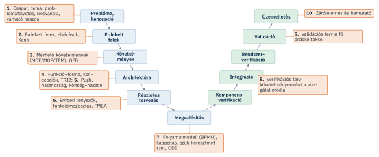

# A féléves projekt {#sec-projekt}

::: {.cel title="A projekt célja"}
A projekt során egy csapat egy valós vagy életszerű fejlesztési feladaton végigjárja a V-modell lépéseit, a problémafelvetéstől az ellenőrzés és a validáció megtervezéséig. A cél nem egy kész termék. A cél egy **átgondolt, nyomon követhető és indokolt fejlesztési terv**, amelyben minden lépés a korábbiakra épül, és minden döntés mögött ott van az elemzés.
:::

## Témaválasztás

A téma lehet egy elképzelt vagy valós vállalat, intézmény vagy közösség fejlesztési feladata. A jó téma három feltételnek felel meg:

- **valós problémára** felel (van kinek fájjon);
- **legalább néhány érdekelt felet** érint, köztük a szervezeten kívülieket is;
- **műszaki és működési oldala is van:** termék, berendezés, informatikai rendszer vagy folyamat, amelynek követelményei, koncepciói és folyamatai elemezhetők.

A témák kiválasztásához jó irányt ad a **zöld és digitális átállás**: olyan fejlesztések, amelyek erőforrást, energiát vagy kibocsátást takarítanak meg, illetve digitális eszközökkel tesznek egy működést hatékonyabbá, átláthatóbbá vagy emberközpontúbbá. Néhány javaslat:

| Téma | Jellege |
|:--|:--|
| Okos parkolásirányítás egy egyetemi kampuszon | informatika, szolgáltatás |
| Önjáró anyagmozgató robot bevezetése egy kis raktárban | mechatronika, folyamat |
| Állapotalapú karbantartás egy nyomdagépre | mechatronika, adatelemzés |
| Napelemes töltőállomás elektromos rollereknek | termék, energia |
| Digitális munkautasítás-rendszer egy összeszerelő soron | informatika, ember–gép |
| Hulladékcsökkentés egy pékség gyártási folyamataiban | folyamat, minőség |
| Okos öntözés városi parkokban | mechatronika, környezet |
| Laboreszköz-kölcsönző alkalmazás az egyetemen | informatika, szolgáltatás |
| Betegirányító kijelzőrendszer egy rendelőintézetben | ember–gép, folyamat |
| Visszaváltható ételcsomagolás egy közétkeztetőnél | folyamat, logisztika |

: Javasolt projekttémák. {#tbl-temak tbl-colwidths="[70,30]"}

## A projekt lépései a V mentén

A projekt tíz lépésből áll ([-@fig-projekt-v]. ábra). Minden lépés egy vagy több eszközlap végén található feladatra épül, és a zárójelentés egy-egy fejezetét adja.

{#fig-projekt-v width=100%}

| Lépés | Tartalom | Minimális elvárás | Eszközlap |
|:-:|:--|:--|:--|
| 1. | Csapat, téma, problémafelvetés, relevancia, várható haszon; a projekt V-terve | Egyoldalas problémaleírás; kitöltött V-terv | [-@sec-v-terv]. |
| 2. | Érdekelt felek azonosítása és priorizálása; elvárások feltárása | Legalább tíz érdekelt fél, közülük legalább három külső; hatalom–érdekeltség rács; legalább két interjú | [-@sec-erdekelt-azonositas]–[-@sec-kano]. |
| 3. | Működési koncepció; követelmények: mérték és célérték; MOE, MOP, TPM; nyomonkövetés; QFD | Működési koncepció legalább két forgatókönyvvel; 5–10 számszerűsített követelmény verifikációs móddal; minőségház legalább 3–5 elvárással és 3–5 műszaki jellemzővel | [-@sec-conops]–[-@sec-qfd]. |
| 4. | Koncepcionális tervezés: funkció és forma, koncepciógenerálás | Funkció–forma dekompozíció legalább négy funkcióval; legalább három koncepcióváltozat; egy feloldott ellentmondás (TRIZ) | [-@sec-funkciofa]–[-@sec-otletroham]. |
| 5. | Koncepció-kiválasztás | Pugh-összevetés; hasznosságelemzés vagy súlyozott pontozás érzékenységvizsgálattal; költség–haszon becslés | [-@sec-pugh]–[-@sec-koltseg-haszon]. |
| 6. | Emberi tényezők és kockázat | Funkciómegosztás és automatizálási szint indoklással; FMEA legalább nyolc hibamóddal és intézkedésekkel | [-@sec-hta]–[-@sec-fmea]. |
| 7. | A megvalósító folyamat tervezése | BPMN-modell legalább három résztvevővel és tíz lépéssel; kapacitás és szűk keresztmetszet; OEE vagy ennek megfelelő hatékonysági mutató | [-@sec-folyamatabra-vsm]–[-@sec-bpmn]. |
| 8. | Integrációs és verifikációs terv | Követelmény-verifikációs mátrix minden követelményre, sikerkritériumokkal; integrációs terv (választható) | [-@sec-integracios-terv]–[-@sec-rvm]. |
| 9. | Validációs terv | A fő érdekelt csoportokkal végzendő próba terve, a MOE-k mérési módjával | [-@sec-hasznalhatosagi-teszt]. |
| 10. | Zárójelentés és bemutató | A jelentés az alábbi szerkezetben; kreatív bemutató (előadás, poszter, szerepjáték, makett) | – |

: A projekt lépései, minimális elvárásai és a kapcsolódó eszközlapok. {#tbl-projekt-lepesek tbl-colwidths="[7,30,43,20]"}

## A zárójelentés szerkezete

1. **Vezetői összefoglaló** (fél oldal): a fejlesztés célja, a legfontosabb megállapítások és javaslatok.
2. **A fejlesztési feladat:** probléma, relevancia, várható haszon; a projekt V-terve.
3. **Érdekelt felek és elvárásaik:** nyilvántartás, rács, a legfontosabb elvárások igényként; Kano-elemzés, ha készült.
4. **Követelmények:** szükséglet–cél–célkitűzés; számszerűsített követelmények MOE/MOP/TPM besorolással és verifikációs móddal; QFD és értékelése.
5. **Koncepció:** funkció–forma dekompozíció, koncepcióváltozatok, a kiválasztás menete és indoklása.
6. **Ember és kockázat:** funkciómegosztás, FMEA és fő megállapításai.
7. **Megvalósítás:** folyamatmodell, kapacitás, szűk keresztmetszet, hatékonysági mutatók, javaslatok.
8. **Ellenőrzés és validáció:** verifikációs mátrix, validációs terv.
9. **Összegzés és kitekintés:** mit tanultunk, mi a következő lépés.
10. **Mellékletek:** kitöltött sablonok, interjújegyzetek, a mesterséges intelligencia használatának leírása.

## Értékelési szempontok

A projektmunka értékelésekor az alábbi szempontokat javasoljuk. Az oktató ezeket a kurzus követelményeihez igazíthatja.

| Szempont | Mit vizsgálunk? |
|:--|:--|
| Nyomonkövethetőség | Végigkövethető-e az út az érdekelt felektől a követelményeken és a koncepción át az ellenőrzésig? |
| Mérhetőség | Számszerűek, egyértelműek és ellenőrizhetők-e a követelmények és a célkitűzések? |
| Módszertani helyesség | Helyesen alkalmazták-e az eszközöket, és helyes-e a számítás? |
| Indokoltság | Elemzés és adatok támasztják-e alá a döntéseket? Megjelennek-e a kompromisszumok? |
| Az emberi szempontok | Megjelenik-e a felhasználók és az üzemeltetők nézőpontja a követelményekben és a tervben? |
| Kommunikáció | Világos-e a jelentés és a bemutató, és érthető-e egy kívülálló számára? |

: Javasolt értékelési szempontok. {#tbl-ertekeles tbl-colwidths="[25,75]"}

::: {.hiba title="A projekt leggyakoribb hibái"}
- **A lépések elszigetelten készülnek.** A QFD vevői elvárásai nem azonosak az érdekeltfél-elemzés elvárásaival, az FMEA nem a kiválasztott koncepcióra készül. Minden lépésnek az előzőre kell épülnie.
- **A követelmények megoldást írnak elő** („legyen benne RFID-olvasó”) ahelyett, hogy azt mondanák meg, mit kell teljesíteni.
- **Hiányzik a szám.** A „gyors”, „megbízható”, „felhasználóbarát” nem követelmény, amíg nincs mértéke és célértéke.
- **A döntés megelőzi az elemzést.** A csapat már az elején tudja, mit akar, és az összevetés csak utólagos igazolás.
:::
