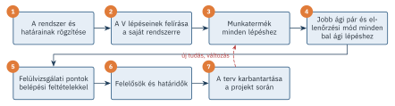

# A projekt V-terve {#sec-v-terv}

::: {.cel title="Eszközkártya"}
- **Mire való?** A fejlesztés teljes ívének egyoldalas terve. Rögzíti, milyen munkatermék készül a V-modell egyes lépéseiben, hogyan ellenőrizzük őket, és hol vannak a felülvizsgálati pontok.
- **Tanulási eredmény:** az eszközlap feldolgozása után képes leszel egyoldalas V-tervet készíteni, amely a V-modell minden lépéséhez munkaterméket, felelőst, határidőt és ellenőrzési módot rendel.
- **V-lépés:** a teljes V; a projekt indításakor készül, és minden felülvizsgálatkor frissül.
- **Bemenet:** a problémafelvetés, az ismert korlátok (határidők, erőforrások), a fejlesztés tárgyának első leírása.
- **Kimenet:** kitöltött V-terv-táblázat, felülvizsgálati pontok belépési feltételekkel.
- **Időigény:** 1–2 óra csapatmunka a kezdéskor, utána rövid frissítések.
- **Kézikönyv:** [2. fejezet – A rendszerfejlesztés életciklusa és a V-modell](../../kezikonyv/fejezetek/02-v-modell.html).
:::

## Mikor használd?

- **A projekt indításakor**, hogy a csapat közös képet kapjon a teendőkről és a leadandókról.
- **A folyamat projekthez igazításakor:** egy kis projekt nem igényli a nagy szervezetek összes felülvizsgálatát, de a lényeges ellenőrzési pontokat nem szabad kihagyni.
- **Új csapattag vagy új megbízó bevonásakor:** a V-terv egy oldalon mutatja meg, hol tart a munka.
- **Felülvizsgálat előtt:** a V-terv alapján ellenőrizhető, hogy minden munkatermék elkészült-e.

Nem helyettesíti a részletes ütemtervet és a feladatlistát. Ezek a V-terv alapján, annak lépéseit lebontva készülnek.

## Lépések

{#fig-lepesek-v-terv width=100%}

1. **Rögzítsd a rendszert és a határait.** Egy-két mondatban fogalmazd meg, mi a fejlesztés tárgya, és mi nem tartozik hozzá. Például a KoboCella-projektben a cella igen, a gyár MES-rendszere nem, de a cellához csatlakozó interfésze igen.
2. **Írd fel a V lépéseit a saját rendszeredre.** Használd a kézikönyv V-modelljét (2.4. ábra), de nevezd meg a lépéseket a saját projekted nyelvén. Egy szolgáltatásfejlesztésben a „komponens-verifikáció” lehet például „az egyes szolgáltatáselemek próbája”.
3. **Rendelj munkaterméket minden lépéshez.** Mi lesz a lépés kézzelfogható eredménye: dokumentum, modell, táblázat, prototípus vagy döntés?
4. **Írd fel minden bal ági lépés jobb ági párját, és azt, hogyan fogod ellenőrizni.** Ez a korai tesztterv. Ha egy lépésnél nem tudod megmondani, hogyan ellenőrzöd majd, az jelzi, hogy a munkatermék még nem elég pontosan meghatározott.
5. **Jelöld ki a felülvizsgálati pontokat.** Egy kis projektben jellemzően három elég: a koncepció és a követelmények, a terv, végül az átadás előtt. Mindegyikhez írd fel a kulcskérdést és a belépési feltételeket, vagyis azt, hogy mely munkatermékeknek kell elkészülniük.
6. **Rendelj felelőst és határidőt** minden munkatermékhez.
7. **Tartsd karban a tervet.** Minden felülvizsgálaton nézd át, és jelöld a változásokat (változat, dátum).

## Kidolgozott példa: a KoboCella V-terve

A Kobold Hajtástechnika projektcsapata a projekt első hetében készítette el a V-tervet ([-@tbl-v-terv-kobo]. táblázat). A csapat a ciklusidő-követelményt az éves igényből, a munkaidőalapból és a tervezett berendezéshatékonyságból vezette le. A számítás menetét a folyamatelemzés eszközlapja mutatja be.

| Bal ági lépés | Munkatermék | Jobb ági pár | Hogyan ellenőrizzük? |
|:--|:--|:--|:--|
| Probléma, cél, működési koncepció | Problémaleírás (igénynövekedés, ergonómiai panaszok, 3,5% utómunka); műszakforgatókönyvek normál, hiba és típusváltás esetére | Átadás, üzemeltetés | Három hónapos üzem után: kibocsátás, utómunka-arány, ergonómiai panaszok száma a kiinduló állapothoz képest |
| Az érdekelt felek igényei | Érdekeltfél-nyilvántartás, hatalom–érdekeltség rács, operátori interjúk, munkavédelmi egyeztetés | Validáció | Kétműszakos próbaüzem valódi operátorokkal; terhelésfelmérés; a vevő minőségügyi auditja |
| Rendszerkövetelmények | Ciklusidő legfeljebb 75 s; első átmenetes kihozatal legalább 99%; minden meghúzás nyomatéknaplója; az ergonómiai kockázat alacsony szintre csökken; MES-interfész | Rendszerverifikáció | Nyolcórás folyamatos teszt mért ciklusidőkkel; 500 darabos mintán kihozatal; interfészteszt; ergonómiai felmérés |
| Architektúra és koncepció | Öt alrendszer; két koncepcióváltozat (közös vagy elválasztott munkaterület) összevetése | Integráció és alrendszer-verifikáció | Integrációs sorrend: kobot és csavarozó → biztonsági rendszer → MES; interfészenkénti ellenőrzőlista |
| Részletes tervezés | Megfogó, biztonsági zónák, kezelőfelület, FMEA | Komponens-verifikáció | Csavarozó nyomatékkalibrációja; a biztonsági funkciók egyenkénti tesztje; a megfogó tartóssági próbája |
| Megvalósítás | A cella építése, programozás, betanítási anyag | – | – |

: A KoboCella V-tervének fő sorai. {#tbl-v-terv-kobo tbl-colwidths="[18,32,16,34]"}

A felülvizsgálati pontok:

| Felülvizsgálat | Kulcskérdés | Belépési feltételek |
|:--|:--|:--|
| Koncepció és követelmények (4. hét) | Értjük-e a problémát? Mérhetők-e a követelmények? | Érdekeltfél-elemzés, célkitűzések, követelménylista verifikációs módokkal |
| Terv (10. hét) | Teljesítheti-e a választott koncepció a követelményeket elfogadható kockázattal? | Koncepció-összevetés, architektúra, kockázatelemzés és FMEA, integrációs terv |
| Üzemkészség (próbaüzem előtt) | Igazoltuk-e a követelményeket? Felkészültek-e az operátorok? | Verifikációs mátrix kitöltve, biztonsági funkciók jegyzőkönyve, betanítás megtörtént |

: A KoboCella felülvizsgálati pontjai. {#tbl-v-terv-felulv tbl-colwidths="[24,38,38]"}

## Sablon

- [projekt_v_terv_sablon.xlsx](../sablonok/projekt_v_terv_sablon.xlsx): V-terv és felülvizsgálati lap, kitöltési útmutatóval.

## Előnyök és korlátok

| Előnyök | Korlátok |
|:--|:--|
| Egy oldalon mutatja a teljes fejlesztést és a lépések közötti kapcsolatokat | Nem ütemterv: a feladatokat és az időbeosztást külön kell megtervezni |
| A korai tesztterv már az elején kiszűri a pontatlan munkatermékeket | A kezdeti terv bizonytalan; rendszeres frissítés nélkül gyorsan elavul |
| Segít a folyamatot a projekt méretéhez igazítani | Erősen iteratív, agilis fejlesztésben ciklusonként kell újragondolni |

: A projekt V-tervének előnyei és korlátai. {tbl-colwidths="[50,50]"}

::: {.hiba}
- **Dokumentumlista ellenőrzés nélkül.** A bal ági oszlop kitöltött, a jobb ági üres. Pedig éppen a jobb ági pár teszi a V-tervet többé, mint egy feladatlista.
- **Általános ellenőrzési mód.** A „teszteléssel” nem válasz. Meg kell mondani, mit mérünk, milyen körülmények között, és mi az elfogadás feltétele.
- **Felülvizsgálat belépési feltétel nélkül.** Ha nem rögzítjük előre, mi kell a felülvizsgálathoz, a találkozó beszélgetéssé válik.
:::

## Mintapromptok

::: {.prompt title="Mintaprompt: a V-terv kritikus átnézése"}
```text
Szerepkör: tapasztalt rendszermérnök vagy, aki egy mérnökhallgatói projekt
V-tervét nézi át.

Bemenet: az alábbi táblázat a projektünk V-terve. A projekt tárgya:
[1–2 mondatos leírás]. Határidő: [x hét], csapat: [y fő].

[IDE ILLESZD BE A V-TERV TÁBLÁZATÁT]

Feladat:
1. Minden bal ági lépésnél vizsgáld meg, hogy a jobb ági ellenőrzési mód
   konkrét-e (mit mérünk, milyen körülmények között, mi az elfogadás
   feltétele). Ahol nem, jelezd és indokold.
2. Jelöld, ha egy munkatermék hiányzik vagy nem következik az előző lépésből.
3. Ne írj helyettünk új tartalmat. Ehelyett minden problémához tegyél fel
   egy-két kérdést, amely segít a javításban.
Formátum: táblázat (lépés | probléma | kérdés).
```
:::

::: {.prompt title="Mintaprompt: a folyamat projekthez igazítása"}
```text
Egy [x] hetes, [y] fős projektben [fejlesztés tárgya] a feladatunk.
A V-modell mely felülvizsgálati pontjai indokoltak ekkora projektben?
Javasolj legfeljebb négy pontot, és mindegyikhez adj kulcskérdést és
belépési feltételeket. Indokold, mit hagysz el a nagyprojektes
gyakorlathoz képest, és milyen kockázattal jár az elhagyás.
```
:::

A modell válaszát a kézikönyv 2.5. szakaszával vesd össze, és a csapatban döntsetek. A felülvizsgálati pontok kijelölése a csapat felelőssége.

## Feladat

::: {.projekt title="1. projektlépés: a projekt V-terve"}
Töltsd ki a sablon „V-terv” lapját a saját projektedre. Jelölj ki legalább három felülvizsgálati pontot belépési feltételekkel, és csatold a V-tervet a problémaleíráshoz (csapat, téma, problémafelvetés, relevancia, várható haszon).
:::
