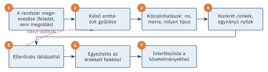
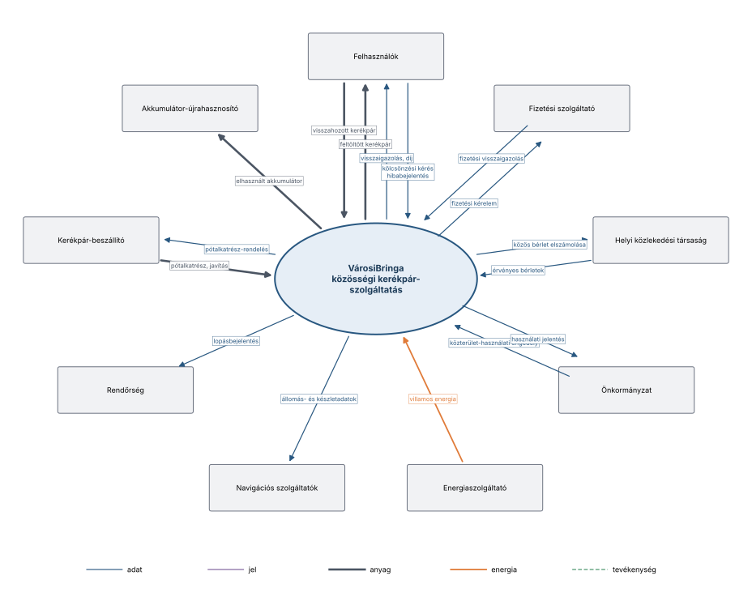

# Kontextusdiagram és interfészlista {#sec-kontextusdiagram}

::: {.cel title="Eszközkártya"}
- **Mire való?** A rendszer határának kijelölése: mely külső entitásokkal és milyen áramlásokkal (adat, jel, anyag, energia, tevékenység) áll kapcsolatban a rendszer, és mi nem tartozik a fejlesztés tárgyához.
- **Tanulási eredmény:** az eszközlap feldolgozása után képes leszel kijelölni egy rendszer határát, felrajzolni a kontextusdiagramját, és a határon átmenő kölcsönhatásokat típus szerint besorolni és interfészlistába rendezni.
- **V-lépés:** 1. Probléma; a követelmények (interfészkövetelmények) és az integráció bemenete.
- **Bemenet:** a fejlesztési feladat leírása, az érdekelt felek első listája, a meglévő folyamatok és rendszerek ismerete.
- **Kimenet:** kontextusdiagram, interfészlista gazdákkal, a „mi nem a rendszer része” rögzítése.
- **Időigény:** az első változat 1–2 óra csapatmunka; a pontosítás az érdekelt felekkel folyamatos.
- **Kézikönyv:** [3. fejezet](../../kezikonyv/fejezetek/03-modellek.html), 3.3. szakasz.
:::

## Mikor használd?

- **A projekt legelején**, amikor még a feladat megfogalmazása zajlik. A kontextusdiagram az egyik leggyorsabb módja annak, hogy a csapat és a megrendelő ugyanazt értse „a rendszeren”.
- **Ha vita van arról, mi tartozik a fejlesztéshez.** A diagramon minden, ami a középső alakzaton kívül van, a környezet része. Ezt nem tervezzük meg, de illeszkednünk kell hozzá.
- **Beszállítói egyeztetéskor**, ajánlatkéréskor. A diagram és az interfészlista egyértelművé teszi, mit kell a szállítónak megvalósítania, és mihez kell kapcsolódnia.
- **Integráció és átadás előtt.** Az interfészlista minden sora egy ellenőrizendő kapcsolat.

## Lépések

{#fig-lepesek-kontextus width=100%}

1. **Nevezd meg a rendszert a feladata szerint.** Ne a megoldást nevezd meg („MES”, „mobilalkalmazás”), hanem azt, amit a rendszernek el kell végeznie („rendelésteljesítési rendszer”, „közösségi kerékpár-szolgáltatás”). Így a név nem zárja ki idő előtt a lehetséges megoldásokat.
2. **Gyűjtsd össze a külső entitásokat.** Forrásaid: az érdekeltfél-lista ([-@sec-erdekelt-azonositas]. eszközlap), a befoglaló rendszer elemei, az életciklus-szakaszok (ki szállít, ki szervizel, ki selejtez), valamint a meglévő informatikai rendszerek. Az entitás lehet szervezet, szereplő, másik rendszer vagy természeti környezet.
3. **Rögzítsd a kölcsönhatásokat.** Minden entitásnál kérdezd meg: mi megy át a határon, milyen irányba, és milyen típusú? A típusok: **adat** (feldolgozandó információ), **jel** (reakciót igénylő állapot vagy esemény), **anyag**, **energia**, **tevékenység** (egy külső szereplő munkája a rendszeren) [@kossiakoff2011, 3.4. szakasz].
4. **Címkézz konkrétan, és használj egyirányú nyilakat.** Az „adatcsere a bankkal” helyett két nyíl: „fizetési kérelem” kifelé, „fizetési visszaigazolás” befelé. Az olyan címkék, mint az „adat” vagy a „kommunikáció”, semmit sem mondanak.
5. **Ellenőrizd táblázattal.** Az interfészlistából számold meg entitásonként a bemeneteket és a kimeneteket. A csak bemenettel vagy csak kimenettel rendelkező entitásnál gondold végig, nem maradt-e ki egy visszairányú áramlás (visszaigazolás, rendelés, elszámolás). Nézd meg azt is, kimaradt-e valamilyen környezeti hatás: hulladék, kibocsátás, zaj. Ha hiányt találsz, térj vissza a 2. lépéshez.
6. **Egyeztesd az érdekelt felekkel.** A diagramot mutasd meg a megrendelőnek és a legfontosabb érdekelteknek. A „kimaradt valami?” kérdésre adott válaszok gyakran a projekt legértékesebb információi.
7. **Vezesd tovább az interfészlistát.** Minden sorhoz rendelj gazdát (ki felel érte), és később kapcsolódó követelményt ([-@sec-kovetelmeny-iras]. eszközlap). A belső interfészeket az N²-diagram tárja fel ([-@sec-n2-dsm]. eszközlap).

::: {.fogalom title="Interfészelemek"}
Az interfészlistában azt is rögzítheted, milyen elem valósítja meg a kapcsolatot. Kossiakoff és szerzőtársai szerint az **összekötő** átviszi a hatást (kábel, tengelykapcsoló, kezelőpanel), a **szigetelő** gátolja (árnyékolás, tömítés, védőburkolat), az **átalakító** megváltoztatja a közeg formáját (A/D átalakító, hajtómű, billentyűzet) [@kossiakoff2011, 3.5. szakasz]. A külső interfészeknél ez a mező a koncepció szakaszában gyakran még üres; ilyenkor „–” jelet írj.
:::

## Kidolgozott példa: a VárosiBringa kontextusdiagramja

A projektcsapat a rendszert *VárosiBringa közösségi kerékpár-szolgáltatásnak* nevezte el. A szolgáltatás része a flotta, a dokkolók, az alkalmazás, a háttérrendszer, a szerviz és az áthelyező szolgálat. A határ kijelölésekor a legfontosabb döntés az volt, hogy az áthelyezés és a szerviz a rendszer *része*, akkor is, ha a konzorcium később alvállalkozóra bízza. A szolgáltatás minőségét ugyanis ezek határozzák meg.

A csapat kilenc külső entitást és tizennyolc kölcsönhatást azonosított ([-@tbl-vb-interfesz]. táblázat, a sablon „Példa –” lapjain teljes egészében).

| Külső entitás | Kölcsönhatás | Irány | Típus |
|:--|:--|:-:|:--|
| Felhasználók | kölcsönzési kérés (alkalmazás vagy kártya) | be | adat |
| Felhasználók | kölcsönzési visszaigazolás, díjtájékoztatás | ki | adat |
| Felhasználók | feltöltött elektromos kerékpár | ki | anyag |
| Felhasználók | visszahozott kerékpár | be | anyag |
| Felhasználók | hibabejelentés | be | adat |
| Fizetési szolgáltató | fizetési kérelem / fizetési visszaigazolás | ki / be | adat |
| Helyi közlekedési társaság | érvényes bérletek listája / közös bérletes kölcsönzések elszámolása | be / ki | adat |
| Önkormányzat | közterület-használati engedély / használati és kibocsátási jelentés | be / ki | adat |
| Energiaszolgáltató | villamos energia a dokkolóknak | be | energia |
| Navigációs szolgáltatók | állomások helye, szabad kerékpárok száma | ki | adat |
| Rendőrség | lopás- és rongálásbejelentés | ki | adat |
| Kerékpár-beszállító | pótalkatrész-rendelés / pótalkatrész, garanciális javítás | ki / be | adat / anyag |
| Akkumulátor-újrahasznosító | elhasznált akkumulátorok | ki | anyag |

: A VárosiBringa interfészlistája (összevont nézet; a sablonban minden irány külön sor). {#tbl-vb-interfesz tbl-colwidths="[26,50,10,14]"}

{#fig-kontextus-vb width=100%}

**Tanulságok:**

- **Az ellenőrzés talált hiányt.** Az első változatban a kerékpár-beszállító csak bemenetként szerepelt („pótalkatrész, garanciális javítás”). A táblázat „csak bemenet – rendben?” jelzésére a csapat rájött, hogy a pótalkatrész-rendelés és a garanciális igény bejelentése kimaradt. Ezek nélkül a szerviz nem tud működni, és mindkettő a háttérrendszer feladata.
- **Nem minden jelzés hiba.** Az energiaszolgáltató felé valóban nem megy semmi, a navigációs szolgáltatók felől pedig nem érkezik semmi. A csapat ezeket tudatosan jóváhagyta.
- **A környezeti hatás is interfész.** Az akkumulátor-újrahasznosító eredetileg nem szerepelt. A környezetvédő civilek érdekeltfél-interjúján derült ki, hogy az elhasznált akkumulátorok sorsa számukra kulcskérdés. Az interfész jogszabályi nyilvántartási kötelezettséggel is jár.
- **Ami nincs a diagramon, az nem a rendszer része.** A buszhálózat menetrendjét, a város parkolási rendszerét és a navigációs alkalmazásokat a VárosiBringa nem tervezi újra, de a velük való kapcsolatát igen.

## Sablon és notebook

- [kontextusdiagram_sablon.xlsx](../sablonok/kontextusdiagram_sablon.xlsx): az „Interfészlista” lapon legördülő listák (irány, típus, interfészelem) és automatikus ellenőrzés (hiányzó adat, túl általános címke, gazda nélküli sor). Az „Entitások” lap entitásonként megszámolja a bemeneteket, a kimeneteket és a típusokat, és jelzi a gyanús eseteket. A „Példa –” lapok a VárosiBringa kitöltött listáit tartalmazzák.
- [kontextusdiagram.ipynb](../notebookok/kontextusdiagram.ipynb) · [Megnyitás Google Colabban](kontextusdiagram.ipynb): az interfészlistából automatikusan felrajzolja a kontextusdiagramot (a [-@fig-kontextus-vb]. ábra így készült), és elvégzi a táblázatos ellenőrzéseket. A beépített példával azonnal futtatható. A saját, kitöltött sablon feltöltéséhez állítsd a `SAJAT_SABLON` változót `True` értékre.

## Előnyök és korlátok

| Előnyök | Korlátok |
|:--|:--|
| Egyszerű, gyorsan elkészíthető, bárki számára érthető | Nem mutatja a rendszer belsejét, sem az áramlások időbeli sorrendjét |
| A határvita korán, olcsón lezárható | Sok entitásnál és kölcsönhatásnál zsúfolttá válik; ilyenkor bontsd több nézetre |
| Az interfészlistából közvetlenül követelmények és integrációs tesztek vezethetők le | A minőségi jellemzőket (gyakoriság, késleltetés, adatformátum) csak az interfészlista tartalmazza |
| A hiányzó érdekelt feleket és környezeti hatásokat is felszínre hozza | Csak annyira teljes, amennyire a csapat tudása; az érdekelt felekkel való egyeztetés nem hagyható el |

: A kontextusdiagram előnyei és korlátai. {tbl-colwidths="[50,50]"}

::: {.hiba}
- **Megoldás a középen.** Ha a középső alakzat neve „MES-szoftver”, a diagram már a megoldást rögzíti, és kimaradnak belőle az emberek és az eljárások.
- **Belső részletek a fekete dobozban.** Ha a középső alakzatba alrendszereket rajzolsz, az már architektúra, nem kontextus.
- **Kétirányú, semmitmondó nyilak.** Az „adatcsere” nyíl nem mondja meg, mi megy át, és merre.
- **A „csendes” entitások kihagyása.** A hulladékkezelő, a hatóság, az energiaszolgáltató vagy a karbantartó könnyen kimarad, pedig mindegyiknek van interfésze a rendszerrel.
:::

## Mintapromptok

::: {.prompt title="Mintaprompt: interfészlista-vázlat szöveges leírásból"}
```text
Az alábbiakban egy fejlesztendő rendszer leírása olvasható.
[IDE ILLESZD BE A LEÍRÁST]

Feladat: készíts interfészlista-vázlatot táblázatban a következő
oszlopokkal: külső entitás | kölcsönhatás (mi megy át a határon) |
irány (be/ki a rendszer szemszögéből) | típus (adat, jel, anyag,
energia, tevékenység).
Szabályok: minden sor egyetlen irány; a címke legyen konkrét
(ne „adat” vagy „kommunikáció”); a rendszer belső elemei NE legyenek
külső entitások. Jelöld csillaggal azokat a sorokat, amelyek nem a
leírásból következnek, hanem a te feltételezéseid.
```
:::

::: {.prompt title="Mintaprompt: hiányzó entitások és áramlások keresése"}
```text
Ez a kontextusdiagram interfészlistája: [TÁBLÁZAT].
Vizsgáld meg a rendszer teljes életciklusát (beszerzés, telepítés,
üzemeltetés, karbantartás, selejtezés) és a környezeti hatásokat
(hulladék, kibocsátás, zaj, energia). Sorold fel, milyen külső
entitások vagy kölcsönhatások hiányozhatnak, és mindegyiknél írd le,
melyik életciklus-szakaszban vagy hatásnál merül fel. Ne egészítsd ki
a táblázatot; a döntés a csapaté.
```
:::

## Feladat

::: {.projekt title="1. projektlépés (második rész): kontextusdiagram"}
Készítsd el saját projekted interfészlistáját a sablonban (legalább hat külső entitás, legalább tizenkét kölcsönhatás), és rajzold fel a kontextusdiagramot kézzel vagy a notebookkal. Az ellenőrző lap minden jelzésénél írd le egy mondatban, miért rendben van, vagy mit egészítettél ki. Mutasd meg a diagramot legalább egy érdekelt félnek, és rögzítsd, mit javasolt.
:::
