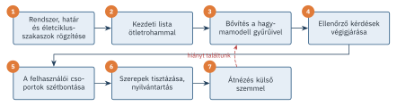

# Érdekelt felek azonosítása {#sec-erdekelt-azonositas}

::: {.cel title="Eszközkártya"}
- **Mire való?** A fejlesztés érdekelt feleinek rendszerezett, teljességre törekvő összegyűjtése, és az érdekeltfél-nyilvántartás elkészítése.
- **Tanulási eredmény:** az eszközlap feldolgozása után képes leszel rendszerezetten, az életciklus-szakaszok és a hagymamodell segítségével összegyűjteni egy fejlesztés érdekelt feleit, a „csendes” és a negatív érdekelteket is beleértve.
- **V-lépés:** 2. Az érdekelt felek igényei; az életciklus során többször is frissül.
- **Bemenet:** a rendszer és határainak leírása, az életciklus-szakaszok, az első megbeszélések jegyzetei.
- **Kimenet:** érdekeltfél-nyilvántartás (szerepek, gyűrű, fő elvárások), a felhasználói csoportok listája.
- **Időigény:** 1–2 óra csapatmunka, utána egyeztetés néhány tájékozott kívülállóval.
- **Kézikönyv:** [5. fejezet – Érdekelt felek elemzése](../../kezikonyv/fejezetek/05-erdekelt-felek.html), 5.2. szakasz.
:::

## Mikor használd?

- **Minden fejlesztés elején**, a követelmények meghatározása előtt.
- **Az életciklus szakaszhatárain**, mert a gyártás, az üzemeltetés és a kivonás új szereplőket hoz.
- **Ha a projekt váratlan ellenállásba ütközik.** Ilyenkor gyakran kiderül, hogy egy érdekelt fél kimaradt.

## Lépések

{#fig-lepesek-ea width=100%}

1. **Rögzítsd a rendszert, a határát és az életciklus-szakaszait.** Mi a termék vagy szolgáltatás? Hol ér véget? Ki gyártja, használja, tartja karban, vonja ki?
2. **Készíts kezdeti listát ötletrohammal.** Tíz percig mindenki írjon fel cetlikre minden szereplőt, aki eszébe jut, értékelés nélkül.
3. **Bővítsd a hagymamodell gyűrűivel.** Haladj belülről kifelé, és minden szerepnél kérdezd meg, ki tölti be:
    - *a mi rendszerünk*: napi kezelő, karbantartó, üzemeltetést segítő;
    - *a befoglaló rendszer*: a kimenet haszonélvezője, kapcsolódó rendszerek, megrendelő, szponzor;
    - *a tágabb környezet*: pénzügyi és politikai haszonélvező, szabályozó, fejlesztő, tanácsadó, beszállító, negatív érdekelt.
4. **Járd végig az ellenőrző kérdéseket** (kézikönyv, 5.2. szakasz): ki fizet, ki használja, ki építi és vonja ki, ki szabályozza, kit zavar, kinek a rendszerével kapcsolódik, kinek nincs hangja, ki akadályozhatja.
5. **Bontsd szét a felhasználói csoportokat.** Ahol a használat módja, gyakorisága, környezete vagy a felhasználók képességei eltérnek, ott külön csoportot vegyél fel.
6. **Tisztázd a szerepeket, és töltsd ki a nyilvántartást.** Vond össze a duplikációkat. Ahol egy szereplő több szerepben is megjelenik, a szerepeket külön sorba vedd fel. Minden sorhoz írj legalább egy fő elvárást, igényként megfogalmazva.
7. **Nézesd át külső szemmel.** Egy tapasztalt üzemeltető, egy hatósági szakember vagy egy felhasználó gyakran olyan szereplőt is megnevez, akire a csapat nem gondolt.

## Kidolgozott példa: a ForgácsTech érdekelt felei

A ForgácsTech digitális átállási projektjének (kézikönyv, A. függelék) első megbeszélésén a csapat hat szereplőt sorolt fel: a tulajdonost, a termelésvezetőt, a gépkezelőket, a MES-szállítót, a vevőket és a könyvelést. A hagymamodell és az ellenőrző kérdések végigjárása után a nyilvántartás így bővült (részlet):

| Gyűrű | Szerep | Ki tölti be? | Fő elvárás (igényként) |
|:--|:--|:--|:--|
| A mi rendszerünk | Napi kezelő | CNC-gépkezelők (három műszak) | A következő feladat aktuális rajzához és adataihoz a gép mellől, keresgélés nélkül hozzáférni |
| A mi rendszerünk | Napi kezelő | Gyártáselőkészítők, CNC-programozók | A rendelések állapotát és a programok változatait egy helyen látni |
| A mi rendszerünk | Karbantartó | Karbantartási csoport | A gépállások okait megbízhatóan rögzíteni és visszakeresni |
| A mi rendszerünk | Üzemeltetést segítő | Belső informatikus (részmunkaidős) | A rendszer üzemeltetése ne igényeljen állandó szakértői jelenlétet |
| Befoglaló rendszer | A kimenet haszonélvezője | Termelésvezető | Valós idejű kép a rendelések és a gépek állapotáról, megalapozott ütemezés |
| Befoglaló rendszer | Kapcsolódó rendszer | Könyvelés, vállalatirányítási szoftver | Az anyag- és munkaidő-adatok egyezzenek a számlázással |
| Befoglaló rendszer | Megrendelő, szponzor | Tulajdonos-ügyvezető | Rövidebb átfutás, kevesebb csúszás, megtérülő beruházás |
| Tágabb környezet | Pénzügyi haszonélvező | A fejlesztést támogató pályázat kezelője | A vállalt mutatók igazolható teljesülése |
| Tágabb környezet | Szabályozó | Adatvédelmi előírások, a vevői audit követelményei | Személyes adatok kezelése és nyomonkövethetőség az előírások szerint |
| Tágabb környezet | Fejlesztő, beszállító | MES-szállító, gépgyártók (vezérlőinterfészek) | Egyértelmű interfész-specifikáció, megfelelő hozzáférés a gépekhez |
| Tágabb környezet | A kimenet haszonélvezője | Járműipari vevők minőségügye | Alkatrészszintű nyomonkövethetőség, kimutatható folyamatképesség |
| Tágabb környezet | Negatív érdekelt | A gépkezelők egy része, aki ellenőrzéstől tart | A mérés ne egyéni teljesítményértékelésre, hanem a folyamat javítására szolgáljon |

: A ForgácsTech érdekeltfél-nyilvántartásának részlete. {#tbl-ea-forgacs tbl-colwidths="[17,18,27,38]"}

**Tanulságok.** A bővítés három olyan szereplőt hozott felszínre, amelynek kihagyása komoly kockázat lett volna.

- **Az ellenőrzéstől tartó gépkezelők.** Nélkülük a projekt a bevezetésnél ellenállásba ütközne. Igényük tervezési elvként azonnal bekerült a követelmények közé: a mérés a folyamatot szolgálja, nem az egyéni teljesítményértékelést.
- **A pályázatkezelő.** Az ő mutatói meghatározzák a hatékonyság mérőszámait.
- **A vállalatirányítási szoftverrel való kapcsolat.** Ez interfészkövetelményt jelent, amely különben csak az integrációnál derült volna ki.

## Sablon és notebook

- [erdekelt_felek_sablon.xlsx](../sablonok/erdekelt_felek_sablon.xlsx): nyilvántartás, legördülő gyűrűválasztás, automatikus negyed- és fontossági besorolás, rácsdiagram; kitöltött VárosiBringa-példával.
- [erdekelt_felek.ipynb](../notebookok/erdekelt_felek.ipynb) · [Megnyitás Google Colabban](erdekelt_felek.ipynb): a nyilvántartásból kiszámítja a negyedeket és a fontossági osztályokat, bevonási javaslatot ad, és felrajzolja a hatalom–érdekeltség rácsot. A beépített VárosiBringa-példával azonnal futtatható; saját adatokhoz a kitöltött sablon tölthető fel.

## Előnyök és korlátok

| Előnyök | Korlátok |
|:--|:--|
| Szerepekben gondolkodtat, így a kevésbé látható érdekeltek is előkerülnek | Nem garantálja a teljességet; a helyismeretet nem pótolja |
| Gyors, csapatban is jól végezhető | Az elvárásokat csak vázlatosan rögzíti; a feltárás külön lépés |
| A nyilvántartás a teljes projekt során újrahasznosítható | Ha nem frissítik, elavul, mert az érdekelt felek köre változik |

: Az érdekeltfél-azonosítás előnyei és korlátai. {tbl-colwidths="[50,50]"}

::: {.hiba}
- **Személyek a szerepek helyett.** Ha egy névsor készül, a szerepek elsikkadnak, és amikor egy személy távozik, a nézőpont is eltűnik.
- **Egyetlen „felhasználó” csoport.** A különböző felhasználói csoportok eltérő elvárásai így nem jelennek meg.
- **A negatív érdekeltek elhallgatása.** Kényelmetlen róluk beszélni, de ők a legnagyobb meglepetések forrásai.
- **Megoldás az elvárás oszlopban.** A „tablet minden gép mellé” megoldás. Az igény az, ami mögötte van.
:::

## Mintapromptok

::: {.prompt title="Mintaprompt: hiányzó szerepek keresése"}
```text
Szerepkör: rendszermérnök vagy, aki egy érdekeltfél-elemzést ellenőriz.

A rendszer: [1–3 mondatos leírás, határokkal együtt].
Életciklus: [koncepció, fejlesztés, gyártás, használat, támogatás, kivonás
– a projektre jellemző sajátosságokkal].
Eddigi listánk (szerep – ki tölti be):
[IDE ILLESZD BE A LISTÁT]

Feladat: Ian Alexander hagymamodelljének szerepei (napi kezelő,
karbantartó, üzemeltetést segítő, a kimenet haszonélvezője, kapcsolódó
rendszer, megrendelő, szponzor, pénzügyi és politikai haszonélvező,
szabályozó, fejlesztő, tanácsadó, beszállító, negatív érdekelt) és az
életciklus-szakaszok alapján jelezd, mely szerepek hiányozhatnak.
Minden javaslatnál írd le, milyen helyzetben érinti őket a rendszer.
Ne találj ki konkrét szervezet- vagy személyneveket. Ahol bizonytalan
vagy, kérdezz.
```
:::

::: {.prompt title="Mintaprompt: felhasználói csoportok szétbontása"}
```text
A rendszerünk felhasználói jelenleg egyetlen csoportként szerepelnek:
"[felhasználók]". A rendszer: [leírás].
Javasolj legfeljebb hat felhasználói csoportot, amelyek elvárásai
érdemben eltérhetnek egymástól. Szempontok: használati gyakoriság,
környezet, képességek (például látás, mozgás, digitális jártasság),
cél. Minden csoporthoz adj meg egy-egy kérdést, amelyet interjúban
feltennénk nekik.
```
:::

A modell javaslatai hipotézisek. Egy szerep csak akkor kerül a nyilvántartásba, ha a csapat igazolni tudja, hogy valódi érintettje a rendszernek.

## Feladat

::: {.projekt title="2. projektlépés (első rész): érdekeltfél-nyilvántartás"}
Készítsd el saját projekted érdekeltfél-nyilvántartását a sablon „Nyilvántartás” lapján: legalább tíz szerep, ebből legalább három a tágabb környezetből, és legalább egy negatív érdekelt. A felhasználókat bontsd legalább két csoportra.
:::
