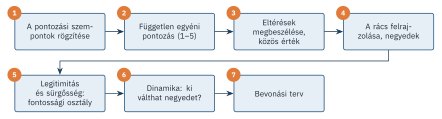

# Hatalom–érdekeltség és fontossági elemzés {#sec-hatalom-erdekeltseg}

::: {.cel title="Eszközkártya"}
- **Mire való?** Az érdekelt felek priorizálása, és mindegyikhez a megfelelő bevonási mód kijelölése.
- **Tanulási eredmény:** az eszközlap feldolgozása után képes leszel elhelyezni az érdekelt feleket a hatalom–érdekeltség rácson és a fontossági modellben, és mindegyikhez indokolt bevonási módot rendelni.
- **V-lépés:** 2. Az érdekelt felek igényei; a felülvizsgálatokon frissül.
- **Bemenet:** érdekeltfél-nyilvántartás ([-@sec-erdekelt-azonositas]. eszközlap).
- **Kimenet:** pontozott nyilvántartás, hatalom–érdekeltség rács, fontossági osztályok, bevonási terv.
- **Időigény:** 1–2 óra csapatmunka.
- **Kézikönyv:** [5. fejezet](../../kezikonyv/fejezetek/05-erdekelt-felek.html), 5.3. szakasz.
:::

## Mikor használd?

- **Az érdekelt felek azonosítása után**, mielőtt az elvárások feltárására időt és energiát osztunk.
- **Ha korlátozott a kapacitás:** kivel készítsünk interjút, kit hívjunk workshopra, kit elég tájékoztatni?
- **Konfliktusos helyzetekben:** kik a kulcsszereplők, és kik válhatnak azzá?

## Lépések

{#fig-lepesek-he width=100%}

1. **Rögzítsd a pontozási szempontokat** ([-@tbl-pontozas]. táblázat). Mindenki ugyanazt értse a pontszámokon.
2. **Pontozzatok egymástól függetlenül.** Minden csapattag egyedül pontozza az érdekelt feleket 1-től 5-ig mindkét szempont szerint. Így elkerülhető, hogy a leghangosabb vélemény határozza meg az eredményt.
3. **Beszéljétek meg az eltéréseket.** Ahol a pontszámok kettőnél többel eltérnek, ott valaki mást tud vagy mást ért. Ezek a viták a legértékesebbek. Rögzítsétek a közös értéket és az indoklást.
4. **Rajzold fel a rácsot.** A negyedek határa a skála közepe (3). A sablon a negyedet és a rácsdiagramot automatikusan elkészíti.
5. **Vizsgáld meg a legitimitást és a sürgősséget**, és határozd meg a fontossági osztályt (szunnyadó, mérlegelhető, követelőző, domináns, veszélyes, függő, meghatározó).
6. **Gondold végig a dinamikát.** Ki szerezhet hatalmat (szövetséggel, hatósági eljárással, sajtóval)? Kinek nőhet az érdekeltsége (egy rossz hír, egy baleset nyomán)? Kit érdemes tudatosan áthelyezni, például egy támogató érintettet kulcsszereplővé emelni?
7. **Készíts bevonási tervet:** a bevonás módja, csatornája, gyakorisága és felelőse érdekelt felenként.

| Pont | Hatalom | Érdekeltség |
|:-:|:--|:--|
| 1 | Nincs eszköze a rendszer befolyásolására | A rendszer nem érinti, nem foglalkozik vele |
| 2 | Közvetve, más szereplőkön keresztül hathat | Érinti, de csak kis mértékben vagy ritkán |
| 3 | Véleményét figyelembe veszik; lassíthatja a projektet | Érzékelhetően érinti a munkáját, mindennapjait |
| 4 | Fontos erőforrás vagy jóváhagyás felett rendelkezik | Erősen érinti; aktívan figyeli, véleményt nyilvánít |
| 5 | Megállíthatja vagy alapvetően átalakíthatja a projektet | A rendszer a mindennapjai vagy az üzleti eredménye központi eleme |

: Pontozási útmutató a hatalom és az érdekeltség megítéléséhez. {#tbl-pontozas tbl-colwidths="[8,46,46]"}

## Kidolgozott példa: a KoboCella priorizálása

A csapat a hagymamodellben azonosított szerepeket (kézikönyv, 5.1. ábra) pontozta. Az eredmény és a bevonási terv részletét a [-@tbl-kobo-priorizalas]. táblázat mutatja.

| Érdekelt fél | H | É | L | S | Negyed | Fontossági osztály | Bevonás |
|:--|:-:|:-:|:-:|:-:|:--|:--|:--|
| Üzemigazgató (szponzor) | 5 | 4 | 1 | 1 | kulcsszereplő | meghatározó | Kéthetente státuszegyeztetés; felülvizsgálatok résztvevője |
| Operátorok | 2 | 5 | 1 | 1 | érintett | függő | Két operátor a csapat tagja; makett- és próbaüzemi tesztek |
| Üzemi tanács | 3 | 4 | 1 | 1 | kulcsszereplő | meghatározó | Korai tájékoztatás a munkaszervezési hatásokról; véleményezés |
| Munkavédelmi hatóság és szabványok | 5 | 2 | 1 | 0 | keretadó | domináns | A kockázatértékelés és a biztonsági koncepció korai egyeztetése szakértővel |
| Karbantartás | 3 | 4 | 1 | 0 | kulcsszereplő | domináns | Bevonás a részletes tervbe és az FMEA-ba |
| Robotintegrátor | 3 | 4 | 1 | 0 | kulcsszereplő | domináns | Szerződéses műszaki egyeztetések, közös tervfelülvizsgálat |
| Kerékpárgyártó vevő | 4 | 2 | 1 | 0 | keretadó | domináns | Tájékoztatás a minőségi mutatók javulásáról; auditra felkészülés |
| Anyavállalati központi beszerzés | 4 | 1 | 1 | 0 | keretadó | domináns | Beruházási javaslat a szabályzat szerint; tájékoztatás a mérföldköveknél |

: A KoboCella érdekelt feleinek priorizálása és bevonási terve (részlet). H = hatalom, É = érdekeltség (1–5); L = legitim követelés, S = sürgős követelés (1 = igen). {#tbl-kobo-priorizalas tbl-colwidths="[22,5,5,5,5,13,13,32]"}

**Tanulságok:**

- **Az operátorok függő érdekeltek** (legitim és sürgős követelés, kis hatalom). A csapat nem várja meg, hogy az üzemi tanács révén hatalmat szerezzenek: a kezdetektől bevonja őket. Így a konfliktus helyett tudás érkezik a projektbe.
- **A munkavédelmi előírások keretadók.** Kevéssé érdekeltek a projekt részleteiben, de egy biztonsági hiányosság megállíthatja az üzembe helyezést. Ezért a biztonsági koncepciót korán egyeztetni kell.
- **A központi beszerzés szunnyadó hatalmú** volt, amíg a beruházás összege a helyi jogkörön belül maradt. Ha a költség átlépi a határt, közvetlenül érdekeltté válik. Ezt a kockázatot a csapat a kockázatlistára is felvette.

## Sablon és notebook

- [erdekelt_felek_sablon.xlsx](../sablonok/erdekelt_felek_sablon.xlsx): a „Nyilvántartás” lap pontozási oszlopai és automatikus besorolása, rácsdiagram, valamint a kézikönyv VárosiBringa-példája kitöltve.
- [erdekelt_felek.ipynb](../notebookok/erdekelt_felek.ipynb) · [Megnyitás Google Colabban](erdekelt_felek.ipynb): a nyilvántartásból kiszámítja a negyedeket és a fontossági osztályokat, bevonási javaslatot ad, és felrajzolja a hatalom–érdekeltség rácsot. A beépített VárosiBringa-példával azonnal futtatható; saját adatokhoz a kitöltött sablon tölthető fel.

## Előnyök és korlátok

| Előnyök | Korlátok |
|:--|:--|
| Egyszerű, szemléletes, csapatban gyorsan elvégezhető | A pontozás szubjektív; a független pontozás és a megbeszélés csak mérsékli ezt |
| A bevonási erőforrásokat tudatosan osztja el | Pillanatfelvétel: a helyzetek változnak, rendszeresen frissíteni kell |
| A fontossági modell a dinamikát és a kockázatokat is láthatóvá teszi | Az érdekelt felek közötti kapcsolatokat (szövetségeket) nem mutatja |

: A priorizálás előnyei és korlátai. {tbl-colwidths="[50,50]"}

::: {.hiba}
- **A hangerő nem hatalom.** Aki sokat panaszkodik, nem feltétlenül befolyásos. Aki hallgat, attól még megállíthatja a projektet.
- **A „tömeg” elfelejtése.** A kis hatalmú és kis érdekeltségű szereplők helyzete egyik napról a másikra megváltozhat.
- **A rács mint ítélet.** A rács belső munkaanyag. Érzékeny megítéléseket tartalmaz, ezért körültekintően kell kezelni és megosztani.
:::

## Mintapromptok

::: {.prompt title="Mintaprompt: a pontozás ellenőrzése ördögügyvédként"}
```text
Az alábbi táblázat egy fejlesztési projekt érdekelt feleinek
hatalom- és érdekeltségpontszámait tartalmazza (1–5), indoklással.
A projekt: [leírás].
[IDE ILLESZD BE A TÁBLÁZATOT]

Feladat: játszd az ördög ügyvédjét. Keress legfeljebb öt olyan
pontszámot, amelyet alul- vagy túlbecsülhettünk, és mindegyiknél írj
le egy konkrét forgatókönyvet, amelyben a becslésünk tévesnek bizonyul
(például szövetség, hatósági eljárás, sajtóhír). Ne javasolj új
pontszámot; a döntés a csapaté.
```
:::

::: {.prompt title="Mintaprompt: bevonási terv vázlata"}
```text
A következő érdekelt feleket kulcsszereplőnek, illetve érintettnek
soroltuk be: [lista negyeddel és fő elvárással].
Javasolj mindegyikhez bevonási módot (közös döntés, konzultáció,
tájékoztatás), csatornát és gyakoriságot egy [x] hetes projektre.
Vedd figyelembe, hogy a csapat kapacitása heti [y] óra kapcsolattartás.
Ahol a kapacitás nem elég, jelezd, kit érdemes csoportosan bevonni.
```
:::

## Feladat

::: {.projekt title="2. projektlépés (második rész): priorizálás és bevonási terv"}
Pontozzátok egymástól függetlenül a nyilvántartás érdekelt feleit, beszéljétek meg az eltéréseket, és készítsétek el a hatalom–érdekeltség rácsot. A kulcsszereplőkhöz és az érintettekhez írjatok bevonási tervet. Legalább egy érdekelt félnél írjátok le, milyen fordulat helyezhetné át egy másik negyedbe.
:::
