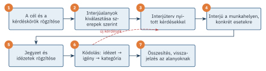

# Interjú és megfigyelés {#sec-interju}

::: {.cel title="Eszközkártya"}
- **Mire való?** Az érdekelt felek elvárásainak, valódi igényeinek és a jelenlegi működés rejtett részleteinek feltárása személyes beszélgetéssel és a munka helyszíni megfigyelésével.
- **Tanulási eredmény:** az eszközlap feldolgozása után képes leszel félig strukturált interjút és helyszíni megfigyelést megtervezni, lebonyolítani és kiértékelni, és a nyers jegyzetekből megoldásfüggetlen igényeket megfogalmazni.
- **V-lépés:** 2. Az érdekelt felek igényei; a ConOps és a követelmények forrása.
- **Bemenet:** érdekeltfél-nyilvántartás és priorizálás ([-@sec-erdekelt-azonositas]. és [-@sec-hatalom-erdekeltseg]. eszközlap), a probléma első megfogalmazása.
- **Kimenet:** interjújegyzetek, kódolt idézetek, megoldásmentesen megfogalmazott igények kategóriánként.
- **Időigény:** interjúnként 45–75 perc, a kódolás interjúnként további 1–2 óra.
- **Kézikönyv:** [5. fejezet](../../kezikonyv/fejezetek/05-erdekelt-felek.html), 5.4. szakasz; [4. fejezet](../../kezikonyv/fejezetek/04-problema.html).
:::

## Mikor használd?

- **Ha meg kell érteni, hogyan működnek a dolgok valójában**, nem csak papíron. A hivatalos folyamatleírás és a valós munka gyakran eltér.
- **Ha a kérések megoldások formájában érkeznek** („kell egy tablet”), és meg kell találni mögöttük az igényt.
- **A kérdőív előtt**, hogy kiderüljön, mit érdemes egyáltalán kérdezni, és milyen válaszlehetőségek vannak.
- **Rendellenes forgatókönyvek gyűjtésére**: a gyakorlott felhasználók tudják, mi szokott elromlani, és mit csinálnak ilyenkor.

## Lépések

{#fig-lepesek-interju width=100%}

1. **Rögzítsd a célt és a kérdésköröket.** Mit akarsz megtudni? Milyen döntést fog segíteni az eredmény?
2. **Válaszd ki az interjúalanyokat szerepek szerint.** A hatalom–érdekeltség rács kulcsszereplőit és érintettjeit mindenképp. A felhasználói csoportokból több embert is kérdezz meg, mert egy ember véleménye nem a csoporté. Guest és szerzőtársai egy viszonylag egynemű csoporttal végzett vizsgálatában az új témák túlnyomó többsége már az első tizenkét interjúban megjelent, a későbbiek alig hoztak újat [@guest2006]. Ha az újabb interjúk már nem hoznak új témát (telítődés), érdemes továbblépni.
3. **Készíts interjútervet.** Félig strukturált interjút javaslunk: rögzített témák és nyitó kérdések, de rugalmas sorrend és mélyítő kérdések. A kérdések nyitottak legyenek („mesélje el…”, „mi történt legutóbb, amikor…”), ne eldöntendők. Konkrét esetekre kérdezz, ne általánosságokra.
4. **Készítsd az interjút a munkahelyen.** Beyer és Holtzblatt kontextuális vizsgálati módszere szerint a legtöbbet akkor tudjuk meg, ha a felhasználót a saját munkakörnyezetében, munka közben figyeljük meg és kérdezzük. A kapcsolatot a mester és a tanítvány viszonyához hasonlítják: a felhasználó a szakértő, a tervező tőle tanul [@beyer1998].
5. **Rögzíts szó szerint.** Az interjúhoz kérj hozzájárulást a jegyzeteléshez. Ha lehet, ketten menjetek: egy kérdez, egy jegyzetel. Az idézeteket szó szerint írd le. Az értelmezés a következő lépés.
6. **Kódold a jegyzeteket.** Minden idézethez fogalmazd meg a mögötte álló igényt megoldásmentesen, és sorold kategóriába (funkció, teljesítmény, kezelhetőség, megbízhatóság, biztonság, költség, adat). Kérdezd meg: *miért kell ez?* A válasz az igény.
7. **Összesíts, és adj visszajelzést.** A kategóriákban összegyűlt igényeket mutasd meg az interjúalanyoknak: jól értetted-e őket? Ez egyben az érdekeltek bevonásának is fontos eszköze.

::: {.fogalom title="Félig strukturált interjú"}
Brinkmann és Kvale kvalitatív interjúzásról írt kézikönyve szerint a félig strukturált interjú célja, hogy az interjúalany saját életvilágának leírását kapjuk meg, és ezt értelmezzük [@brinkmann2015]. Az interjú nem kötetlen beszélgetés, de nem is szigorú kérdőív. Témákra és javasolt kérdésekre épül, de a kérdező a válaszok nyomán szabadon mélyít, és követi a váratlan, de fontos szálakat.
:::

## Kidolgozott példa: a ForgácsTech interjúi

A projektcsapat négy interjút készített: két CNC-gépkezelővel (megmunkáló központ, illetve esztergák), a termelésvezetővel és a minőségügyi vezetővel. A gépkezelőkkel a gépek mellett, műszak közben, a termelésvezetővel az irodájában beszéltek. A kódolt idézetek egy részét a [-@tbl-forgacs-kodolas]. táblázat mutatja.

| Idézet (szó szerint) | Igény (megoldásmentesen) | Kategória |
|:--|:--|:--|
| „Hétfőn megkapom a papírt, de szerdára már semmi sem igaz belőle.” | A gépkezelő a munka sorrendjének aktuális változását időben ismerje. | adat, információ |
| „Ha nincs anyag, elmegyek a raktárba, és ott derül ki, hogy nincs.” | A munka kiadásakor ismert legyen, hogy az anyag rendelkezésre áll-e. | funkció |
| „Tablet kell minden gép mellé.” | A gépnél, kézmosás nélkül is elérhető legyen a munkautasítás és a rajz. | kezelhetőség |
| „Olajos kézzel nem tudom nyomkodni a képernyőt.” | A gépnél használt kezelőfelület olajos, kesztyűs kézzel is működjön. | kezelhetőség |
| „Pénteken mindig túlórázunk, mert a vevő szólt, hogy sürgős.” | A sürgős rendelések hatása a többi határidőre előre látható legyen. | funkció |
| „Az audit előtt két napig keressük a papírokat.” | Egy munkadarab gyártási adatai néhány perc alatt visszakereshetők legyenek. | adat, információ |

: A ForgácsTech interjúinak kódolt részlete. {#tbl-forgacs-kodolas tbl-colwidths="[38,46,16]"}

**Tanulságok:**

- **A „tablet minden gép mellé” megoldás, nem igény.** A mögötte álló igény a munkautasítás és a rajz elérhetősége a gépnél. A második gépkezelő idézete („olajos kézzel nem tudom nyomkodni”) azonnal megmutatta, hogy a tablet nem is jó megoldás. A csapat később falra szerelt, kesztyűvel is használható ipari kijelzőt és vonalkódolvasót választott.
- **A megfigyelés többet mutatott, mint a kérdések.** Az egyik gépkezelő a beszélgetés közben háromszor ment el kérdezni a művezetőtől, hogy mi a következő munka. Ezt a szokást egyik interjúban sem említették, mert annyira megszokott volt.
- **Az igények a probléma okaihoz vezetnek.** A kódolt igények szinte pontosan a problémafa okait adták vissza (kézikönyv, [4. fejezet](../../kezikonyv/fejezetek/04-problema.html)). Ez megerősítette a csapatot abban, hogy a problémát jól fogalmazták meg.

## Sablon

- [interju_sablon.xlsx](../sablonok/interju_sablon.xlsx): interjúterv nyitott kérdésekkel és időkerettel, interjúnapló a hozzájárulás rögzítésével, kódolási lap (idézet → igény → kategória → érdekelt fél → fontosság) és automatikus összesítés kategóriánként, diagrammal. A ForgácsTech példájával kitöltve.

## Előnyök és korlátok

| Előnyök | Korlátok |
|:--|:--|
| Mély megértés, váratlan összefüggések | Időigényes; kevés alannyal dolgozik, ezért nem reprezentatív |
| Feltárja a kimondott megoldás mögötti igényt | Az eredmény függ a kérdező ügyességétől és előfeltevéseitől |
| A helyszíni megfigyelés a hallgatólagos tudást is megmutatja | Az alanyok gyakran azt mondják, amit szerintük hallani akarunk |
| Egyben az érdekelt felek bevonásának eszköze | Érzékeny információk kerülhetnek elő; etikus adatkezelés kell |

: Az interjú és a megfigyelés előnyei és korlátai. {tbl-colwidths="[50,50]"}

::: {.hiba}
- **Rávezető kérdések.** A „Ugye hasznos lenne egy tablet?” kérdésre mindenki igent mond. Kérdezz inkább így: „Hogyan jut hozzá most a rajzhoz?”
- **Megoldások gyűjtése igények helyett.** Minden megoldásjavaslatnál kérdezd meg: miért lenne ez jó?
- **Csak a vezetők megkérdezése.** A vezető tudja, mit *kellene* csinálni, a gépkezelő azt, mit *csinálnak*.
- **Értelmezés a jegyzetben.** Ha a jegyzetbe már a saját értelmezésedet írod, elveszik az eredeti szó. Idézz szó szerint, és külön oszlopba írd az értelmezést.
- **Visszajelzés nélküli adatgyűjtés.** Ha az interjúalany soha nem hallja, mi lett a véleményével, legközelebb nem fog őszintén beszélni.
:::

## Mintapromptok

::: {.prompt title="Mintaprompt: interjúterv vázlata"}
```text
Fejlesztési projektünk: [rövid leírás]. Interjút készítünk a következő
szereppel: [szerep, például CNC-gépkezelő], a munkahelyén, 60 percben.
Feladat: készíts félig strukturált interjútervet 6–8 témával. Minden
témához egy nyitott, konkrét esetre rákérdező nyitó kérdést és 2–3
mélyítő kérdést írj. Kerüld az eldöntendő és a rávezető kérdéseket,
és ne javasolj megoldást a kérdésekben. A végén jelöld meg, melyik
kérdés segít a rendellenes helyzetek feltárásában.
```
:::

::: {.prompt title="Mintaprompt: idézetek kódolásának ellenőrzése"}
```text
Az alábbi táblázatban interjúidézetek és az általunk megfogalmazott
igények szerepelnek: [TÁBLÁZAT: idézet | igény | kategória].
Ellenőrizd soronként: (1) az igény megoldásmentes-e (nem nevez meg
technológiát vagy eszközt); (2) hű-e az idézethez, nem tesz-e hozzá
olyat, ami az idézetből nem következik; (3) jó-e a kategória.
Ahol hibát találsz, javasolj átfogalmazást, és indokold egy mondatban.
Ne találj ki új igényeket.
```
:::

## Feladat

::: {.projekt title="2. projektlépés (harmadik rész): interjúk"}
Készíts legalább két interjút saját projekted kulcsszereplőivel vagy érintettjeivel a sablon interjútervének a projektedhez igazított változatával. Lehetőleg a munkahelyükön, legalább részben megfigyeléssel. Kódold az idézeteket (legalább 10 sor), és foglald össze kategóriánként a legfontosabb igényeket. Jelöld meg, melyik igény mond ellent a kezdeti problémamegfogalmazásodnak.
:::
