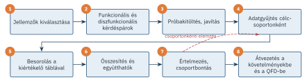
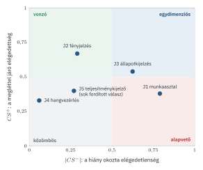

# Kano-elemzés {#sec-kano}

::: {.cel title="Eszközkártya"}
- **Mire való?** Az érdekelt felek elvárásainak osztályozása aszerint, hogyan függ az elégedettség az egyes jellemzők teljesülésétől: alapvető, egydimenziós, vonzó, közömbös vagy fordított.
- **Tanulási eredmény:** az eszközlap feldolgozása után képes leszel Kano-kérdőívet összeállítani és kiértékelni, az elvárásokat Kano-kategóriákba sorolni, és kiszámítani az elégedettségi és elégedetlenségi együtthatókat.
- **V-lépés:** 2. Az érdekelt felek igényei; eredménye a követelmények súlyozásának és a QFD-nek a bemenete.
- **Bemenet:** a vizsgálandó jellemzők listája, a célcsoportok, elérhető válaszadók.
- **Kimenet:** jellemzőnkénti besorolás, elégedettségi együtthatók ($CS^{+}$, $CS^{-}$), elégedettségi diagram.
- **Időigény:** a kérdőív összeállítása 2–3 óra, az adatgyűjtés napok, a kiértékelés a sablonnal fél óra.
- **Kézikönyv:** [5. fejezet](../../kezikonyv/fejezetek/05-erdekelt-felek.html), 5.5. szakasz.
:::

## Mikor használd?

- **Ha sok lehetséges jellemző közül kell választani**, és tudni kell, melyik kötelező, melyikben érdemes versenyezni, és melyik lehet megkülönböztető.
- **Szolgáltatásoknál és felhasználói termékeknél**, ahol a felhasználók köre elég nagy ahhoz, hogy legalább néhány tucat válasz gyűljön össze csoportonként.
- **A követelmények súlyozása előtt**, a minőség házának bemeneteként.

**Mikor ne?** Ha a jellemző annyira új, hogy a válaszadók nem tudják elképzelni, előbb mutasd be leírással, képpel vagy prototípussal. Ha csak néhány válaszadó van (például egy megrendelő), interjú és megbeszélés a jobb eszköz.

## Lépések

{#fig-lepesek-kano width=100%}

1. **Válaszd ki a jellemzőket.** Legyenek egymástól függetlenek, a felhasználó számára érthetők, és megoldásfüggetlenek, amennyire lehet. A kérdőív hossza miatt egyszerre legfeljebb 15–20 jellemzőt vizsgálj.
2. **Fogalmazd meg a kérdéspárokat.** Minden jellemzőhöz egy funkcionális kérdés („Mit érezne, ha …?”) és egy diszfunkcionális kérdés („Mit érezne, ha nem …?”) tartozik. A két kérdés szövege a tagadástól eltekintve legyen azonos.
3. **Próbáld ki a kérdőívet** néhány emberrel, és javítsd a félreérthető megfogalmazásokat.
4. **Gyűjts adatot célcsoportonként.** Rögzítsd a válaszadó csoportját is (például korcsoport, műszak, használati gyakoriság), hogy később szét lehessen bontani az eredményt.
5. **Sorold be a válaszpárokat** a kiértékelő táblázattal ([-@tbl-kano-tabla]. táblázat).
6. **Összesíts és számold ki az együtthatókat** ([-@eq-cs]. egyenlet).
7. **Értelmezd az eredményt.** Ha két kategória gyakorisága közel azonos, vagy sok a fordított válasz, bontsd az elemzést célcsoportokra.
8. **Vezesd át az eredményt** a követelményekbe és a minőség házába. Az alapvető jellemzőkből kötelező követelmények lesznek. Az egydimenziósakhoz versenyképes célérték tartozik. A vonzók a koncepcióválasztás megkülönböztető szempontjai.

### A kérdőív

Mindkét kérdésre ugyanaz az öt válaszlehetőség tartozik:

1. *Tetszene.*
2. *Elvárom, magától értetődő.*
3. *Közömbös.*
4. *Elviselném.*
5. *Nem tetszene.*

Példa egy kérdéspárra a KoboCella operátorai számára:

- **Funkcionális:** *„Mit érezne, ha a munkaasztal magassága gombnyomásra az Ön testmagasságához igazodna?”*
- **Diszfunkcionális:** *„Mit érezne, ha a munkaasztal magassága rögzített lenne?”*

### Kiértékelés

| Funkcionális \\ diszfunkcionális | 1 Tetszene | 2 Elvárom | 3 Közömbös | 4 Elviselném | 5 Nem tetszene |
|:--|:-:|:-:|:-:|:-:|:-:|
| **1 Tetszene** | K | V | V | V | E |
| **2 Elvárom** | F | Kö | Kö | Kö | A |
| **3 Közömbös** | F | Kö | Kö | Kö | A |
| **4 Elviselném** | F | Kö | Kö | Kö | A |
| **5 Nem tetszene** | F | F | F | F | K |

: A Kano-kiértékelő táblázat. V = vonzó, E = egydimenziós, A = alapvető, Kö = közömbös, F = fordított, K = kétséges. @berger1993 alapján. {#tbl-kano-tabla tbl-colwidths="[25,15,15,15,15,15]"}

Az elégedettségi együtthatók [@berger1993]:

$$
CS^{+}=\frac{V+E}{V+E+A+\mathit{Kö}}, \qquad CS^{-}=-\frac{E+A}{V+E+A+\mathit{Kö}}.
$$ {#eq-cs}

A $CS^{+}$ azt mutatja, mennyire növeli a jellemző megléte az elégedettséget (0 és 1 között). A $CS^{-}$ azt, mennyire csökkenti a hiánya (−1 és 0 között). Az elégedettségi diagramon a $CS^{+}$ értéket a $|CS^{-}|$ függvényében ábrázoljuk. A négy negyed (0,5-ös határokkal) a vonzó, az egydimenziós, az alapvető és a közömbös jellemzőket különíti el.

::: {.content-visible when-format="html"}
```{=html}
<div class="demo kano-kalk">
  <div class="demo-cim">Interaktív kalkulátor</div>
  <p>Állítsd be egy jellemző válaszainak számát, és figyeld, hogyan változik a besorolás és az elégedettségi együtthatók! A kiinduló értékek a KoboCella fényjelzésére vonatkoznak.</p>
  <div class="kk-racs">
    <label>Vonzó (V) <input type="range" min="0" max="100" value="11" data-k="V"> <output>11</output></label>
    <label>Egydimenziós (E) <input type="range" min="0" max="100" value="5" data-k="E"> <output>5</output></label>
    <label>Alapvető (A) <input type="range" min="0" max="100" value="2" data-k="A"> <output>2</output></label>
    <label>Közömbös (Kö) <input type="range" min="0" max="100" value="6" data-k="Ko"> <output>6</output></label>
    <label>Fordított (F) <input type="range" min="0" max="100" value="0" data-k="F"> <output>0</output></label>
  </div>
  <p class="kk-eredmeny"></p>
  <svg viewBox="0 0 330 300" width="100%" style="max-width:460px" role="img" aria-label="Elégedettségi diagram">
    <rect x="45" y="10" width="130" height="120" fill="#DDEFE4"/>
    <rect x="175" y="10" width="130" height="120" fill="#E6EEF6"/>
    <rect x="175" y="130" width="130" height="120" fill="#F6DEDE"/>
    <rect x="45" y="130" width="130" height="120" fill="#F1F2F4"/>
    <text x="50" y="24" font-size="11" fill="#3E8E63" font-weight="700">vonzó</text>
    <text x="300" y="24" font-size="11" fill="#285780" font-weight="700" text-anchor="end">egydimenziós</text>
    <text x="300" y="244" font-size="11" fill="#B83A3A" font-weight="700" text-anchor="end">alapvető</text>
    <text x="50" y="244" font-size="11" fill="#6B7280" font-weight="700">közömbös</text>
    <line x1="45" y1="250" x2="305" y2="250" stroke="#6B7280"/><line x1="45" y1="10" x2="45" y2="250" stroke="#6B7280"/>
    <text x="45" y="264" font-size="10" text-anchor="middle" fill="#6B7280">0</text>
    <text x="175" y="264" font-size="10" text-anchor="middle" fill="#6B7280">0,5</text>
    <text x="305" y="264" font-size="10" text-anchor="middle" fill="#6B7280">1</text>
    <text x="38" y="254" font-size="10" text-anchor="end" fill="#6B7280">0</text>
    <text x="38" y="134" font-size="10" text-anchor="end" fill="#6B7280">0,5</text>
    <text x="38" y="14" font-size="10" text-anchor="end" fill="#6B7280">1</text>
    <text x="175" y="284" font-size="11" text-anchor="middle" fill="#1F2933">|CS−|: a hiány okozta elégedetlenség</text>
    <text x="12" y="130" font-size="11" text-anchor="middle" fill="#1F2933" transform="rotate(-90 12 130)">CS+: a megléttel járó elégedettség</text>
    <circle class="kk-pont" cx="0" cy="0" r="8" fill="#285780" stroke="#fff" stroke-width="2"/>
  </svg>
</div>
<script>
(function () {
  var gyoker = document.currentScript.previousElementSibling;
  var csuszkak = gyoker.querySelectorAll("input[type=range]");
  var kiir = gyoker.querySelector(".kk-eredmeny");
  var pont = gyoker.querySelector(".kk-pont");
  var nevek = {V: "vonzó", E: "egydimenziós", A: "alapvető", Ko: "közömbös", F: "fordított"};
  function fmt(x) { return x.toFixed(2).replace(".", ",").replace("-", "−"); }
  function frissit() {
    var v = {};
    csuszkak.forEach(function (c) { v[c.dataset.k] = +c.value; c.nextElementSibling.value = c.value; });
    var n = v.V + v.E + v.A + v.Ko;
    var csp = n ? (v.V + v.E) / n : 0, csm = n ? -(v.E + v.A) / n : 0;
    var max = Object.keys(v).sort(function (a, b) { return v[b] - v[a]; })[0];
    kiir.innerHTML = "<strong>Leggyakoribb kategória:</strong> " + nevek[max] +
      " · <strong>CS+ =</strong> " + fmt(csp) + " · <strong>CS− =</strong> " + fmt(csm);
    pont.setAttribute("cx", 45 + 260 * Math.abs(csm));
    pont.setAttribute("cy", 10 + 240 * (1 - csp));
  }
  csuszkak.forEach(function (c) { c.addEventListener("input", frissit); });
  frissit();
})();
</script>
```
:::

## Kidolgozott példa: a KoboCella operátori Kano-elemzése

A KoboCella-csapat a cella kezelőfelületének és munkahelyének öt lehetséges jellemzőjéről kérdezte meg a három műszak 24 operátorát. A válaszok összesítését és az együtthatókat a [-@tbl-kano-kobo]. táblázat, az elégedettségi diagramot a [-@fig-kano-kobo]. ábra mutatja (szemléltető adatok).

| Kód | Jellemző | V | E | A | Kö | F | K | Besorolás | $CS^{+}$ | $CS^{-}$ |
|:--|:--|:-:|:-:|:-:|:-:|:-:|:-:|:--|:-:|:-:|
| J1 | Állítható munkaasztal-magasság | 3 | 6 | 13 | 2 | 0 | 0 | alapvető | 0,38 | −0,79 |
| J2 | Fényjelzés a következő műveletről | 11 | 5 | 2 | 6 | 0 | 0 | vonzó | 0,67 | −0,29 |
| J3 | A kobot állapotának és zónájának kijelzése | 4 | 9 | 6 | 5 | 0 | 0 | egydimenziós | 0,54 | −0,63 |
| J4 | Hangvezérlés | 5 | 1 | 0 | 12 | 6 | 0 | közömbös | 0,33 | −0,06 |
| J5 | Egyéni teljesítménykijelző a cellán | 3 | 3 | 1 | 8 | 9 | 0 | fordított | 0,40 | −0,27 |

: A KoboCella operátori Kano-elemzésének eredménye (24 válaszadó, szemléltető adatok). {#tbl-kano-kobo tbl-colwidths="[6,32,5,5,5,5,5,5,12,10,10]"}

{#fig-kano-kobo width=78%}

**Értelmezés:**

- **Az állítható munkaasztal alapvető elvárás** ($CS^{-}=-0{,}79$). Hiánya erős elégedetlenséget okozna, ezért a csapat kötelező követelményként rögzítette.
- **A fényjelzés vonzó.** Nem várják el, de nagy elégedettséget okozna, és a betanulást is gyorsíthatja. Olcsó, ezért bekerült a koncepcióba.
- **Az állapotkijelzés egydimenziós.** Minél jobb, annál elégedettebbek. A biztonságérzet és a bizalom miatt itt a versenyképes szint a cél.
- **A hangvezérlés a többségnek közömbös**, a hat fordított válasz a zajos környezetből fakadhat. Nem kerül be a koncepcióba.
- **Az egyéni teljesítménykijelző fordított.** Az operátorok egy része kifejezetten nem szeretné. Ez fontos jelzés. A csapat nem egyéni, hanem műszakszintű, a folyamat javítását szolgáló kijelzést tervez, és a megoldást az üzemi tanáccsal is egyezteti. A kis mintán (24 fő) a besorolások bizonytalanok, ezért a csapat a fontos döntések előtt célzott interjúkkal is ellenőrzi az eredményt.

## Sablon és notebook

- [kano_sablon.xlsx](../sablonok/kano_sablon.xlsx): jellemzők és kérdések, válaszok kódolva (1–5), automatikus besorolás a kiértékelő táblázattal, összesítés, együtthatók és elégedettségi diagram. A kézikönyv VárosiBringa-példájának 120 válaszával feltöltve.
- [kano_elemzes.ipynb](../notebookok/kano_elemzes.ipynb) · [Megnyitás Google Colabban](kano_elemzes.ipynb): ugyanez Pythonban: besorolás, együtthatók és elégedettségi diagram. A beépített példával azonnal futtatható; saját adatokhoz a kitöltött sablon „Válaszok” lapját olvassa be. Telepítést nem igényel.

## Előnyök és korlátok

| Előnyök | Korlátok |
|:--|:--|
| A jellemzők nem lineáris hatását is megmutatja; segít a prioritások kijelölésében | Sok válaszadót igényel; kis mintán a besorolás bizonytalan |
| Egyszerű, szabványos kérdőív; gyorsan kiértékelhető | A kétkérdéses forma fárasztó, és a válaszadók félreérthetik |
| Feltárja a megosztó és a nem kívánt jellemzőket is | Pillanatfelvétel; a besorolás idővel változik (a vonzóból elvárt lesz) |

: A Kano-elemzés előnyei és korlátai. {tbl-colwidths="[50,50]"}

::: {.hiba}
- **Nem tükörszimmetrikus kérdéspár.** Ha a két kérdés nem ugyanarról szól („Mit érezne, ha gyors lenne?” / „Mit érezne, ha lassú lenne?”), a besorolás torzul. A diszfunkcionális kérdés a jellemző *hiányára* kérdezzen.
- **Csoportok összemosása.** Ha a diákok és az idősebb lakók válaszait együtt összesítjük, a jellemző közömbösnek tűnhet, miközben az egyik csoportnak alapvető, a másiknak fordított.
- **Túl sok jellemző.** Harminc kérdéspár után a válaszok minősége romlik.
- **A „leggyakoribb kategória” túlértelmezése.** Ha a két legnagyobb kategória közel azonos, ne mondj ki egyértelmű besorolást.
:::

## Mintapromptok

::: {.prompt title="Mintaprompt: kérdéspárok megfogalmazása és ellenőrzése"}
```text
Kano-kérdőívet készítünk [célcsoport] számára a következő rendszerhez:
[rendszer leírása]. A vizsgálandó jellemzők: [lista].

Feladat:
1. Minden jellemzőhöz fogalmazz meg egy funkcionális ("Mit érezne, ha ...?")
   és egy diszfunkcionális ("Mit érezne, ha nem ...?") kérdést, egyszerű,
   a célcsoport számára érthető nyelven.
2. Ellenőrizd, hogy a két kérdés a tagadástól eltekintve azonos-e, és
   hogy egyik sem sugall választ.
3. Jelezd, ha egy jellemző valójában két jellemzőt takar, vagy megoldást
   ír elő igény helyett.
Formátum: táblázat (jellemző | funkcionális | diszfunkcionális | megjegyzés).
```
:::

::: {.prompt title="Mintaprompt: az eredmények értelmezésének ellenőrzése"}
```text
Az alábbi táblázat egy Kano-elemzés összesített eredménye
(V, E, A, Kö, F, K darabszámok és CS+, CS− értékek), [n] válaszadóval,
[csoportok leírása].
[IDE ILLESZD BE A TÁBLÁZATOT]

Feladat: jelezd, mely besorolások bizonytalanok (közel azonos
kategóriagyakoriságok, sok fordított vagy kétséges válasz, kis minta),
és javasolj célzott kérdéseket vagy csoportbontást a tisztázásukra.
Ne számold újra az együtthatókat; ha számítási hibát látsz, jelezd.
```
:::

## Feladat

::: {.projekt title="2. projektlépés (opcionális bővítés): Kano-elemzés"}
Válassz ki saját projektedben 5–8 jellemzőt, és készíts róluk Kano-kérdőívet. Gyűjts legalább 20 választ a fő felhasználói csoport(ok)ból, értékeld ki a sablonnal, és írd le, hogyan módosítja az eredmény a követelmények prioritását.
:::
