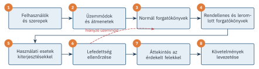

# Működési koncepció és forgatókönyvek {#sec-conops}

::: {.cel title="Eszközkártya"}
- **Mire való?** A jövőbeli rendszer használatának leírása a felhasználó nyelvén: üzemmódok és a köztük lévő átmenetek, valamint normál, rendellenes és leromlott üzemű forgatókönyvek, amelyekből követelmények és validációs tesztek születnek.
- **Tanulási eredmény:** az eszközlap feldolgozása után képes leszel működési koncepciót írni a felhasználó nyelvén, üzemmódokkal, normál és rendellenes forgatókönyvekkel, és abból követelményjelölteket levezetni.
- **V-lépés:** 1–2. Probléma és érdekelt felek; a validáció ([-@sec-hasznalhatosagi-teszt]. eszközlap) alapja.
- **Bemenet:** problémamegfogalmazás, érdekeltfél-nyilvántartás, interjúk és megfigyelések, kontextusdiagram.
- **Kimenet:** ConOps-dokumentum, üzemmód-diagram, forgatókönyv-táblázat azonosítókkal, használati esetek, a lefedettség ellenőrzése.
- **Időigény:** az első változat 1–2 nap csapatmunka; a forgatókönyvek a projekt során bővülnek.
- **Kézikönyv:** [4. fejezet](../../kezikonyv/fejezetek/04-problema.html), 4.4. szakasz.
- **Továbbolvasás:** [@nasa2016seh, 4.1. szakasz és S függelék].
:::

## Mikor használd?

- **A koncepció szakaszában**, a követelmények előtt. A forgatókönyvekből sok olyan követelmény adódik, amely a műszaki szemléletű listákból kimarad.
- **Ha az érdekelt felek nem mérnökök.** A ConOps az a dokumentum, amelyet a felhasználó, a megrendelő és a hatóság is el tud olvasni és jóvá tud hagyni.
- **Rendellenes helyzetek tervezéséhez.** Mi történik, ha valami elromlik, kifogy, késik, vagy ha a felhasználó hibázik?
- **A validációs tesztek tervezésekor.** Az elfogadási tesztek a ConOps forgatókönyveit játsszák le.

## Lépések

{#fig-lepesek-conops width=100%}

1. **Írd le a felhasználókat és a szerepeket.** Kik használják, üzemeltetik, karbantartják a rendszert? A felhasználói csoportokat ne vond össze ([-@sec-erdekelt-azonositas]. eszközlap).
2. **Határozd meg az üzemmódokat és az átmeneteket.** Milyen állapotokban lehet a rendszer (indítás, normál, korlátozott, leromlott, vészhelyzeti, karbantartási, kivonási)? Mi váltja ki az átmeneteket? Rajzolj állapotdiagramot.
3. **Írd meg a normál forgatókönyveket.** Konkrét szereplővel, konkrét helyzetben, időrendben. A forgatókönyv a felhasználó céljáról és tapasztalatáról szóljon, ne a kezelőfelület részleteiről.
4. **Írd meg a rendellenes és a leromlott üzemű forgatókönyveket.** Minden normál forgatókönyv minden lépésénél kérdezd meg: mi romolhat el? Mi történik, ha a bemenet hibás, késik, hiányzik? Mi történik, ha egy alrendszer kiesik?
5. **Rendszerezd használati esetekkel.** A fontos forgatókönyveket általánosítsd használati esetté: elsődleges szereplő, cél, előfeltétel, fő sikerforgatókönyv, kiterjesztések, utófeltétel [@cockburn2001].
6. **Ellenőrizd a lefedettséget.** Minden üzemmódhoz tartozik-e legalább egy forgatókönyv? Van-e rendellenes forgatókönyv a normál üzemhez? A magas valószínűségű vagy súlyos következményű helyzetek mind szerepelnek-e?
7. **Tekintsd át az érdekelt felekkel.** A ConOps-ot a felhasználóknak, az üzemeltetőnek és a megrendelőnek mutasd meg. Az érdekelt felek elvárásait és a működési koncepciót a koncepció-felülvizsgálaton közösen véglegesítik, és jóváhagyásuk után alapvonalba kerülnek (kézikönyv, [2.5. szakasz](../../kezikonyv/fejezetek/02-v-modell.html#sec-felulvizsgalatok)).
8. **Vezess le követelményeket.** Minden forgatókönyv-lépésből és kiterjesztésből egy vagy több követelmény születhet. A forgatókönyv azonosítóját írd a követelmény forrásához ([-@sec-kovetelmeny-iras]. eszközlap).

::: {.fogalom title="A ConOps tartalma"}
Az IEEE 1362 útmutató vázlata, kissé egyszerűsítve: hatókör; hivatkozott dokumentumok; a jelenlegi rendszer vagy helyzet (működési szabályok és korlátok, üzemmódok, felhasználói csoportok, támogató környezet); a változtatás indoka és jellege; a tervezett rendszer koncepciója (célok, a rendszer leírása, üzemmódok, felhasználói csoportok, támogató környezet); működési forgatókönyvek normál és rendellenes körülményekre; a hatások összefoglalása; a tervezett rendszer elemzése [@ieee1362_1998; @iso29148_2018].
:::

## Kidolgozott példa: a KoboCella működési koncepciója

A KoboCella csapata egynapos workshopon dolgozta ki a működési koncepciót. Részt vett rajta két operátor, a műszakvezető, a karbantartás, a munkavédelmi szakember és a robotintegrátor. A workshop menete:

**Délelőtt: üzemmódok.** A csapat egy táblán felrajzolta az üzemmódokat. Az első változat négy állapotot tartalmazott (kikapcsolt, indítás, üzem, hiba). A karbantartó kérdésére („és a típusváltás?”) bekerült a karbantartás és típusváltás üzemmód. A műszakvezető kérdésére („mi lesz, ha két napig áll a robot?”) pedig a leromlott üzem, amelyben a cella kézi munkaállomásként működik tovább (kézikönyv, 4.4. ábra). Végül hét üzemmód lett.

**Délután: forgatókönyvek.** A csapat a normál szerelési ciklusból (FK-01) indult ki, és lépésenként végigkérdezte, mi romolhat el. Így született a többi között a [-@tbl-kobo-forgatokonyv]. táblázat négy rendellenes és leromlott forgatókönyve. A valószínűség és a következmény (1–5) szorzata adta a prioritást.

| Azonosító | Forgatókönyv | Típus | Üzemmód | V × K | Új követelmény |
|:--|:--|:--|:--|:-:|:--|
| FK-01 | Egy motor szerelése | normál | UM-3 | 5 × 2 = 10 | – (alap) |
| FK-04 | Kéz a védőzónában ciklus közben | rendellenes | UM-4 | 4 × 5 = 20 | sebességcsökkentés, jelzőfény |
| FK-09 | Nyomaték a tűrésen kívül | rendellenes | UM-3 | 3 × 4 = 12 | hibás motor elkülönítése |
| FK-12 | Kifogy a csavaradagoló | rendellenes | UM-3 | 4 × 2 = 8 | szintjelzés, félkész darab kezelése |
| FK-15 | Robothiba két napig | leromlott | UM-5 | 2 × 4 = 8 | kézi üzem nyomatékellenőrzéssel |

: A KoboCella forgatókönyveinek részlete prioritással és a belőlük született új követelményekkel. {#tbl-kobo-forgatokonyv tbl-colwidths="[10,28,13,10,11,28]"}

**Tanulságok:**

- **A legmagasabb prioritású forgatókönyv egy rendellenes helyzet volt** (FK-04, kéz a védőzónában). Ez a biztonsági koncepció egyik kiindulópontja lett ([-@sec-pha]. eszközlap).
- **A lefedettségi ellenőrzés hiányokat mutatott.** A sablon jelezte, hogy a vészleállításhoz, az indításhoz és a karbantartáshoz nincs forgatókönyv. A csapat a vészleállítás utáni újraindítást (FK-18) azonnal kidolgozta, mert ott gyakoriak a kezelési hibák.
- **A forgatókönyvekből 14 új követelmény született**, amelyek a műszaki szempontú első listából hiányoztak, például a csavaradagoló szintjelzése és a félkész darabok kezelése.

## Sablon

- [forgatokonyv_sablon.xlsx](../sablonok/forgatokonyv_sablon.xlsx): üzemmódok be- és kilépési feltételekkel; forgatókönyv-táblázat azonosítóval, típussal, üzemmóddal, lépésekkel, elvárt eredménnyel, kapcsolódó követelményekkel és automatikus prioritással; lefedettségi lap, amely üzemmódonként megszámolja a forgatókönyveket, és jelzi a hiányokat. A KoboCella példájával kitöltve.

## Előnyök és korlátok

| Előnyök | Korlátok |
|:--|:--|
| A nem mérnök érdekelt felek is értik és jóváhagyhatják | Nem helyettesíti a követelményeket: azokat le kell vezetni belőle |
| A rendellenes forgatókönyvek sok rejtett követelményt felszínre hoznak | A forgatókönyvek száma gyorsan nő; priorizálni kell |
| A validációs tesztek közvetlen alapja | Ha túl részletes, a megoldásteret kezdi leírni |
| Az üzemmódok korán tisztázzák a rendszer határait és állapotait | Csak annyira jó, amennyire a résztvevők ismerik a valós működést |

: A működési koncepció előnyei és korlátai. {tbl-colwidths="[50,50]"}

::: {.hiba}
- **Csak „napos oldali” forgatókönyvek.** Ha minden forgatókönyv sikeres, a ConOps a tervezők reményeit írja le, nem a valóságot.
- **Felhasználói felület a forgatókönyvben.** A „megnyomja a zöld gombot” mondat a megoldás része; a ConOps-ba az kell, hogy „jóváhagyja a kölcsönzést”.
- **Hiányzó leromlott üzem.** Ha a rendszer egy része kiesik, mi történik? A válasz gyakran fontos követelményeket szül.
- **Azonosító nélküli forgatókönyvek.** Azonosító nélkül a követelmények és a tesztek nem követhetők vissza a forgatókönyvekre.
:::

## Mintapromptok

::: {.prompt title="Mintaprompt: rendellenes forgatókönyvek gyűjtése"}
```text
Ez egy normál működési forgatókönyv: [FORGATÓKÖNYV LÉPÉSEKKEL].
A rendszer üzemmódjai: [LISTA].
Feladat: a forgatókönyv minden lépésénél sorolj fel 2–3 lehetséges
eltérést (hibás vagy hiányzó bemenet, késés, alrendszer-kiesés,
kezelési hiba, környezeti zavar). Mindegyikhez adj becsült
valószínűséget és következményt 1–5 skálán, és egy mondatban írd le,
mit kellene a rendszernek tennie. Jelöld, ha egy eltérés új
üzemmódot igényelne. Ne írj felhasználói felületi részleteket.
```
:::

::: {.prompt title="Mintaprompt: követelmények levezetése forgatókönyvből"}
```text
Az alábbi forgatókönyvből vezess le rendszerkövetelményeket:
[FORGATÓKÖNYV AZONOSÍTÓVAL].
Szabályok: „A ‹rendszer›nek … kell …” szerkezet; egy mondatban egy
„kell”; mérték és érték, ahol lehet (ha nem ismert, írj TBR-t és
indoklást); megoldásmentes megfogalmazás. Minden követelmény mellé írd
oda, a forgatókönyv melyik lépéséből származik. Jelöld külön azokat,
amelyek nem a rendszerre, hanem a működésre vagy a felhasználóra
vonatkoznak: ezek a ConOps-ban maradnak.
```
:::

## Feladat

::: {.projekt title="3. projektlépés (első rész): működési koncepció"}
Saját projektedhez sorold fel az üzemmódokat, és rajzolj róluk állapotdiagramot. Írj legalább két normál, két rendellenes és egy leromlott üzemű forgatókönyvet a sablonban, prioritással. Ellenőrizd a lefedettséget, és minden forgatókönyvből vezess le legalább egy követelményt. Egy forgatókönyvet alakíts használati esetté fő sikerforgatókönyvvel és legalább három kiterjesztéssel.
:::
