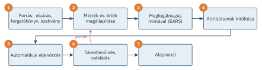

# Követelményírás és -ellenőrzés {#sec-kovetelmeny-iras}

::: {.cel title="Eszközkártya"}
- **Mire való?** Egyértelmű, egyedi, verifikálható rendszerkövetelmények megfogalmazása attribútumokkal, és a megfogalmazási hibák szisztematikus kiszűrése.
- **Tanulási eredmény:** az eszközlap feldolgozása után képes leszel egyértelmű, egyedi, verifikálható követelményeket írni EARS-mintával és attribútumokkal, és egy követelménykészletet az írási szabályok szerint ellenőrizni.
- **V-lépés:** 3. Rendszerkövetelmények; a verifikáció ([-@sec-rvm]. eszközlap) alapja.
- **Bemenet:** érdekeltfél-igények, ConOps-forgatókönyvek, interfészlista, MOE–MOP hierarchia, szabványok és korlátok.
- **Kimenet:** követelménynyilvántartás attribútumokkal, ellenőrzési jelentés, alapvonalba vehető követelményhalmaz.
- **Időigény:** követelményenként 5–15 perc az első megfogalmazás, az ellenőrzés a sablonnal vagy a notebookkal percek alatt.
- **Kézikönyv:** [6. fejezet](../../kezikonyv/fejezetek/06-kovetelmenyek.html), 6.3. szakasz.
- **Továbbolvasás:** [@nasa2016seh, C függelék].
:::

## Mikor használd?

- **Minden olyan állításnál, amely a rendszerre kötelező.** Ha valamit verifikálni kell, követelményként kell megfogalmazni.
- **Beszállítói specifikáció vagy ajánlatkérés előtt.** A kétértelmű követelmény a beszállítóval folytatott vita legbiztosabb forrása.
- **Felülvizsgálat előtt** (SRR, PDR): a követelményhalmaz minőségének ellenőrzésére.
- **Egy meglévő specifikáció átvételekor.** Az automatikus ellenőrzés gyorsan megmutatja a gyenge pontokat.

## Lépések

{#fig-lepesek-kovetelmeny width=100%}

1. **Indulj a forrásból.** Minden követelménynek legyen forrása: egy érdekeltfél-igény, egy forgatókönyv-lépés, egy interfész, egy szabvány vagy egy felsőbb szintű követelmény. Ha nincs forrás, kérdezd meg, miért kell.
2. **Állapítsd meg a mértéket és az értéket.** Mit mérünk, milyen mértékegységben, milyen határértékkel és tűréssel? Milyen feltételek mellett érvényes? Ha az érték még nem ismert, adj legjobb becslést, és jelöld TBR-rel (pontosítandó), a felelőssel és a határidővel együtt.
3. **Fogalmazd meg mintával.** Használd a „A ‹rendszer›nek … kell …” szerkezetet, egy mondatban egyetlen „kell”-lel. Feltételes viselkedésnél használd az EARS-mintákat ([-@tbl-ears-gyak]. táblázat) [@mavin2009].
4. **Töltsd ki az attribútumokat.** Azonosító, típus, indoklás, forrás, prioritás, verifikációs mód, felelős, állapot, KDR.
5. **Futtasd az automatikus ellenőrzést.** A sablon „Ellenőrzés” oszlopa vagy a notebook jelzi a tipikus hibákat. A jelzés figyelmeztetés: döntsd el, valóban hiba-e.
6. **Társellenőrzés és validálás.** Egy másik csapattag olvassa el a követelményeket az INCOSE írási szabályai szerint [@incose2023gtwr]. Az érdekelt felek erősítsék meg, hogy a követelmény az ő igényüket fejezi ki. Ha hibát találtok, javítsátok, és ismételjétek az ellenőrzést.
7. **Alapvonal.** A jóváhagyott követelmények alapvonalba kerülnek; ettől kezdve csak szabályozott változáskezeléssel módosíthatók ([-@sec-konfiguracio]. eszközlap).

| Minta | Szerkezet | Mikor? |
|:--|:--|:--|
| állandó | A ‹rendszer›nek ‹válasz› kell. | mindig érvényes tulajdonság vagy funkció |
| eseményvezérelt | Amikor ‹esemény›, a ‹rendszer›nek ‹válasz› kell. | egy esemény bekövetkeztére adott válasz |
| állapotvezérelt | Amíg ‹állapot›, a ‹rendszer›nek ‹válasz› kell. | egy állapot fennállása alatt érvényes viselkedés |
| nem kívánt viselkedés | Ha ‹nem kívánt feltétel›, akkor a ‹rendszer›nek ‹válasz› kell. | hibakezelés, rendellenes helyzet |
| opcionális jellemző | Ahol ‹jellemző›, a ‹rendszer›nek ‹válasz› kell. | csak bizonyos változatokra vagy konfigurációkra érvényes |

: Az EARS-minták gyakorlati alkalmazása. {#tbl-ears-gyak tbl-colwidths="[20,46,34]"}

::: {.fogalom title="Ellenőrzőlista egy követelményhez"}
Az ISO/IEC/IEEE 29148:2018 és az INCOSE követelményírási útmutatója szerint egy jó követelmény **szükséges, megfelelő szintű, egyértelmű, teljes, egyedi, megvalósítható, verifikálható, helyes és szabályos** [@iso29148_2018; @incose2023gtwr]. Az INCOSE írási szabályai ehhez gyakorlati kérdéseket adnak: cselekvő szerkezet; egy alany, egy állítmány; tűrés a mennyiségi értékekhez; megoldásmentes; megfelelő alany (nem működési leírás); pozitív megfogalmazás; indoklás; nincs „szükség szerint”, „stb.”, „és/vagy” [@incose2023gtwr]. Hasznos kiegészítés, hogy a még ismeretlen értékeknél TBD helyett legjobb becslést adjunk TBR-jelöléssel.
:::

## Kidolgozott példa: a KoboCella követelményeinek ellenőrzése

A KoboCella első követelménylistáját a rendszermérnök a sablonba töltötte, és lefuttatta az automatikus ellenőrzést. A 34 követelményből 11-nél volt jelzés. Néhány jellemző eset és a javításuk:

| Eredeti | Jelzés | Javított |
|:--|:--|:--|
| R-30: A cellának gyorsnak és felhasználóbarátnak kell lennie. | kétértelmű kifejezés; nincs szám; hiányzó indoklás, forrás, verifikáció | két követelmény: R-01 (ciklusidő ≤ 75 s) és R-16 (a betanult operátor a ciklust a kezelőpanel 2 érintésével indítja és nyugtázza) |
| R-31: A cellának meg kell jelenítenie a hibákat és naplóznia kell az eseményeket, stb. | több „kell”; „stb.” | R-17: a hibakód és a teendő megjelenítése 1 s-on belül; R-18: minden esemény naplózása időbélyeggel; a „stb.” helyett felsorolt eseménytípusok |
| R-32: Az operátor ellenőrzi a kész motort. | nincs „kell”; az alany nem a rendszer | működési leírás, a ConOps-ba került; a rendszerre vonatkozó rész: R-19 (a kiadóban a motor szemrevételezésre alkalmas megvilágítása, legalább 500 lux) |
| R-33: A csavarozó egység pontossága TBD. | nincs „kell”; TBD | CS-05: a csavarozó egység nyomatékmérési pontosságának ±2%-nak kell lennie (TBR, a beszállító adatlapja alapján megerősítendő, felelős: minőségügy, határidő: PDR) |

: A KoboCella néhány hibás követelménye és javítása. {#tbl-kobo-kov-javitas tbl-colwidths="[30,24,46]"}

**Tanulságok:**

- **A legtöbb hiba a nem verifikálható megfogalmazás volt.** „Gyors”, „felhasználóbarát”, „megbízható”: ezek érdekeltfél-elvárások, amelyeket MOE-vá és MOP-pá kell alakítani ([-@sec-moe-mop-tpm]. eszközlap).
- **Az összetett mondatokat szét kell bontani.** Egy követelmény egy állítás, különben a verifikáció is összetett lesz, és részleges teljesülésnél nem dönthető el, teljesült-e.
- **A „nincs számérték” jelzés nem mindig hiba.** Az R-07 („ha egy csavar nyomatéka a tűrésen kívül esik, akkor a cellának a motort hibásként kell megjelölnie”) funkcionális követelmény, amelynek teljesítményjellemzője (a tűrés) az R-03-ban szerepel. Ezt a csapat tudatosan jóváhagyta.

## Sablon és notebook

- [kovetelmeny_sablon.xlsx](../sablonok/kovetelmeny_sablon.xlsx): követelménynyilvántartás attribútumokkal és legördülő listákkal; automatikus ellenőrzés (a „kell” száma, kétértelmű kifejezések a bővíthető szótárból, TBD, számérték, a rendszer mint alany, hiányzó attribútumok); összesítés típus és verifikációs mód szerint. A „Példa – KoboCella” lap jó és szándékosan hibás követelményeket is tartalmaz.
- [kovetelmeny_ellenorzes.ipynb](../notebookok/kovetelmeny_ellenorzes.ipynb) · [Megnyitás Google Colabban](kovetelmeny_ellenorzes.ipynb): ugyanezek a szabályok Pythonban, reguláris kifejezésekkel, a hibatípusok gyakoriságának ábrájával. Könnyen bővíthető saját szabályokkal; nagyobb specifikációk gyors átvilágítására is alkalmas.

## Előnyök és korlátok

| Előnyök | Korlátok |
|:--|:--|
| Egyértelmű, verifikálható, beszállítónak is átadható követelmények | Az automatikus ellenőrzés csak a megfogalmazást vizsgálja, a helyességet nem |
| Az attribútumok révén kezelhető, visszakövethető, priorizálható halmaz | A nyelvi szabályok heurisztikák: téves riasztás és kimaradt hiba is előfordul |
| A mintamondatok csökkentik a kétértelműséget | A túlzott formalizálás nehezen olvasható szöveget eredményezhet |
| Gyors, ismételhető minőségellenőrzés | A jó követelményhez a tartalmat továbbra is a csapatnak kell kitalálnia |

: A követelményírási szabályok és az automatikus ellenőrzés előnyei és korlátai. {tbl-colwidths="[50,50]"}

::: {.hiba}
- **Megoldás a követelményben.** „A cellának kobottal kell…” helyett azt írd le, mit kell elérni. A megoldás a koncepcióválasztás eredménye ([-@sec-pugh]. eszközlap).
- **Szenvedő szerkezet, rejtett alany.** „A hibákat jelezni kell” – ki jelzi? A rendszer, a kezelő vagy a karbantartó?
- **Negatív követelmény mérték nélkül.** „A dokkoló ne legyen hangos” helyett: legfeljebb 60 dB(A) 1 m-en.
- **TBD a végtelenségig.** Minden TBD kockázat. Adj becslést, jelöld TBR-rel, és rögzítsd, ki és mikorra pontosítja.
:::

## Mintapromptok

::: {.prompt title="Mintaprompt: követelmények átfogalmazása"}
```text
Az alábbi követelmények egy [rendszer leírása] rendszerre vonatkoznak:
[LISTA AZONOSÍTÓKKAL]
Minden követelményhez:
1. jelezd, melyik jó követelmény-ismérvet sérti (szükséges, megfelelő
   szintű, egyértelmű, teljes, egyedi, megvalósítható, verifikálható,
   helyes, szabályos);
2. javasolj átfogalmazást „A ‹rendszer›nek … kell …” szerkezetben,
   egyetlen „kell”-lel, mértékkel és értékkel; ha egy érték nem
   következik a szövegből, írj [TBR: indoklás] jelölést, ne találj ki
   számot;
3. ha a követelmény működési leírás vagy megoldást ír elő, jelezd.
Ne adj hozzá új követelményt.
```
:::

::: {.prompt title="Mintaprompt: hiányzó követelménytípusok keresése"}
```text
Itt egy követelményhalmaz típusokkal: [TÁBLÁZAT].
A rendszer működési koncepciója és környezete: [RÖVID LEÍRÁS].
Vizsgáld meg, mely követelménytípusok hiányoznak vagy gyengén
lefedettek (funkcionális, teljesítmény-, interfész-, környezeti –
gyártás, szállítás, tárolás, üzemeltetés –, emberi tényezők,
megbízhatóság, karbantarthatóság, biztonság, védelem, korlátok).
Típusonként sorolj fel 1–3 kérdést, amelyet a csapatnak meg kellene
válaszolnia. Ne írj kész követelményeket.
```
:::

## Feladat

::: {.projekt title="3. projektlépés (második rész): követelményspecifikáció"}
Írd be saját projekted legalább 15 rendszerkövetelményét a sablonba minden attribútummal. Legalább öt követelményt fogalmazz meg EARS-mintával. Futtasd le az ellenőrzést, és minden jelzésnél döntsd el, hiba-e; a hibákat javítsd. Készíts rövid jelentést: hány követelményt javítottál, milyen típusú hibák voltak a leggyakoribbak, és melyik jelzést hagytad tudatosan jóvá, miért.
:::
