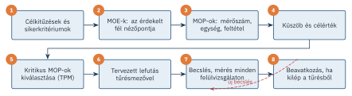
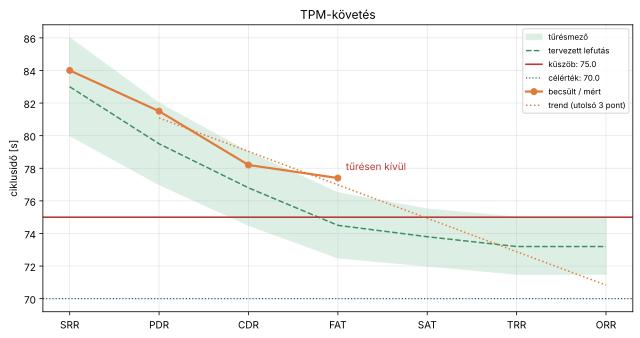

# A siker mérőszámai: MOE, MOP, TPM {#sec-moe-mop-tpm}

::: {.cel title="Eszközkártya"}
- **Mire való?** A rendszer sikerének mérőszámait (MOE) az érdekelt felek nézőpontjából megfogalmazni, teljesítménymérőszámokra (MOP) bontani, és a kritikus jellemzőket műszaki teljesítménymérőszámként (TPM) a fejlesztés során nyomon követni.
- **Tanulási eredmény:** az eszközlap feldolgozása után képes leszel az érdekelt felek céljaiból MOE-kat, azokból MOP-okat levezetni, kijelölni a követendő TPM-eket, és a TPM-et tervezett lefutással és tűrésmezővel követni.
- **V-lépés:** 2–3. Érdekelt felek és rendszerkövetelmények; a felülvizsgálatokon és a validációban tér vissza.
- **Bemenet:** szükséglet–cél–célkitűzés hierarchia, problémamegfogalmazás a siker kritériumaival, Kano- és QFD-eredmények.
- **Kimenet:** MOE–MOP hierarchia küszöbökkel és célértékekkel, TPM-lista, TPM-követési diagramok.
- **Időigény:** a hierarchia 2–4 óra csapatmunka; a TPM-követés felülvizsgálatonként fél óra.
- **Kézikönyv:** [6. fejezet](../../kezikonyv/fejezetek/06-kovetelmenyek.html), 6.4. szakasz; [5. fejezet](../../kezikonyv/fejezetek/05-erdekelt-felek.html), 5.6. szakasz.
- **Továbbolvasás:** [@nasa2016seh, 4.1. és 4.2. szakasz].
:::

## Mikor használd?

- **Amikor a célkitűzések megvannak**, de még nem világos, miből fogjuk látni, hogy a rendszer sikeres.
- **Amikor sok követelmény van**, és ki kell választani azt a néhányat, amelyet a fejlesztés során folyamatosan figyelni kell.
- **Minden felülvizsgálaton**, a TPM-ek becsült vagy mért értékének frissítésére.
- **A validáció tervezésekor:** a MOE-k a validáció mércéi.

## Lépések

{#fig-lepesek-moe width=100%}

1. **Gyűjtsd össze a célkitűzéseket és a sikerkritériumokat** a problémamegfogalmazásból és az érdekeltfél-elemzésből.
2. **Fogalmazd meg a MOE-kat** az érdekelt fél nézőpontjából. A MOE-k a megrendelő és a felhasználó szemszögéből mérik, sikeres-e a rendszer a tervezett működési környezetben [@roedler2005]. Kevés legyen belőlük (projektenként 3–6).
3. **Bontsd a MOE-kat MOP-okra.** A MOP-ok műszaki nyelven, a szállító nézőpontjából fogalmazódnak meg; egy MOE-hoz jellemzően több mennyiségi MOP tartozik [@roedler2005]. Minden MOP-nál add meg a mérőszámot, a mértékegységet és a feltételeket, amelyek mellett érvényes [@kossiakoff2011, 6. fejezet].
4. **Rögzítsd a küszöböt és a célértéket.** A küszöb a követelmény, amely alatt a rendszer nem fogadható el. A célérték a kívánatos szint.
5. **Válaszd ki a TPM-eket.** Azok a MOP-ok (vagy belőlük levezetett műszaki jellemzők) legyenek TPM-ek, amelyek kritikusak a sikerhez, és amelyeknél a teljesülés a fejlesztés során bizonytalan. Projektenként tipikusan 3–10 TPM-et követünk.
6. **Tervezd meg a TPM-ek lefutását tűrésmezővel.** Mérföldkövenként milyen becsült értéket vársz a terv érettségének függvényében, és mekkora eltérés még elfogadható?
7. **Becsüld vagy mérd a TPM-eket minden felülvizsgálaton**, és vesd össze a tervvel. A TPM-ek az aktuálisan elért érték vagy a legjobb becslés és az adott időpontra tervezett érték összevetésével igazolják az előrehaladást, és korán jelzik a hiányosságokat [@roedler2005].
8. **Avatkozz be, ha a TPM kilép a tűrésmezőből**, még akkor is, ha a végső küszöb elvileg teljesíthető. Ha új becslés születik, frissítsd a követést.

## Kidolgozott példa: a KoboCella mérőszámai

A KoboCella csapata két MOE-t fogalmazott meg az üzemigazgató és az operátorok elvárásaiból, és mindegyiket két-három MOP-ra bontotta ([-@tbl-kobo-moe]. táblázat).

| MOE | MOP | Mértékegység | Küszöb | Célérték | Feltételek | TPM? |
|:--|:--|:--|:-:|:-:|:--|:-:|
| MOE-1: a vevői igény teljesítése elfogadható minőségben | MOP-1: ciklusidő | s | ≤ 75 | ≤ 70 | referencia-motortípus, betanult operátor, folyamatos üzem | igen |
| | MOP-2: havi rendelkezésre állás | % | ≥ 95 | ≥ 97 | tervezett leállások nélkül | nem |
| | MOP-3: első átfutásra jó darabok aránya | % | ≥ 99,5 | ≥ 99,8 | nyomatékellenőrzéssel | igen |
| MOE-2: az operátorok ergonómiai terhelésének csökkentése | MOP-4: legnagyobb törzshajlítás egy ciklusban | fok | ≤ 20 | ≤ 15 | minden testmagassági csoportra | nem |
| | MOP-5: kézzel tartott szerszám tömege | kg | 0 | 0 | normál üzemben | nem |

: A KoboCella MOE–MOP hierarchiája. {#tbl-kobo-moe tbl-colwidths="[22,24,10,8,8,20,8]"}

A csapat két TPM-et választott: a ciklusidőt és az első átfutásra jó darabok arányát. Mindkettő kritikus, és mindkettő teljesülése a koncepció szakaszában bizonytalan volt. A ciklusidő követését a [-@fig-tpm-pelda]. ábra mutatja.

{#fig-tpm-pelda width=95%}

**Tanulságok:**

- **A tűrésmező a terv érettségéhez igazodik.** A koncepciós becslés (SRR) még 9 s-mal a küszöb fölött volt, és ez rendben volt, mert a terv még nem volt optimalizálva. A FAT-on viszont már a tűrésmezőn belül kellett volna lennie.
- **A TPM a beavatkozás időpontját mutatja meg.** A FAT-on mért 77,4 s alapján a csapat azonnal átírta a kobot pályáját, és a SAT-on 74,1 s lett. Írd be ezt az értéket a notebookba vagy a sablonba, és nézd meg, hogyan változik az állapot!
- **A MOP-4 és a MOP-5 nem TPM.** Teljesülésük a tervezés korai szakaszában eldől (állítható asztal, a csavarozót nem kézben tartják), ezért elég egyszer verifikálni.

## Sablon és notebook

- [moe_mop_tpm_sablon.xlsx](../sablonok/moe_mop_tpm_sablon.xlsx): MOE–MOP hierarchia küszöbbel, célértékkel, feltételekkel és TPM-jelöléssel; TPM-követési lap tervezett lefutással, tűrésmezővel, eltéréssel, automatikus állapotjelzéssel, a küszöbig maradt tartalékkal és diagrammal. A KoboCella példájával kitöltve.
- [tpm_kovetes.ipynb](../notebookok/tpm_kovetes.ipynb) · [Megnyitás Google Colabban](tpm_kovetes.ipynb): a TPM-követés ábrája (a [-@fig-tpm-pelda]. ábra így készült), az eltérés és a tartalék számítása, valamint az utolsó mérések alapján lineáris trend-előrejelzés.

## Előnyök és korlátok

| Előnyök | Korlátok |
|:--|:--|
| Az érdekelt fél nyelvén megfogalmazott siker mérhetővé válik | A MOE-k gyakran nehezen mérhetők közvetlenül; közelítő mérőszám kell |
| A TPM-követés korai figyelmeztetést ad, mielőtt a hiba drága lenne | A tervezett lefutás és a tűrésmező megadása tapasztalatot igényel |
| Kevés, jól megválasztott mérőszámra irányítja a figyelmet | Túl sok TPM esetén a követés adminisztrációvá válik |
| A felülvizsgálatok tényszerűbbé válnak | A becslések minősége a modellek és mérések minőségén múlik |

: A MOE–MOP–TPM megközelítés előnyei és korlátai. {tbl-colwidths="[50,50]"}

::: {.hiba}
- **MOE helyett MOP.** A „ciklusidő ≤ 75 s” MOP; a MOE az, amiért ez fontos (a vevői igény teljesítése). Ha csak MOP-ok vannak, a csapat elfelejti, mi a valódi cél.
- **Feltételek nélküli mérőszám.** A „ciklusidő” önmagában nem mérhető egyértelműen: melyik típusra, milyen operátorral, milyen üzemben?
- **Csak a végső küszöb figyelése.** Ha a TPM-et csak a küszöbhöz mérjük, a beavatkozás túl későn jön.
- **Mindent TPM-mé tenni.** A TPM-követés erőforrást igényel; csak a kritikus és bizonytalan jellemzőket kövesd.
:::

## Mintapromptok

::: {.prompt title="Mintaprompt: MOE–MOP hierarchia vázlata"}
```text
Projektünk célkitűzései és sikerkritériumai: [LISTA].
Érdekelt feleink és fő elvárásaik: [LISTA].
Feladat: javasolj 3–5 MOE-t az érdekelt felek nézőpontjából, és
mindegyikhez 2–3 MOP-ot. Minden MOP-nál add meg: mérőszám,
mértékegység, a mérés feltételei, és jelöld [TBR]-rel a küszöböt,
ha nem következik a megadott adatokból (ne találj ki számot).
Végül jelöld meg, mely MOP-okat javasolnád TPM-nek, és miért.
```
:::

::: {.prompt title="Mintaprompt: TPM-eltérés értékelése felülvizsgálat előtt"}
```text
TPM: [név, küszöb, célérték, irány].
Tervezett lefutás és tűrésmező mérföldkövenként: [TÁBLÁZAT].
Becsült vagy mért értékek eddig: [TÁBLÁZAT].
Feladat: értékeld az állapotot (tűrésen belül vagy kívül), számold
ki a küszöbig maradt tartalékot, és sorolj fel 3–5 kérdést, amelyet
a felülvizsgálaton fel kell tenni a lehetséges okokról és
beavatkozásokról. Ne javasolj konkrét műszaki megoldást.
```
:::

## Feladat

::: {.projekt title="3. projektlépés (harmadik rész): mérőszámok"}
Saját projektedhez fogalmazz meg legalább két MOE-t, mindegyikhez legalább két MOP-ot mértékegységgel, feltételekkel, küszöbbel és célértékkel. Válassz ki egy TPM-et, tervezd meg a lefutását a projekt mérföldköveire tűrésmezővel, és legalább két mérföldkőre adj (becsült) értéket. Rajzold meg a követési diagramot a sablonnal vagy a notebookkal, és írd le, mikor kellene beavatkozni.
:::
