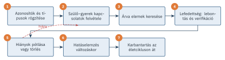
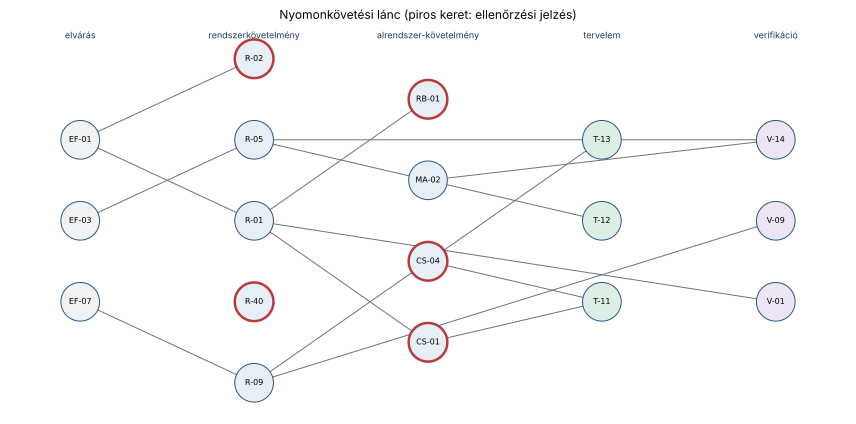

# Nyomonkövethetőség {#sec-nyomonkovetes}

::: {.cel title="Eszközkártya"}
- **Mire való?** A kétirányú nyomonkövethetőség rögzítése az érdekelt felek elvárásai, a rendszer- és alrendszer-követelmények, a tervelemek és a verifikációk között; az árva elemek, a lebontatlan és a verifikálatlan követelmények kiszűrése; változáskor a hatáselemzés.
- **Tanulási eredmény:** az eszközlap feldolgozása után képes leszel kétirányú nyomonkövetési mátrixot felépíteni, megtalálni benne az árva és a lefedetlen elemeket, és egy változás hatását a láncon végigkövetni.
- **V-lépés:** 3–5. Követelmények és lebontás; a V jobb ágán a verifikáció és a validáció.
- **Bemenet:** érdekeltfél-igények, követelménynyilvántartás, architektúra- és tervelemek, verifikációs terv.
- **Kimenet:** nyomonkövetési mátrix (RTM), ellenőrzési jelentés, lefedettségi mutatók, a lánc gráfja.
- **Időigény:** a felépítés követelményenként néhány perc; a karbantartás folyamatos.
- **Kézikönyv:** [6. fejezet](../../kezikonyv/fejezetek/06-kovetelmenyek.html), 6.5. szakasz.
- **Továbbolvasás:** [@nasa2016seh, 6.2. szakasz].
:::

## Mikor használd?

- **Már az első követelményeknél.** Utólag felépíteni a nyomonkövethetőséget sokszor drágább, mint a követelményeket megírni.
- **Lebontáskor és allokációkor:** minden felsőbb szintű követelmény lebomlott-e, és minden alacsonyabb szintűnek van-e forrása?
- **Változtatási kérelemnél:** mely követelményeket, terveket és teszteket érinti egy változás?
- **Felülvizsgálatok és átadás előtt:** minden követelménynek van-e verifikációja?

## Lépések

{#fig-lepesek-nyomonkovetes width=100%}

1. **Rögzítsd az elemeket azonosítóval és típussal.** Elvárás, rendszerkövetelmény, alrendszer-követelmény, tervelem, verifikáció. Az azonosító legyen egyedi és változatlan.
2. **Vedd fel a szülő–gyerek kapcsolatokat.** Egy sor egy kapcsolat: miből mi lett (például EF-01 → R-01, R-01 → CS-01, R-01 → V-01).
3. **Keresd meg az árva elemeket.** Minden követelménynek és tervelemnek legyen forrása. Ha egy követelménynek nincs szülője, és nem is dokumentált levezetett követelmény, akkor vagy a visszakövetés hibás, vagy a követelmény felesleges „aranyozás”, amelyet törölni kell.
4. **Ellenőrizd a lefedettséget.** Minden elvárás lebomlott-e követelményre? Minden követelmény lebomlott-e vagy megvalósult-e tervelemben? Minden követelménynek van-e verifikációja, saját magán vagy leszármazottain keresztül?
5. **Pótold a hiányokat, vagy törölj.** A hiány lehet valódi (kimaradt követelmény, verifikáció), vagy jelezheti, hogy egy elem felesleges.
6. **Hatáselemzés változáskor.** Egy változtatási kérelemnél kövesd a láncot felfelé (miért van ez?) és lefelé (mit érint?). Minden változás hatását fel kell mérni a költségre, az ütemtervre, az architektúrára, a tervre, az interfészekre, a ConOps-ra és a felsőbb és alsóbb szintű követelményekre is [@iso10007_2017].
7. **Tartsd karban az életcikluson át.** A nyomonkövethetőség csak akkor ér valamit, ha naprakész.

## Kidolgozott példa: a KoboCella nyomonkövetési lánca

A KoboCella rendszermérnöke a három fő érdekeltfél-elvárástól a verifikációig felvette a lánc egy részletét: 18 elemet és 16 kapcsolatot. A notebook ebből gráfot rajzolt, és lefuttatta az ellenőrzéseket ([-@fig-nyomonkovetes-pelda]. ábra).

{#fig-nyomonkovetes-pelda width=100%}

| Jelzés | Elem | Értelmezés és döntés |
|:--|:--|:--|
| árva (nincs forrás) | R-40 díszvilágítás | egy tervező ötlete, egyik érdekelt fél sem kérte: aranyozás, törölve |
| lebontatlan, verifikálatlan | R-02 rendelkezésre állás ≥ 95% | valódi hiány: a megbízhatósági allokáció még nem készült el (kézikönyv, 16. fejezet), felvéve a teendők közé |
| lebontatlan | RB-01 kobotciklus ≤ 9 s | a robotintegrátor tervelemét még nem rögzítették; a beszállítói specifikációhoz kell |
| verifikálatlan alrendszer-követelmény | CS-01, CS-04, RB-01 | a szülő R-01 és R-09 rendszerszintű tesztje (V-01, V-09) közvetve lefedi őket, de a beszállítói átvételhez külön alrendszer-teszt kell: V-21–V-23 felvéve |

: A KoboCella nyomonkövetési ellenőrzésének eredménye és a csapat döntései. {#tbl-kobo-rtm tbl-colwidths="[24,24,52]"}

**Tanulságok:**

- **Az ellenőrzés két irányba néz.** Az árva R-40 felesleges munkát, a lebontatlan R-02 hiányzó munkát jelzett.
- **A „közvetett” verifikáció tudatos döntés.** Az alrendszer-követelményeket elvben lefedheti a rendszerszintű teszt, de ha az alrendszert beszállító szállítja, az átvételhez külön verifikáció kell.
- **A verifikációs lefedettség mutató a felülvizsgálatok egyik bemenete lett.** A CDR-re a csapat 100%-os lefedettséget tűzött ki célul.

## Sablon és notebook

- [nyomonkovetes_sablon.xlsx](../sablonok/nyomonkovetes_sablon.xlsx): elemek azonosítóval, típussal és leírással; szülő–gyerek kapcsolatok külön lapon; automatikus ellenőrzés (szülők és gyerekek száma, árva, lebontatlan vagy verifikálatlan elem). A „Példa –” lapok a KoboCella láncának részletét tartalmazzák.
- [nyomonkovetes.ipynb](../notebookok/nyomonkovetes.ipynb) · [Megnyitás Google Colabban](nyomonkovetes.ipynb): irányított gráfot épít, elvégzi a teljes körű ellenőrzést, beleértve a leszármazottakon keresztüli verifikációs lefedettséget is, és szintenként felrajzolja a láncot (a [-@fig-nyomonkovetes-pelda]. ábra így készült).

## Előnyök és korlátok

| Előnyök | Korlátok |
|:--|:--|
| Láthatóvá teszi a hiányzó és a felesleges elemeket | Karbantartása munkaigényes; elavult mátrix félrevezet |
| Gyors, megalapozott hatáselemzés változáskor | Nagy rendszereknél táblázatban kezelhetetlenné válik; eszköz kell |
| Az átadáskor igazolható, hogy minden követelmény teljesült | A kapcsolat megléte nem garantálja, hogy a gyerek valóban teljesíti a szülőt |
| Alapja a felülvizsgálatok és az auditok tényszerű értékelésének | A „közvetett” lefedettséget mindig emberi döntésnek kell megerősítenie |

: A nyomonkövethetőség előnyei és korlátai. {tbl-colwidths="[50,50]"}

::: {.hiba}
- **Utólagos kitöltés.** Ha a mátrixot csak az átadás előtt töltik ki, a kapcsolatok a meglévő tervhez igazodnak, és nem a valós levezetést tükrözik.
- **Egyirányú visszakövetés.** Ha csak lefelé követünk, az aranyozás rejtve marad; ha csak felfelé, a kimaradt követelmények.
- **Formális kapcsolat, tartalmi lefedés nélkül.** A visszakövetést érdemes egy független személlyel is átnézetni abból a szempontból, hogy a gyerekkövetelmények valóban teljesen lefedik-e a szülő követelményt.
:::

## Mintapromptok

::: {.prompt title="Mintaprompt: szülő–gyerek lefedés ellenőrzése"}
```text
Szülő követelmény: [AZONOSÍTÓ, SZÖVEG].
Gyerek követelmények: [LISTA AZONOSÍTÓKKAL].
Feladat: vizsgáld meg, hogy a gyerekek együtt teljesen lefedik-e
a szülőt. Ha nem, írd le, a szülő mely része marad lefedetlen, és
milyen típusú gyerek követelmény hiányozhat (ne fogalmazd meg).
Ha egy gyerek túlmegy a szülőn, jelezd: lehet levezetett követelmény
(tervezési döntés) vagy aranyozás.
```
:::

::: {.prompt title="Mintaprompt: változás hatáselemzése"}
```text
Változtatási kérelem: [LEÍRÁS, érintett követelmény azonosítója].
Nyomonkövetési kapcsolatok (szülő → gyerek): [LISTA].
Feladat: sorold fel a láncon felfelé és lefelé érintett elemeket,
és mindegyiknél írd le egy mondatban, mit kell ellenőrizni (a cél
még teljesül-e; a terv, az interfész, a verifikáció módosul-e).
Rendezd az eredményt típus szerint.
```
:::

## Feladat

::: {.projekt title="3. projektlépés (negyedik rész): nyomonkövetési mátrix"}
Saját projektedben vedd fel a sablonba legalább 5 elvárást, 10 rendszerkövetelményt, 5 alrendszer-követelményt vagy tervelemet és 5 verifikációs tevékenységet a kapcsolataikkal. Futtasd le az ellenőrzést a sablonban és a notebookban. Minden jelzésnél döntsd el, valódi hiány, aranyozás vagy tudatosan elfogadott eset-e, és rögzítsd a döntést. Add meg a verifikációs lefedettséget százalékban.
:::
