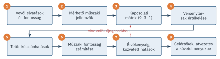
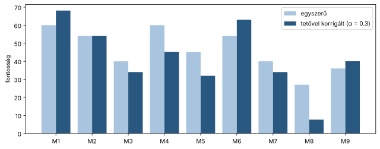

# Minőségfunkció-telepítés (QFD) {#sec-qfd}

::: {.cel title="Eszközkártya"}
- **Mire való?** A vevői elvárások lefordítása mérhető műszaki jellemzőkre; a műszaki jellemzők fontossági sorrendjének, ellentmondásainak és célértékeinek meghatározása a minőségházzal.
- **Tanulási eredmény:** az eszközlap feldolgozása után képes leszel felépíteni egy minőségházat, kiszámítani a műszaki jellemzők abszolút és relatív fontosságát, és a tető alapján azonosítani az ellentmondó jellemzőket.
- **V-lépés:** 2–3. Az érdekelt felek igényeitől a rendszerkövetelményekig; alkatrész-szinten a 4. lépés (architektúra) bemenete.
- **Bemenet:** vevői elvárások fontossággal (felmérés, interjúk, Kano-elemzés), versenytársak ismerete, a műszaki jellemzők jelöltjei.
- **Kimenet:** kitöltött minőségház, a műszaki jellemzők fontossága és rangsora, a tető ellentmondásai, célértékek, amelyek követelményekké válnak.
- **Időigény:** egy minőségház 6–10 elvárással és jellemzővel 4–8 óra csapatmunka.
- **Kézikönyv:** [7. fejezet](../../kezikonyv/fejezetek/07-qfd.html).
:::

## Mikor használd?

- **Ha sok, egymással versengő vevői elvárás van**, és el kell dönteni, mely műszaki jellemzőkre koncentráljon a fejlesztés.
- **Ha a marketing (vagy a megrendelő) és a mérnökök nem értik egymást.** A minőségház közös nyelvet és közös térképet ad.
- **Versenytársakhoz képest pozicionált terméknél**: hol vagyunk lemaradva, és hol tudunk kitűnni?
- **Ha a műszaki jellemzők ütköznek egymással**, és a kompromisszumokat tudatosan kell meghozni.

## Lépések

{#fig-lepesek-qfd width=100%}

1. **Vevői elvárások és fontosság.** 5–15 elvárás a vevő nyelvén, hierarchiába rendezve, fontossággal (1–5). A fontosság forrása lehetőleg felmérés; a Kano-elemzés ([-@sec-kano]. eszközlap) eredményét is vedd figyelembe [@matzler1998].
2. **Mérhető műszaki jellemzők.** Megoldásfüggetlen, mérhető jellemzők mértékegységgel és iránnyal (nagyobb vagy kisebb a jobb). Minden elvárást legalább egy jellemzőnek erősen kell befolyásolnia; ha nem, hiányzik egy jellemző.
3. **Kapcsolati mátrix.** Minden cellánál kérdezd meg: ha ezt a jellemzőt jelentősen javítjuk, mennyivel javul az elvárás? 9 erős, 3 közepes, 1 gyenge, üres = nincs. A vitás cellák indoklását rögzítsd.
4. **Versenytársak értékelése.** A vevők szemével 1–5 skálán: hogyan teljesít a saját (tervezett) megoldás és 1–2 versenytárs elvárásonként.
5. **Tető.** A műszaki jellemzők kölcsönhatása: ++ erősen támogatja, + támogatja, − gyengíti, −− erősen gyengíti egymást.
6. **Műszaki fontosság.** $F_j = \sum_i w_i r_{ij}$, a relatív fontosság ennek százalékos aránya (kézikönyv, 7.2. szakasz). A sablon és a notebook automatikusan számol.
7. **Érzékenység és közvetett hatások.** Mennyire stabil a rangsor, ha a súlyok és a kapcsolati erősségek kissé megváltoznak? Hogyan módosítja a tető a képet? Ha a rangsor bizonytalan, vagy a tető erős ellentmondást mutat, térj vissza a vitás cellákhoz (3. lépés).
8. **Célértékek és átvezetés.** A fontosság, a versenytársak és a tető alapján határozz meg célértékeket; ezek rendszerkövetelményekké válnak ([-@sec-kovetelmeny-iras]. eszközlap).

## Kidolgozott példa: a VárosiBringa minőségháza

A VárosiBringa csapatának minőségházát (6 elvárás, 9 műszaki jellemző) a kézikönyv 7.3. szakasza részletesen bemutatja; a sablon „Példa –” lapjai ugyanezt tartalmazzák. Itt a notebookkal végzett kiegészítő elemzést mutatjuk be.

**Érzékenységvizsgálat.** A notebook 2000-szer véletlenszerűen ±1-gyel módosította a fontossági súlyokat, és a nem nulla kapcsolatok mintegy 30%-át egy fokozattal (9 ↔ 3 ↔ 1) elmozdította. Az M1 (állomássűrűség) a futtatások mintegy 80%-ában, az M4 (hatótáv) mintegy 71%-ában a legfontosabb három jellemző között maradt. Az M2 (kerékpár/állomás, 55%) és az M6 (áthelyezés, 44%) helyezése viszont bizonytalan, a sorrendjük gyakran felcserélődött. A csapat következtetése: az első két jellemző prioritása megbízható, a középmezőnyben a költségek is döntsenek.

**Közvetett hatások.** A tetővel korrigált fontosság ([-@fig-qfd-kozvetett]. ábra) két dolgot mutatott. Az M8 (tömeg) fontossága jelentősen csökkent, mert erős ellentmondásban áll a fontos M4-gyel (hatótáv) és M5-tel (rásegítés). Ezért tömegből érdemes engedni, egy felső korlátig. Az M1 és az M6 kölcsönösen erősíti egymást, így a hálózat sűrítése és az áthelyezés együtt még fontosabbá vált.

{#fig-qfd-kozvetett width=90%}

::: {.kitekintes title="Hálózatalapú QFD"}
A tetővel korrigált fontosság egyszerű, szemléltető kiterjesztés. Abonyi és Czvetkó a QFD-t hálózati folyamproblémaként és hipergráfként is megfogalmazta: az előbbi optimalizálással választ ki intézkedéseket a vevői igények kielégítésére vagy a költségek minimalizálására, az utóbbi centralitási mérőszámokkal tárja fel a kapcsolati és a korrelációs mátrix közvetett kölcsönhatásait [@abonyi2022qfd]. A módszer részletei a kézikönyv 7.7. szakaszában találhatók.
:::

## Sablon és notebook

- [qfd_sablon.xlsx](../sablonok/qfd_sablon.xlsx): minőségház legfeljebb 10 elvárással és 10 műszaki jellemzővel; legördülő listák (9/3/1, irány); a versenytársakhoz mért lemaradás; automatikusan számolt abszolút és relatív fontosság, rangsor és diagram; külön tetőlap. A „Példa –” lapok a kézikönyv VárosiBringa-minőségházát tartalmazzák (a számok egyeznek a kézikönyv 7.3. szakaszával).
- [qfd_minoseghaz.ipynb](../notebookok/qfd_minoseghaz.ipynb) · [Megnyitás Google Colabban](qfd_minoseghaz.ipynb): a fontosság számítása, a kapcsolati mátrix hőtérképe, Monte-Carlo-érzékenységvizsgálat a rangsor stabilitására és a tetővel korrigált fontosság (a [-@fig-qfd-kozvetett]. ábra így készült).

## Előnyök és korlátok

| Előnyök | Korlátok |
|:--|:--|
| A vevő hangját rendszerezetten viszi át a műszaki jellemzőkbe | A kapcsolati erősségek és a súlyok szubjektív csapatbecslések |
| Közös térkép a marketing, a tervezés és a gyártás számára | Sok elvárásnál és jellemzőnél átláthatatlanná válik |
| A tető korán láthatóvá teszi a műszaki ellentmondásokat | Az egyszerű összegzés a közvetett hatásokat nem veszi figyelembe |
| Dokumentálja a döntések indokait | Nem veszi figyelembe a javítások költségét |

: A QFD előnyei és korlátai. {tbl-colwidths="[50,50]"}

::: {.hiba}
- **Megoldás a mennyezeten.** A „lítium-ion akkumulátor” nem műszaki jellemző, hanem megoldás; a jellemző a hatótáv (km) vagy az energiasűrűség (Wh/kg).
- **Csupa 9-es.** Ha minden kapcsolat erős, a mátrix nem különböztet. Kérdezd meg cellánként, valóban jelentősen javul-e az elvárás.
- **Elhanyagolt tető.** A tető negatív kapcsolatai a legértékesebb információk közé tartoznak: itt kell kompromisszumot vagy innovatív megoldást keresni ([-@sec-triz]. eszközlap).
- **A rangsor túlértelmezése.** Két jellemző, amelynek fontossága néhány ponttal tér el, gyakorlatilag azonos fontosságú. Az érzékenységvizsgálat megmutatja, mennyire stabil a sorrend.
:::

## Mintapromptok

::: {.prompt title="Mintaprompt: műszaki jellemzők javaslata"}
```text
Termék vagy szolgáltatás: [leírás].
Vevői elvárások fontossággal: [LISTA].
Feladat: javasolj 6–10 mérhető, megoldásfüggetlen műszaki jellemzőt.
Mindegyikhez: mértékegység, irány (nagyobb vagy kisebb a jobb), és
melyik elvárásokat befolyásolja erősen. Jelezd, ha egy elváráshoz
nem találsz erős kapcsolatú jellemzőt. Ne nevezz meg konkrét
technológiát vagy alkatrészt.
```
:::

::: {.prompt title="Mintaprompt: a kapcsolati mátrix kritikus átnézése"}
```text
Itt a minőségházunk kapcsolati mátrixa (sorok: elvárások, oszlopok:
műszaki jellemzők, értékek: 9/3/1/üres): [TÁBLÁZAT].
Játszd az ördög ügyvédjét: keress legfeljebb 6 cellát, ahol szerinted
a kapcsolat túl- vagy alulbecsült, és mindegyiknél írj egy mondatos
műszaki indoklást. Ne javasolj új értéket; a döntés a csapaté.
Végül jelezd, ha egy jellemző túl sok elvárással áll erős
kapcsolatban (lehet, hogy túl tág a meghatározása).
```
:::

## Feladat

::: {.projekt title="3. projektlépés (ötödik rész): minőségház"}
Készítsd el saját projekted minőségházát a sablonban 5–8 elvárással és 5–8 műszaki jellemzővel, a tetővel és legalább egy versenytárs értékelésével. Futtasd le a notebook érzékenységvizsgálatát. Írd le: melyik két jellemző a legfontosabb, mennyire stabil a sorrend, melyik a tető legerősebb ellentmondása, és hogyan oldanád fel. Határozz meg célértékeket, és vezesd át őket a követelménynyilvántartásba.
:::
