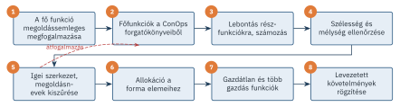
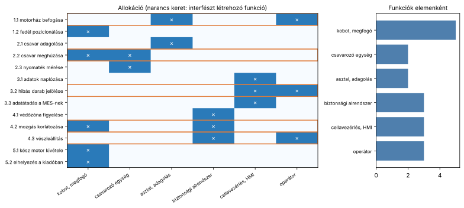

# Funkciófa és allokációs táblázat {#sec-funkciofa}

::: {.cel title="Eszközkártya"}
- **Mire való?** A rendszer funkcióinak megoldássemleges, hierarchikus lebontása, majd a funkciók hozzárendelése a forma elemeihez (alrendszer, komponens, ember, szoftver), a gazdátlan funkciók és a keletkező interfészek felismerése.
- **Tanulási eredmény:** az eszközlap feldolgozása után képes leszel megoldássemleges, igei szerkezetű funkciófát felírni, a funkciókat a forma elemeihez allokálni, és az allokációból a levezetett követelményeket azonosítani.
- **V-lépés:** 4. Architektúra (logikai dekompozíció); az alsóbb szinteken rekurzívan ismétlődik.
- **Bemenet:** rendszerkövetelmények, működési koncepció (ConOps) és forgatókönyvek, a koncepció leírása.
- **Kimenet:** számozott funkciófa, allokációs táblázat, a több gazdás funkciók listája (interfészjelöltek), levezetett követelmények.
- **Időigény:** a funkciófa első változata 2–3 óra csapatmunka; az allokáció koncepciónként 1 óra.
- **Kézikönyv:** [8. fejezet](../../kezikonyv/fejezetek/08-architektura.html), 8.1., 8.3. és 8.5. szakasz.
- **Továbbolvasás:** [@nasa2016seh, 4.3. szakasz].
:::

## Mikor használd?

- **A követelmények rögzítése után**, amikor az architektúra kialakítása kezdődik, és még nem világos, milyen részekből áll a rendszer.
- **Koncepciók összevetésekor:** ugyanaz a funkciófa több koncepcióhoz is allokálható, és az allokációs táblázatok összevetése megmutatja a koncepciók szerkezeti különbségeit.
- **A morfológiai doboz előtt:** a funkciófa második szintje adja a doboz sorait ([-@sec-morfologiai-doboz]. eszközlap).
- **Hibamód-elemzés előtt:** a funkcionális FMEA a funkciófa funkcióira épül.

## Lépések

{#fig-lepesek-funkciofa width=100%}

1. **Fogalmazd meg a fő funkciót megoldássemlegesen.** Crawley és szerzőtársai szerint a funkció folyamatból (ige) és operandusból (főnév) áll, és úgy kell megfogalmazni, hogy a megvalósítás módja ne szerepeljen benne [@crawley2016]. A „robotos csavarozás” helyett: „csavarkötés létrehozása előírt nyomatékkal”.
2. **Gyűjtsd össze a főfunkciókat** a működési koncepció forgatókönyveiből: mit kell a rendszernek tennie a teljes életciklusban, a normál üzemen túl a beállítás, a hibakezelés és a karbantartás során is.
3. **Bontsd le a főfunkciókat részfunkciókra**, és számozd őket (1, 1.1, 1.1.1). A számozás végigvihető a teljes elemzésen, és lehetővé teszi a nyomonkövetést [@dau2001, 5. fejezet].
4. **Ellenőrizd a szélességet és a mélységet.** Egy szinten jellemzően 2–9 elem legyen. Ha egy funkciónak egyetlen gyermeke van, a szint felesleges; ha tíznél több, valószínűleg hiányzik egy közbülső szint. A lebontást ott állítsd meg, ahol egy funkció már egyértelműen egy formai elemhez rendelhető.
5. **Ellenőrizd a megfogalmazást.** A DAU-jegyzet egyszerű szabálya: a funkciók legyenek igék; ha egy funkció főnévként jelenik meg, a funkciók megértésével van baj [@dau2001, 5. fejezet]. Szűrd ki a megoldásneveket is (robot, szoftver, alkalmazás).
6. **Allokáld a legalsó szintű funkciókat a forma elemeihez.** Az allokációs táblázat soraiban a funkciók, oszlopaiban a formai elemek állnak; egy „x” jelzi, hogy az elem részt vesz a funkcióban.
7. **Vizsgáld meg a gazdák számát.** A gazdátlan funkció elveszett funkció. A több gazdás funkció interfészt hoz létre, amelyet az N²-diagramon fel kell tüntetni ([-@sec-n2-dsm]. eszközlap).
8. **Rögzítsd a levezetett követelményeket.** A kiválasztott architektúrából olyan követelmények születnek, amelyek a bemeneti követelmények között nem szerepeltek; ezeket is allokálni kell (kézikönyv, [8. fejezet](../../kezikonyv/fejezetek/08-architektura.html)).

## Kidolgozott példa: a KoboCella funkciói

A KoboCella fő funkciója a „motor összeszerelése”. A csapat öt főfunkciót és tizenhárom részfunkciót azonosított (a kézikönyv 8.3. szakaszában látható funkciófa). A sablon ellenőrző oszlopai két hibát jeleztek az első változatban: a „kobotos csavarozás” megoldásnevet tartalmazott, a „MES-interfész” pedig főnévi szerkezetű volt. Az átfogalmazás után („csavarkötés létrehozása”, „adatátadás a MES-nek”) mindkét jelzés eltűnt.

Az allokációs táblázatot a notebook hőtérképként rajzolja ki ([-@fig-funkciofa-allokacio]. ábra). A tizenhárom részfunkcióból nyolcnak egy gazdája van, ötnek kettő. A modularitási mutató (az egy gazdás funkciók aránya) így 62%.

{#fig-funkciofa-allokacio width=100%}

**Tanulságok:**

- **A kobot integrált elem.** Öt funkcióban vesz részt, négy különböző főfunkcióból. Ez a kobotos koncepció lényegéből fakad, de a kobot programjának bármely módosítása után több funkciót kell újra ellenőrizni.
- **Az operátor is elem.** Három funkcióban vesz részt (befogás, hibás darab jelölése, vészleállítás). Az ember–gép interfészeket ugyanúgy meg kell tervezni, mint a műszakiakat.
- **Minden több gazdás funkció interfész.** A „mozgás korlátozása” a kobothoz és a biztonsági alrendszerhez is tartozik; ebből két levezetett követelmény született a jelzés és a sebességcsökkentés idejére (kézikönyv 8.5. szakasz).

::: {.kitekintes title="Funkcionális folyamatábra és IDEF0"}
A funkciófa a hierarchiát mutatja, a sorrendet nem. A funkciók lefutását a funkcionális folyamatábra (FFBD) írja le ÉS- és VAGY-pontokkal, a bemeneteket, vezérléseket, kimeneteket és mechanizmusokat pedig az IDEF0-ábra [@dau2001, 5-A. és 5-B. kiegészítés; @fips183]. Mindkettő ugyanarra a számozásra épül, mint a funkciófa. A KoboCella FFBD-jét és a ForgácsTech IDEF0-ábráját a kézikönyv 8.4. szakasza mutatja be.
:::

## Sablon és notebook

- [funkciofa_sablon.xlsx](../sablonok/funkciofa_sablon.xlsx): funkciófa azonosítóval és szülővel; automatikus szint, gyermekszám, szélesség-ellenőrzés, igei szerkezet és megoldásnevek jelzése (a „Szótár” lap listái bővíthetők); allokációs táblázat a gazdák számával, állapotjelzéssel és modularitási mutatóval. A KoboCella példájával kitöltve.
- [funkciofa.ipynb](../notebookok/funkciofa.ipynb) · [Megnyitás Google Colabban](funkciofa.ipynb): a funkciófa kirajzolása, a szélesség ellenőrzése, az allokáció hőtérképe (a [-@fig-funkciofa-allokacio]. ábra így készült) és a modularitási mutató.

## Előnyök és korlátok

| Előnyök | Korlátok |
|:--|:--|
| Egyszerű, mindenki számára érthető ábrázolás | Csak a hierarchiát mutatja, a sorrendet és az áramlásokat nem |
| A megoldássemleges megfogalmazás nyitva tartja a koncepciók körét | A lebontás nem egyértelmű: ugyanaz a rendszer többféleképpen bontható |
| Az allokáció azonnal megmutatja az elveszett funkciókat és az interfészeket | Az allokációs táblázat nem mondja meg, milyen az interfész |
| Alapot ad a követelménylebontáshoz, az FMEA-hoz és a morfológiai dobozhoz | Nagy rendszernél a fa és a táblázat gyorsan áttekinthetetlenné válik |

: A funkciófa és az allokációs táblázat előnyei és korlátai. {tbl-colwidths="[50,50]"}

::: {.hiba}
- **Megoldás a funkció helyén.** A „kobotos csavarozás” már eldönti a koncepciót. A funkció a „csavarkötés létrehozása”.
- **Alkatrészfa funkciófa helyett.** Ha a fa elemei főnevek („kobot”, „asztal”), az a termékszerkezet, nem a funkciók hierarchiája.
- **Csak a normál üzem.** A beállítás, a hibakezelés, a karbantartás és a vészhelyzet funkciói gyakran kimaradnak, pedig éppen ezekben a helyzetekben következik be a legtöbb baleset és hiba.
- **Az interfészek figyelmen kívül hagyása.** Minden több gazdás funkció interfészt jelent; ha nincs gazdája, az integrációnál derül ki a hiba.
:::

## Mintapromptok

::: {.prompt title="Mintaprompt: megoldássemleges funkciófa vázlata"}
```text
Rendszerünk célja és fő forgatókönyvei: [LEÍRÁS].
Feladat: javasolj kétszintű, számozott funkciófát (1, 1.1 …),
legfeljebb 7 főfunkcióval és főfunkciónként 2–5 részfunkcióval.
Minden funkció igei szerkezetű legyen (tárgy + igéből képzett
főnév), és NE tartalmazzon megoldást, eszközt vagy technológiát.
Vedd figyelembe a normál üzemen kívüli életciklus-szakaszokat is
(beállítás, hibakezelés, karbantartás, vészhelyzet).
A végén sorold fel, mely funkciókat érdemes a csapattal ellenőrizni.
```
:::

::: {.prompt title="Mintaprompt: az allokációs táblázat felülvizsgálata"}
```text
Allokációs táblázatunk (funkciók × formai elemek, „x” = részt vesz):
[TÁBLÁZAT].
Feladat: (1) sorold fel a gazdátlan és a több gazdás funkciókat;
(2) minden több gazdás funkcióhoz fogalmazd meg, milyen interfész
keletkezik a két elem között (mit adnak át egymásnak);
(3) jelöld meg azokat az elemeket, amelyek sok funkciót látnak el,
és írd le, milyen kockázatot jelent ez a változtatásoknál.
Ne javasolj új elemeket, csak elemezd a meglévőket.
```
:::

## Feladat

::: {.projekt title="4. projektlépés (első rész): funkciófa és allokáció"}
Saját projektedhez készíts legalább kétszintű, megoldássemleges funkciófát, és ellenőrizd a sablonnal (szélesség, igei szerkezet, megoldásnevek). Írj le egy koncepciót, és allokáld hozzá a legalsó szintű funkciókat. Sorold fel a több gazdás funkciókat, és mindegyikhez fogalmazz meg legalább egy levezetett követelményt.
:::
