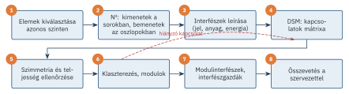
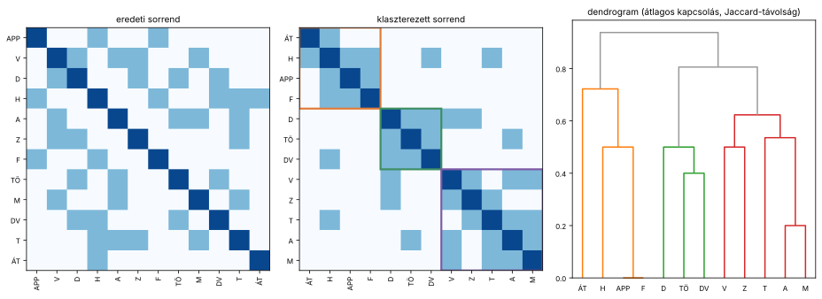

# N²-diagram és DSM {#sec-n2-dsm}

::: {.cel title="Eszközkártya"}
- **Mire való?** Az N²-diagram a rendszerelemek közötti interfészeket azonosítja és írja le; a tervezési struktúramátrix (DSM) a kapcsolatokat mátrixban, algoritmikusan elemezhető formában rögzíti, és klaszterezéssel modulokat javasol.
- **Tanulási eredmény:** az eszközlap feldolgozása után képes leszel N²-diagrammal azonosítani és leírni a rendszerelemek közötti interfészeket, és a DSM klaszterezésével modulokat javasolni.
- **V-lépés:** 4. Architektúra; az interfészek a 7. lépésben (integráció) térnek vissza.
- **Bemenet:** az architektúra elemei (alrendszerek, komponensek vagy funkciók), az allokációs táblázat, a működési koncepció.
- **Kimenet:** N²-diagram az interfészek leírásával, DSM, javasolt modulok, a modulinterfészek listája interfészgazdákkal.
- **Időigény:** egy 6–10 elemű N²-diagram 1–2 óra; egy 10–20 elemű DSM kitöltése 1–2 óra, az elemzés a notebookkal néhány perc.
- **Kézikönyv:** [8. fejezet](../../kezikonyv/fejezetek/08-architektura.html), 8.6. és 8.7. szakasz.
- **Továbbolvasás:** [@nasa2016seh, 6.3. szakasz].
:::

## Mikor használd?

- **Az allokáció után**, amikor már tudod, milyen elemekből áll a rendszer, és fel kell tárni, mit adnak át egymásnak.
- **Beszállítói vagy csapatfelosztás előtt:** a modulhatároknak a gyenge kapcsolatok mentén kell húzódniuk, és minden modulinterfésznek gazdát kell kapnia.
- **Integrációs terv készítésekor:** az interfészek listája az integrációs és interfész-verifikációs lépések alapja.
- **Változáskezelésnél:** a DSM megmutatja, egy elem módosítása mely más elemeket érinthet.

## Lépések

{#fig-lepesek-n2-dsm width=100%}

1. **Válaszd ki az elemeket egy szinten.** Ne keverd a szinteket (például egy alrendszert a másik alrendszer egyik csavarjával). Az N²-diagramnál 5–10, a DSM-nél akár több tucat elem is kezelhető.
2. **Készítsd el az N²-diagramot.** Az átlóba az elemek kerülnek. A szokásos olvasat szerint az i-edik sor j-edik cellája az i-edik elem kimenete, amely a j-edik bemenete lesz [@lano1977]. Az üres cella azt jelenti, hogy nincs közvetlen interfész.
3. **Írd le az interfészeket.** Minden cellába rövid leírás: mit adnak át (jel, adat, anyag, energia, erőhatás), és ha már ismert, milyen formában. Az interfész forrását, célját és az átadott anyag, energia vagy információ jellemzőit is dokumentálni kell [@kossiakoff2011, 3.5. szakasz].
4. **Készítsd el a DSM-et.** Ugyanazok az elemek a sorokban és az oszlopokban; 1 jelzi a kapcsolatot. Komponensalapú DSM-nél a kapcsolatok általában kölcsönösek, ezért a mátrix szimmetrikus [@eppinger2012].
5. **Ellenőrizd a szimmetriát és a teljességet.** A sablon jelzi az aszimmetrikus cellapárokat; nézd meg az elszigetelt (kapcsolat nélküli) elemeket is.
6. **Klaszterezz.** Rendezd át a sorokat és oszlopokat úgy, hogy a kapcsolatok az átló körüli blokkokba tömörüljenek [@browning2001]. A notebook hierarchikus klaszterezéssel javasol modulokat, és Newman modularitási mérőszámával értékeli őket [@newman2006].
7. **Rendelj interfészgazdát a modulinterfészekhez.** A blokkokon kívüli kapcsolatok a modulok közötti interfészek: ezekhez dokumentált interfészleírás és felelős kell.
8. **Vesd össze a szervezettel.** Ha a modulokat különböző csapatok vagy beszállítók fejlesztik, nézd meg, van-e a modulinterfészek két oldala között rendszeres kommunikáció [@sosa2004].

## Kidolgozott példa: KoboCella-interfészek és VárosiBringa-modulok

**N²-diagram.** A KoboCella hat alrendszerének N²-diagramja (a kézikönyv 8.6. szakaszában) 15 interfészt tartalmaz. A cellavezérlés sora és oszlopa a legsűrűbb (a központi vezérlésű architektúra jellemzője), az operátor sora és oszlopa pedig négy ember–gép interfészt mutat (alkatrész behelyezése, nyugtázás, belépés a zónába, hibakód és utasítás fogadása). A sablon „N2” lapja ezt a diagramot tartalmazza, és soronként, oszloponként megszámolja az interfészeket.

**DSM.** A VárosiBringa 12 elemének DSM-jében 19 kölcsönös kapcsolat van (a mátrix sűrűsége 29%). A notebook a szomszédsági mintázatok hasonlósága (Jaccard-távolság) alapján átlagos kapcsolású hierarchikus klaszterezést végzett ([-@fig-dsm-klaszter]. ábra).

{#fig-dsm-klaszter width=100%}

A dendrogram három modulnál vágva a platformot (áthelyezés-tervező, háttérrendszer, mobilalkalmazás, fizetési modul), a dokkolót (mechanika, töltőegység, vezérlő) és a kerékpárt (váz és hajtás, zár, telematika, akkumulátor, motor) adja. A 19 kapcsolatból 14 a modulokon belülre, 5 a modulok közé esik. A Newman-féle modularitás $Q = 0{,}374$, és a hálózattudományi mohó modularitás-maximalizálás ugyanezt a három modult találta meg, ami megerősíti a felosztást.

**Tanulságok:**

- **Az öt modulinterfész** (zár–dokkoló mechanika, váz–dokkoló mechanika, akkumulátor–töltőegység, telematika–háttérrendszer, dokkolóvezérlő–háttérrendszer) lett a három beszállítói csomag közötti interfészszerződések tárgya.
- **A háttérrendszer központi elem:** öt kapcsolata van, és két modulinterfészben is részt vesz. Változásait különösen gondosan kell kezelni.
- **Az algoritmus javaslat, nem döntés.** Két modulnál vágva a dokkoló és a kerékpár egy modulba kerül, négynél az áthelyezés-tervező önálló modullá válik. Hogy melyik felosztás a jobb, az a beszállítói piacon, a csapatokon és a várható változásokon is múlik.

## Sablon és notebook

- [n2_dsm_sablon.xlsx](../sablonok/n2_dsm_sablon.xlsx): N²-diagram legfeljebb 8 elemre, soronkénti és oszloponkénti interfészszámmal; DSM legfeljebb 20 elemre modul-hozzárendeléssel, fokszámmal, aszimmetria-ellenőrzéssel, a modulokon belüli és a modulok közötti kapcsolatok számával. A KoboCella N²-diagramjával és a VárosiBringa DSM-jével kitöltve.
- [n2_dsm.ipynb](../notebookok/n2_dsm.ipynb) · [Megnyitás Google Colabban](n2_dsm.ipynb): hierarchikus klaszterezés, dendrogram, eredeti és klaszterezett mátrix (a [-@fig-dsm-klaszter]. ábra így készült), Newman-modularitás és összevetés közösségkereső algoritmussal.

## Előnyök és korlátok

| Előnyök | Korlátok |
|:--|:--|
| Rendszerezetten feltárja az összes páros interfészt | Csak páros kapcsolatokat ábrázol; a több elemet érintő kölcsönhatások rejtve maradnak |
| Az üres cellák is beszédesek: ott nem kell interfészt tervezni | Nagy N esetén az N²-diagram cellái átláthatatlanná válnak |
| A DSM algoritmikusan elemezhető: klaszterezés, sorba rendezés, változásterjedés | A kapcsolat erőssége és típusa egyetlen számba sűrítve elvész |
| Alapot ad az integrációs tervhez és a beszállítói felosztáshoz | Az eredmény a kitöltés minőségén múlik; a hiányzó kapcsolatok nem derülnek ki maguktól |

: Az N²-diagram és a DSM előnyei és korlátai. {tbl-colwidths="[50,50]"}

::: {.hiba}
- **Keveredő szintek.** Ha az elemek között alrendszer és alkatrész is van, a mátrix félrevezető lesz.
- **Csak a „fő” interfészek.** A tápellátás, a földelés, a hűtés és a mechanikai rögzítés gyakran kimarad, pedig az integrációs hibák jelentős része itt jelentkezik.
- **Az ember kihagyása.** Az operátor, a karbantartó és a felhasználó is elem: az ember–gép interfészeket is fel kell tüntetni.
- **Gazdátlan interfész.** Ha egy interfész két oldalát két csapat fejleszti, és mindkettő azt hiszi, hogy a másik felel érte, az eltérés csak az integrációnál derül ki.
:::

## Mintapromptok

::: {.prompt title="Mintaprompt: N²-diagram vázlata"}
```text
Rendszerünk alrendszerei: [LISTA, rövid leírással].
Működési koncepciónk fő forgatókönyve: [LEÍRÁS].
Feladat: készíts N²-diagramot táblázatként (sor = kimenet, oszlop =
bemenet). Minden nem üres cellába írd, mit ad át az egyik
alrendszer a másiknak (jel, adat, anyag, energia, erőhatás).
Jelöld [?]-lel azokat a cellákat, amelyeknél nem biztos, hogy van
interfész, és fogalmazz meg hozzájuk egy-egy tisztázó kérdést.
Ne felejtsd ki az embert (operátor, karbantartó) mint elemet.
```
:::

::: {.prompt title="Mintaprompt: modulfelosztás értékelése"}
```text
DSM-ünk klaszterezése a következő modulokat adta: [MODULOK].
A modulok közötti kapcsolatok: [LISTA].
Szervezetünkben a fejlesztést ezek a csapatok/beszállítók végzik:
[LISTA].
Feladat: (1) értékeld, illeszkedik-e a modulfelosztás a szervezeti
felosztáshoz; (2) sorold fel azokat a modulinterfészeket, amelyek
két különböző csapat határán vannak; (3) mindegyikhez javasolj
interfészleírási tartalmat (mit kell rögzíteni). Ne javasolj új
modulfelosztást, csak a kockázatokat azonosítsd.
```
:::

## Feladat

::: {.projekt title="4. projektlépés (második rész): interfészek és modulok"}
Saját projekted kiválasztott koncepciójához készíts N²-diagramot legalább öt alrendszerrel, és írd le minden interfész tartalmát. Ha legalább nyolc elemed van, készíts DSM-et, futtasd le a notebookot, és értékeld a javasolt modulokat. Sorold fel a modulinterfészeket, és mindegyikhez nevezz meg felelőst.
:::
