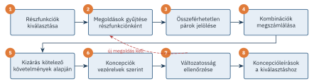
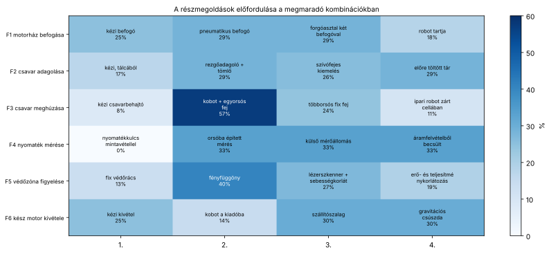

# Morfológiai doboz {#sec-morfologiai-doboz}

::: {.cel title="Eszközkártya"}
- **Mire való?** Koncepciók rendszerezett előállítása: részfunkciónként megoldásokat gyűjtünk, majd a részmegoldások kombinálásával teljes koncepciókat állítunk össze, kizárva az összeférhetetlen párokat.
- **Tanulási eredmény:** az eszközlap feldolgozása után képes leszel részfunkciónként megoldásváltozatokat gyűjteni, a morfológiai dobozból összeférhető koncepciókat összeállítani, és az összeférhetetlen kombinációkat kizárni.
- **V-lépés:** 4. Architektúra (koncepciógenerálás).
- **Bemenet:** funkciófa (a második szint részfunkciói), kötelező követelmények, ötletgyűjtések eredményei.
- **Kimenet:** kitöltött doboz, összeférhetetlenségi lista, 3–5 vezérelv szerint összeállított koncepció rövid leírással.
- **Időigény:** a doboz kitöltése 2–3 óra csapatmunka; a koncepciók összeállítása 1 óra.
- **Kézikönyv:** [9. fejezet](../../kezikonyv/fejezetek/09-kreativitas.html), 9.4. szakasz.
:::

## Mikor használd?

- **Amikor a funkciók már ismertek**, és több, egymástól lényegesen különböző koncepcióra van szükség.
- **Amikor a csapat egyetlen ötlethez ragaszkodik:** a doboz kényszeríti a többi lehetőség végiggondolását, és csökkenti a tervezési fixációt.
- **Ha a megoldás több, viszonylag független részfunkcióból áll össze**, és a részmegoldások szabadon kombinálhatók.

## Lépések

{#fig-lepesek-morfologiai-doboz width=100%}

1. **Válaszd ki a részfunkciókat.** Legyenek egymástól függetlenek, és együtt fedjék le a fő funkciót. A funkciófa második szintje jó kiindulópont; 4–8 részfunkció kezelhető.
2. **Gyűjts megoldásokat részfunkciónként.** Részfunkciónként 3–6 megoldás, lehetőleg eltérő működési elvekre építve (mechanikus, pneumatikus, elektronikus, kézi, informatikai). Ehhez bármelyik ötletgeneráló módszer használható ([-@sec-otletroham]. eszközlap).
3. **Jelöld az összeférhetetlen párokat** indoklással: melyik részmegoldás nem kombinálható melyikkel, és miért.
4. **Számold meg a kombinációkat.** Az elvi kombinációk száma a részfunkciónkénti megoldásszámok szorzata. Ez a módszer legnagyobb erénye és legnagyobb nehézsége: a szám gyorsan ezres nagyságrendű lesz [@zwicky1969].
5. **Zárd ki a kötelező követelményt nem teljesítő részmegoldásokat.**
6. **Állíts össze koncepciókat vezérelvek szerint.** Például „minden automatikus”, „minimális beruházás”, „maximális rugalmasság”. Minden koncepció egy útvonal a dobozon át.
7. **Ellenőrizd a változatosságot.** A koncepciók lényegesen különbözzenek: ha két koncepció csak egy-két részfunkcióban tér el, inkább egy koncepció két változata.
8. **Írj rövid leírást minden koncepcióról**, és add tovább a kiválasztásnak ([-@sec-pugh]. eszközlap).

## Kidolgozott példa: a KoboCella koncepciói

A KoboCella csapata hat részfunkcióhoz részfunkciónként négy megoldást gyűjtött (a doboz a kézikönyv 9.4. szakaszában látható). A sablon és a notebook számításai:

- **elvi kombinációk:** $4^6 = 4096$;
- **összeférhető kombinációk** a 17 tiltott pár (például a kézi csavarbehajtó és a fix védőrács, vagy a zárt robotcella és a kézi kivétel) kizárása után: 1344;
- **a kötelező követelmények után:** az R-09 szerint minden csavarkötés adatát át kell adni a MES-nek, ezért a mintavételes nyomatékkulcsos ellenőrzés kiesett; 1008 kombináció maradt.

A notebook azt is megmutatja, hogy az egyes részmegoldások a megmaradó kombinációk hányadában szerepelnek ([-@fig-morf-gyakorisag]. ábra). A kobot egyorsós fejjel a kombinációk 57%-ában fordul elő, mert szinte mindennel összeférhető; az ipari robot zárt cellában csak 11%-ában, mert sok más választást kizár.

{#fig-morf-gyakorisag width=100%}

A csapat négy vezérelv köré szervezett koncepciót állított össze: együttműködő cella, fix állomás, kézi plusz és zárt robotcella. A sablon „Koncepciók” lapja mind a négyet összeférhetőnek jelzi. A notebook változatossági javaslata ezután két további, a meglévőktől legtávolabbi kombinációt mutatott. Az egyik szerint a motorházat robot tartja, a csavart egyorsós kobot húzza meg, a védelem erő- és teljesítménykorlátozással működik. A csapat ezt nem vitte tovább, de a „robot tartja a munkadarabot” ötlet a befogó egyszerűsítésének lehetőségeként bekerült a részletes tervezés kérdései közé.

**Tanulságok:**

- **A „kézi plusz” csak a doboz miatt merült fel.** A kobotos megoldás iránti lelkesedésben senki nem gondolt rá, holott a beruházási költsége a legkisebb (kézikönyv 9.4. szakasz).
- **Az összeférhetetlenségek a legértékesebb tudást hordozzák.** Indoklásuk sokszor egy-egy rejtett követelményt tár fel (például: a zárt cellában nincs kézi beavatkozás).

## Sablon és notebook

- [morfologiai_doboz_sablon.xlsx](../sablonok/morfologiai_doboz_sablon.xlsx): doboz legfeljebb 10 részfunkcióra és 6 megoldásra, az elvi kombinációk számával; összeférhetetlenségi lista; legfeljebb 5 koncepció összeállítása sorszámokkal, a választott megoldások kiírásával és az összeférhetőség automatikus ellenőrzésével. A KoboCella példájával kitöltve.
- [morfologiai_doboz.ipynb](../notebookok/morfologiai_doboz.ipynb) · [Megnyitás Google Colabban](morfologiai_doboz.ipynb): a kombinációk teljes felsorolása és szűrése, a részmegoldások gyakorisága (a [-@fig-morf-gyakorisag]. ábra így készült), a koncepciók ellenőrzése és változatossági javaslat további koncepciókra.

## Előnyök és korlátok

| Előnyök | Korlátok |
|:--|:--|
| Rendszerezetten feltárja a megoldásteret, csökkenti a fixációt | A kombinációk száma gyorsan kezelhetetlenné válik |
| Szokatlan, de ígéretes kombinációkat is elénk tesz | Csak a felírt megoldásokat kombinálja; új működési elvet nem talál |
| Az összeférhetetlenségek rögzítése rejtett követelményeket tár fel | Feltételezi, hogy a részfunkciók függetlenek; erősen csatolt rendszereknél félrevezető |
| Jól dokumentálja, milyen lehetőségeket vizsgált meg a csapat | A koncepciók összeállítása továbbra is mérnöki ítéletet igényel |

: A morfológiai doboz előnyei és korlátai. {tbl-colwidths="[50,50]"}

::: {.hiba}
- **Változatok egy elv körül.** Ha minden megoldás ugyanarra a működési elvre épül (négyféle robot), a doboz nem bővíti a megoldásteret.
- **Nem független részfunkciók.** Ha két sor valójában ugyanaz (például „csavar meghúzása” és „nyomaték elérése”), a kombinációk jelentős része értelmetlen.
- **Az összes kombináció értékelése.** Ezres nagyságrendű kombinációt nem lehet egyenként értékelni; vezérelvek szerint kell néhány jellegzetest kiválasztani.
- **Indoklás nélküli tiltások.** Az összeférhetetlenség indoklása nélkül később nem lehet eldönteni, hogy egy tiltás még érvényes-e.
:::

## Mintapromptok

::: {.prompt title="Mintaprompt: megoldások gyűjtése egy részfunkcióhoz"}
```text
Részfunkció: [megoldássemleges megfogalmazás].
Környezet és korlátok: [LEÍRÁS].
Feladat: sorolj fel 6–8 megoldást, mindegyik más működési elvre
épüljön (mechanikus, pneumatikus/hidraulikus, elektromos,
elektronikus/informatikai, kézi, biológiai analógia). Minden
megoldáshoz írd le egy mondatban az elvet és a fő korlátot.
Ne értékeld és ne rangsorold a megoldásokat.
```
:::

::: {.prompt title="Mintaprompt: összeférhetetlen párok keresése"}
```text
Morfológiai dobozunk (részfunkciók és megoldások kóddal): [TÁBLÁZAT].
Feladat: keresd meg azokat a részmegoldás-párokat, amelyek fizikai,
biztonsági vagy logikai okból nem kombinálhatók. Minden párhoz adj
egymondatos indoklást. Jelöld külön azokat, amelyeknél nem vagy
biztos, és fogalmazz meg hozzájuk ellenőrző kérdést a csapatnak.
```
:::

## Feladat

::: {.projekt title="4. projektlépés (harmadik rész): koncepciók előállítása"}
Saját projektedhez készíts morfológiai dobozt legalább öt részfunkcióval és részfunkciónként legalább három, eltérő elvű megoldással. Jelöld az összeférhetetlen párokat, számold ki az elvi és a megmaradó kombinációk számát, és állíts össze legalább három koncepciót vezérelvvel és egybekezdéses leírással.
:::
