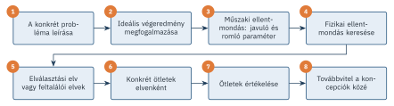

# TRIZ: ellentmondások és feltalálói elvek {#sec-triz}

::: {.cel title="Eszközkártya"}
- **Mire való?** Egy műszaki vagy fizikai ellentmondás megfogalmazása, és feloldási irányok keresése kompromisszum helyett: a 39 általános paraméter, a 40 feltalálói elv, az elválasztási elvek és az ideális végeredmény segítségével.
- **Tanulási eredmény:** az eszközlap feldolgozása után képes leszel egy műszaki problémát műszaki vagy fizikai ellentmondásként megfogalmazni, és az ellentmondásmátrix, a feltalálói elvek és az elválasztási elvek segítségével feloldási irányokat találni.
- **V-lépés:** 4. Architektúra (koncepciógenerálás); a részletes tervezésben is használható.
- **Bemenet:** a minőségház tetőmátrixának negatív kapcsolatai, egymással ütköző követelmények, egy koncepció ismert gyengesége.
- **Kimenet:** megfogalmazott ellentmondás, választott elvek, konkrét megoldási ötletek értékeléssel.
- **Időigény:** egy ellentmondás 1–2 óra csapatmunka.
- **Kézikönyv:** [9. fejezet](../../kezikonyv/fejezetek/09-kreativitas.html), 9.5. szakasz.
:::

## Mikor használd?

- **Ha a minőségház tetőmátrixában negatív kapcsolat van**, és a csapat kompromisszumra készül.
- **Ha két követelmény ütközik**, és egyik sem engedhető el (például a gyors kezelhetőség és a biztonság).
- **Ha egy koncepció egy pontban elakad**, és a szokásos megoldások nem működnek.
- **Nem való** olyan problémára, amelynek ismert, bevált megoldása van: ott elég a szakirodalom vagy a szabvány.

## Lépések

{#fig-lepesek-triz width=100%}

1. **Írd le a konkrét problémát** egy-két mondatban, a környezettel és a korlátokkal együtt.
2. **Fogalmazd meg az ideális végeredményt:** azt a képzeletbeli rendszert, amely a funkciót ellátja, de nincs költsége, káros hatása és helyigénye. Ez segít elszakadni a meglévő megoldásoktól.
3. **Fogalmazd meg a műszaki ellentmondást:** melyik paraméter javítása melyik romlását okozza. Fordítsd le a konkrét jellemzőket Altsuller 39 általános paraméterének nyelvére [@altshuller1984].
4. **Keress fizikai ellentmondást:** ugyanannak a jellemzőnek két ellentétes értéket kellene felvennie. Ez gyakran a műszaki ellentmondás mögött rejlő valódi probléma.
5. **Válassz megoldási irányt.** Fizikai ellentmondásnál elválasztási elvet: időben, térben, feltétel szerint vagy a rendszerszintek között. Műszaki ellentmondásnál feltalálói elveket; ezek kiválasztását az ellentmondásmátrix segíti, amely a szakirodalomban és a TRIZ-szoftverekben elérhető.
6. **Írj konkrét ötletet minden választott elvhez.** Az elv csak irány; a konkrét megoldáshoz szakmai tudás kell.
7. **Értékeld az ötleteket** megvalósíthatóság és várható hatás szerint.
8. **Vidd tovább a legjobbakat** a koncepciók közé vagy a koncepció módosításaként.

## Kidolgozott példa: a VárosiBringa zárja

A VárosiBringa minőségházában a kölcsönzés gyorsasága és a zár feltörési ellenállása között negatív kapcsolat volt. A sablon „Ellentmondás” lapján a csapat így dolgozott:

| Lépés | Tartalom |
|:--|:--|
| konkrét probléma | a zár legyen gyorsan nyitható kölcsönzéskor, de nehezen feltörhető |
| ideális végeredmény | a kerékpár magától a helyén marad, amíg a jogosult felhasználó el nem viszi |
| műszaki ellentmondás | javítandó: kezelhetőség (a használat egyszerűsége); romló: szilárdság |
| fizikai ellentmondás | a reteszelőelemnek merevnek és könnyen mozdulónak is kell lennie |
| elválasztási elv | feltétel szerint: jogosulatlan erőhatással szemben merev, jogosult kérésre könnyen mozdul |
| választott elvek | dinamika; megelőző beavatkozás; a mechanikus rendszer helyettesítése |

: A VárosiBringa zárjának TRIZ-elemzése. {tbl-colwidths="[28,72]"}

A három elvből három ötlet született: egy mechanikusan önzáró retesz, amelyet csak hitelesített jelre működő kis aktuátor old ki (dinamika); a kioldás előkészítése már a kölcsönzés jóváhagyásakor (megelőző beavatkozás); és a fizikai ellenállás egy részének kiváltása helymeghatározással és riasztással (a mechanikus rendszer helyettesítése). Az értékelés szerint az első a legjobban megvalósítható és a leghatásosabb; a harmadik az ideális végeredményhez áll a legközelebb, mert a zár szilárdságára kisebb terhelés jut, ha a lopott kerékpár helyzete mindig ismert.

**Tanulságok:**

- **A fizikai ellentmondás gyakran termékenyebb.** A műszaki ellentmondás („kezelhetőség kontra szilárdság”) kompromisszumra csábít; a fizikai ellentmondás („merev és mozgékony”) az elválasztás felé terel.
- **Az elvek nem adnak kész megoldást.** A „dinamika” elv önmagában semmit nem mond a zárról; a konkrét ötlethez zárszerkezeti tudás kellett.

## Sablon

- [triz_sablon.xlsx](../sablonok/triz_sablon.xlsx): a 39 általános paraméter magyarul és angolul; a 40 feltalálói elv rövid leírással és általános (ipari, hétköznapi) példával; ellentmondás-munkalap legördülő listákkal (paraméterek, elválasztási elvek, feltalálói elvek), az elvek leírásának automatikus kiírásával és az ötletek értékelésével. A VárosiBringa példájával kitöltve.

A TRIZ-hez nem tartozik notebook: a módszer lényege a csapat gondolkodása, amelyet a számítás nem helyettesít. A 40 elv konkrét alkalmazási ötleteinek előállításában a nyelvi modellek segíthetnek (lásd a mintapromptokat).

## Előnyök és korlátok

| Előnyök | Korlátok |
|:--|:--|
| Kompromisszum helyett az ellentmondás feloldására irányít | Elsajátítása időigényes; a módszertan összetett [@ilevbare2013] |
| Rendszerezett „ötletforrás”: a 40 elv tágítja a megoldásteret | Az elvek általánosak; a konkrét megoldáshoz szakmai tudás kell |
| Az ideális végeredmény segít elszakadni a meglévő megoldásoktól | Az ellentmondásmátrix javaslatai nem minden területen relevánsak |
| Jól kapcsolódik a QFD tetőmátrixához | A sikeres alkalmazás nagyban függ a szervezeti kultúrától [@ilevbare2013] |

: A TRIZ előnyei és korlátai. {tbl-colwidths="[50,50]"}

::: {.hiba}
- **Rosszul megfogalmazott ellentmondás.** Ha a javuló és a romló paraméter nem valódi ellentmondás (például mindkettő a költség két megjelenése), az elvek nem segítenek.
- **Az elvek mechanikus alkalmazása.** Az elvek iránymutatók, nem receptek: minden elvhez legalább egy konkrét, a problémára szabott ötletet kell írni.
- **Csak az ellentmondásmátrix.** A TRIZ eszköztára jóval bővebb; a fizikai ellentmondás és az elválasztási elvek sokszor gyorsabban vezetnek eredményre.
:::

## Mintapromptok

::: {.prompt title="Mintaprompt: az ellentmondás megfogalmazása"}
```text
Problémánk: [LEÍRÁS]. Két ütköző követelmény: [A] és [B].
Feladat: (1) fogalmazd meg műszaki ellentmondásként (melyik
paraméter javítása melyik romlását okozza), Altsuller 39 általános
paraméterének nevével; (2) fogalmazd meg fizikai ellentmondásként
(melyik jellemzőnek kellene két ellentétes értéket felvennie);
(3) írd le, melyik elválasztási elv (idő, tér, feltétel,
rendszerszint) tűnik alkalmazhatónak, és miért.
Ne adj még konkrét műszaki megoldást.
```
:::

::: {.prompt title="Mintaprompt: ötletek feltalálói elvekhez"}
```text
Ellentmondásunk: [megfogalmazás]. Környezet és korlátok: [LEÍRÁS].
Választott feltalálói elvek: [3–5 elv neve].
Feladat: minden elvhez írj két konkrét, a problémára szabott
megoldási ötletet egy-egy mondatban. Jelöld, ha egy ötlet új
kockázatot hoz be (biztonság, költség, karbantartás).
Ne rangsorold az ötleteket; az értékelést a csapat végzi.
```
:::

## Feladat

::: {.projekt title="4. projektlépés (negyedik rész): egy ellentmondás feloldása"}
Keress saját projektedben legalább egy ellentmondást (például a minőségház tetőmátrixából vagy két ütköző követelményből). Fogalmazd meg műszaki és fizikai ellentmondásként, válassz elválasztási elvet és legalább három feltalálói elvet, írj elvenként konkrét ötletet, és értékeld őket a sablonnal.
:::
