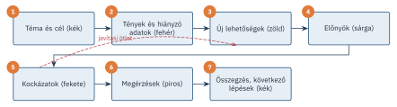

# Hat gondolkodó kalap {#sec-hat-kalap}

::: {.cel title="Eszközkártya"}
- **Mire való?** Egy megbeszélésen a gondolkodásmódok időbeli szétválasztása: a csoport egyszerre csak egyféle módon gondolkodik (tények, érzések, kockázatok, előnyök, új ötletek, folyamatirányítás), így csökkennek a parttalan viták.
- **Tanulási eredmény:** az eszközlap feldolgozása után képes leszel egy csoportos megbeszélést a hat gondolkodó kalap módszerével levezetni, és a kalapok sorrendjét a megbeszélés céljához igazítani.
- **V-lépés:** 4. Architektúra (koncepciók megvitatása); bármely csoportos értékelésnél és felülvizsgálatnál használható.
- **Bemenet:** egy megvitatandó javaslat, koncepció vagy probléma, a rendelkezésre álló tények.
- **Kimenet:** kalaponként rendezett jegyzet, megállapítások, döntés vagy javaslat, következő lépések felelőssel.
- **Időigény:** 45–60 perc.
- **Kézikönyv:** [9. fejezet](../../kezikonyv/fejezetek/09-kreativitas.html), 9.6. szakasz.
:::

## Mikor használd?

- **Ha egy megbeszélésen** az egyik résztvevő az előnyökről, a másik a hátrányokról beszél, és egyikük sem hallja a másikat.
- **Koncepciók értékelésekor**, a számszerű értékelés előtt vagy után, hogy a nem számszerűsíthető szempontok is felszínre kerüljenek.
- **Vegyes csoportban**, ahol a kritikus és a kreatív alkatú résztvevők egyaránt jelen vannak.

## Lépések

{#fig-lepesek-hat-kalap width=100%}

De Bono módszerében a hat kalap hat gondolkodásmódot jelöl [@debono1985]. A kék kalapot a moderátor viseli: ő nyit, vált és zár.

1. **Kék kalap: cél és menet.** A moderátor rögzíti a megbeszélés célját, a kalapok sorrendjét és az időkeretet.
2. **Fehér kalap: tények.** Mit tudunk biztosan? Milyen adat hiányzik, és honnan szerezzük meg? Vélemény nem hangozhat el.
3. **Zöld kalap: új lehetőségek.** Milyen más megoldások jöhetnek szóba? Kritika tilos.
4. **Sárga kalap: előnyök.** Miért lehetünk bizakodók? Az előnyöket indokolni kell.
5. **Fekete kalap: kockázatok.** Mi mehet félre? Itt kifejezetten elvárt a kritika, indoklással.
6. **Piros kalap: megérzések.** Mindenki egy-két szóban, indoklás nélkül elmondja a zsigeri reakcióját.
7. **Kék kalap: összegzés.** Mire jutottunk? Ki mit tesz, és mikorra? Ha a fekete kalap kockázataira a zöld kalap még nem adott választ, egy újabb zöld kör következhet.

A sorrend a céltól függ. Új ötlet kidolgozásánál a zöld kalap kerül előre; egy kész javaslat értékelésénél a fehér, a sárga és a fekete; ha erős érzelmek vannak jelen, a piros kalap már az elején segíthet „kibeszélni” őket.

## Kidolgozott példa: a ForgácsTech fokozatos MES-bevezetése

A költség–haszon elemzés után a ForgácsTech vezetősége a fokozatos bevezetés (M3) javaslatát hat kalappal vitatta meg (kézikönyv 10.7. szakasz). A sablon „Jegyzet” lapjának kivonata:

| Kalap | Fő gondolatok |
|:--|:--|
| fehér | a rendelések 38%-a késik, átlagosan 4 munkanapot; a keret 45 MFt; az M3 első üteme 14 MFt; nincs adatunk arról, mennyi idő alatt tanulják meg a műszakvezetők az ütemezőt |
| zöld | az első ütem egy bővíthető platformon induljon; kísérleti üzem két géppel egy hónapig; a sürgősségi átsorolás naplózása már az első ütemben |
| sárga | gyors megtérülés, kis kockázat; a csapat hamar látja az eredményt; a tapasztalatok a második ütem követelményeit pontosítják |
| fekete | két ütem két átállást jelent a műhelynek; ha a platform mégsem bővíthető, zsákutcába jutunk; az első ütem után elfogyhat a lendület |
| piros | bizakodó, óvatos, kíváncsi |

: A ForgácsTech hat kalapos megbeszélésének kivonata. {tbl-colwidths="[14,86]"}

A kék kalapos összegzés döntése: az M3-at javasolják, azzal a feltétellel, hogy a beszállítói ajánlatkérésben a teljes MES-funkcionalitásig való bővíthetőség igazolása kötelező feltétel legyen. A fekete kalap második kockázatára (zsákutca) ez a feltétel ad választ, az elsőre (két átállás) a kísérleti üzem.

**Tanulság:** a fekete kalap kockázatai közvetlenül a döntés feltételeivé váltak. Ha a kritika a megbeszélés elején, rendezetlenül hangzott volna el, a csapat valószínűleg vagy elveti a javaslatot, vagy figyelmen kívül hagyja a kockázatokat.

## Sablon

- [hat_kalap_sablon.xlsx](../sablonok/hat_kalap_sablon.xlsx): ülésterv a kalapok sorrendjével, vezérkérdéseivel és időkeretével (automatikus összidő); jegyzetlap kalaponként a bejegyzések számlálásával; összegzés megállapításokkal, döntésekkel és következő lépésekkel. A ForgácsTech példájával kitöltve.

A módszerhez nem tartozik notebook: a megbeszélés szerkezetét adja, számítást nem igényel.

## Előnyök és korlátok

| Előnyök | Korlátok |
|:--|:--|
| A kritika helyet kap, de nem fojtja el az ötleteket | Erős moderálás nélkül a résztvevők visszacsúsznak a vitába |
| Kiegyensúlyozza a kritikus és a kreatív alkatok részvételét | A kalapok „szerepjátéka” egyes csoportokban idegennek hathat |
| Gyors, nem igényel előkészületet vagy eszközt | Nem ad számszerű eredményt; döntést önmagában nem alapoz meg |
| A piros kalap legitim helyet ad az érzéseknek | A tények (fehér kalap) minősége a rendelkezésre álló adatokon múlik |

: A hat gondolkodó kalap előnyei és korlátai. {tbl-colwidths="[50,50]"}

::: {.hiba}
- **Kalapok mint személyiségek.** Nem az a cél, hogy „Péter mindig a fekete kalapos”, hanem hogy mindenki minden kalapot felvegyen.
- **Hiányzó kék kalap.** Moderátor nélkül a sorrend felbomlik, és a megbeszélés visszatér a szokásos vitához.
- **Túl hosszú fekete kör.** A kockázatok gyűjtése könnyen elhatalmasodik; az időkeretet tartani kell, és a kockázatokra a zöld kalap adjon választ.
:::

## Mintapromptok

::: {.prompt title="Mintaprompt: ülésterv"}
```text
Megvitatandó javaslat: [LEÍRÁS]. Résztvevők: [szerepek].
Rendelkezésre álló idő: [perc].
Feladat: készíts hat kalapos üléstervet: a kalapok sorrendje
a célhoz igazítva, kalaponként 2–3 vezérkérdés és időkeret.
Indokold röviden a sorrendet. Ne töltsd ki a kalapok tartalmát;
azt a csapat adja.
```
:::

::: {.prompt title="Mintaprompt: fekete és zöld kalap gyakorlásra"}
```text
Javaslat: [LEÍRÁS].
Feladat: (1) „fekete kalapban” sorolj fel 5 kockázatot vagy gyenge
pontot, mindegyikhez egy mondat indoklással; (2) „zöld kalapban”
minden kockázathoz adj egy lehetséges ellenintézkedést vagy
alternatívát. Jelöld, melyik kockázathoz kell több adat (fehér
kalap). A döntést ne hozd meg helyettünk.
```
:::

## Feladat

::: {.projekt title="4. projektlépés (ötödik rész, opcionális): koncepció megvitatása"}
Vitassátok meg a csapatban a legígéretesebb koncepciót hat kalappal, a sablon ülésterve szerint. Rögzítsétek kalaponként a gondolatokat, és az összegzésben írjátok le, mely fekete kalapos kockázatokra milyen választ adtatok.
:::
