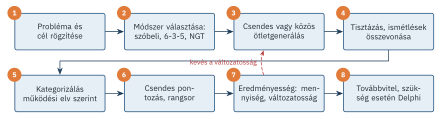
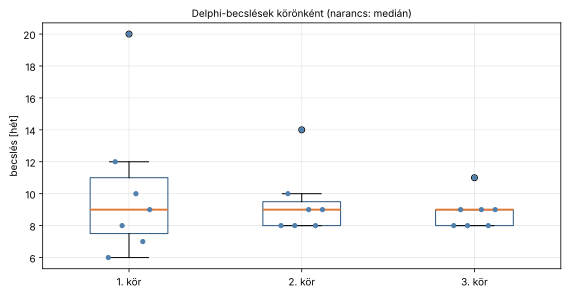

# Ötletroham, névleges csoporttechnika, Delphi {#sec-otletroham}

::: {.cel title="Eszközkártya"}
- **Mire való?** Egy csoport tudásának és ötleteinek összegyűjtése (ötletroham, 6-3-5 ötletírás), az ötletek csendes, kiegyensúlyozott rangsorolása (névleges csoporttechnika) és szakértői becslések több körben, névtelenül történő egyeztetése (Delphi).
- **Tanulási eredmény:** az eszközlap feldolgozása után képes leszel kiválasztani és levezetni a feladathoz illő csoportos ötletgeneráló módszert (ötletroham, 6-3-5, névleges csoporttechnika, Delphi), és az eredményt rangsorolni.
- **V-lépés:** 4. Architektúra (koncepciógenerálás); a problémafeltárásban, a kockázatelemzésben és a becslésekben is használható.
- **Bemenet:** világosan megfogalmazott kérdés vagy probléma, 5–12 résztvevő (Delphinél 5–15 szakértő).
- **Kimenet:** ötletlista kategóriákkal, rangsor, Delphinél konszenzusos becslés a szórással együtt.
- **Időigény:** ötletroham vagy 6-3-5 30–60 perc; névleges csoport 60–90 perc; Delphi 2–4 kör, körönként néhány nap.
- **Kézikönyv:** [9. fejezet](../../kezikonyv/fejezetek/09-kreativitas.html), 9.3. és 9.9. szakasz.
- **Továbbolvasás:** [@goldberg1994toolbox, 7.7., 7.9. és 7.10. szakasz].
:::

## Mikor használd?

| Módszer | Akkor válaszd, ha … |
|:--|:--|
| ötletroham | kis, összeszokott csapat dolgozik egy laza témán, és fontos egymás ötleteire építeni |
| 6-3-5 ötletírás | sok ötlet kell rövid idő alatt, és el akarod kerülni, hogy egy-két ember vigye a szót |
| névleges csoporttechnika | az ötletek mellett rangsor is kell, és a csoportban eltérő státuszú résztvevők vannak |
| Delphi | szakértői becslés vagy előrejelzés kell, a szakértők nem tudnak egyszerre jelen lenni, vagy erős személyiségek befolyásolnák egymást |

: Melyik csoportos módszert mikor válaszd? {tbl-colwidths="[25,75]"}

## Lépések

{#fig-lepesek-otletroham width=100%}

**Ötletroham.** Osborn négy szabálya: az ítélet felfüggesztése, a mennyiségre törekvés, a szokatlan ötletek bátorítása, az ötletek kombinálása és továbbfejlesztése [@osborn1953]. Az ülés három szakaszra tagolódik (generálás, tisztázás, értékelés), és fontos ülésekhez olyan moderátort érdemes felkérni, aki az eredményben nem érdekelt. A szóbeli csoportok termelékenysége a produkciós blokkolás miatt elmarad az egyénileg dolgozókétól [@diehl1987; @mullen1991], ezért érdemes az ülést néhány perc csendes, egyéni ötleteléssel kezdeni.

**6-3-5 ötletírás.** Hat résztvevő, mindenki három ötletet ír egy lapra öt perc alatt, majd továbbadja; hat kör után legfeljebb 108 ötlet születik [@rohrbach1969].

**Névleges csoporttechnika** [@delbecq1971]:

1. a moderátor ismerteti a kérdést és a szabályokat;
2. a résztvevők 5–15 percig csendben, egyénileg írnak;
3. a moderátor körbejárva egyesével gyűjti az ötleteket;
4. tisztázó kérdések vita nélkül, az ismétlődések összevonása;
5. csendes pontozás: mindenki a legfontosabb öt ötletnek ad 5, 4, 3, 2, 1 pontot;
6. összesítés: pontszám, szavazatszám, rangsor.

**Delphi** [@dalkey1963; @rowe1999]:

1. a kérdés pontos megfogalmazása (mértékegységgel, feltételekkel);
2. a szakértők kiválasztása (ne legyenek érdekeltek az eredményben);
3. első kör: egyéni, névtelen becslések indoklással;
4. a moderátor összesíti (medián, kvartilisek, az indoklások összefoglalása), és visszaküldi;
5. újabb körök, amíg a szórás egy előre rögzített határ alá nem csökken, vagy már nem változik.

**Eredményesség.** Shah és szerzőtársai szerint az ötletgenerálás eredményessége négy mérőszámmal jellemezhető: mennyiség, változatosság, újdonság és minőség [@shah2003]. A korai szakaszban a változatosság (hány különböző működési elv vagy kategória) a legfontosabb.

## Kidolgozott példa: a ForgácsTech késési okai és egy Delphi-becslés

**Névleges csoport.** A kézikönyv 9.3. szakaszában leírt ülésen tizenegy résztvevő csendes írással 41 ötletet gyűjtött, amelyből az összevonás után 27 különböző ok maradt. A sablon a csendes pontozás tizenkét legtöbb pontot kapott okát tartalmazza. Az első helyre a sürgős rendelések szóbeli előresorolása került (48 pont, mind a tizenegy résztvevő szavazott rá), a másodikra az alapanyag-beérkezés bizonytalansága (40 pont, tíz szavazat), a harmadikra a váratlan gépleállások (34 pont, kilenc szavazat). Az első két ok a korábbi, szóbeli ötletrohamon fel sem merült. A tizenkét okot a csapat nyolc kategóriába sorolta (ütemezés, beszerzés, gépállapot, információ, erőforrás, technológia, minőség, értékesítés).

**Delphi.** Hét szakértő becsülte meg, hány hét alatt vezethető be az ütemezőmodul a műhely minden gépén ([-@fig-delphi]. ábra). Az első körben a becslések 6 és 20 hét között szóródtak (medián 9, interkvartilis terjedelem 3,5 hét). A harmadik körre a terjedelem 1 hétre csökkent, a medián 9 héten maradt: a relatív terjedelem 39%-ról 11%-ra esett, ami a 20%-os konszenzushatár alatt van.

{#fig-delphi width=85%}

**Tanulságok:**

- **A szavazatszám is számít.** A harmadik helyezett okra kilencen szavaztak, a negyedikre (hosszú beállítási idők) csak öten, de ők magas pontszámmal. Az ilyen „szakértői kisebbségi” véleményt érdemes külön megvizsgálni.
- **A kilógó becslés információ.** A negyedik szakértő első becslése (20 hét) a többiekétől messze esett. Az indoklásából derült ki, hogy a gépek egy részén a vezérlő szoftverfrissítése is szükséges; ez a kockázat bekerült a projekttervbe.

## Sablon és notebook

- [otletroham_sablon.xlsx](../sablonok/otletroham_sablon.xlsx): 6-3-5 ötletírólap (hat lap, hat kör) az ötletek számlálásával; ötletlista kategóriával, ismétlés- és újdonságjelöléssel, a mennyiség, a változatosság és az újszerű ötletek arányának számításával; névleges csoport pontozólap legfeljebb 30 ötletre és 11 résztvevőre (pontszám, szavazatszám, rang); Delphi-lap négy körre (medián, kvartilisek, interkvartilis és relatív terjedelem). A ForgácsTech példájával kitöltve.
- [otletertekeles.ipynb](../notebookok/otletertekeles.ipynb) · [Megnyitás Google Colabban](otletertekeles.ipynb): a névleges csoport összesítése, a Delphi-konvergencia ábrája (a [-@fig-delphi]. ábra így készült) és az ötletlista mérőszámai.

## Előnyök és korlátok

| Előnyök | Korlátok |
|:--|:--|
| A csoport tudását és nézőpontjainak sokféleségét gyűjti össze | Az ötletroham csak javasol, nem dönt; eredménye a csoport konszenzusképességén múlik |
| A csendes változatok kiegyensúlyozzák a részvételt | A szóbeli csoportokban termelékenységi veszteség lép fel [@diehl1987] |
| A névleges csoport rangsort is ad | A rangsor a pontozási szabálytól függ; a szavazatszámot is nézni kell |
| A Delphi kiküszöböli a személyes ellentéteket és a domináns hangokat | A Delphi időigényes, a résztvevők összegyűjtése nehéz [@rowe1999] |

: A csoportos módszerek előnyei és korlátai. {tbl-colwidths="[50,50]"}

::: {.hiba}
- **Rosszul megfogalmazott kérdés.** A „hogyan javíthatnánk a termelést?” túl tág. A „milyen okok miatt késnek a rendelések?” már jól ötletelhető.
- **Kritika az ülés alatt.** Egyetlen lekicsinylő megjegyzés is visszafogja a további ötleteket.
- **A főnök beszél először.** A státusz befolyásolja a többieket; ezért kell a csendes, egyéni írással kezdeni.
- **Delphi indoklás nélkül.** A számok összesítése önmagában kevés; a szélsőséges becslések indoklása gyakran a legértékesebb információ.
:::

## Mintapromptok

::: {.prompt title="Mintaprompt: ötletlista kategorizálása"}
```text
Ötletgyűjtésünk eredménye: [LISTA].
Feladat: (1) vond össze a lényegében azonos ötleteket, és jelöld,
melyeket vontad össze; (2) sorold be az ötleteket legfeljebb 8,
működési elv vagy témakör szerinti kategóriába; (3) jelöld meg,
mely kategóriák maradtak üresen vagy alulreprezentáltan, és
fogalmazz meg hozzájuk egy-egy kérdést, amely új ötleteket
hívhat elő. Ne értékeld és ne rangsorold az ötleteket.
```
:::

::: {.prompt title="Mintaprompt: Delphi-kérdőív"}
```text
Becslendő mennyiség: [LEÍRÁS, mértékegység, feltételek].
Feladat: készíts Delphi-kérdőívet az első körhöz: a kérdés pontos
megfogalmazása, a becslés formája (legvalószínűbb, pesszimista,
optimista érték), az indoklás kérdései (milyen feltevésekre épül,
mi tenné nagyon rosszá vagy nagyon jóvá). Írd meg a második kör
visszajelzésének szerkezetét is (mit látnak a szakértők az első
kör eredményéből). Ne adj számszerű becslést.
```
:::

## Feladat

::: {.projekt title="4. projektlépés (hatodik rész): csoportos ötletgenerálás"}
Tarts saját projektedben egy 6-3-5 vagy névleges csoportos ülést a fő funkció megoldási lehetőségeiről vagy a probléma okairól. Rögzítsd az ötleteket a sablonban, kategorizáld őket, és számold ki a mennyiséget és a változatosságot. Ha a projektben van bizonytalan, szakértői becslést igénylő mennyiség (idő, költség, igény), végezz legalább kétkörös Delphi-becslést.
:::
