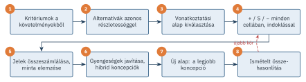

# Pugh-módszer {#sec-pugh}

::: {.cel title="Eszközkártya"}
- **Mire való?** Koncepciók gyors, minőségi összehasonlítása egy vonatkoztatási alaphoz (datum), kritériumonként jobb (+), azonos (S) vagy rosszabb (−) jelöléssel; a gyenge koncepciók kiszűrése és hibrid koncepciók létrehozása.
- **Tanulási eredmény:** az eszközlap feldolgozása után képes leszel Pugh-összehasonlítást végezni több körben, a koncepciók erősség–gyengeség mintázatából hibrid koncepciókat alkotni, és indokolni a továbbvitt koncepciókat.
- **V-lépés:** 4. Architektúra (koncepció-kiválasztás, korai szakasz).
- **Bemenet:** 3–8 koncepció azonos részletességű leírással, a kritériumok a követelményekből és az érdekelt felek elvárásaiból.
- **Kimenet:** kitöltött összehasonlító táblázat indoklásokkal, a koncepciók erősség–gyengeség mintázata, hibrid ötletek, a továbbvitt koncepciók listája.
- **Időigény:** körönként 1–2 óra csapatmunka.
- **Kézikönyv:** [10. fejezet](../../kezikonyv/fejezetek/10-dontes.html), 10.3. szakasz.
:::

## Mikor használd?

- **A koncepció szakasz elején**, amikor sok koncepció van, de kevés mennyiségi adat.
- **Mielőtt részletes, számszerű értékelésbe kezdenél:** a Pugh-módszer kiszűri a gyengéket, így a súlyozott értékelésre kevesebb alternatíva marad.
- **Ha a csapatban vita van:** a táblázat cellánként kényszeríti ki az indoklást.
- **Nem való** a végső döntéshez, ha a koncepciók között finom különbségek vannak, vagy ha a kritériumok fontossága nagyon eltérő.

## Lépések

{#fig-lepesek-pugh width=100%}

1. **Válaszd ki a kritériumokat** az alapkövetelményekből és a kívánt célból. Tipikus szempontok: fejlesztési és életciklus-költség, a követelmények teljesítése, műszaki kockázat (megbízhatóság, biztonság, minőség, emberi tényezők, környezeti hatás), költség- és ütemezési kockázat, a működtetés összetettsége.
2. **Írd le az alternatívákat** a lehető legtöbb szempontból azonos részletességgel.
3. **Válassz vonatkoztatási alapot:** a jelenlegi megoldást, egy versenytárs termékét vagy a legígéretesebbnek vélt koncepciót.
4. **Töltsd ki a táblázatot.** Minden cellában döntsd el: jobb (+), azonos (S) vagy rosszabb (−) az alternatíva az alapnál. Ha egy cellában nem lehet dönteni, több információ kell.
5. **Számold össze a jeleket.** Az előjeles összeg csak tájékoztató; a minta a fontosabb: hol erős és hol gyenge egy koncepció [@pugh1991].
6. **Javítsd a gyengeségeket.** Nézd meg, hogyan lehetne a legjobb koncepciók mínuszait más koncepciók pluszaival kiváltani. Így születnek a hibrid koncepciók.
7. **Válassz új alapot**, általában az első kör nyertesét.
8. **Ismételd meg az összehasonlítást.** Pugh szerint a módszer ereje az iteráció: a koncepciók köre körről körre szűkül és erősödik.

## Kidolgozott példa: a KoboCella koncepciói

**Első kör.** Vonatkoztatási alap: a jelenlegi kézi szerelés.

| Kritérium | A: együttműködő cella | B: fix állomás | C: kézi plusz | D: zárt robotcella |
|:--|:-:|:-:|:-:|:-:|
| ciklusidő-képesség | + | + | + | + |
| kötésminőség, utómunka | + | + | + | + |
| ergonómia | + | + | S | + |
| beruházási költség | − | − | S | − |
| átállási rugalmasság | S | − | S | − |
| helyigény | S | − | S | − |
| technikai kockázat | − | S | S | − |
| bővíthetőség 140 ezer db/évig | + | + | S | + |
| **pluszok / S / mínuszok** | **4 / 2 / 2** | **4 / 1 / 3** | **2 / 6 / 0** | **4 / 0 / 4** |
| **előjeles összeg** | **+2** | **+1** | **+2** | **0** |

: A KoboCella Pugh-összehasonlításának első köre. {tbl-colwidths="[32,17,17,17,17]"}

A „kézi plusz” ugyanannyi pontot kapott, mint az együttműködő cella, mínusz nélkül. A mintázat azonban beszédes: a C koncepció hat S-t kapott, vagyis alig különbözik a jelenlegi megoldástól. A részletesebb ergonómiai elemzés szerint a legnagyobb törzshajlítása 25° lenne, miközben az R-05 legfeljebb 20°-ot enged; a C így kötelező követelményt sértett, és kiesett. Elemeit (automatikus csavaradagolás, mérő csavarbehajtó) a csapat az A koncepció leromlott üzemmódjába építette be.

**Második kör.** Vonatkoztatási alap: az együttműködő cella (A). A fix állomás (B) három pluszt, két S-t és három mínuszt kapott (összeg: 0), a zárt robotcella (D) három pluszt, egy S-t és négy mínuszt (összeg: −1). Mindkettő ciklusidőben és minőségben jobb, rugalmasságban, helyigényben és beruházásban rosszabb az A-nál. A Pugh-módszer tehát nem adott egyértelmű nyertest, de pontosan megmutatta, min múlik a döntés: a ciklusidő és a rugalmasság közötti átváltáson. Ennek számszerűsítésére a csapat súlyozott értékelést végzett ([-@sec-trade-study]. eszközlap).

**Tanulságok:**

- **A sok S gyanús.** Egy koncepció, amely mindenben azonos az alappal, valószínűleg nem old meg semmit; vagy a leírása túl elnagyolt.
- **A kizáró szűrést ne hagyd ki.** A Pugh-táblázat nem jelzi, ha egy koncepció kötelező követelményt sért; ezt külön ellenőrizni kell.
- **A vesztes koncepció is adhat ötletet.** A „kézi plusz” elemei tartalékmegoldásként élnek tovább.

## Sablon

- [pugh_sablon.xlsx](../sablonok/pugh_sablon.xlsx): két kör, körönként legfeljebb 14 kritérium és 6 alternatíva; legördülő +, S, − jelölés; a pluszok, S-ek és mínuszok száma, az előjeles összeg, valamint opcionális súlyozással a súlyozott összeg; mező a hibrid ötleteknek. A KoboCella két körével kitöltve.

A Pugh-módszerhez nem tartozik notebook: a táblázat számítása egyszerű, a módszer értéke a cellánkénti vitában van. A súlyozott, számszerű folytatáshoz a [trade_study notebook](../notebookok/trade_study.ipynb) használható.

## Előnyök és korlátok

| Előnyök | Korlátok |
|:--|:--|
| Gyors, kevés adattal is működik | A számok csak tájékoztatók; nem szabad algebrailag végeredménynek tekinteni őket |
| Strukturálja a csapatmunkát, kikényszeríti az indoklást | A +/S/− skála elfedi a különbségek nagyságát |
| Kiszűri a gyenge koncepciókat, és hibrid ötleteket ad | Az eredmény függ a vonatkoztatási alap megválasztásától |
| Az iteráció a koncepciókat erősíti, nem csak szűri | Nem kezeli a kritériumok eltérő fontosságát (csak opcionális súlyozással) |

: A Pugh-módszer előnyei és korlátai. {tbl-colwidths="[50,50]"}

::: {.hiba}
- **Döntés az összegből.** A mátrix nem dönt helyettünk: az előjeles összeg csak tájékoztató [@pugh1991].
- **Eltérő részletességű koncepciók.** Egy kidolgozott és egy egysoros koncepció összehasonlításában az utóbbi indokolatlanul sok S-t kap.
- **Egyetlen kör.** Az első kör után a hibrid ötletek és az új alap nélkül a módszer ereje elvész.
- **Indoklás nélküli cellák.** Ha a + vagy − mögé nem kerül rövid indoklás, a táblázat utólag nem ellenőrizhető.
:::

## Mintapromptok

::: {.prompt title="Mintaprompt: kritériumlista a Pugh-táblázathoz"}
```text
Követelményeink: [LISTA]. Érdekelt feleink fő elvárásai: [LISTA].
Koncepcióink rövid leírása: [LISTA].
Feladat: javasolj 6–10 kritériumot a Pugh-összehasonlításhoz.
Minden kritérium legyen megkülönböztető (a koncepciók eltérhetnek
benne), és ne fedje át a másikat. Jelöld, melyik kritérium mögött
van kötelező követelmény: ezeket kizáró szűrésként külön is
ellenőrizni kell. Ne töltsd ki a táblázatot.
```
:::

::: {.prompt title="Mintaprompt: hibrid koncepció keresése"}
```text
Pugh-táblázatunk első köre (kritériumok, koncepciók, +/S/− jelek
indoklással): [TÁBLÁZAT].
Feladat: a két legerősebb koncepció minden mínuszához keresd meg,
melyik másik koncepció melyik eleme adhat rá választ, és javasolj
legfeljebb két hibrid koncepciót egybekezdéses leírással. Jelöld,
milyen új kockázatot hoz a hibridizálás.
```
:::

## Feladat

::: {.projekt title="5. projektlépés (első rész): Pugh-összehasonlítás"}
Saját projektedben hasonlítsd össze legalább három koncepciót a Pugh-módszerrel legalább hat kritérium szerint. Minden cellához írj egymondatos indoklást. Végezz kizáró szűrést a kötelező követelményekre, fogalmazz meg legalább egy hibrid ötletet, és végezz második kört új vonatkoztatási alappal.
:::
