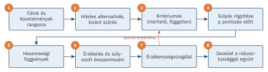
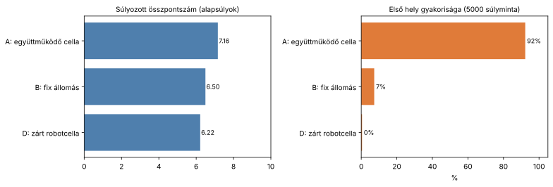

# Súlyozott értékelés (trade study) {#sec-trade-study}

::: {.cel title="Eszközkártya"}
- **Mire való?** Jól definiált alternatívák számszerű összehasonlítása több, különböző mértékegységű kritérium szerint: hasznossági függvényekkel közös skálára hozott pontszámok, súlyozott összpontszám, rangsor és érzékenységvizsgálat.
- **Tanulási eredmény:** az eszközlap feldolgozása után képes leszel súlyozott értékelést összeállítani mérhető kritériumokkal, előre rögzített súlyokkal és hasznossági függvényekkel, és érzékenységvizsgálattal ellenőrizni a rangsor robusztusságát.
- **V-lépés:** 4. Architektúra (koncepció-kiválasztás); a részletes tervezésben (gyártás vagy vásárlás, tesztmódszer, változtatási javaslatok) is használható.
- **Bemenet:** a kizáró szűrésen átjutott alternatívák, mérhető kritériumok, a döntéshozó által rögzített súlyok, becsült vagy mért teljesítményadatok.
- **Kimenet:** értékelő táblázat, rangsor, a rangsorfordulás küszöbei, Monte Carlo-alapú robusztussági mérőszám, javaslat.
- **Időigény:** a kritériumok és súlyok egyeztetése 1–2 óra; az adatgyűjtés a kritériumoktól függ; a számítás a sablonnal percek.
- **Kézikönyv:** [10. fejezet](../../kezikonyv/fejezetek/10-dontes.html), 10.2. és 10.4. szakasz.
- **Továbbolvasás:** [@goldberg1994toolbox, 2.1. szakasz; @nasa2016seh, 6.8. szakasz].
:::

## Mikor használd?

- **A Pugh-összehasonlítás után**, amikor 2–5 alternatíva maradt, és vannak mennyiségi adatok vagy megalapozott becslések.
- **Ha a döntést dokumentálni kell** egy felülvizsgálaton vagy a megrendelő felé.
- **Ha az alternatívák és a követelmények is jól definiáltak**, és a kritériumok legalább becsülhetők.

## Lépések

{#fig-lepesek-trade-study width=100%}

A lépések a többszempontú hasznosságelemzés bevett gyakorlatát követik [@edwards1994; @parnell2013].

1. **Rögzítsd és rangsorold a célokat és a követelményeket.**
2. **Gyűjtsd össze a hiteles alternatívákat**, és zárd ki azokat, amelyek kötelező követelményt nem teljesítenek. A kötelező kritériumot nem teljesítő alternatívát el kell vetni [@kepner1965].
3. **Határozd meg a kritériumokat.** Jelentsenek mindenkinek ugyanazt, legyenek mérhetők, tegyenek különbséget az alternatívák között, kötődjenek a követelményekhez, és legyenek egymástól függetlenek.
4. **Rögzítsd a súlyokat (összesen 100)** a pontozás előtt. A súlyokat a döntésre jogosult személy vagy csoport határozza meg, lehetőleg az értékelőktől függetlenül.
5. **Készíts hasznossági függvényt minden kritériumhoz.** A sablon lineáris függvényt használ: a „rossz” szint 0, a „jó” szint 10 pontot ér. Szóbeli kritériumnál (kockázat) operatív definíciókkal ellátott skálát használj; a legfontosabb, hogy minden fokozatnak mérhető, megismételhető tartalma legyen [@keeney2005attr].
6. **Értékeld az alternatívákat** kritériumonként, és számítsd ki a súlyozott összpontszámot.
7. **Végezz érzékenységvizsgálatot.** Ha az összpontszámok közelebb vannak egymáshoz, mint amit a becslések megbízhatósága megenged, gyűjts több adatot, vagy gondold újra a kritériumokat és a súlyokat. Minőségi pontszámoknál egy skálalépésnél kisebb különbséget óvatosan kell értelmezni.
8. **Tegyél javaslatot a robusztussággal együtt.** Szoros eredménynél minden közeli alternatívát be kell mutatni a döntéshozónak [@parnell2013].

## Kidolgozott példa: a KoboCella három koncepciója

A kizáró szűrés után három koncepció maradt (együttműködő cella, fix állomás, zárt robotcella). A súlyokat a gyártásvezető, a minőségügyi vezető és a munkavédelmi felelős rögzítette: ciklusidő 20, utómunka-arány 20, törzshajlítás 15, beruházás 15, átállási idő 15, technikai kockázat 15. A pontszámok és az összpontszámok a kézikönyv 10.4. szakaszának táblázatában láthatók: A 7,16, B 6,50, D 6,22.

Az egytényezős érzékenységvizsgálat (sablon: „Érzékenység” lap; notebook: küszöbtáblázat) szerint az A első helye akkor fordulna meg, ha

- az átállási idő (K5) súlya 7,6 alá csökkenne (ekkor a B nyer);
- a technikai kockázat (K6) súlya 30,5 fölé nőne (B nyer);
- a ciklusidő (K1) súlya 43,3 fölé nőne, vagy a törzshajlítás (K3) súlya 49,3 fölé (D nyer).

A Monte Carlo-szimuláció 5000 súlymintával az A-t az esetek 92%-ában, a B-t 7%-ában, a D-t kevesebb mint 1%-ában találta elsőnek ([-@fig-trade-montecarlo]. ábra).

{#fig-trade-montecarlo width=100%}

**Tanulságok:**

- **A döntés kulcsa egyetlen súly.** A rangsor az átállási idő súlyán múlik, ezért a csapat a gyártásvezetővel tisztázta a változatváltások várható gyakoriságát (két új motorváltozat két éven belül). Az érzékenységvizsgálat így nem a számítás „díszítése”, hanem a következő kérdés megtalálásának eszköze.
- **A robusztusság nem valószínűség.** A 92% nem azt jelenti, hogy az A 92%-os eséllyel a jó döntés, hanem azt, hogy a súlyok ésszerű bizonytalansága mellett a rangsor ennyire stabil.
- **A javaslat feltételes.** A javaslatban rögzítették: ha a termékpaletta nem bővül, a fix állomás versenyképes alternatíva lett volna.

## Sablon és notebook

- [trade_study_sablon.xlsx](../sablonok/trade_study_sablon.xlsx): kritériumok súllyal és lineáris hasznossági függvénnyel (vagy szóbeli skálával), súlyösszeg-ellenőrzés; értékelő lap legfeljebb 10 kritériumra és 6 alternatívára, 0–10 pontszámmal, súlyozott összpontszámmal, ranggal és az elsőtől való eltéréssel; érzékenységi lap a választott kritérium súlyának 0–50 közötti változtatásával és diagrammal. A KoboCella példájával kitöltve.
- [trade_study.ipynb](../notebookok/trade_study.ipynb) · [Megnyitás Google Colabban](trade_study.ipynb): pontszámok és összpontszámok, minden kritériumra a rangsorfordulás küszöbe, Monte Carlo-szimuláció Dirichlet-eloszlású súlyokkal (a [-@fig-trade-montecarlo]. ábra így készült).

## Előnyök és korlátok

| Előnyök | Korlátok |
|:--|:--|
| Átlátható, dokumentálható, a felülvizsgálaton bemutatható | Az eredmény nagyban függ az elemző szakértelmétől és az adatok minőségétől |
| Különböző mértékegységű kritériumokat egyesít | A rosszul megválasztott kritériumok, súlyok és hasznossági függvények torzítják az eredményt |
| A vizsgálat mélysége a feladat súlyához igazítható | Az alternatívákat előre kell meghatározni; a módszer nem állít elő újakat |
| Az érzékenységvizsgálat megmutatja, min múlik a döntés | A súlyok szubjektívek, és közvetlenül befolyásolják a következtetést |

: A súlyozott értékelés előnyei és korlátai [@parnell2013]. {tbl-colwidths="[50,50]"}

::: {.hiba}
- **A súlyok utólagos hangolása.** Ha a csapat addig változtatja a súlyokat, amíg a kívánt alternatíva nem nyer, az értékelés hamis tudományosságot kölcsönöz egy előre meghozott döntésnek. A súlyokat a pontozás előtt kell rögzíteni.
- **Átfedő kritériumok.** A „beruházás” és az „életciklus-költség”, vagy a „ciklusidő” és a „termelékenység” együtt ugyanazt kétszer jutalmazza.
- **Kötelező követelmény súlyként.** A kötelező követelmény nem súlyozandó, hanem kizáró feltétel.
- **Szoros eredmény egyetlen nyertessel.** Ha a különbség a becslések bizonytalanságán belül van, mindkét alternatívát be kell mutatni.
:::

## Mintapromptok

::: {.prompt title="Mintaprompt: kritériumok és hasznossági függvények"}
```text
Alternatíváink: [LISTA rövid leírással]. Követelményeink: [LISTA].
Feladat: javasolj 5–8 kritériumot a súlyozott értékeléshez.
Mindegyikhez add meg: mértékegység, irány (kisebb vagy nagyobb a
jobb), a 0 pontot érő „rossz” és a 10 pontot érő „jó” szint
javaslata indoklással (a követelményekhez kötve), és jelöld [TBR]-rel,
ha a szint nem következik a megadott adatokból. Ellenőrizd, hogy a
kritériumok ne fedjék át egymást. Súlyokat NE javasolj: azokat a
döntéshozó rögzíti.
```
:::

::: {.prompt title="Mintaprompt: az érzékenységvizsgálat értelmezése"}
```text
Súlyozott értékelésünk eredménye: [TÁBLÁZAT összpontszámokkal].
Az egytényezős érzékenységvizsgálat küszöbei: [TÁBLÁZAT].
Feladat: fogalmazd meg, mely súlyokon múlik a döntés, és milyen
kérdéseket kell feltenni a döntéshozónak ezekről a súlyokról.
Írj egy bekezdést a javaslatba a rangsor robusztusságáról.
Ne változtasd meg a súlyokat, és ne válassz alternatívát.
```
:::

## Feladat

::: {.projekt title="5. projektlépés (második rész): súlyozott értékelés"}
Saját projektedben értékeld a Pugh-összehasonlításon továbbjutott koncepciókat legalább öt kritérium szerint. A súlyokat egy csapattársad vagy a megrendelőd rögzítse a pontozás előtt. Végezz egytényezős érzékenységvizsgálatot a két legfontosabb kritériumra, futtasd le a notebook Monte Carlo-szimulációját, és írd le a javaslatot a robusztussággal együtt.
:::
