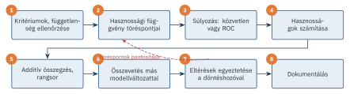
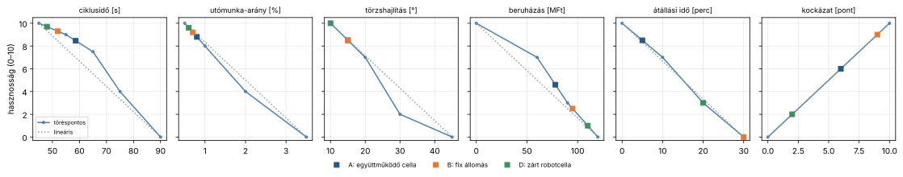

# Hasznossági függvények (MAUT) {#sec-maut}

::: {.cel title="Eszközkártya"}
- **Mire való?** A súlyozott értékelés továbbfejlesztése: nemlineáris (töréspontos) hasznossági függvények a döntéshozó tényleges preferenciáinak leírására, valamint többféle súlymeghatározás (közvetlen pontosztás, rangsor-súlypont) és ezek hatásának összevetése.
- **Tanulási eredmény:** az eszközlap feldolgozása után képes leszel töréspontos hasznossági függvényt felvenni a döntéshozóval, és ellenőrizni, hogy az additív aggregálás feltételei teljesülnek-e.
- **V-lépés:** 4. Architektúra (koncepció-kiválasztás, előzetes tervezés).
- **Bemenet:** az alternatívák értékei a kritériumok szerint, a döntéshozóval egyeztetett hasznossági töréspontok, a kritériumok sorrendje vagy súlya.
- **Kimenet:** hasznossági függvények, súlyok, összpontszámok négy modellváltozatban, a modellválasztás hatásának értékelése.
- **Időigény:** a töréspontok egyeztetése kritériumonként 10–20 perc a döntéshozóval; a számítás percek.
- **Kézikönyv:** [10. fejezet](../../kezikonyv/fejezetek/10-dontes.html), 10.4. szakasz.
:::

## Mikor használd?

- **Ha a lineáris hasznosság félrevezető:** például egy követelményhatár közelében egy kis javulás sokat ér, azon túl alig valamit.
- **Ha a döntéshozók a sorrendben könnyebben egyeznek meg, mint a pontos súlyokban:** ekkor a rangsor-súlypont (ROC) súlyozás segít.
- **Ha meg akarod mutatni, mennyire függ az eredmény a modellezési döntésektől** (függvényalak, súlyozási módszer).

## Lépések

{#fig-lepesek-maut width=100%}

1. **Ellenőrizd a kritériumok függetlenségét.** Az additív modell Keeney és Raiffa szerint csak bizonyos függetlenségi feltételek mellett érvényes [@keeney1976]. A gyakorlati próba: két kritérium közötti átváltási hajlandóságod nem függ-e a többi kritérium szintjétől?
2. **Határozd meg a töréspontokat.** Kérdezd meg a döntéshozót: „Mennyit ér (0–10 skálán), ha a ciklusidő 65 s?” A hasznossági függvény lehet monoton növekvő vagy csökkenő, konkáv vagy konvex, sőt nem monoton is (a nagyobb kijelző egy méretig jobb). Az átalakítást dokumentálni kell.
3. **Válassz súlyozási módszert.** Közvetlen pontosztás (összesen 100), vagy rangsor-súlypont: Edwards és Barron szerint $n$ kritérium esetén az $i$-edik helyen álló súlya $w_i = \frac{1}{n}\sum_{k=i}^{n} \frac{1}{k}$ [@edwards1994].
4. **Számítsd ki a hasznosságokat** töréspontok közötti lineáris interpolációval.
5. **Összegezd additívan**, és állítsd fel a rangsort.
6. **Vesd össze a modellváltozatokat:** lineáris vagy töréspontos hasznosság, közvetlen vagy ROC-súlyok.
7. **Egyeztesd az eltéréseket a döntéshozóval.** Ha a változatok eltérő nyertest adnak, a döntés egy modellezési döntésen múlik: ezt tisztázni kell, nem elrejteni.
8. **Dokumentáld** a függvényeket, a súlyokat és az összevetés eredményét.

## Kidolgozott példa: a KoboCella nemlineáris hasznossággal

A KoboCella súlyozott értékelését ([-@sec-trade-study]. eszközlap) a csapat töréspontos hasznossági függvényekkel is elvégezte ([-@fig-maut-fuggvenyek]. ábra). A ciklusidőnél a 75 s-os követelményhatár körül meredek a függvény (75 s: 4 pont, 65 s: 7,5 pont), a törzshajlításnál a 20°-os határ körül (20°: 7 pont, 30°: 2 pont), a beruházásnál pedig 60 MFt fölött gyorsan csökken a hasznosság (a költségkeret szorítása).

{#fig-maut-fuggvenyek width=100%}

A négy modellváltozat eredménye:

| Alternatíva | lineáris + közvetlen | töréspontos + közvetlen | lineáris + ROC | töréspontos + ROC |
|:--|--:|--:|--:|--:|
| A: együttműködő cella | **7,16** | **7,59** | 7,96 | **8,31** |
| B: fix állomás | 6,50 | 6,70 | 7,59 | 7,75 |
| D: zárt robotcella | 6,22 | 6,26 | **8,24** | 8,27 |

: A KoboCella összpontszámai négy modellváltozatban. A ROC-súlyok a következő sorrendből: utómunka, ciklusidő, törzshajlítás, átállási idő, beruházás, kockázat. {tbl-colwidths="[28,18,18,18,18]"}

**Tanulságok:**

- **A közvetlen súlyokkal az eredmény stabil.** A töréspontos függvények az A előnyét növelik (7,59 a B 6,70-ével szemben), mert az A a követelményhatárok körüli meredek szakaszokon kedvezően áll.
- **A ROC-súlyozás megfordíthatja a rangsort.** Hat kritériumnál a ROC-súlyok 0,408; 0,242; 0,158; 0,103; 0,061; 0,028, vagyis az első két kritérium együtt a súly 65%-át kapja. Ezekben (utómunka, ciklusidő) a zárt robotcella a legjobb, ezért lineáris hasznossággal a D nyer, töréspontossal az A csak hajszállal (8,31 a 8,27-tel szemben).
- **A súlyozási módszer itt nagyobb hatású, mint a függvényalak.** A csapat ezért a döntéshozókkal megerősíttette, hogy a közvetlen súlyok (20–20–15–15–15–15) tükrözik a szándékukat, és a ROC-változat eredményét a döntési jelentésben érzékenységi információként rögzítette.

## Sablon és notebook

- [maut_sablon.xlsx](../sablonok/maut_sablon.xlsx): kritériumonként legfeljebb öt töréspont; súlylap közvetlen és ROC-súlyokkal (a ROC-súlyok a rangsorból automatikusan); értékelő lap interpolált hasznosságokkal és mindkét súlyozással számított összpontszámmal és ranggal. A KoboCella példájával kitöltve.
- [maut.ipynb](../notebookok/maut.ipynb) · [Megnyitás Google Colabban](maut.ipynb): a hasznossági függvények ábrája (a [-@fig-maut-fuggvenyek]. ábra így készült), a ROC-súlyok és a négy modellváltozat összevetése.

## Előnyök és korlátok

| Előnyök | Korlátok |
|:--|:--|
| A döntéshozó tényleges preferenciáit írja le, nem egy feltételezett lineáris összefüggést | A töréspontok egyeztetése időigényes, és a kérdezés módja befolyásolja a válaszokat |
| A követelményhatárok körüli „értékugrások” megjeleníthetők | Az additív modell függetlenségi feltételei a gyakorlatban ritkán ellenőrzöttek |
| A ROC-súlyokhoz csak sorrend kell | A ROC az első helyeken álló kritériumokat erősen felülsúlyozza |
| A modellváltozatok összevetése a modellbizonytalanságot is láthatóvá teszi | Több változat több vitát is szülhet; a döntési jelentésnek ezt kezelnie kell |

: A MAUT előnyei és korlátai. {tbl-colwidths="[50,50]"}

::: {.hiba}
- **A töréspontokat az elemző találja ki.** A hasznosság a döntéshozó preferenciája; nélküle a függvény csak az elemző véleménye.
- **Nem monoton kritérium lineárisan.** Ha egy jellemzőnek optimuma van (például kijelzőméret, munkamagasság), a monoton függvény félrevezet.
- **Összeadás függő kritériumoknál.** Ha a gyors, de selejtes gyártás semmit sem ér, a ciklusidő és a minőség nem adható össze egyszerűen; ilyenkor kizáró feltétel vagy összetettebb aggregálás kell [@keeney1976].
:::

## Mintapromptok

::: {.prompt title="Mintaprompt: interjúkérdések a hasznossági függvényhez"}
```text
Kritérium: [név, mértékegység, a követelmény határa, a vizsgált
tartomány]. Döntéshozó: [szerep].
Feladat: írj 5–6 interjúkérdést, amelyekkel a döntéshozótól a
hasznossági függvény töréspontjai (0–10 skálán) felvehetők.
Kérdezz rá a követelményhatár környékére, a telítődésre és arra,
van-e optimum. A kérdések legyenek semlegesek, ne sugalljanak
választ. Ne adj meg számértéket.
```
:::

::: {.prompt title="Mintaprompt: a modellváltozatok eltérésének magyarázata"}
```text
Négy modellváltozatunk eredménye: [TÁBLÁZAT].
Súlyaink (közvetlen és ROC): [TÁBLÁZAT]. Hasznossági töréspontjaink:
[TÁBLÁZAT].
Feladat: magyarázd el közérthetően, miért ad eltérő nyertest a
[változat] és a [változat], és fogalmazz meg két kérdést a
döntéshozónak, amelyek a különbséget feloldhatják. Ne válassz
alternatívát.
```
:::

## Feladat

::: {.projekt title="5. projektlépés (harmadik rész, választható): hasznosságelemzés"}
Saját projektedben legalább két kritériumhoz vedd fel a hasznossági függvény töréspontjait egy érdekelt féllel készített rövid interjúval. Számítsd ki az összpontszámokat lineáris és töréspontos hasznossággal, közvetlen és ROC-súlyokkal, és írd le, hogyan befolyásolják a modellezési döntések az eredményt.
:::
