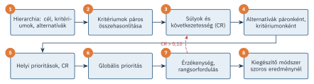
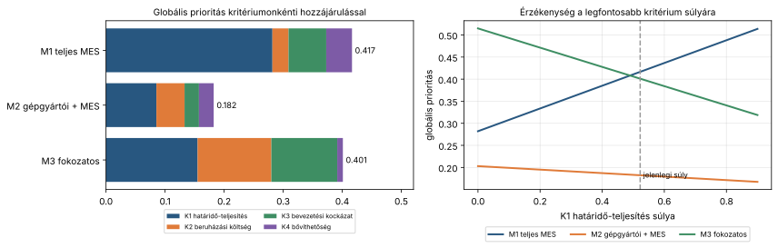

# AHP – páros összehasonlítás {#sec-ahp}

::: {.cel title="Eszközkártya"}
- **Mire való?** Kritériumsúlyok és alternatíva-prioritások meghatározása páros, szóbeli összehasonlításokból (Saaty analitikus hierarchia eljárása), az ítéletek következetességének ellenőrzésével.
- **Tanulási eredmény:** az eszközlap feldolgozása után képes leszel páros összehasonlítási mátrixot felállítani Saaty-skálán, kiszámítani a súlyokat és a konzisztenciaarányt, és a következetlen ítéleteket javítani.
- **V-lépés:** 4. Architektúra (koncepció-kiválasztás); bármely többszempontú döntésnél, ahol a kritériumok nehezen számszerűsíthetők.
- **Bemenet:** a döntési hierarchia (cél, kritériumok, alternatívák), a döntéshozók páros ítéletei a Saaty-skálán.
- **Kimenet:** kritériumsúlyok, helyi és globális prioritások, következetességi arány (CR), érzékenységi görbe.
- **Időigény:** $n$ elemű szinthez $n(n-1)/2$ összehasonlítás; négy kritérium és három alternatíva esetén összesen 18 ítélet, kb. 1 óra.
- **Kézikönyv:** [10. fejezet](../../kezikonyv/fejezetek/10-dontes.html), 10.5. szakasz.
- **Továbbolvasás:** [@goldberg1994toolbox, 2.1. szakasz].
:::

## Mikor használd?

- **Ha a kritériumok fontosságát nehéz számmal kifejezni**, de páronként könnyű megmondani, melyik fontosabb és mennyivel. Az AHP akkor hasznos, ha a szóbeli ítéletek (egyforma, mérsékelten, erősen fontosabb) könnyebben előállíthatók, mint a számszerű értékelések [@saaty1990].
- **Súlyok meghatározására** egy súlyozott értékeléshez ([-@sec-trade-study]. eszközlap), akkor is, ha az alternatívákat már mennyiségi adatokkal értékeled.
- **Kevés elem esetén:** szintenként legfeljebb 7–9 elem, különben az összehasonlítások száma kezelhetetlenné válik.

## Lépések

{#fig-lepesek-ahp width=100%}

1. **Építsd fel a hierarchiát:** a csúcson a cél, alatta a kritériumok (szükség esetén alkritériumok), legalul az alternatívák [@saaty1990].
2. **Hasonlítsd össze páronként a kritériumokat** a cél szempontjából, Saaty skáláján: 1 egyforma, 3 mérsékelten, 5 erősen, 7 nagyon erősen, 9 rendkívül fontosabb; 2, 4, 6, 8 köztes értékek. Ha a sor eleme a kevésbé fontos, a reciprok kerül a cellába.
3. **Számítsd ki a súlyokat és a következetességet.** A súlyok a legnagyobb sajátértékhez tartozó normált sajátvektor elemei; a sablon ennek jó közelítését, a sorok mértani közepét használja. A következetességi index $\mathrm{CI} = (\lambda_{\max} - n)/(n-1)$, a következetességi arány $\mathrm{CR} = \mathrm{CI}/\mathrm{RI}_n$; a 0,10 alatti érték elfogadható [@saaty1980; @saaty1990].
4. **Hasonlítsd össze páronként az alternatívákat** minden kritérium szempontjából. Figyelj az irányra: költségnél és kockázatnál a kisebb érték a jobb.
5. **Számítsd ki a helyi prioritásokat** és mátrixonként a CR-t.
6. **Számítsd ki a globális prioritást:** a kritériumsúlyokkal súlyozott helyi prioritások összegét.
7. **Végezz érzékenységvizsgálatot** a legfontosabb kritérium súlyára, és figyelj a rangsorfordulásra: egy új, az eddigiek egyikéhez hasonló alternatíva hozzáadása megfordíthatja a korábbi sorrendet [@belton1983].
8. **Szoros eredménynél egészítsd ki** más módszerrel (például költség–haszon elemzéssel, [-@sec-koltseg-haszon]. eszközlap).

## Kidolgozott példa: a ForgácsTech MES-koncepciója

A ForgácsTech vezetősége négy kritérium szerint hasonlította össze a három MES-koncepciót (M1 teljes MES egy beszállítótól, M2 gépgyártói adatgyűjtés és MES, M3 fokozatos bevezetés). A kritériumok páros összehasonlítása:

| | K1 határidő | K2 költség | K3 kockázat | K4 bővíthetőség | Súly |
|:--|:-:|:-:|:-:|:-:|:-:|
| K1 határidő-teljesítés javulása | 1 | 3 | 3 | 5 | 0,522 |
| K2 beruházási költség | 1/3 | 1 | 1 | 3 | 0,200 |
| K3 bevezetési kockázat | 1/3 | 1 | 1 | 3 | 0,200 |
| K4 bővíthetőség | 1/5 | 1/3 | 1/3 | 1 | 0,078 |

: A ForgácsTech kritériumainak páros összehasonlítása és sajátvektor-súlyai. {tbl-colwidths="[32,13,13,13,15,14]"}

A legnagyobb sajátérték 4,043, így $\mathrm{CI} = 0{,}014$ és $\mathrm{CR} = 0{,}016$. A sablon mértani közép módszere gyakorlatilag ugyanezt adja (0,520; 0,201; 0,201; 0,078). Az alternatívák mátrixainak CR-értéke 0,008 és 0,016 között van. A globális prioritások: M1 0,417, M2 0,182, M3 0,401 ([-@fig-ahp-prioritas]. ábra).

{#fig-ahp-prioritas width=100%}

**Tanulságok:**

- **Az AHP az M2-t egyértelműen kiszűrte**, az M1 és az M3 között azonban nem döntött: a különbség 4%, és a határidő-teljesítés súlyának 0,522-ről 0,48 alá csökkenése már megfordítaná a sorrendet.
- **A hozzájárulások megmutatják a különbség okát.** Az M1 pontjait a határidő-teljesítésből és a bővíthetőségből, az M3 pontjait a költségből és a kockázatból szerzi.
- **A legkövetkezetlenebb hármas** (a notebook szerint K1–K2–K4) ítéletei között is csak 1,8-szoros az eltérés, ami a CR alacsony értékével összhangban van. Magas CR esetén ezzel a hármassal kellene kezdeni a felülvizsgálatot.
- **A döntést a költség–haszon elemzés vitte tovább**, amely az M3-at preferálta (kézikönyv 10.7. szakasz).

## Sablon és notebook

- [ahp_sablon.xlsx](../sablonok/ahp_sablon.xlsx): kritériummátrix legfeljebb 6 kritériumra (felső háromszög bemenet, reciprok és átló automatikus), mértani közép alapú súlyok, $\lambda_{\max}$-becslés, CI, RI, CR és állapotjelzés; alternatívamátrixok kritériumonként legfeljebb 5 alternatívára; eredménylap globális prioritásokkal, ranggal és diagrammal. A ForgácsTech példájával kitöltve.
- [ahp.ipynb](../notebookok/ahp.ipynb) · [Megnyitás Google Colabban](ahp.ipynb): sajátvektor- és mértani közép súlyok, CR, a legkövetkezetlenebb hármas, globális prioritások hozzájárulásokkal és érzékenységi görbe (a [-@fig-ahp-prioritas]. ábra így készült).

## Előnyök és korlátok

| Előnyök | Korlátok |
|:--|:--|
| Szóbeli ítéletekből is súlyokat ad | Az összehasonlítások száma az elemszámmal négyzetesen nő |
| Méri az ítéletek következetességét | Rangsorfordulás léphet fel új alternatíva hozzáadásakor [@belton1983] |
| A hierarchia átláthatóvá teszi a döntés szerkezetét | A Saaty-skála számértékei (1–9) önkényesek; az arányskála értelmezése vitatott |
| Csoportos döntésnél az egyéni ítéletek mértani közepe összesíthető | Szoros eredménynél nem dönt; kiegészítő módszer kell |

: Az AHP előnyei és korlátai. {tbl-colwidths="[50,50]"}

::: {.hiba}
- **Rossz irány.** Költségnél és kockázatnál a kisebb érték a jobb: az olcsóbb alternatíva a „fontosabb” a költség szempontjából.
- **A CR figyelmen kívül hagyása.** A 0,10 fölötti CR azt jelzi, hogy az ítéletek ellentmondanak egymásnak; ilyenkor a súlyok nem megbízhatók.
- **Túl sok elem egy szinten.** Kilenc elemnél már 36 összehasonlítás kell szintenként; bontsd alkritériumokra.
- **Alternatívák utólagos hozzáadása.** A rangsorfordulás miatt az alternatívák listáját az elemzés előtt véglegesíteni kell.
:::

## Mintapromptok

::: {.prompt title="Mintaprompt: AHP-hierarchia és kérdések"}
```text
Döntési helyzetünk: [LEÍRÁS]. Alternatíváink: [LISTA].
Feladat: javasolj AHP-hierarchiát (cél, 3–6 kritérium, szükség
esetén alkritériumok), és írd meg a kritériumok páros
összehasonlításának kérdéseit a döntéshozók számára, közérthetően
(„A két szempont közül melyik fontosabb a cél szempontjából, és
mennyivel?”). Ne adj meg ítéleteket vagy súlyokat.
```
:::

::: {.prompt title="Mintaprompt: következetlenség feltárása"}
```text
Páros összehasonlítási mátrixunk (Saaty-skála): [MÁTRIX].
A CR értéke: [ÉRTÉK].
Feladat: keresd meg azokat a hármasokat (i, j, k), ahol az
a_ij · a_jk szorzat a legjobban eltér a_ik-tól, és fogalmazz meg
kérdéseket a döntéshozónak ezeknek az ítéleteknek a
felülvizsgálatához. Ne javíts önkényesen a mátrixon.
```
:::

## Feladat

::: {.projekt title="5. projektlépés (negyedik rész, választható): AHP"}
Saját projektedben határozd meg a kritériumok súlyát AHP-val legalább két csapattárs vagy érdekelt fél ítéletei alapján (az egyéni ítéleteket mértani középpel összesítsd). Ellenőrizd a CR-t, és vesd össze az AHP-súlyokat a közvetlen pontosztással kapott súlyokkal.
:::
