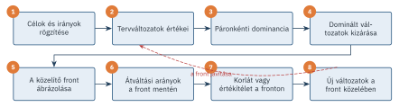
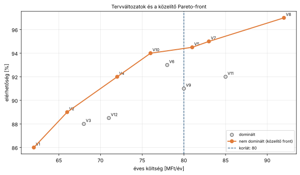

# Dominancia és Pareto-front {#sec-pareto-front}

::: {.cel title="Eszközkártya"}
- **Mire való?** Tervváltozatok szűkítése súlyok nélkül: a dominált változatok kiszűrése, a nem dominált változatok (a közelítő Pareto-front) azonosítása, és a front mentén az átváltási arányok (egységnyi javulás ára) láthatóvá tétele.
- **Tanulási eredmény:** az eszközlap feldolgozása után képes leszel dominanciamátrixszal kiszűrni a dominált tervváltozatokat, ábrázolni a közelítő Pareto-frontot, és értelmezni a front menti kompromisszumokat.
- **V-lépés:** 4. Architektúra (koncepció-kiválasztás, előzetes tervezés).
- **Bemenet:** tervváltozatok két vagy több mennyiségi cél szerinti értékei (modellből, szimulációból vagy becslésből), a célok iránya, esetleges korlátok.
- **Kimenet:** dominanciamátrix, nem dominált változatok, a front ábrája, átváltási arányok, a korláton belül legjobb változat.
- **Időigény:** a számítás percek; az időt a változatok értékeinek előállítása igényli.
- **Kézikönyv:** [10. fejezet](../../kezikonyv/fejezetek/10-dontes.html), 10.6. szakasz.
:::

## Mikor használd?

- **Ha sok tervváltozat van** (paraméterkombinációk, méretezési változatok), és két-három mennyiségi cél között kell átváltani.
- **Ha nincs megállapodás a súlyokról:** a dominanciavizsgálat súlyok nélkül is szűkít, és a döntéshozók elé már csak a valódi kompromisszumok kerülnek.
- **Súlyozott értékelés előtt:** a dominált változatokat felesleges részletesen értékelni.

## Lépések

{#fig-lepesek-pareto-front width=100%}

1. **Rögzítsd a célokat és irányukat** (minimalizálandó vagy maximalizálandó).
2. **Állítsd elő a változatok értékeit** azonos feltételek mellett (ugyanaz a modell, ugyanaz az időtáv).
3. **Vizsgáld meg páronként a dominanciát.** Egy változat akkor dominál egy másikat, ha minden cél szerint legalább olyan jó, és legalább egy szerint jobb.
4. **Zárd ki a dominált változatokat.** A dominanciamátrix oszlopösszege megmutatja, hány változat dominál egy adott változatot; a nem dominált változatok oszlopösszege 0.
5. **Ábrázold a közelítő frontot.** Fontos finomság: minden Pareto-optimális pont nem dominált, de nem minden nem dominált pont Pareto-optimális: néhány vizsgált változat között a nem dominált változatok csak közelítik a valódi frontot.
6. **Számítsd ki az átváltási arányokat** a front mentén: mennyi az egyik célban elért egységnyi javulás ára a másikban. Ahol az arány hirtelen megnő, ott van a front „könyöke”.
7. **Hozz értékítéletet a fronton**, például egy korlát (költségkeret, minimális teljesítmény) vagy a könyökpont alapján. Ez a döntéshozók feladata.
8. **Keress új változatokat a front közelében.** A teljes tervezési tér frontjának közelítésére többcélú evolúciós algoritmusok (például az NSGA-II) alkalmasak [@deb2002].

## Kidolgozott példa: a VárosiBringa tervváltozatai

A VárosiBringa csapata tizenkét változatot vizsgált (250, 300 vagy 350 kerékpár; 25, 30 vagy 35 dokkoló; 1 vagy 2 áthelyező furgon). Két cél: az éves teljes költség (minimalizálandó) és az elérhetőség, vagyis a kérések hány százalékában van kerékpár 300 méteren belül (maximalizálandó). Az eredményt a [-@fig-pareto-front]. ábra mutatja.

{#fig-pareto-front width=90%}

A dominanciavizsgálat öt változatot szűrt ki: a V3-at és a V12-t a V2, a V6-ot a V10, a V9-et a V4, a V6 és a V10, a V11-et öt változat is dominálja. A front hét változatból áll (V1, V2, V4, V10, V5, V7, V8). Az átváltási arányok:

| Lépés a fronton | Többletköltség [MFt/év] | Elérhetőség-javulás [százalékpont] | Egy százalékpont ára [MFt/év] |
|:--|--:|--:|--:|
| V1 → V2 | 4 | 3,0 | 1,3 |
| V2 → V4 | 6 | 3,0 | 2,0 |
| V4 → V10 | 4 | 2,0 | 2,0 |
| V10 → V5 | 5 | 0,5 | 10,0 |
| V5 → V7 | 2 | 0,5 | 4,0 |
| V7 → V8 | 9 | 2,0 | 4,5 |

: Átváltási arányok a VárosiBringa közelítő Pareto-frontja mentén. {tbl-colwidths="[22,26,28,24]"}

**Tanulságok:**

- **A V10 a front könyöke.** Odáig egy százalékpont elérhetőség 1,3–2 MFt/évbe kerül, utána 4–10 MFt/évbe. A 80 MFt/éves kereten belül is a V10 adja a legjobb elérhetőséget (94%).
- **A dominált V6 tanulsága:** több kerékpár helyett több dokkoló a hatékonyabb út (a V10 olcsóbb és jobb, mint a V6).
- **A választás a fronton értékítélet.** Az eredeti terv (V4) is a fronton van; a V10 évi 4 MFt-ért 2 százalékpontot ad. Erről a város döntéshozóinak kell dönteniük.

## Sablon és notebook

- [pareto_front_sablon.xlsx](../sablonok/pareto_front_sablon.xlsx): két cél iránnyal és opcionális korláttal; legfeljebb 20 változat; dominanciamátrix a sor- és oszlopösszegekkel; automatikus „dominált / nem dominált” jelölés, a korlátot teljesítő legjobb változat kiválasztása és pontdiagram. A VárosiBringa példájával kitöltve.
- [pareto_front.ipynb](../notebookok/pareto_front.ipynb) · [Megnyitás Google Colabban](pareto_front.ipynb): dominanciavizsgálat tetszőleges számú célra, a front ábrája (a [-@fig-pareto-front]. ábra így készült), a korlát kezelése és az átváltási arányok.

## Előnyök és korlátok

| Előnyök | Korlátok |
|:--|:--|
| Súlyok nélkül szűkít; értékítélet csak a fronton belül kell | Sok cél esetén szinte minden változat nem dominált lesz |
| A kompromisszumok és az átváltási arányok láthatóvá válnak | Csak mennyiségi célokkal működik |
| Kevés változatnál is egyszerű, átlátható | Csak a vizsgált változatok közül választ; a valódi frontot közelíti |
| Jól kombinálható optimalizálással és szimulációval | A célértékek bizonytalansága elmoshatja a dominanciát |

: A dominanciavizsgálat és a Pareto-front előnyei és korlátai. {tbl-colwidths="[50,50]"}

::: {.hiba}
- **Rossz irány.** Ha egy minimalizálandó célt maximalizálandóként adsz meg, a front a legrosszabb változatokat mutatja.
- **Eltérő feltételek mellett számolt célértékek.** A dominancia csak akkor értelmes, ha a változatokat azonos modellel és feltételekkel értékelték.
- **Túl sok cél.** Négy-öt cél fölött a dominancia alig szűkít; ilyenkor célokat kell összevonni vagy korláttá alakítani.
- **A front „automatikus” pontja.** A front nem ad egyetlen megoldást; a választás értékítélet.
:::

## Mintapromptok

::: {.prompt title="Mintaprompt: tervváltozatok terve"}
```text
Rendszerünk fő tervezési paraméterei és tartományaik: [LISTA].
Két fő célunk és irányuk: [CÉL 1, CÉL 2].
Feladat: javasolj 10–15 tervváltozatot, amelyek a paramétertér
különböző részeit fedik le (ne csak a szélsőértékeket). Minden
változathoz írd le, mit várunk tőle a két cél szerint minőségileg,
és milyen modellel vagy méréssel lehetne a célértékeket becsülni.
Ne adj meg számszerű célértékeket.
```
:::

::: {.prompt title="Mintaprompt: a front értelmezése döntéshozóknak"}
```text
Nem dominált változataink és célértékeik: [TÁBLÁZAT].
Átváltási arányok a front mentén: [TÁBLÁZAT]. Korlátunk: [KORLÁT].
Feladat: írj egyoldalas, döntéshozóknak szóló összefoglalót:
mit jelent a front, hol van a könyöke, mit nyerünk és mit
veszítünk, ha a front mentén lépünk. Ne válassz változatot;
a választást a döntéshozók végzik.
```
:::

## Feladat

::: {.projekt title="5. projektlépés (ötödik rész, választható): Pareto-front"}
Ha projektedben van legalább két mennyiségi cél, állíts elő legalább hat tervváltozatot, határozd meg a nem dominált változatokat, ábrázold a közelítő frontot, és számítsd ki az átváltási arányokat. Írd le, hol van a front könyöke, és melyik változatot javasolnád egy általad választott korlát mellett.
:::
