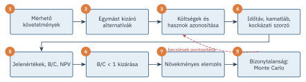
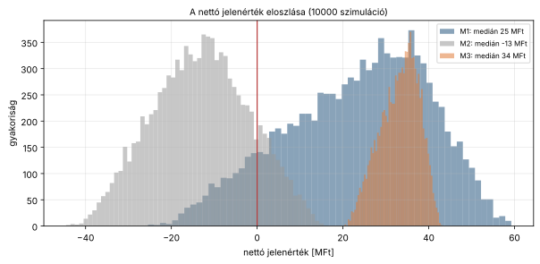

# Költség–haszon elemzés {#sec-koltseg-haszon}

::: {.cel title="Eszközkártya"}
- **Mire való?** Egymást kizáró alternatívák összehasonlítása a teljes életciklusra vetített hasznok és költségek jelenértékével: haszon–költség arány (B/C), nettó jelenérték, növekményes elemzés és a bizonytalanság Monte Carlo-vizsgálata.
- **Tanulási eredmény:** az eszközlap feldolgozása után képes leszel jelenérték-számítással összevetni egymást kizáró alternatívákat, növekményes elemzést végezni, és a kockázatot szorzóval vagy Monte Carlo-szimulációval figyelembe venni.
- **V-lépés:** 4. Architektúra (koncepció-kiválasztás); beruházási, gyártás-vagy-vásárlás és fejlesztési döntéseknél bármikor.
- **Bemenet:** mérhető követelmények, alternatívák, beruházási és működtetési költségbecslések, a hasznok becslése, időtáv, kamatláb.
- **Kimenet:** jelenértékek, B/C, nettó jelenérték, megtérülési idő, növekményes elemzés, a nettó jelenérték eloszlása.
- **Időigény:** a becslések összegyűjtése napokat is igényelhet; a számítás percek.
- **Kézikönyv:** [10. fejezet](../../kezikonyv/fejezetek/10-dontes.html), 10.7. szakasz.
- **Továbbolvasás:** [@goldberg1994toolbox, 2.2. szakasz].
:::

## Mikor használd?

- **Beruházási döntéseknél**, ahol a hasznok és költségek pénzben kifejezhetők, és több év alatt jelentkeznek.
- **Ha a súlyozott értékelés vagy az AHP nem ad egyértelmű eredményt**, és a pénzügyi szempont dönthet.
- **Ha a költségkeret nem rögzített**, és azt kell eldönteni, megéri-e a drágább alternatíva többletköltsége.
- **Óvatosan** használd, ha a hasznok nagy része nehezen forintosítható (biztonság, ergonómia, környezeti hatás): ezeket inkább kötelező követelményként vagy külön kritériumként kezeld.

## Lépések

{#fig-lepesek-koltseg-haszon width=100%}

A lépések a költség–haszon elemzés tankönyvi eljárását követik [@boardman2018].

1. **Fogalmazz meg mérhető, verifikálható követelményeket**, amelyekhez a hasznok köthetők.
2. **Gyűjtsd össze a hiteles, egymást kizáró alternatívákat**, olyan részletességgel, hogy minden jelentős költség és haszon azonosítható legyen.
3. **Azonosítsd a költségeket** (beruházás, üzemeltetés, karbantartás; a maradványérték megtakarításként) **és a hasznokat** (teljesítmény, idő, megbízhatóság, biztonság, termelékenység; a hátrányok negatív haszonként).
4. **Rögzítsd az időtávot, a kamatlábat és a kockázati szorzót.** A bevezetés kockázata és a műszaki érettség egy $f$ szorzóval vehető figyelembe a hasznok oldalán. Mivel ez szubjektív becslés, elég néhány durva fokozat (például 0,5; 0,75; 1).
5. **Számítsd jelenértékre** a költségeket és a hasznokat, majd a B/C arányt és a nettó jelenértéket. Évente esedékes $X$ összeg jelenértéke $T$ év alatt $r$ kamatláb mellett $X \sum_{t=1}^{T} (1+r)^{-t}$.
6. **Zárd ki az 1-nél kisebb B/C arányú alternatívákat.**
7. **Végezz növekményes elemzést**, ha a keret nincs rögzítve: a maradékot rendezd növekvő költség szerint, és minden lépésben vizsgáld meg, megéri-e a drágább alternatíva többletköltsége ($\Delta B / \Delta C > 1$). A preferált alternatíva nem feltétlenül a legnagyobb B/C arányú.
8. **Vizsgáld a bizonytalanságot.** A pontbecslések helyett adj meg pesszimista, legvalószínűbb és optimista értékeket, és Monte Carlo-szimulációval nézd meg, milyen gyakran lesz az egyes alternatíva a legjobb, és mekkora a veszteség valószínűsége.

## Kidolgozott példa: a ForgácsTech MES-koncepciói

A ForgácsTech csapata ötéves időtávra és 8%-os kamatlábbal hasonlította össze a három MES-koncepciót (kézikönyv 10.7. szakasz). Az annuitástényező 3,993. A pontbecslések eredménye:

| | M1: teljes MES | M2: gépgyártói + MES | M3: fokozatos |
|:--|--:|--:|--:|
| beruházás / éves működtetés / éves haszon [MFt] | 42 / 4 / 28 | 30 / 6 / 22 | 14 / 3 / 15 |
| kockázati szorzó | 0,75 | 0,5 | 1,0 |
| C / B (jelenérték) [MFt] | 58,0 / 83,8 | 54,0 / 43,9 | 26,0 / 59,9 |
| B/C | 1,45 | 0,81 | 2,31 |
| nettó jelenérték [MFt] | 25,9 | −10,0 | 33,9 |

: A ForgácsTech költség–haszon elemzése (5 év, 8%). {tbl-colwidths="[40,20,20,20]"}

Az M2 kiesett (B/C < 1). Az M3-ról az M1-re lépés növekménye: $\Delta B = 24{,}0$ MFt, $\Delta C = 32{,}0$ MFt, $\Delta B/\Delta C = 0{,}75 < 1$, tehát a többletköltség nem éri meg; a preferált alternatíva az M3.

A Monte Carlo-szimulációban a kockázatot nem a szorzó, hanem a haszon ferde háromszögeloszlása hordozza, amelynek várható értéke megegyezik a szorzóval (M1: 0,35–0,85–1,05; M3: 0,8–1,05–1,15 a pontbecslés arányában), és a beruházás is felfelé ferde eloszlású ([-@fig-kh-montecarlo]. ábra). 10 000 szimuláció alapján:

| | NPV medián [MFt] | NPV 10. percentilis [MFt] | P(NPV > 0) | P(legnagyobb NPV) |
|:--|--:|--:|--:|--:|
| M1 | 25,3 | −0,6 | 89% | 32% |
| M2 | −12,9 | −28,0 | 14% | 0% |
| M3 | 33,7 | 26,8 | 100% | 68% |

: A nettó jelenérték eloszlásának jellemzői a Monte Carlo-szimulációban. {tbl-colwidths="[16,21,25,19,19]"}

{#fig-kh-montecarlo width=88%}

**Tanulságok:**

- **Az M3 előnye a kis kockázat.** A nettó jelenértéke gyakorlatilag mindig pozitív, és az esetek kétharmadában ez a legnagyobb. Az M1 felső része vonzó, de tízből egy esetben öt év alatt nem térül meg.
- **A legnagyobb B/C nem mindig a válasz.** Itt egybeesett a növekményes elemzés eredményével, de nem feltétlenül esik egybe: a növekményes elemzés szabálya szerint a preferált alternatíva az utolsó, amelynek növekménye még megéri [@sullivan2019].
- **A szám nem minden.** Az M3 gyengesége a bővíthetőség; a csapat ezért kötelező feltételként írta elő, hogy az első ütem bővíthető platformra épüljön.

## Sablon és notebook

- [koltseg_haszon_sablon.xlsx](../sablonok/koltseg_haszon_sablon.xlsx): kamatláb, időtáv, annuitástényező; legfeljebb 8 alternatíva beruházással, működtetéssel, haszonnal és kockázati szorzóval; jelenértékek, B/C, nettó jelenérték, megtérülési idő, kiesési jelzés; növekményes lap védő–kihívó összevetéssel és a preferált alternatíva kiválasztásával. A ForgácsTech példájával kitöltve.
- [koltseg_haszon.ipynb](../notebookok/koltseg_haszon.ipynb) · [Megnyitás Google Colabban](koltseg_haszon.ipynb): jelenértékek, növekményes elemzés és Monte Carlo-szimuláció háromszögeloszlású becslésekkel (a [-@fig-kh-montecarlo]. ábra így készült).

## Előnyök és korlátok

| Előnyök | Korlátok |
|:--|:--|
| A teljes életciklusra vetítve értékeli a költséghatékonyságot | Hiányos vagy túl általános követelmények mellett a hasznok nem mérhetők |
| Dokumentálja a vizsgált paramétereket és alternatívákat | Csak annyira teljes, amennyire az alternatívák listája |
| A növekményes elemzés a többletráfordítás értelmét is vizsgálja | Pontatlan költségbecslésekkel hibás eredményt ad |
| A Monte Carlo-vizsgálat a kockázatot is láthatóvá teszi | A hasznok forintosítása gyakran vitatott, különösen a nem pénzügyi hasznoknál |

: A költség–haszon elemzés előnyei és korlátai [@boardman2018]. {tbl-colwidths="[50,50]"}

::: {.hiba}
- **Különböző időtávok.** Az alternatívákat azonos időtávra kell számolni; különben a hosszabb élettartamú indokolatlanul jobbnak vagy rosszabbnak tűnik.
- **Kétszeres kockázatkezelés.** Ha a hasznokat kockázati szorzóval is csökkented, és a Monte Carlo-ban ferde eloszlással is, ugyanazt a kockázatot kétszer veszed figyelembe.
- **Elsüllyedt költségek beszámítása.** A már elköltött pénz nem része a döntésnek: csak a jövőbeli költségek és hasznok számítanak.
- **A forintosítás erőltetése.** A biztonságot és az ergonómiát ne próbáld pénzben kifejezni csak azért, hogy beférjen a B/C arányba; kezeld kötelező követelményként.
:::

## Mintapromptok

::: {.prompt title="Mintaprompt: költség- és haszonelemek azonosítása"}
```text
Alternatívánk: [LEÍRÁS]. A rendszer élettartama: [ÉV].
Feladat: sorold fel a költségelemeket (beruházás, üzemeltetés,
karbantartás, képzés, átállás, maradványérték) és a haszonelemeket
(és hátrányokat) kategóriánként. Mindegyikhez írd le, milyen adatból
vagy kitől becsülhető, és jelöld, melyik nehezen forintosítható.
Ne adj számszerű becslést.
```
:::

::: {.prompt title="Mintaprompt: a növekményes elemzés magyarázata"}
```text
Költség–haszon elemzésünk eredménye: [TÁBLÁZAT B, C, B/C, NPV].
Feladat: magyarázd el egy nem pénzügyi szakember számára, miért
nem a legnagyobb B/C arányú (vagy a legnagyobb NPV-jű) alternatíva a
preferált, vagy miért az, a növekményes elemzés lépésein keresztül.
Fogalmazz meg két kérdést, amely a becslések legbizonytalanabb
pontjára kérdez rá.
```
:::

## Feladat

::: {.projekt title="5. projektlépés (hatodik rész): költség–haszon becslés"}
Saját projektedben készíts költség–haszon becslést legalább két alternatívára, a rendszer várható élettartamára. Végezd el a növekményes elemzést, majd a két legbizonytalanabb becsléshez adj meg pesszimista, legvalószínűbb és optimista értéket, és futtasd le a notebook Monte Carlo-szimulációját. Írd le, változtat-e a bizonytalanság a javaslatodon.
:::
