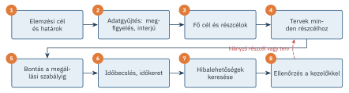
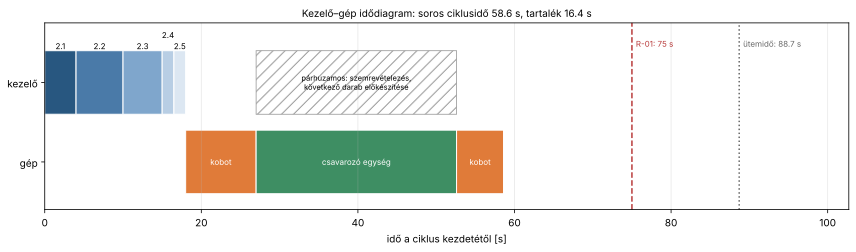

# Hierarchikus feladatelemzés (HTA) {#sec-hta}

::: {.cel title="Eszközkártya"}
- **Mire való?** Annak leírása, mit kell az embernek tennie egy rendszercél eléréséhez: célok és részcélok hierarchiája, tervekkel, időbecsléssel és a lehetséges hibákkal.
- **Tanulási eredmény:** az eszközlap feldolgozása után képes leszel egy feladatot célok, részcélok és tervek hierarchiájaként leírni, és a feladatelemzésből tervezési javaslatokat és hibalehetőségeket levezetni.
- **V-lépés:** 4. Architektúra (a funkciómegosztás után) és 5. Részletes tervezés (kezelőfelület, eljárások, képzés); a validációs tesztforgatókönyvek alapja.
- **Bemenet:** a funkciómegosztás eredménye (mi marad az embernek), a működési koncepció forgatókönyvei, megfigyelések és interjúk a felhasználókkal.
- **Kimenet:** HTA-diagram vagy táblázatos HTA, tervek, időbecslések, hibalehetőségek és tervezési javaslatok.
- **Időigény:** egy jól körülhatárolt feladatra 2–4 óra, a megfigyeléssel és a felhasználói ellenőrzéssel együtt.
- **Kézikönyv:** [11. fejezet](../../kezikonyv/fejezetek/11-emberkozpontu.html), 11.5. szakasz.
- **Továbbolvasás:** [@nasa2015hsi].
:::

## Mikor használd?

A feladatelemzés azt vizsgálja, mit kell a kezelőnek (vagy a kezelők csoportjának) tennie, cselekvésekben és gondolkodási folyamatokban, hogy a rendszer célja teljesüljön [@kirwan1992]. A HTA ennek legelterjedtebb módszere: Annett és Duncan eredetileg a képzés tervezésére dolgozta ki [@annett1967], Stanton áttekintése szerint azonban azóta a kezelőfelület-tervezéstől a létszámtervezésen át az emberi hibák előrejelzéséig széles körben alkalmazzák [@stanton2006]. Használd, ha:

- **eldőlt, mi marad az embernek** ([-@sec-funkciomegosztas]. eszközlap), és most azt kell megtervezni, hogyan végzi el;
- **időkeretet kell ellenőrizni**, például hogy a kezelői műveletek beleférnek-e a ciklusidő-költségvetésbe;
- **kezelőfelületet, eljárásleírást vagy képzési anyagot** tervezel: a HTA megmutatja, milyen információ kell az egyes lépésekhez;
- **hibalehetőségeket keresel**: a legalsó szintű műveletek a hibaelemzés ([-@sec-fmea]. eszközlap, kézikönyv 13. fejezet) természetes egységei.

## Lépések

{#fig-lepesek-hta width=100%}

1. **Határozd meg az elemzés célját és határait.** Képzéshez, kezelőfelülethez vagy hibaelemzéshez más-más részletesség kell; rögzítsd, melyik szerepkör melyik feladatát elemzed, és milyen üzemállapotban.
2. **Gyűjts adatot:** figyeld meg a munkát (ha van előd rendszer), kérdezd a kezelőket, olvasd el a meglévő eljárásokat. Új rendszernél a működési koncepció forgatókönyveiből és a prototípusokon végzett próbákból indulj ki.
3. **Fogalmazd meg a fő célt és az első szintű részcélokat.** Négy–nyolc részcél egy szinten általában áttekinthető. A részcélok célok, nem eszközök: „csavarellátás ellenőrzése”, nem „a kijelző 3. menüpontjának megnyitása”.
4. **Írj tervet minden részcélhoz.** A terv megmondja, milyen sorrendben és feltételek mellett hajtódnak végre a gyermekei. Stanton tipizálása szerint a terv lehet soros (1, majd 2, majd 3), tetszőleges sorrendű, egyidejű, elágazó (ha X, akkor 2), ciklikus (ismételd, amíg X) és választó (1, majd 2 vagy 3) [@stanton2006].
5. **Bonts tovább a megállási szabályig.** Annett és Duncan szabálya szerint akkor állj meg, ha a nem megfelelő végrehajtás valószínűségének és költségének szorzata (P × C) már elfogadható [@annett1967]. A gyakorlatban: ahol a további bontás már nem ad új információt az elemzés céljához.
6. **Becsüld meg a legalsó szintű műveletek idejét**, és vesd össze a ciklusonként ismétlődő műveletek összegét az időkerettel.
7. **Keresd meg a hibalehetőségeket** műveletenként, Reason kategóriáival: megcsúszás (jó szándék, rossz kivitelezés), kihagyás, tévedés (rossz szándék, rossz szabály vagy tudás) és szabályszegés [@reason1990]. Minden hibához írd le a következményt és a tervezési javaslatot.
8. **Ellenőrizd a HTA-t a kezelőkkel.** A felhasználók gyakran olyan lépéseket és kerülőutakat is ismernek, amelyek az eljárásleírásban nem szerepelnek.

## Kidolgozott példa: a KoboCella kezelőjének feladatai

A KoboCella csapata a kezelő munkáját egy műszakra elemezte (a diagram a kézikönyv 11. fejezetében látható). A fő cél terve: „1, majd 2 ismételve; ha hibajelzés: 3, utána vissza 2-re; a műszak végén 4”. A ciklusonként ismétlődő 2-es részcél és a ritka 3-as részcél táblázatos HTA-ja:

| Azonosító | Művelet | Idő [s] | Hibatípus | Lehetséges hiba | Javaslat |
|:--|:--|:-:|:--|:--|:--|
| **2** | **egy motor szerelése** (terv: 2.1 > 2.2 > 2.3 > 2.4 > 2.5) | **18,0** | | | |
| 2.1 | motorház kivétele a tálcáról | 4,0 | – | – | – |
| 2.2 | motorház behelyezése a befogóba | 6,0 | megcsúszás | nem ül fel teljesen | befogóérzékelő, visszajelzés a HMI-n |
| 2.3 | fedél ráhelyezése | 5,0 | megcsúszás | fordítva kerül fel | aszimmetrikus illesztőcsapok |
| 2.4 | kilépés a zónából | 1,5 | szabályszegés | a zónában marad | teljes sebesség csak zónaelhagyás után |
| 2.5 | indítás nyugtázása | 1,5 | – | – | – |
| **3** | **hibajelzés kezelése** (terv: 3.1 > 3.2 > 3.3) | 15,0 | | | |
| 3.1 | hibakód leolvasása | 5,0 | tévedés | félreérti a hibakódot | a HMI a hiba helyét is mutatja |
| 3.2 | hibás darab a selejtdobozba | 8,0 | kihagyás | a darab a kiadóba kerül | a kiadó csak a selejtdoboz jelzése után enged |
| 3.3 | nyugtázás | 2,0 | – | – | – |

: A KoboCella kezelőjének táblázatos HTA-ja (részlet). A teljes elemzés a sablonban található. {#tbl-hta-kobo tbl-colwidths="[11,25,8,13,18,25]"}

A ciklusonként ismétlődő öt művelet összesen 18 s, pontosan a ciklusidő-költségvetés kezelői része (kézikönyv 6. fejezet). A gépi összetevőkkel együtt a soros ciklusidő 58,6 s, a 75 s-os követelményhez képest 16,4 s (22%) a tartalék ([-@fig-hta-idodiagram]. ábra).

{#fig-hta-idodiagram width=100%}

**Tanulságok:**

- **A kezelői részben nincs tartalék.** Ha a próbaüzemben a behelyezés tovább tart a becsültnél, az a cella közös tartalékát fogyasztja. Ezért a 2.2-es és a 2.3-as időt az első prototípuson mérni kell (TPM-ként követhető, [-@sec-moe-mop-tpm]. eszközlap).
- **A ciklusban ismétlődő hibalehetőségeket műszaki úton kell kezelni.** A 2.2, a 2.3 és a 2.4 minden ciklusban előfordulhat, napi több száz alkalommal; itt az oktatás nem elég, érzékelő, hibabiztos kialakítás és reteszelés kell (kézikönyv 13. fejezet).
- **A ritka részcél másféle támogatást kíván.** A 3-as részcélt a kezelő ritkán gyakorolja, ezért ott a tévedés és a kihagyás jellemző: a HMI-nek lépésenként kell végigvezetnie.
- **A HTA a funkciómegosztást is visszaigazolja.** A kezelő szabad ideje a csavarozás alatt teremtette meg a lehetőséget, hogy a minőségi ellenőrzés a kezelő feladata legyen ([-@sec-funkciomegosztas]. eszközlap).

## Sablon és notebook

- [hta_sablon.xlsx](../sablonok/hta_sablon.xlsx): legfeljebb 60 elem azonosítóval, szülővel, tervvel, idővel, gyakorisággal; automatikus szintszámítás, a kezelő ciklusonkénti ideje és tartaléka az időkerethez képest, hibatípusok legördülő listából és típusonkénti összesítés. A KoboCella példájával kitöltve.
- [hta.ipynb](../notebookok/hta.ipynb) · [Megnyitás Google Colabban](hta.ipynb): táblázatos HTA a hiányzó tervek jelzésével, időkeret-ellenőrzés, kezelő–gép idődiagram (a [-@fig-hta-idodiagram]. ábra így készült) és a hibalehetőségek összesítése.

## Előnyök és korlátok

| Előnyök | Korlátok |
|:--|:--|
| Egyszerű, gyorsan tanulható, a felhasználókkal is jól átbeszélhető | Elsősorban a megfigyelhető cselekvéseket írja le; a gondolkodási folyamatokat (döntés, diagnózis) kevésbé |
| Rugalmas: a részletesség az elemzés céljához igazítható | Az eredmény az elemző ítéletén múlik; két elemző eltérő bontást készíthet |
| Számos további elemzés kiindulópontja (hibaelemzés, idő, terhelés, képzés) [@stanton2006] | A tervek szöveges leírása bonyolult feltételeknél nehezen követhető |
| A kezelőfelület és az eljárások információigényét lépésenként mutatja | Új rendszernél nincs mit megfigyelni: prototípus és forgatókönyv kell hozzá |

: A HTA előnyei és korlátai. {tbl-colwidths="[50,50]"}

::: {.hiba}
- **Eszköz a cél helyett.** Ha a részcélok a jelenlegi kezelőfelület lépései („menü megnyitása”), a HTA a régi megoldást rögzíti, és nem segít újat tervezni.
- **Hiányzó tervek.** Terv nélkül a hierarchia csak egy lista: nem derül ki, mi ismétlődik, mi feltételes, mi párhuzamos.
- **Csak a normál üzem.** A hibakezelés, az indítás, a leállítás és a leromlott üzem gyakran kimarad, pedig ezekben a ritka helyzetekben a legnagyobb a hiba esélye.
- **Íróasztal mellett készült HTA.** A kezelőkkel való ellenőrzés nélkül a valódi munkavégzés (kerülőutak, informális lépések) rejtve marad.
:::

## Mintapromptok

::: {.prompt title="Mintaprompt: HTA vázlat forgatókönyvből"}
```text
Rendszerünk: [LEÍRÁS]. A vizsgált szerepkör: [KEZELŐ/FELHASZNÁLÓ].
A forgatókönyv: [FORGATÓKÖNYV LEÍRÁSA].
Feladat: készíts kétszintű hierarchikus feladatelemzést (HTA)
táblázatos formában: azonosító, részcél vagy művelet, terv minden
részcélhoz (soros, elágazó, ciklikus, választó). A részcélokat
célként fogalmazd meg, ne a kezelőfelület lépéseiként. Jelöld
külön a ritka helyzeteket (hiba, indítás, leállás). Időbecslést
ne adj meg: azt mérni fogjuk.
```
:::

::: {.prompt title="Mintaprompt: hibalehetőségek a HTA alapján"}
```text
Az alábbi HTA legalsó szintű műveletei: [TÁBLÁZAT].
Feladat: minden művelethez gondold végig, előfordulhat-e
megcsúszás, kihagyás, tévedés vagy szabályszegés (Reason
kategóriái). Ha igen, írd le a hibát, a következményt és egy
tervezési javaslatot. A javaslatoknál előnyben részesítsd a
műszaki megoldást (hibabiztos kialakítás, érzékelő, reteszelés)
az oktatással és a figyelmeztetéssel szemben, és jelöld, ha
egy hibát nem tudsz megítélni a megadott információból.
```
:::

## Feladat

::: {.projekt title="6. projektlépés (első rész, választható): HTA"}
Saját projektedben készíts HTA-t a legfontosabb kezelői vagy felhasználói feladatra, legalább két szinten, tervekkel és időbecsléssel. Jelölj meg legalább három hibalehetőséget tervezési javaslattal, és ellenőrizd a HTA-t legalább egy leendő felhasználóval.
:::
