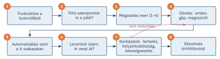
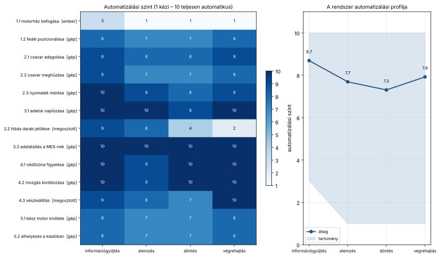

# Funkciómegosztás és automatizálási szint {#sec-funkciomegosztas}

::: {.cel title="Eszközkártya"}
- **Mire való?** Annak eldöntése és indoklása, hogy egy-egy funkciót az ember, a gép vagy a kettő együtt végezzen, és ha gép, milyen szinten automatizáljuk az információgyűjtést, az elemzést, a döntést és a végrehajtást.
- **Tanulási eredmény:** az eszközlap feldolgozása után képes leszel funkciónként indokolni az ember és a gép közötti megosztást Price osztályozása és a Fitts-lista alapján, és kijelölni a megfelelő automatizálási szintet.
- **V-lépés:** 4. Architektúra (a funkcióelemzés és a fizikai allokáció mellett); a leromlott üzem tervezésénél és a validáció előkészítésénél újra elő kell venni.
- **Bemenet:** a funkciófa legalsó szintje ([-@sec-funkciofa]. eszközlap), a működési koncepció üzemállapotai, a felhasználók jellemzői és elvárásai.
- **Kimenet:** funkciónkénti megosztás indoklással, automatizálási profil (négy szakasz, 1–10 szint), átvételi igények leromlott üzemben, kockázatok és intézkedések.
- **Időigény:** 10–20 funkcióra 2–3 óra, a felhasználói képviselőkkel együtt.
- **Kézikönyv:** [12. fejezet](../../kezikonyv/fejezetek/12-automatizalas.html), 12.1–12.3. szakasz.
- **Továbbolvasás:** [@nasa2015hsi].
:::

## Mikor használd?

- **Ha a funkciófa elkészült**, és el kell dönteni, mi marad az embernek. A megosztás meghatározza a kezelő feladatait (amelyeket a HTA részletez, [-@sec-hta]. eszközlap), a kezelőfelület információigényét és a képzést.
- **Ha egy automatizálási döntést indokolni kell.** A „technikailag megoldható, tehát automatizáljuk” gondolatmenet a kézikönyv 12.3. szakaszában tárgyalt buktatókhoz vezethet: túlzott támaszkodáshoz, a helyzettudatosság elvesztéséhez és a készségek leépüléséhez [@parasuraman1997; @bainbridge1983].
- **Ha a rendszernek leromlott üzemben is működnie kell**, és tudni kell, mit vesz át ilyenkor az ember.

## Lépések

{#fig-lepesek-funkciomegosztas width=100%}

1. **Készítsd el a funkciólistát** a funkciófa legalsó szintjéről, megoldássemleges, igei megfogalmazásban.
2. **Értékeld a funkciókat a Fitts-lista szellemében**: sebesség, következetesség, ítélőképesség, váratlan helyzetek kezelése, költség. Szempontonként jelöld, ki a jobb (gép, ember, egyforma). A Fitts-lista hét évtized után is jó kiindulópont, de nem algoritmus [@fitts1951; @dewinter2014].
3. **Sorold be a funkciót a hat megosztási eset egyikébe** (Price osztályozása szerint [@price1985]): 1 nincs különbség; 2 az ember jobb; 3 a gép jobb; 4 a gép túl gyenge, ezért az emberé; 5 az ember túl gyenge, ezért a gépé; 6 egyik sem elfogadható, a funkciót vagy a rendszert újra kell gondolni.
4. **Dönts, és írd le az indoklást.** Az 1–3. esetben a képességek mellett Price megosztási szabályai is számítanak: a kötelező megosztás (amit jogszabály vagy képesség kikényszerít), az érték-egyensúly, a haszonelvű és költségalapú megosztás, valamint az érzelmi és kognitív támogatás, vagyis hogy az érintettek elfogadják-e, és értelmes munka marad-e az embernek [@price1985].
5. **Add meg az automatizálási szintet** (Sheridan–Verplank skála, 1–10) a négy információfeldolgozási szakaszban: információgyűjtés, információelemzés, döntés, végrehajtás [@sheridan1978; @parasuraman2000]. A szintet szakaszonként a hibás döntés költsége és az emberi teljesítményre gyakorolt hatás alapján válaszd [@parasuraman2000].
6. **Vizsgáld meg a leromlott üzemet**: ki végzi a funkciót, ha a gép kiesik? Ha normál üzemben gépi, leromlott üzemben emberi, átvételi igény keletkezik.
7. **Mérlegeld a kockázatokat**: a magas döntési szint és a ritka emberi átvétel együtt az automatizálás iróniájához vezet, vagyis a kezelő éppen azt nem gyakorolja, amire a legnagyobb szükség lenne [@bainbridge1983]. Ilyenkor rendszeres gyakorlás, átlátható automatika és a megbízhatóságot is jelző visszajelzés kell, amely a bizalmat a tényleges teljesítményhez igazítja [@lee2004].
8. **Ellenőrizd prototípussal** és a felhasználókkal: a terhelés és a használhatóság mérésére a [-@sec-tlx-sus]. eszközlap ad módszert.

## Kidolgozott példa: a KoboCella funkcióinak megosztása

A KoboCella csapata a funkciófa tizenhárom részfunkcióján ment végig (kézikönyv 12. fejezet). Néhány jellemző sor:

| Funkció | Gépi/emberi előny (db) | Eset | Döntés | LOA (gyűjtés, elemzés, döntés, végrehajtás) | Leromlott üzemben |
|:--|:-:|:-:|:--|:-:|:--|
| 1.1 motorház befogása | 2/3 | 2 | ember | 3, 1, 1, 1 | ember |
| 2.2 csavar meghúzása | 3/1 | 3 | gép | 9, 7, 7, 8 | ember |
| 2.3 nyomaték mérése | 3/0 | 5 | gép | 10, 9, 8, 9 | gép |
| 3.2 hibás darab jelölése | 2/2 | 1 | megosztott | 9, 8, 4, 2 | ember |
| 4.1 védőzóna figyelése | 2/0 | 5 | gép | 10, 9, 10, 10 | gép |
| 4.3 vészleállítás | 1/2 | 1 | megosztott | 9, 8, 7, 10 | ember |

: A KoboCella funkciómegosztásának részlete. Az előny a Fitts-szempontok közül azok száma, amelyekben a gép, illetve az ember jobb. {#tbl-fm-kobo tbl-colwidths="[24,14,7,13,24,18]"}

A tizenhárom funkcióból tíz gépi, kettő megosztott, egy emberi lett. A rendszer automatizálási profilja az információgyűjtésben a legmagasabb (átlag 8,7), a döntésben a legalacsonyabb (7,3) ([-@fig-loa-hoterkep]. ábra).

{#fig-loa-hoterkep width=100%}

**Tanulságok:**

- **A motorház befogása a jelölések alapján is emberi.** Itt az ítélőképesség (változatok, sérült alkatrész), a váratlan helyzetek és a költség az ember mellett szól; a gép csak a sebességben és a következetességben jobb.
- **A megosztott funkciók döntési szintje alacsony.** A hibás darabnál a gép jelez, de a javításról vagy a selejtezésről az ember dönt (4-es szint); a vészleállítást a gép automatikusan is kiváltja, de az ember bármikor beavatkozhat.
- **Hat funkciót leromlott üzemben az embernek kell átvennie.** Ezek közül ötnél a normál üzemi döntési szint 7 vagy magasabb, tehát a kezelő ezeket a műveleteket a mindennapokban nem gyakorolja. A csapat ezért negyedéves kézi gyakorlást írt elő a leromlott üzemmódra (UM-7).
- **Az érzelmi szempont a feladatkiosztást is módosította.** A kezelők attól tartottak, hogy „a robot mellett csak adogatók lesznek”; a minőségi ellenőrzés és a változatváltás ezért került a kezelő feladatai közé. A HTA idődiagramja ([-@sec-hta]. eszközlap) megmutatta, hogy erre a csavarozás alatt van idő.

## Sablon és notebook

- [funkciomegosztas_sablon.xlsx](../sablonok/funkciomegosztas_sablon.xlsx): legfeljebb 40 funkció; öt Fitts-szempont legördülő listával (G, E, =), gépi és emberi előny számlálása, megosztási eset, döntés és ellentmondásjelzés; automatizálási szint a négy szakaszban, leromlott üzem és átvételi igény; összesítés és a Sheridan–Verplank skála külön lapon. A KoboCella példájával kitöltve.
- [funkciomegosztas.ipynb](../notebookok/funkciomegosztas.ipynb) · [Megnyitás Google Colabban](funkciomegosztas.ipynb): ellentmondásjelzés, automatizálási hőtérkép és profil (a [-@fig-loa-hoterkep]. ábra így készült), az átvételi igények listája a készségvesztés kockázatának jelzésével.

## Előnyök és korlátok

| Előnyök | Korlátok |
|:--|:--|
| A megosztási döntés indoklása átlátható és visszakereshető | A Fitts-szempontok összevetése nem ad gépiesen helyes döntést; a súlyuk helyzetfüggő [@dewinter2014] |
| A négy szakasz külön kezelése finomabb, mint az „ember vagy gép” kérdés [@parasuraman2000] | A szintek ordinálisak: átlaguk csak tájékoztató jellegű |
| Feltárja a leromlott üzem átvételi igényeit | A dinamikus (helyzetfüggő) megosztást nehezen írja le (kézikönyv 12.5. szakasz) |
| Az érdekeltek elfogadását is a döntés részévé teszi [@price1985] | Az eredmény a csapat ítéletén múlik; prototípussal ellenőrizni kell |

: A funkciómegosztás és az automatizálási profil előnyei és korlátai. {tbl-colwidths="[50,50]"}

::: {.hiba}
- **„Amit lehet, automatizáljunk.”** Ilyenkor az embernek a gép által meg nem oldott maradékfeladatok jutnak, gyakran monoton felügyelet, ritka, de nehéz beavatkozással [@bainbridge1983].
- **Egyetlen szint az egész funkcióra.** Egy funkció információgyűjtése lehet teljesen automatikus, miközben a döntést szándékosan az embernél tartjuk; ezt az egyetlen szám elfedi.
- **A leromlott üzem kihagyása.** Ha nem derül ki, mit kell kézzel átvenni, a képzés és az eljárásleírás is elmarad.
- **A felhasználók kihagyása.** Az elfogadás nem utólagos kommunikációs feladat; a megosztás egyik szempontja.
:::

## Mintapromptok

::: {.prompt title="Mintaprompt: megosztási javaslat ellenőrzése"}
```text
Rendszerünk: [LEÍRÁS]. Funkciólistánk a javasolt megosztással
és indoklással: [TÁBLÁZAT].
Feladat: minden funkciónál vizsgáld meg az indoklást a Fitts-lista
szempontjai (sebesség, következetesség, ítélőképesség, váratlan
helyzetek, költség) és az elfogadás szempontjából. Jelöld, ahol
az indoklás hiányos vagy ellentmond a szempontoknak, és kérdezz
rá a hiányzó információra. Ne változtasd meg a döntéseket.
```
:::

::: {.prompt title="Mintaprompt: automatizálási profil és kockázatok"}
```text
Az alábbi funkciók gépi végrehajtásúak, a négy szakasz
automatizálási szintjével (Sheridan–Verplank, 1–10) és azzal,
hogy leromlott üzemben ki veszi át őket: [TÁBLÁZAT].
Feladat: azonosítsd, hol fenyeget túlzott támaszkodás, a
helyzettudatosság elvesztése vagy a készségek leépülése.
Mindegyikhez javasolj tervezési intézkedést (visszajelzés,
gyakorlás, a szint módosítása), és jelöld, milyen méréssel
ellenőriznéd a prototípuson.
```
:::

## Feladat

::: {.projekt title="6. projektlépés (második rész): funkciómegosztás"}
Saját projektedben oszd meg a funkciófa legalsó szintjének funkcióit ember és gép között, indoklással. A gépi és a megosztott funkciókhoz add meg az automatizálási szintet a négy szakaszban, és jelöld, mit kell az embernek leromlott üzemben átvennie. Legalább egy funkciónál írd le, miért nem a legmagasabb technikailag elérhető szintet választottátok.
:::
