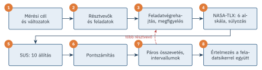
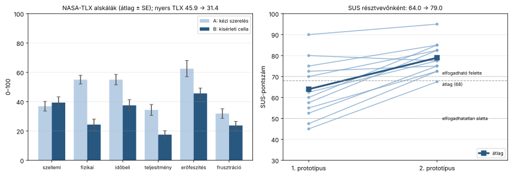

# Terhelés- és használhatóságmérés (NASA-TLX, SUS) {#sec-tlx-sus}

::: {.cel title="Eszközkártya"}
- **Mire való?** A szubjektív munkaterhelés (NASA-TLX) és az észlelt használhatóság (SUS) mérése szabványosított kérdőívvel, két változat vagy egy változat és egy viszonyítási érték összevetésére.
- **Tanulási eredmény:** az eszközlap feldolgozása után képes leszel megtervezni és kiértékelni egy NASA-TLX- és SUS-mérést, és az eredményt a szakirodalmi referenciaértékekhez viszonyítva értelmezni.
- **V-lépés:** 5. Részletes tervezés (prototípusok összevetése) és 9. Validáció (a felhasználói elvárások teljesülése); a MOE-k mérési módja is lehet.
- **Bemenet:** prototípus vagy működő rendszer, reprezentatív résztvevők, valós feladatokat tartalmazó tesztforgatókönyv.
- **Kimenet:** nyers és súlyozott TLX, alskálánkénti profil; SUS-pontszám konfidenciaintervallummal és értelmezéssel; feladatsiker; a változatok statisztikai összevetése.
- **Időigény:** résztvevőnként a feladatokon felül 5–10 perc a kérdőívekre; kiértékelés sablonnal 1 óra.
- **Kézikönyv:** [11. fejezet](../../kezikonyv/fejezetek/11-emberkozpontu.html), 11.6. szakasz.
:::

## Mikor használd?

- **Két tervváltozat összevetésére**: melyik kezelőfelület, melyik munkahely-elrendezés terhel kevésbé, melyik prototípust érzik használhatóbbnak a felhasználók.
- **Validációs mérésre**: ha a követelmény a megelégedettségre is vonatkozik (például „a SUS-pontszám legalább 70”), a SUS a mérés módja. Az ISO 9241-11 szerint a használhatóság az eredményesség, a hatékonyság és a megelégedettség együttese [@iso9241_11_2018]: a kérdőív csak a harmadikat méri, ezért a feladatsikert és a feladatidőt mellette mindig mérni kell.
- **A funkciómegosztás ellenőrzésére** ([-@sec-funkciomegosztas]. eszközlap): a terhelés átrendeződése (például a fizikai terhelés csökken, a szellemi nő) a TLX alskáláin látszik.

## Lépések

{#fig-lepesek-tlx-sus width=100%}

1. **Rögzítsd a mérési célt és a változatokat.** Mit hasonlítasz össze, és mi a viszonyítási alap (másik változat, előd rendszer, követelményérték)?
2. **Válaszd ki a résztvevőket és a feladatokat.** A résztvevők a valódi felhasználói csoportokat képviseljék; a feladatok a működési koncepció forgatókönyveiből jöjjenek. Ha ugyanazok a résztvevők próbálják ki mindkét változatot, a sorrendet résztvevőnként váltogasd a tanulási hatás kiegyenlítésére.
3. **Végeztesd el a feladatokat, és figyeld meg** a végrehajtást: befejezte-e segítség nélkül, mennyi idő alatt, hol akadt el.
4. **Töltesd ki a NASA-TLX-et** közvetlenül a feladat vagy a feltétel után. Hat alskála, 0–100 között 5-ös lépésekben: szellemi igénybevétel, fizikai igénybevétel, időbeli nyomás, teljesítmény (0 = tökéletes, 100 = sikertelen), erőfeszítés, frusztráció [@hart1988]. A súlyozott változathoz a résztvevő 15 páros összehasonlításban dönti el, melyik alskála járult hozzá jobban a terheléséhez; a súly az alskála győzelmeinek száma.
5. **Töltesd ki a SUS-t** a használat végén: tíz állítás ötfokú egyetértési skálán, a páratlanok pozitív, a párosak negatív megfogalmazásúak [@brooke1996]. Saját fordításnál ügyelj arra, hogy az állítások iránya és erőssége megmaradjon.
6. **Számítsd ki a pontszámokat.** Nyers TLX: a hat érték átlaga; súlyozott TLX: a súlyokkal vett összeg osztva 15-tel. SUS: a páratlan állításoknál (érték − 1), a párosaknál (5 − érték), az összeg 2,5-szerese, 0 és 100 között.
7. **Vesd össze a változatokat** intervallumokkal és próbával: azonos résztvevőknél páros t-próbával és (kis mintánál kiegészítésként) Wilcoxon-próbával, eltérő résztvevőknél kétmintás próbával. A feladatsiker arányára kis mintánál a korrigált Wald-intervallumot használd [@sauro2016].
8. **Értelmezd az eredményt a feladatsikerrel együtt.** A SUS-pontszám nem százalék. Bangor és munkatársai szerint a 70 fölötti pontszám elfogadható, az 50 alatti elfogadhatatlan [@bangor2008]; a melléknévi minősítések átlaga „OK” 50,9, „jó” 71,4, „kiváló” 85,5 [@bangor2009]; Sauro és Lewis adatbázisában az átlag 68 [@sauro2016]. A TLX-nek nincs általános elfogadhatósági határa: változatok vagy feltételek összevetésére való.

## Kidolgozott példa 1: a KoboCella kezelőinek terhelése

A KoboCella nyolc kezelője egy-egy műszakot dolgozott a jelenlegi kézi szerelésben (A) és a kísérleti cellában (B), és mindkettő után kitöltötte a súlyozott NASA-TLX-et.

| Alskála | A: kézi szerelés | B: kísérleti cella | Változás |
|:--|:-:|:-:|:-:|
| szellemi igénybevétel | 36,9 | 39,4 | +2,5 |
| fizikai igénybevétel | 55,0 | 24,4 | −30,6 |
| időbeli nyomás | 55,0 | 37,5 | −17,5 |
| teljesítmény | 34,4 | 17,5 | −16,9 |
| erőfeszítés | 62,5 | 45,6 | −16,9 |
| frusztráció | 31,9 | 23,8 | −8,1 |
| **nyers TLX** | **45,9** | **31,4** | **−14,6** |
| **súlyozott TLX** | **50,8** | **33,8** | **−17,0** |

: A KoboCella kezelőinek NASA-TLX-átlagai (n = 8). {#tbl-tlx-kobo tbl-colwidths="[34,22,22,22]"}

A nyers TLX csökkenése 14,6 pont (95%-os intervallum: 10,2–19,0), a páros t-próba szerint $t(7) = -7{,}80$, $p = 0{,}0001$; a Wilcoxon-próba is szignifikáns ($p = 0{,}008$). Mind a nyolc kezelő terhelése csökkent. A súlyok szerint a kezelők terhelésének fő forrása az időbeli nyomás és a fizikai igénybevétel volt (átlagos súly 0,28 és 0,25).

## Kidolgozott példa 2: a VárosiBringa alkalmazás két prototípusa

Ugyanaz a tizenkét résztvevő, mind a négy felhasználói csoportból, két hét különbséggel próbálta ki a két prototípust, négy feladattal (F1 kölcsönzés regisztrált felhasználóként, F2 dokkoló keresése, F3 vendégfizetés, F4 visszaadás).

| | 1. prototípus | 2. prototípus |
|:--|:-:|:-:|
| SUS átlag (95%-os intervallum) | 64,0 (55,2–72,7) | 79,0 (74,2–83,7) |
| értelmezés | határeset, az átlag (68) alatt | elfogadható, a „jó” és a „kiváló” között |
| feladatsiker (korrigált Wald-intervallum) | 36/48 = 75% (61–85%) | 46/48 = 96% (85–100%) |
| F3 vendégfizetés sikere | 5/12 = 42% | 11/12 = 92% |

: A VárosiBringa alkalmazás két prototípusának SUS-pontszáma és feladatsikere (n = 12). {#tbl-sus-bringa tbl-colwidths="[40,30,30]"}

A SUS-pontszám átlagosan 15,0 ponttal nőtt (95%-os intervallum: 8,9–21,1; $t(11) = 5{,}42$, $p = 0{,}0002$). A [-@fig-tlx-sus]. ábra mindkét mérést mutatja.

{#fig-tlx-sus width=100%}

**Tanulságok:**

- **A terhelés átrendeződött, nem tűnt el.** A fizikai igénybevétel kevesebb mint a felére csökkent, a szellemi kissé nőtt, mert a kezelőnek a HMI visszajelzéseit is figyelnie kell. Ez összhangban van a funkciómegosztás céljával, de a szellemi terhelést a HMI továbbfejlesztésénél figyelni kell.
- **A SUS és a feladatsiker ugyanabba az irányba mutat**, és a megfigyelés megmondja, miért: a legnagyobb javulás a vendégfizetésnél volt, ahol az első prototípusnál a résztvevők több mint fele elakadt.
- **Az első prototípus intervalluma átnyúlik a 70-es határon.** Tizenkét résztvevővel ennyi a mérés pontossága; az egyetlen átlagérték alapján nem lehetne biztosan eldönteni, hogy elfogadhatatlan vagy elfogadható.
- **A páros elrendezés ára a tanulási hatás.** A második próbán a résztvevők már ismerték a feladatokat, ezért a javulás egy része a gyakorlásnak is betudható. Új résztvevőkkel vagy váltogatott sorrenddel ez kiszűrhető.

## Sablon és notebook

- [tlx_sus_sablon.xlsx](../sablonok/tlx_sus_sablon.xlsx): TLX-súlyok ellenőrzéssel (soronként 15), két feltétel nyers és súlyozott TLX-e, alskálánkénti átlagok, különbségek és diagram; két SUS-blokk legfeljebb 20 résztvevőre a kérdések szövegével, pontszámítással, átlaggal, szórással, 95%-os intervallummal és elfogadhatósági minősítéssel; feladatsiker-lap. A két kidolgozott példával kitöltve.
- [tlx_sus.ipynb](../notebookok/tlx_sus.ipynb) · [Megnyitás Google Colabban](tlx_sus.ipynb): páros t-próba, Wilcoxon-próba, hatásméret, SUS-értelmezés a melléknévi skálán, korrigált Wald-intervallum a feladatsikerre, ábra (a [-@fig-tlx-sus]. ábra így készült).

## Előnyök és korlátok

| Előnyök | Korlátok |
|:--|:--|
| Rövid, szabványosított, nemzetközileg összevethető | Szubjektív: azt méri, hogyan élik meg a résztvevők, nem a teljesítményt |
| A SUS megbízható: Bangor és munkatársai nagy mintáján a belső konzisztencia 0,9 körüli volt [@bangor2008] | A SUS nem diagnosztikus: nem mondja meg, mi a baj; ehhez megfigyelés kell |
| A TLX alskálái megmutatják a terhelés forrását | A TLX-nek nincs abszolút elfogadhatósági határa |
| A nyers TLX egyszerűbb; Hart áttekintése szerint széles körben használják [@hart2006] | Kis mintán az intervallumok szélesek; egyetlen átlagértékből nem szabad dönteni |

: A NASA-TLX és a SUS előnyei és korlátai. {tbl-colwidths="[50,50]"}

::: {.hiba}
- **A SUS-pontszám százalékként olvasása.** A 64 nem azt jelenti, hogy „64%-ban használható”; csak viszonyítási skálán értelmezhető.
- **Kérdőív megfigyelés nélkül.** Az elégedett felhasználó is hibázhat, és fordítva; a feladatsiker és a feladatidő nélkül az eredmény félrevezető lehet.
- **Átírt állítások.** Ha a fordítás vagy egy „javítás” megváltoztatja az állítások irányát, a pontozás elromlik.
- **A TLX késleltetett kitöltése.** A terhelés emléke gyorsan halványul; a kérdőívet közvetlenül a feladat után kell kitölteni.
- **Páros próba eltérő résztvevőkre.** Ha a két változatot más-más résztvevők próbálták ki, kétmintás próba kell.
:::

## Mintapromptok

::: {.prompt title="Mintaprompt: tesztforgatókönyv a méréshez"}
```text
Rendszerünk: [LEÍRÁS]. Felhasználói csoportjaink: [LISTA].
A két összevetendő változat: [VÁLTOZATOK].
Feladat: javasolj 4–6 tesztfeladatot a működési koncepció
forgatókönyvei alapján, mindegyikhez a sikerkritériummal (mikor
tekintjük segítség nélkül befejezettnek). Javasolj sorrend-
váltogatási tervet, ha ugyanazok a résztvevők próbálják ki
mindkét változatot. A kérdőívek (NASA-TLX, SUS) szövegét ne
írd át.
```
:::

::: {.prompt title="Mintaprompt: eredmények értelmezése"}
```text
Méréseink eredménye: [SUS-PONTSZÁMOK VÁLTOZATONKÉNT],
[TLX-ALSKÁLÁK ÁTLAGAI], [FELADATSIKER FELADATONKÉNT],
megfigyelési jegyzetek: [JEGYZETEK].
Feladat: értelmezd az eredményeket a Bangor-féle elfogadhatósági
tartományok és a 68-as átlag fényében, a konfidenciaintervallumok
figyelembevételével. Kösd össze a pontszámokat a megfigyelt
elakadásokkal, és jelöld, mit nem lehet a mintanagyság miatt
biztosan állítani. Ne számolj újra: a számokat a notebook adja.
```
:::

## Feladat

::: {.projekt title="6. projektlépés (harmadik rész, választható): terhelés és használhatóság"}
Saját projektedben tervezd meg a terhelés és a használhatóság mérését: résztvevők, feladatok sikerkritériummal, kérdőívek, a változatok összevetésének módja és az elfogadási határ. Ha van prototípusotok, végezz el egy legalább öt résztvevős próbát, és értékeld a sablonnal.
:::
