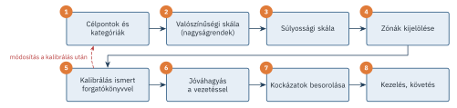
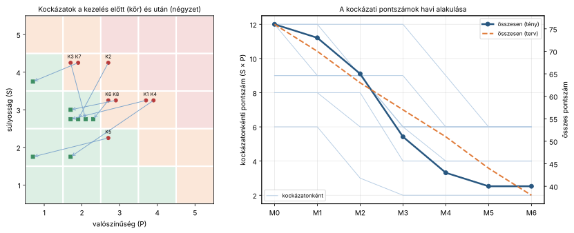

# Kockázati mátrix {#sec-kockazati-matrix}

::: {.cel title="Eszközkártya"}
- **Mire való?** A kockázatok egységes, szubjektív minősítése valószínűség és súlyosság alapján; a kezelés sürgősségének kijelölése és a kockázatok követése egy kockázati nyilvántartásban.
- **Tanulási eredmény:** az eszközlap feldolgozása után képes leszel a projekthez igazított, kalibrált kockázati mátrixot szerkeszteni, és a kockázatokat a mátrixban következetesen minősíteni és rangsorolni.
- **V-lépés:** átívelő tevékenység a teljes életcikluson; először a koncepció kiválasztásakor és a veszélyelemzésben, utána minden felülvizsgálaton.
- **Bemenet:** azonosított veszélyek vagy projektkockázatok, a vezetés által jóváhagyott kockázati kritériumok.
- **Kimenet:** kalibrált kockázati mátrix, kockázati nyilvántartás feltétel–következmény állításokkal, kezelési móddal, felelőssel, küszöbbel; havi követés.
- **Időigény:** a mátrix kialakítása és kalibrálása 1–2 óra; a nyilvántartás első kitöltése 2–3 óra, havi frissítése fél óra.
- **Kézikönyv:** [14. fejezet](../../kezikonyv/fejezetek/14-kockazat.html), 14.2–14.3. és 14.6. szakasz.
- **Továbbolvasás:** [@goldberg1994toolbox, 3.1. szakasz].
:::

## Mikor használd?

- **Veszélyelemzésben** a veszélyek rangsorolására ([-@sec-pha]. eszközlap): mely veszélyekkel kell azonnal, melyekkel később foglalkozni. A mátrix a szubjektív kockázatértékelést egységesíti, de maga nem azonosít veszélyeket [@ericson2015].
- **Projektkockázatok** (technikai, költség, ütemezési) követésére: a havi frissített nyilvántartás megmutatja, mely kockázatok nem csökkennek a tervek szerint.
- **Kommunikációra**: a vezetés, a csapat és az érdekelt felek ugyanazt a skálát és ugyanazokat a zónákat értik.
- **Nem** alkalmas két hasonló kockázatú tervváltozat közötti finom döntésre; ott mennyiségi elemzés kell (megbízhatósági blokkdiagram, hibafa, eseményfa: [-@sec-rbd]–[-@sec-esemenyfa]. eszközlap).

## Lépések

{#fig-lepesek-kockazati-matrix width=100%}

1. **Határozd meg a célpontokat és a kategóriákat.** Mi van kockázatnak kitéve (személy, berendezés, termelés, termék, környezet, projektcél)? Célpontonként külön súlyossági leírás kell, de közös szintekkel [@milstd882e].
2. **Szerkeszd meg a valószínűségi skálát.** A szomszédos szintek nagyságrendben különbözzenek, és minden szinthez tartozzon expozíciós idő (évente, élettartam alatt, a projekt során).
3. **Szerkeszd meg a súlyossági skálát** célpontonként, konkrét, felismerhető leírásokkal (például „orvosi ellátást igénylő sérülés”, „1–3 hónap csúszás”).
4. **Jelöld ki a zónákat.** Csak annyi zóna legyen, ahány különböző kezelési mód van (elfogadhatatlan, tűrhető, elfogadható), és egy lépés a mátrixban legfeljebb egy zónahatárt lépjen át. Ha mindkét skála nagyságrendi lépésekből áll, a szintek összege ($S + P$) a kockázat logaritmusával arányos, így az azonos összegű cellák az izokockázati görbék mentén helyezkednek el; a sablon ezért az összegre alapozza a zónákat.
5. **Kalibráld a mátrixot** egy mindenki által ismert forgatókönyvvel: helyezd el, és ellenőrizd, hogy a besorolása megfelel-e a közös ítéletnek.
6. **Hagyasd jóvá a zónahatárokat a vezetéssel.** A kockázatvállalásról nem az elemző dönt.
7. **Sorold be a kockázatokat** a legrosszabb hihető következmény alapján, a kezelés előtt és a tervezett intézkedések után.
8. **Kezeld és kövesd a kockázatokat**: rögzítsd a kezelés módját, a felelőst, a beavatkozást kiváltó küszöböt, és havonta frissítsd a pontszámokat.

## Kidolgozott példa: a ForgácsTech MES-bevezetésének kockázatai

A ForgácsTech csapata az első ütem indításakor nyolc projektkockázatot rögzített a nyilvántartásban (kézikönyv 14.6. szakasz). Néhány bejegyzés:

| Az. | Kockázat (rövidítve) | $S$/$P$ előtte | Kezelés | $S$/$P$ utána |
|:--|:--|:-:|:--|:-:|
| K1 | gépi interfészek hiánya → 2–3 hónap csúszás | 3/4 (ALARP) | felmérés szerződéskötés előtt, hardvertartalék | 3/2 (elfogadható) |
| K2 | az ütemező megkerülése → nem javul a határidő | 4/3 (ALARP) | a műszakvezetők bevonása, naplózott átsorolás | 3/2 (elfogadható) |
| K3 | beszállítói függés → a későbbi ütemek ára | 4/2 (ALARP) | megosztás: ár rögzítése a keretszerződésben | 3/2 (elfogadható) |
| K4 | elavult normaidők → pontatlan javaslatok | 3/4 (ALARP) | normaidők felülvizsgálata gépi adatokkal | 2/2 (elfogadható) |
| K7 | kibertámadás → termelésleállás | 4/2 (ALARP) | hálózati szegmentálás, mentési rend | 4/1 (elfogadható) |

: A ForgácsTech kockázati nyilvántartásának részlete. {#tbl-km-forgacs tbl-colwidths="[6,38,14,28,14]"}

A nyolc kockázatból hét a tűrhető tartományból indult, a tervezett kezelés után mind elfogadható. Az összes pontszám ($\sum S \cdot P$) hat hónap alatt 76-ról 40-re csökkent ([-@fig-kockazati-matrix]. ábra).

{#fig-kockazati-matrix width=100%}

**Tanulságok:**

- **A feltétel–következmény állítás megmutatja, hol lehet beavatkozni.** A K1 feltétele („nincs digitális interfész”) ma is igaz; az intézkedés a valószínűséget a feltétel korai felmérésével csökkenti, a következményt a tartalékkal.
- **A követés felfedi a lassan csökkenő kockázatokat.** A K2 és a K8 a harmadik hónapban még a kiinduló szinten állt. A K2-nél a beavatkozási küszöb (a rendszeren kívüli átsorolások aránya) a próbaüzemben teljesült, és a csapat elindította a tervezett tartalékintézkedést.
- **A súlyosság gyakran nem csökkenthető.** A kibertámadás következménye (K7) a szegmentálás után is súlyos maradt; csak a valószínűsége csökkent. Az ilyen kockázatokat a maradó szinten is figyelni kell.
- **A mátrix felbontása korlátozott.** A notebook szimulációja szerint két véletlen kockázat közül a mátrix mintegy harmadát azonos zónába sorolja, holott valódi kockázatuk többszörösen eltérhet [@cox2008].

## Sablon és notebook

- [kockazati_matrix_sablon.xlsx](../sablonok/kockazati_matrix_sablon.xlsx): skála személyi, berendezési és projektkockázatra, két valószínűségi skálával és állítható zónahatárokkal; kockázati nyilvántartás legfeljebb 30 kockázatra (zóna és pontszám a kezelés előtt és után, legördülő kezelési módok és állapotok); két 5 × 5-ös mátrix a kockázatok számával; havi követés tény–terv diagrammal. A ForgácsTech példájával kitöltve.
- [kockazati_matrix.ipynb](../notebookok/kockazati_matrix.ipynb) · [Megnyitás Google Colabban](kockazati_matrix.ipynb): a kockázatok elhelyezése a mátrixon, a zónák folytonosságának ellenőrzése, a mátrix felbontásának szimulációja Cox gondolatmenete szerint, a pontszámok követése (a [-@fig-kockazati-matrix]. ábra így készült).

## Előnyök és korlátok

| Előnyök | Korlátok |
|:--|:--|
| Egyszerű, gyorsan alkalmazható, jól kommunikálható | Szubjektív; a besorolás az értékelők tapasztalatán múlik |
| Egységesíti a szervezet kockázatértékelését | Gyenge felbontás: különböző kockázatok kerülhetnek egy cellába [@cox2008] |
| A kezelés előtti és utáni állapot egy ábrán látható | A cellahatárok közelében kis becslési eltérés más zónát ad |
| A nyilvántartással együtt a folyamatos kockázatkezelés alapja | Nem azonosít veszélyt; a kockázatok közötti függőségeket nem kezeli |

: A kockázati mátrix előnyei és korlátai. {tbl-colwidths="[50,50]"}

::: {.hiba}
- **Expozíciós idő nélküli valószínűség.** „Ritka” – de mihez képest: egy műszakban, egy évben vagy a teljes élettartam alatt?
- **Túl finom skála.** A 10 × 10-es mátrix pontosság látszatát kelti, miközben a besorolás szubjektív.
- **A legrosszabb elképzelhető eset.** Ha minden kockázatot a legrosszabb elképzelhető következménnyel értékelünk, minden piros lesz, és a mátrix elveszíti megkülönböztető erejét; a legrosszabb hihető eset kell.
- **Szín alapú döntés.** A zöld nem jelenti, hogy nincs teendő, és a piros sem, hogy minden áron csökkenteni kell; a döntéshez indoklás kell (ALARP).
- **Elfelejtett nyilvántartás.** A kezelés első kitöltés után nem frissített nyilvántartás a projekt elején érvényes képet őrzi.
:::

## Mintapromptok

::: {.prompt title="Mintaprompt: kockázati állítások megfogalmazása"}
```text
Projektünk: [LEÍRÁS]. Az alábbi aggodalmakat gyűjtöttük össze a
csapatmegbeszélésen: [LISTA].
Feladat: fogalmazz meg mindegyikből kockázati állítást „Mivel
[ma igaz feltétel], fennáll a lehetősége, hogy [esemény], ami
[következmény a projekt céljaira]” formában. Ha egy aggodalom
valójában már bekövetkezett probléma vagy csak egy feltétel,
jelezd. Valószínűséget és súlyosságot ne adj meg: azt a csapat
becsüli.
```
:::

::: {.prompt title="Mintaprompt: a mátrix ellenőrzése"}
```text
Kockázati mátrixunk skálái és zónái: [SKÁLÁK, ZÓNÁK].
Feladat: ellenőrizd a mátrixot a szakirodalom szabályai
szerint: nagyságrendi valószínűségi lépések, expozíciós idő,
a cellák és zónák száma, a zónák folytonossága (egy lépés
legfeljebb egy határ). Javasolj egy kalibráló forgatókönyvet,
amelyet a csapat minden tagja ismer. A zónahatárokat ne
változtasd meg: azokat a vezetés hagyja jóvá.
```
:::

## Feladat

::: {.projekt title="6. projektlépés (negyedik rész): kockázati mátrix és nyilvántartás"}
Saját projektedben alakíts ki kockázati mátrixot a projekthez illő skálákkal, és kalibráld egy ismert forgatókönyvvel. Nyiss kockázati nyilvántartást legalább öt projektkockázattal feltétel–következmény formában, kezelési móddal, felelőssel és beavatkozási küszöbbel, és jelöld a várható maradó kockázatot.
:::
