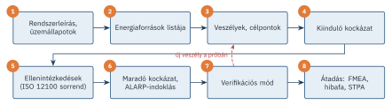
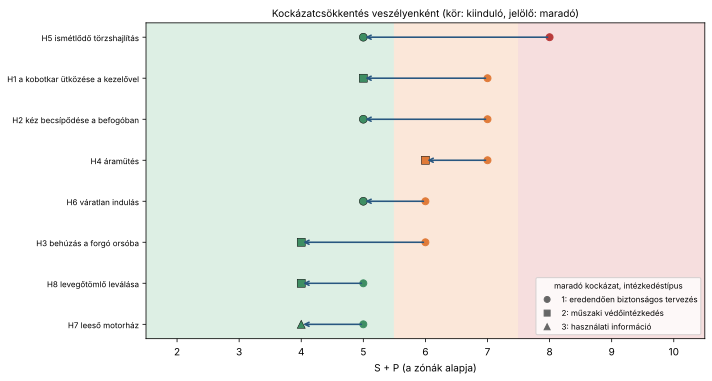

# Előzetes veszélyelemzés (PHA) {#sec-pha}

::: {.cel title="Eszközkártya"}
- **Mire való?** A rendszer veszélyeinek korai leltára: energiaforrások, veszélyek, célpontok, kiinduló kockázat, ellenintézkedések és maradó kockázat, mielőtt a részletes tervezés elkezdődik.
- **Tanulási eredmény:** az eszközlap feldolgozása után képes leszel az energiaforrásokból és a felhasználói feladatokból kiindulva előzetes veszélyelemzést végezni, a veszélyekhez ellenintézkedést rendelni és a maradó kockázatot értékelni.
- **V-lépés:** 3–4. Koncepció és architektúra (a kiválasztott koncepcióra); a részletes tervezés elején frissítve.
- **Bemenet:** a koncepció leírása és üzemállapotai, a funkciófa és a funkciómegosztás, a kezelői feladatok (HTA), a kockázati mátrix.
- **Kimenet:** PHA-munkalap, a veszélyek rangsora, az intézkedések listája típusuk szerint, maradó kockázat ALARP-indoklással, verifikációs módok; a részletes elemzések (FMEA, hibafa, STPA) célpontjai.
- **Időigény:** egy cellányi rendszerre 3–5 óra, a csapattal együtt.
- **Kézikönyv:** [14. fejezet](../../kezikonyv/fejezetek/14-kockazat.html), 14.4–14.5. szakasz.
- **Továbbolvasás:** [@goldberg1994toolbox, 3.2. és 3.3. szakasz].
:::

## Mikor használd?

- **Korán**, amint a koncepció ismert. A PHA a veszélyek és ellenintézkedések leltárát adja; mivel kevés részletet igényel, akkor is elvégezhető, amikor a részletes tervek még nem készültek el [@ericson2015].
- **Koncepciók összevetésekor**: egy-egy koncepció veszélyleltára fontos kiválasztási szempont lehet (a KoboCella C koncepciója ergonómiai okból esett ki).
- **A részletes elemzések célzására**: a PHA megmutatja, mely veszélyekhez kell FMEA ([-@sec-fmea]. eszközlap), hibafa ([-@sec-hibafa]. eszközlap) vagy rendszerelméleti elemzés ([-@sec-stpa]. eszközlap).
- **Korlát**: a PHA az egyidejűleg fennálló hibák kombinációit nem vizsgálja [@ericson2015].

## Lépések

{#fig-lepesek-pha width=100%}

1. **Írd le a rendszert és az üzemállapotait**: normál üzem, indítás, leállás, karbantartás, leromlott üzem, tisztítás. A veszélyek sokszor nem a normál üzemben jelentkeznek.
2. **Készítsd el az energiaforrások listáját.** Haddon szerint a sérülések többsége nem kívánt energiaátadásból ered [@haddon1973]; a sablon ellenőrzőlistája tizenegy energiafajtát sorol fel (mozgási, helyzeti, nyomás, villamos, hő, kémiai, sugárzás, akusztikus, ergonómiai terhelés, vezérlés, környezeti). Az energiaforrások, a célpontok és a gátak vizsgálata önálló módszerként is ismert (gátelemzés) [@haddon1973; @ericson2015].
3. **Azonosítsd a veszélyeket és a célpontokat.** Minden energiaforráshoz: milyen esemény juttathatja el az energiát a célponthoz (személy, berendezés, termék, környezet)? Használd a HTA lépéseit is: hol van a kezelő a veszélyes zóna közelében?
4. **Értékeld a kiinduló kockázatot** a kockázati mátrixszal ([-@sec-kockazati-matrix]. eszközlap), a legrosszabb hihető következményre.
5. **Határozd meg az ellenintézkedéseket** az ISO 12100 sorrendjében: 1. eredendően biztonságos tervezés, 2. műszaki védőintézkedés, 3. használati információ [@iso12100_2010]. Mindig az első típussal kezdd.
6. **Értékeld a maradó kockázatot.** Ha a tűrhető (ALARP) tartományban marad, írd le, miért nem észszerű a további csökkentés [@hse2001].
7. **Rendelj verifikációs módot** minden intézkedéshez (mérés, funkcionális teszt, ellenőrzés, audit); ezek a verifikációs terv bemenetei.
8. **Add át a veszélyeket a részletes elemzéseknek**, és frissítsd a PHA-t, ha a próbák vagy a részletes elemzések új veszélyt tárnak fel.

## Kidolgozott példa: a KoboCella előzetes veszélyelemzése

A KoboCella csapata nyolc veszélyt rögzített hat energiafajtához (a kézikönyv [14. fejezete](../../kezikonyv/fejezetek/14-kockazat.html) a részletet közli). A [-@fig-pha-csokkentes]. ábra veszélyenként mutatja a kockázatcsökkentést és az intézkedés típusát.

{#fig-pha-csokkentes width=100%}

| Veszély | Energia | Kiinduló zóna | Intézkedés (típus) | Maradó zóna |
|:--|:--|:--|:--|:--|
| H5 ismétlődő törzshajlítás | ergonómiai terhelés | elfogadhatatlan | állítható munkamagasság, ≤ 20° (1) | elfogadható |
| H1 a kobotkar ütközése | mozgási | ALARP | erőhatárolás, szkenner, ≤ 250 mm/s (2) | elfogadható |
| H4 áramütés karbantartáskor | villamos | ALARP | érintésvédelem, kizárás, képzett szakember (2) | ALARP, indoklással |
| H7 leeső motorház | helyzeti | elfogadható | csúszásgátló tálca, védőcipő (3) | elfogadható |

: Néhány sor a KoboCella PHA-jából. Az intézkedés típusa: 1 tervezési, 2 műszaki védőintézkedés, 3 tájékoztatás, egyéni védőeszköz. {#tbl-pha-pelda tbl-colwidths="[26,16,14,30,14]"}

**Tanulságok:**

- **A legnagyobb kiinduló kockázat nem a robotból jött**, hanem a jelenlegi kézi munka ergonómiai terheléséből. Ezt tervezési intézkedés (állítható munkamagasság) kezeli, nem tájékoztatás.
- **Az intézkedések túlnyomó része tervezési vagy műszaki védőintézkedés.** Tájékoztatásra és egyéni védőeszközre csak a kis súlyosságú H7-nél épít a csapat; súlyos veszélynél a notebook ezt hiányosságként jelezné.
- **Egy veszély indokoltan maradt a tűrhető tartományban.** Az áramütés súlyossága nem csökkenthető; a csapat írásban indokolta, miért aránytalan a további csökkentés, és a vezetés elfogadta.
- **A PHA a részletes elemzések célpontjait is kijelöli.** A H1 és a H6 (váratlan indulás szoftverhiba miatt) a vezérlés és a biztonsági funkciók kölcsönhatásán múlik: ezekre a csapat STPA-t végzett ([-@sec-stpa]. eszközlap); a csavarozó egység hibamódjait FMEA elemzi ([-@sec-fmea]. eszközlap).

## Sablon és notebook

- [pha_sablon.xlsx](../sablonok/pha_sablon.xlsx): energiaforrás-ellenőrzőlista tizenegy energiafajtával; PHA-munkalap legfeljebb 40 veszélyre legördülő energiafajtával, célponttal és intézkedéstípussal, automatikus zónákkal és jelzésekkel (elfogadhatatlan maradó kockázat, hiányzó ALARP-indoklás, súlyos veszély csak tájékoztatással, hiányzó verifikáció); összesítő mátrixok és mutatók. A KoboCella példájával kitöltve; a skálát a kockázati mátrix sablonnal közösen használja.
- [pha.ipynb](../notebookok/pha.ipynb) · [Megnyitás Google Colabban](pha.ipynb): zónák és jelzések, kereszttábla a kiinduló és a maradó zónákról, összesítés energiafajtánként, ábra a veszélyenkénti kockázatcsökkentésről (a [-@fig-pha-csokkentes]. ábra így készült).

## Előnyök és korlátok

| Előnyök | Korlátok |
|:--|:--|
| Korán, kevés részlettel is elvégezhető | Az egyidejű hibák kombinációit nem vizsgálja |
| A veszélyek és ellenintézkedések teljes leltárát adja | Az energiaszemlélet nem minden veszélyt fed le (például oxigénhiány zárt térben) |
| Az intézkedések típusa a hatékonyság szerinti rangsort is mutatja | A teljesség a csapat tapasztalatán múlik |
| A verifikációs terv és a részletes elemzések bemenete | A kockázatbecslés szubjektív (a mátrix korlátaival) |

: Az előzetes veszélyelemzés előnyei és korlátai. {tbl-colwidths="[50,50]"}

::: {.hiba}
- **Csak a normál üzem.** A karbantartás, a tisztítás, az indítás és a hibaelhárítás gyakran veszélyesebb, mint a normál üzem.
- **Figyelmeztetés mint első megoldás.** A „Vigyázat, mozgó alkatrész!” felirat a harmadik helyen áll a sorrendben; előbb meg kell vizsgálni, megszüntethető vagy elkeríthető-e a veszély.
- **Az új veszélyek figyelmen kívül hagyása.** Minden intézkedés új veszélyt hozhat (például egy védőburkolat akadályozza a karbantartást, és ezért leszerelik).
- **A PHA mint egyszeri dokumentum.** A koncepció változásával és a próbák tapasztalataival frissíteni kell.
:::

## Mintapromptok

::: {.prompt title="Mintaprompt: energiaforrások és veszélyek"}
```text
Rendszerünk: [LEÍRÁS], üzemállapotai: [LISTA]. A kezelő
feladatai (HTA): [LÉPÉSEK].
Feladat: az energia–gát szemlélet alapján sorold fel a rendszer
energiaforrásait (mozgási, helyzeti, nyomás, villamos, hő, kémiai,
sugárzás, akusztikus, ergonómiai terhelés, vezérlés), és mindegyikhez
a lehetséges veszélyes eseményeket és célpontokat, üzemállapotonként.
Kockázatot ne becsülj, és ne javasolj intézkedést: ezt a csapat
végzi.
```
:::

::: {.prompt title="Mintaprompt: ellenintézkedések rangsorolása"}
```text
Az alábbi veszélyekhez javasolt intézkedéseink: [TÁBLÁZAT].
Feladat: minden intézkedést sorolj be az ISO 12100 sorrendje
szerint (eredendően biztonságos tervezés, műszaki védőintézkedés,
használati információ). Ahol csak tájékoztatás vagy egyéni
védőeszköz szerepel, vizsgáld meg, van-e tervezési vagy műszaki
lehetőség, és nevezd meg, milyen új veszélyt hozhat maga az
intézkedés.
```
:::

## Feladat

::: {.projekt title="6. projektlépés (ötödik rész): előzetes veszélyelemzés"}
Saját projektedben végezz előzetes veszélyelemzést legalább hat veszéllyel, az energiaforrás-ellenőrzőlista és a felhasználói feladatok alapján. Minden veszélyhez adj intézkedést típusával, maradó kockázatot és verifikációs módot; ha a maradó kockázat tűrhető, indokold.
:::
