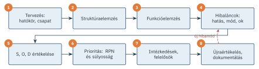
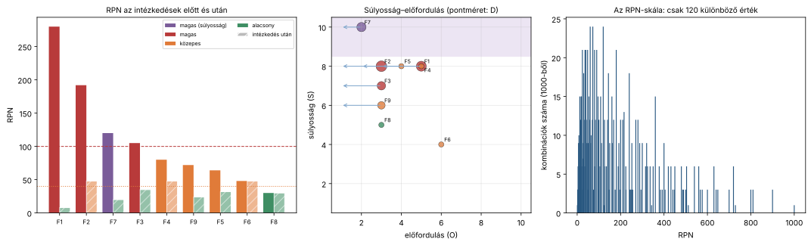

# FMEA {#sec-fmea}

::: {.cel title="Eszközkártya"}
- **Mire való?** A rendszer elemeinek vagy a folyamat lépéseinek lehetséges hibamódjai, ezek hatásai és okai; a kockázat értékelése súlyosság, előfordulás és észlelhetőség szerint; az intézkedések kijelölése és követése.
- **Tanulási eredmény:** az eszközlap feldolgozása után képes leszel tervezési vagy folyamat-FMEA-t végezni hibaláncokkal, a hibamódokat súlyosság, előfordulás és észlelhetőség szerint értékelni, és a prioritás alapján intézkedést javasolni.
- **V-lépés:** 4–5. Architektúra és részletes tervezés (tervezési FMEA), a gyártás-előkészítés (folyamat-FMEA); élő dokumentumként a verifikációig és az üzemeltetésig.
- **Bemenet:** a struktúra (fizikai architektúra, folyamatlépések, HTA), a funkciók és követelmények, a PHA, korábbi hibák, reklamációk, hasonló termékek FMEA-i.
- **Kimenet:** FMEA-munkalap hibaláncokkal, S/O/D értékeléssel, prioritással, intézkedésekkel felelőssel és határidővel, az intézkedések utáni újraértékelés.
- **Időigény:** alrendszerenként 4–8 óra csapatmunka; a frissítés folyamatos.
- **Kézikönyv:** [15. fejezet](../../kezikonyv/fejezetek/15-fmea.html).
- **Továbbolvasás:** [@goldberg1994toolbox, 3.4. szakasz].
:::

## Mikor használd?

- **Új termék, technológia vagy folyamat** tervezésekor, teljes körűen; **módosításkor** a változásra és hatásaira összpontosítva; **új környezetben vagy alkalmazásban** a megváltozott feltételekre [@aiagvda2019].
- **Ha a PHA vagy a kockázati nyilvántartás** egy alrendszert vagy folyamatot kockázatosnak jelölt ([-@sec-pha]. eszközlap).
- **Az egypontos hibák** feltárására: az FMEA erre alapos módszer, de az egyidejű hibák kombinációit nem vizsgálja; azokhoz hibafa kell ([-@sec-hibafa]. eszközlap) [@iec60812_2018].

## Lépések

{#fig-lepesek-fmea width=100%}

1. **Tervezés:** rögzítsd a hatókört (mit elemzünk és mit nem), a csapatot (tervezés, gyártás, minőségügy, karbantartás, kezelő), az ütemezést és a skálákat [@aiagvda2019].
2. **Struktúraelemzés:** bontsd a rendszert elemekre (rendszer, alrendszer, komponens) vagy a folyamatot lépésekre és munkaelemekre. A folyamat-FMEA-nál a HTA lépései jó kiindulópontot adnak ([-@sec-hta]. eszközlap).
3. **Funkcióelemzés:** rendeld az elemekhez a funkciókat és követelményeket, mérhető formában (például „nyomaték 4,0 ± 0,2 Nm”).
4. **Hibaláncok:** minden funkcióhoz írd fel a hibamódokat (fizikai fogalommal), a hibahatásokat (ahogyan a vevő érzékeli) és a hibaokokat. Egy szint hibamódja a fölötte lévő szint hibaoka.
5. **Értékelés:** rögzítsd a meglévő megelőző és észlelő intézkedéseket, majd értékeld a súlyosságot ($S$), az előfordulást ($O$) és az észlelhetőséget ($D$) 1-től 10-ig. A súlyosság a legsúlyosabb hatáshoz tartozik.
6. **Prioritás:** számítsd ki az $\text{RPN} = S \cdot O \cdot D$ értéket, de ne csak ez alapján rangsorolj. A sablon egyszerűsített szabálya: 9–10-es súlyosságnál, ha az előfordulás legalább 2, a prioritás mindig magas; egyébként 100 fölött magas, 40 és 100 között közepes. Ez az AIAG–VDA cselekvési prioritásának elvét követi (először a súlyosság, aztán az előfordulás, végül az észlelhetőség), de nem helyettesíti annak táblázatát.
7. **Intézkedések:** a magas és közepes prioritású sorokhoz rendelj intézkedést felelőssel és határidővel. Sorrend: a súlyosság csökkentése konstrukciós változtatással, az előfordulás csökkentése (megelőzés, hibabiztos kialakítás), végül az észlelés javítása.
8. **Újraértékelés és dokumentálás:** a végrehajtás után értékeld újra a sort, és tartsd naprakészen az FMEA-t a változásokkal, a próbák és a reklamációk tapasztalataival.

## Kidolgozott példa: a KoboCella FMEA-ja

A KoboCella csapata a folyamat-FMEA-t a kezelő HTA-jából és a cella gépi funkcióiból építette fel; a kézikönyv [15. fejezete](../../kezikonyv/fejezetek/15-fmea.html) a részletét közli. A sablon kilenc hibamódot tartalmaz, köztük egy biztonsági funkcióét is:

| Az. | Hibamód | $S$ | $O$ | $D$ | RPN | Prioritás | Intézkedés | RPN’ |
|:--|:--|:-:|:-:|:-:|:-:|:--|:--|:-:|
| F1 | fordított fedél | 8 | 5 | 7 | 280 | magas | aszimmetrikus illesztőcsapok | 8 |
| F2 | hibás darab a kiadóba kerül | 8 | 3 | 8 | 192 | magas | a kiadó reteszelése | 48 |
| F7 | a lézerszkenner nem érzékeli a kezelőt | 10 | 2 | 6 | 120 | magas (súlyosság) | napi indítási teszt, önellenőrzés | 20 |
| F3 | rossz típusprogram | 7 | 3 | 5 | 105 | magas | a HMI tölti be a programot | 35 |
| F4 | hiányzó csavar | 8 | 5 | 2 | 80 | közepes | töltöttségérzékelő | 48 |
| F6 | a motorház nem ül fel teljesen | 4 | 6 | 2 | 48 | közepes | – | 48 |

: A KoboCella FMEA-jának részlete a sablonból. RPN’: az intézkedés utáni érték. {#tbl-fmea-pelda tbl-colwidths="[6,30,5,5,5,7,14,22,6]"}

Az intézkedések után egyetlen magas prioritású sor sem maradt; a legnagyobb RPN 280-ról 48-ra csökkent ([-@fig-fmea-elemzes]. ábra).

{#fig-fmea-elemzes width=100%}

**Tanulságok:**

- **A legjobb intézkedés megszünteti a hibát.** A fordított fedélnél a hibabiztos kialakítás az előfordulást és az észlelhetőséget is a legjobb értékre vitte, mert a hiba nem jöhet létre (a sablon skáláján az 1-es észlelhetőség ezt az esetet is jelenti).
- **A súlyosság önálló figyelmet kíván.** A szkenner hibamódja (F7) 10-es súlyosságú; a szabály akkor is magas prioritást adna, ha az RPN 100 alatt lenne. Az intézkedés a súlyosságot nem változtatja meg, csak az előfordulást és az észlelhetőséget.
- **Azonos RPN, különböző kockázat.** Az intézkedések után a hiányzó csavar (F4, $S = 8$) és a motorház behelyezése (F6, $S = 4$) egyaránt 48: az RPN nem különbözteti meg a vevőnél tömítetlen motort az időveszteségtől [@bowles2003].
- **Az RPN-skála lyukas és egyenetlen.** Az 1000 kombináció csak 120 különböző értéket ad, a kombinációk mediánja 105; a 100-as küszöb tehát a lehetséges esetek felét magasnak minősíti.

## Sablon és notebook

- [fmea_sablon.xlsx](../sablonok/fmea_sablon.xlsx): fejléc az azonosító adatokkal; S/O/D skálák 1–10-ig a klasszikus autóipari skálák alapján; FMEA-munkalap legfeljebb 60 hibamódra (RPN, prioritás egyszerűsített szabály szerint, állítható küszöbökkel, javasolt és végrehajtott intézkedés, újraértékelés, színezett prioritás); összesítés az intézkedések előtt és után. A KoboCella példájával kitöltve.
- [fmea.ipynb](../notebookok/fmea.ipynb) · [Megnyitás Google Colabban](fmea.ipynb): RPN és prioritás az intézkedések előtt és után, az azonos RPN-ű, de eltérő súlyosságú sorok keresése, az RPN-skála elemzése, ábra (a [-@fig-fmea-elemzes]. ábra így készült).

## Előnyök és korlátok

| Előnyök | Korlátok |
|:--|:--|
| Rendszeres, elemenkénti áttekintés; az egypontos hibák alapos feltárása [@iec60812_2018] | Munkaigényes; nagy rendszernél kezelhetetlenül hosszú lehet |
| A csapat tudását és a korábbi tapasztalatokat egy dokumentumba gyűjti | Az egyidejű hibák kombinációit nem vizsgálja |
| Közvetlenül intézkedésekhez és a verifikációs tervhez vezet | Az S, O, D értékelése szubjektív; a skálák sorrendiek |
| Élő dokumentumként a teljes életciklust kíséri | Az RPN torzít: azonos érték mögött eltérő kockázat [@bowles2003; @liu2013fmea] |

: Az FMEA előnyei és korlátai. {tbl-colwidths="[50,50]"}

::: {.hiba}
- **Tünet a hibamód helyett.** „A motor nem jó” helyett „a nyomaték alacsony”: a fizikai hibamód vezet el az okhoz.
- **Csak az RPN alapján döntünk.** A 9–10-es súlyosságú sorok akkor is figyelmet kívánnak, ha az RPN-jük alacsony.
- **Az észlelés javítása a megelőzés helyett.** Egy újabb ellenőrzés csökkenti az RPN-t, de a hiba továbbra is létrejön, és költséget okoz.
- **„Oktatás” mint intézkedés.** Az emberi hibamódoknál a képzés a leggyengébb intézkedés ([-@sec-pha]. eszközlap, ISO 12100 sorrend).
- **Egyszer kitöltött táblázat.** Az FMEA-t a változásokkal és a próbák tapasztalataival frissíteni kell.
:::

## Mintapromptok

::: {.prompt title="Mintaprompt: hibaláncok"}
```text
Vizsgált elem: [ELEM], funkciói és követelményei: [LISTA].
Az elem a(z) [FÖLÖTTE LÉVŐ RENDSZER] része; részei: [ALKATRÉSZEK].
Feladat: minden funkcióhoz sorolj fel lehetséges hibamódokat
fizikai, műszaki fogalmakkal (nem tünetként), és mindegyikhez a
hibahatást a fölötte lévő szinten és a vevőnél, valamint a
lehetséges okokat az alatta lévő szinten. Jelöld a biztonsági
vagy jogszabályi hatásokat. S, O, D értéket ne adj meg.
```
:::

::: {.prompt title="Mintaprompt: intézkedések felülvizsgálata"}
```text
Az FMEA magas prioritású sorai a javasolt intézkedésekkel: [TÁBLÁZAT].
Feladat: minden intézkedésnél állapítsd meg, hogy a súlyosságot,
az előfordulást vagy az észlelhetőséget javítja-e. Ahol csak
észlelést javítunk vagy oktatást javasolunk, keress megelőző vagy
hibabiztos megoldást. Jelöld, ha egy intézkedés új hibamódot
hozhat létre. Az értékeléseket ne módosítsd.
```
:::

## Feladat

::: {.projekt title="6. projektlépés (hatodik rész): FMEA"}
Saját projektedben készíts FMEA-t a legkockázatosabb alrendszerre vagy folyamatra legalább nyolc hibamóddal, hibaláncokkal, meglévő intézkedésekkel és S, O, D értékeléssel. A magas prioritású sorokhoz javasolj intézkedést felelőssel, add meg a várható új értékelést, és mutass rá legalább egy esetre, ahol az RPN félrevezető lenne.
:::
