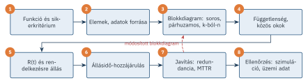
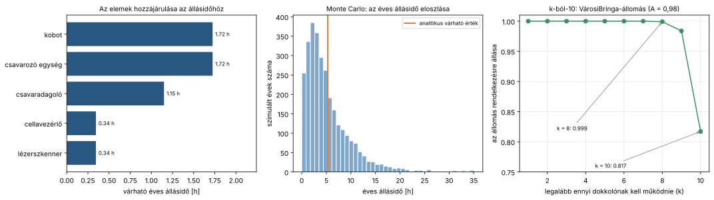

# Megbízhatósági blokkdiagram {#sec-rbd}

::: {.cel title="Eszközkártya"}
- **Mire való?** A rendszer megbízhatóságának és rendelkezésre állásának becslése az elemek adataiból; az egypontos hibák és a legnagyobb állásidő-okozók azonosítása; a redundancia és a javítási idő hatásának vizsgálata.
- **Tanulási eredmény:** az eszközlap feldolgozása után képes leszel megbízhatósági blokkdiagramot felállítani, kiszámítani a rendszer megbízhatóságát és rendelkezésre állását, és azonosítani az egypontos hibákat.
- **V-lépés:** 4. Architektúra (változatok összevetése), 5. Részletes tervezés (megbízhatósági allokáció), 7–8. Verifikáció (az üzemi adatok összevetése a modellel).
- **Bemenet:** a funkció sikerkritériuma, a fizikai architektúra, az elemek MTBF- és MTTR-adatai (adatlap, adatbázis, üzemi tapasztalat, becslés), a küldetési idő és az éves üzemidő.
- **Kimenet:** blokkdiagram, a blokkok és a rendszer $R(t)$ és $A$ értéke, az állásidő-hozzájárulások, a javasolt redundanciák és MTTR-csökkentések.
- **Időigény:** egy cellányi rendszerre 2–3 óra az adatgyűjtéssel együtt.
- **Kézikönyv:** [16. fejezet](../../kezikonyv/fejezetek/16-megbizhatosag.html), 16.1–16.3. szakasz.
- **Továbbolvasás:** [@goldberg1994toolbox, 3.5. szakasz].
:::

## Mikor használd?

- **Rendelkezésre állási vagy megbízhatósági követelmény** tervezésekor és allokálásakor: mekkora MTBF és MTTR kell az egyes elemekre, hogy a rendszer teljesítse a követelményt?
- **Változatok összevetésekor**: mit ér egy redundáns elem, egy tartalék alkatrész vagy egy leromlott üzemmód?
- **Erősség és korlát:** a blokkdiagram viszonylag könnyen felépíthető szimbolikus logikai modell; korlátja, hogy az elemek adatai nem mindig érhetők el, és a számított megbízhatóság irreálisan magas lehet [@oconnor2012].

## Lépések

{#fig-lepesek-rbd width=100%}

1. **Határozd meg a funkciót és a sikerkritériumot.** Mit jelent, hogy a rendszer „működik”? A $k$-ból-$n$ elrendezésnél a követelmény maga mondja meg a $k$ értéket.
2. **Gyűjtsd össze az elemeket és az adataikat** (MTBF, MTTR), és jegyezd fel az adat forrását. Az adatlapok MTBF-definíciója eltérhet; ellenőrizd [@oconnor2012].
3. **Rajzold fel a blokkdiagramot**: soros elem az, amelynek kiesése a funkciót megszünteti; párhuzamos az, amelyet egy másik helyettesíthet; $k$-ból-$n$ az, ahol legalább $k$ elem kell [@iec61078_2016].
4. **Vizsgáld meg a függetlenséget**: van-e közös táp, közös szoftver, közös környezet vagy karbantartás? Ezek a párhuzamos ágak előnyét csökkentik.
5. **Számítsd ki** az elemek, a blokkok és a rendszer megbízhatóságát a küldetési időre és a rendelkezésre állását (a képleteket a kézikönyv 16.3. szakasza adja meg).
6. **Határozd meg az állásidő-hozzájárulásokat**: melyik elem mennyi éves állásidőt okoz.
7. **Javíts**: redundancia, jobb elem (nagyobb MTBF), rövidebb javítás (tartalék alkatrész, gyorscsere: kisebb MTTR), leromlott üzemmód.
8. **Ellenőrizd** a modellt szimulációval és később az üzemi adatokkal.

## Kidolgozott példa: a KoboCella termelési funkciója

A KoboCella öt eleme sorosan kapcsolódik; leromlott üzemben a kézi szerelés (UM-7) párhuzamos tartalékként veszi át a termelést (kézikönyv [16. fejezet](../../kezikonyv/fejezetek/16-megbizhatosag.html)).

| Elem | MTBF [h] | MTTR [h] | $A$ | Éves állásidő [h] |
|:--|--:|--:|:-:|--:|
| kobot | 8000 | 4 | 0,99950 | 1,72 |
| csavarozó egység | 2000 | 1 | 0,99950 | 1,72 |
| csavaradagoló | 1500 | 0,5 | 0,99967 | 1,15 |
| lézerszkenner | 20 000 | 2 | 0,99990 | 0,34 |
| cellavezérlő | 30 000 | 3 | 0,99990 | 0,34 |
| **soros ág (cella)** | **727** | | **0,99847** | **5,3** |
| UM-7 kézi tartalékkal | | | 0,99997 | 0,1 |

: A KoboCella elemeinek adatai és a rendelkezésre állás évi 3450 üzemórával. A cella MTBF-je az elemek meghibásodási rátáinak összegéből adódik. {#tbl-rbd-kobo tbl-colwidths="[32,14,14,18,22]"}

{#fig-rbd-elemzes width=100%}

**Tanulságok:**

- **A kobot és a csavarozó egység okozza az állásidő kétharmadát.** A csavarozó egység ritkábban áll le hosszan, de gyakrabban hibásodik meg; a tartalék orsó (rövidebb MTTR) itt a leghatékonyabb intézkedés.
- **A várható érték mögött nagy szórás van.** A szimuláció szerint az éves állásidő átlaga 5,3 óra, de az évek 5%-ában 14 óránál is több. Szerződésben és tervezésben a szórással is számolni kell.
- **A kézi tartalék a funkciót védi, nem a teljesítményt.** A párhuzamos ág a rendelkezésre állást 0,99997-re emeli, de kisebb kapacitással; a blokkdiagram ezt nem mutatja, a ciklusidő-követelményt külön kell vizsgálni.
- **A követelmény megfogalmazása is számít.** A VárosiBringa tízhelyes állomása „legalább nyolc működő dokkolóval” 0,999, „mind a tízzel” csak 0,82 valószínűséggel teljesít ([-@fig-rbd-elemzes]. ábra, jobb oldal).

## Sablon és notebook

- [rbd_sablon.xlsx](../sablonok/rbd_sablon.xlsx): legfeljebb 25 elem MTBF-fel, MTTR-rel és forrással; a meghibásodási ráta, a rendelkezésre állás és a küldetési időre vett megbízhatóság elemenként; legfeljebb 8 blokk soros, párhuzamos vagy $k$-ból-$n$ kapcsolással; a blokkok soros vagy párhuzamos rendszerkapcsolása, éves állásidő és MTBF. A KoboCella példájával kitöltve.
- [rbd.ipynb](../notebookok/rbd.ipynb) · [Megnyitás Google Colabban](rbd.ipynb): blokk- és rendszerértékek, állásidő-hozzájárulás, Monte Carlo-szimuláció váltakozó működéssel és javítással, $k$-ból-$n$ elemzés (a [-@fig-rbd-elemzes]. ábra így készült).

## Előnyök és korlátok

| Előnyök | Korlátok |
|:--|:--|
| Könnyen felépíthető, szemléletes modell [@oconnor2012] | Az elemadatok gyakran hiányoznak vagy bizonytalanok |
| A rendszer-megbízhatóság az elemekéből számolható | Független meghibásodást feltételez; közös okoknál túl optimista |
| Megmutatja az egypontos hibákat és a legnagyobb állásidő-okozókat | Állandó rátát feltételez; korai hibákra és kopásra nem érvényes |
| A redundancia és a javítás hatása gyorsan összevethető | Csak két állapotot (működik, nem működik) ismer; a részleges teljesítményt nem |

: A megbízhatósági blokkdiagram előnyei és korlátai. {tbl-colwidths="[50,50]"}

::: {.hiba}
- **A blokkdiagram nem a kapcsolási rajz.** Két fizikailag párhuzamos elem logikailag soros, ha mindkettő kell a működéshez.
- **Közös okok figyelmen kívül hagyása.** Két azonos redundáns vezérlő ugyanazzal a szoftverhibával egyszerre esik ki.
- **Ismeretlen definíciójú MTBF.** Egy adatlap MTBF-je tartalmazhatja a javítási időt, vagy csak a működési időt jelentheti; laborkörülményekre vagy terepi adatokra vonatkozhat.
- **Csak a várható érték.** Az éves állásidő szórása nagy; egy rossz év a szerződéses vállalást is veszélyeztetheti.
:::

## Mintapromptok

::: {.prompt title="Mintaprompt: blokkdiagram felépítése"}
```text
Rendszerünk: [LEÍRÁS], a vizsgált funkció: [FUNKCIÓ], a siker
kritériuma: [KRITÉRIUM]. Elemei és kapcsolataik: [LISTA].
Feladat: javasolj megbízhatósági blokkdiagramot (soros, párhuzamos,
k-ból-n részekkel), és indokold minden elem helyét a sikerkritérium
alapján. Jelöld a lehetséges közös okú meghibásodásokat (közös
táp, szoftver, környezet). MTBF-értékeket ne adj meg.
```
:::

::: {.prompt title="Mintaprompt: adatlapértékek ellenőrzése"}
```text
Az alábbi MTBF- és MTTR-értékeket gyűjtöttük adatlapokból:
[TÁBLÁZAT a forrással].
Feladat: segíts ellenőrizni, hogy az értékek összevethetők-e:
milyen MTBF-definíció és milyen körülmények (labor, terep,
hőmérséklet, terhelés) tartozhatnak hozzájuk, és milyen
kérdéseket tegyünk fel a beszállítónak. Új számokat ne adj meg.
```
:::

## Feladat

::: {.projekt title="6. projektlépés (választható): megbízhatósági blokkdiagram"}
Saját projektedben készíts blokkdiagramot a fő funkcióhoz, gyűjts adatot (forrással) vagy becslést az elemek MTBF- és MTTR-értékére, számítsd ki a rendelkezésre állást és az állásidő-hozzájárulásokat, és javasolj legalább egy javítást (redundancia, MTTR-csökkentés vagy leromlott üzemmód) a hatásával együtt.
:::
