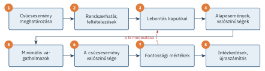
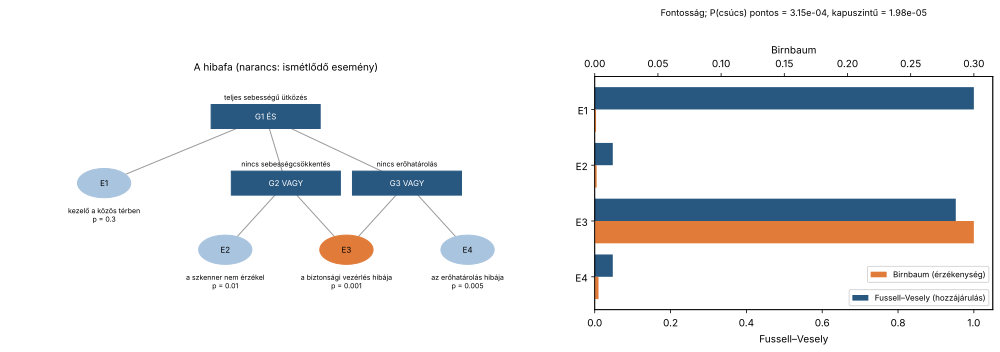

# Hibafa-elemzés {#sec-hibafa}

::: {.cel title="Eszközkártya"}
- **Mire való?** Egy kiválasztott nem kívánt esemény (csúcsesemény) okainak logikai lebontása ÉS- és VAGY-kapukkal; az okok kombinációinak (minimális vágathalmazok) feltárása és a csúcsesemény valószínűségének becslése.
- **Tanulási eredmény:** az eszközlap feldolgozása után képes leszel egy csúcseseményhez hibafát szerkeszteni, meghatározni a minimális vágathalmazokat, és kiszámítani a csúcsesemény valószínűségét.
- **V-lépés:** 4–5. Architektúra és részletes tervezés (a biztonsági funkciók és a redundancia tervezése), 8. Verifikáció (a biztonsági célérték igazolása); balesetvizsgálatnál visszamenőleg is.
- **Bemenet:** a PHA vagy az FMEA legsúlyosabb eseménye, a rendszer felépítése és működése, az alapesemények valószínűsége (megbízhatósági adatok, emberi hibavalószínűség).
- **Kimenet:** hibafa, minimális vágathalmazok, egypontos hibák, a csúcsesemény valószínűsége, fontossági mértékek, intézkedések.
- **Időigény:** egy csúcseseményre 3–6 óra; nagy rendszernél napok, szoftveres támogatással.
- **Kézikönyv:** [16. fejezet](../../kezikonyv/fejezetek/16-megbizhatosag.html), 16.4. szakasz.
- **Továbbolvasás:** [@goldberg1994toolbox, 3.6. szakasz].
:::

## Mikor használd?

- **Ha egyetlen, jól meghatározott, súlyos esemény** okait kell rendszeresen feltárni, beleértve az egyidejű hibákat is. A hibafa éppen az egyidejűleg fennálló hibák valószínűségének értékelésére alkalmas, és feleslegesen beépített elemeket is feltárhat [@vesely1981].
- **Ha egy biztonsági célértéket** (például „évente legfeljebb $10^{-4}$”) kell igazolni.
- **Ha az FMEA egyenként vizsgált hibamódjai** kombinációban is veszélyesek lehetnek ([-@sec-fmea]. eszközlap).
- **Korlát**: csak az előre megnevezett csúcseseményt vizsgálja, és a teljes fák nagyon nagyok lehetnek [@vesely1981].

## Lépések

{#fig-lepesek-hibafa width=100%}

1. **Határozd meg a csúcseseményt** pontosan: mi, hol, milyen üzemállapotban („a kezelőt teljes sebességű kobotkar éri normál üzemben”), és milyen időszakra vonatkozik a valószínűség.
2. **Rögzítsd a rendszerhatárt és a feltételezéseket**: mely elemek, interfészek és emberi cselekvések tartoznak a vizsgálatba [@vesely1981].
3. **Bontsd le a csúcseseményt kapukkal**: milyen közvetlen okok (ÉS: együtt kellenek; VAGY: bármelyik elég) vezetnek hozzá? Folytasd, amíg alapeseményekig (alkatrészhiba, emberi hiba, külső esemény) nem jutsz [@iec61025_2006].
4. **Rendelj valószínűséget az alapeseményekhez**, mindet ugyanarra az időszakra. Jelöld az ismétlődő eseményeket (amelyek több ágban szerepelnek).
5. **Határozd meg a minimális vágathalmazokat** (például a MOCUS-algoritmussal, ahogy a notebook teszi). Az egyelemű vágathalmazok egypontos hibák.
6. **Számítsd ki a csúcsesemény valószínűségét** a vágathalmazokból vagy pontosan. Ismétlődő eseménynél a kapuszintű, független képletek hibásak.
7. **Számíts fontossági mértékeket**: a Fussell–Vesely-mérték megmutatja, hogy egy esemény mekkora részben járul hozzá a kockázathoz, a Birnbaum-mérték, hogy a javítása mennyivel csökkenti a csúcsesemény valószínűségét.
8. **Javasolj intézkedést** a legfontosabb eseményekre és az egypontos hibákra, és számolj újra.

## Kidolgozott példa: a KoboCella biztonsági csúcseseménye

A KoboCella csapata a PHA legsúlyosabb veszélyére (a kobotkar ütközése a kezelővel) a „kezelőt teljes sebességű kobotkar éri” csúcseseményt elemezte. A fa egy ÉS-kapuból (a kezelő a közös térben van, nincs sebességcsökkentés, nincs erőhatárolás) és két VAGY-kapuból áll; a biztonsági vezérlés hibája (E3) mindkét VAGY-kapuban szerepel (kézikönyv [16. fejezet](../../kezikonyv/fejezetek/16-megbizhatosag.html)).

| Számítási mód | $P(\text{csúcsesemény})$ [1/év] |
|:--|--:|
| pontos (az alapesemények minden állapotának felsorolása) | $3{,}15 \cdot 10^{-4}$ |
| minimális vágathalmazokból, ritka esemény közelítéssel | $3{,}15 \cdot 10^{-4}$ |
| kapuszintű, független képletekkel | $1{,}98 \cdot 10^{-5}$ |

: A csúcsesemény valószínűsége háromféle számítással. {#tbl-hibafa-kobo tbl-colwidths="[70,30]"}

{#fig-hibafa-elemzes width=100%}

**Tanulságok:**

- **Két minimális vágathalmaz van:** $\{E1, E3\}$ és $\{E1, E2, E4\}$. Az első a kockázat 95%-át adja: a kezelő jelenléte mellett egyetlen technikai hiba, a biztonsági vezérlés hibája elég a csúcseseményhez.
- **A kapuszintű számítás tizenhatszor alábecsül**, mert az E3 két ágban is szerepel, így a két VAGY-kapu kimenete nem független. Ezt a hibát a sablon kapuszintű lapja is elkövetné; ezért van külön lapja a vágathalmazoknak.
- **A fontossági mértékek a beavatkozás helyét mutatják.** Az E3 Fussell–Vesely- és Birnbaum-fontossága is kiugró; a csapat ezért a sebességfelügyeletet és az erőhatárolást független csatornára tervezte, amivel a két ág közös pontja megszűnt.

## Sablon és notebook

- [hibafa_sablon.xlsx](../sablonok/hibafa_sablon.xlsx): legfeljebb 30 alapesemény valószínűséggel és forrással; legfeljebb 20 kapu (ÉS, VAGY) öt bemenettel, kapuszintű valószínűség független eseményekre; minimális vágathalmazok lapja a csúcsesemény ritka esemény közelítésével, felső korlátjával és a kapuszintű értékkel való összevetéssel. A KoboCella példájával kitöltve.
- [hibafa.ipynb](../notebookok/hibafa.ipynb) · [Megnyitás Google Colabban](hibafa.ipynb): minimális vágathalmazok MOCUS-algoritmussal, ismétlődő események jelzése, pontos, vágathalmaz-alapú és kapuszintű valószínűség, Fussell–Vesely- és Birnbaum-fontosság, a fa kirajzolása (a [-@fig-hibafa-elemzes]. ábra így készült).

## Előnyök és korlátok

| Előnyök | Korlátok |
|:--|:--|
| Az egyidejű hibák kombinációit is értékeli [@vesely1981] | Csak az előre megnevezett csúcseseményt vizsgálja |
| A minimális vágathalmazok megmutatják az egypontos hibákat | Nagy rendszerre a fa nagyon nagy; szoftver kell |
| Mennyiségi eredményt ad biztonsági célértékek igazolásához | Az alapesemények valószínűsége gyakran bizonytalan |
| Fontossági mértékekkel a beavatkozás helye kijelölhető | A függetlenség feltételezése (közös okok, ismétlődő események) csapda |

: A hibafa-elemzés előnyei és korlátai. {tbl-colwidths="[50,50]"}

::: {.hiba}
- **Homályos csúcsesemény.** „A cella meghibásodik” nem elemezhető; a csúcseseménynek konkrétnak és egyértelműnek kell lennie.
- **Kapuszintű számítás ismétlődő eseménnyel.** Ilyenkor a független képletek nagyságrendekkel tévedhetnek, és mindig optimista irányba.
- **Eltérő időszakra vonatkozó valószínűségek.** Egy óránkénti és egy évi valószínűség nem szorozható össze.
- **Az emberi és a közös okú hibák kihagyása.** A fa gyakran csak alkatrészhibákat tartalmaz, holott a kezelő, a karbantartó és a közös táp is lehet ok.
:::

## Mintapromptok

::: {.prompt title="Mintaprompt: a hibafa első két szintje"}
```text
Csúcsesemény: [PONTOS MEGFOGALMAZÁS, üzemállapot].
Rendszerünk felépítése és védelmi funkciói: [LEÍRÁS].
Feladat: javasold a hibafa első két szintjét: a csúcsesemény
közvetlen okait ÉS- és VAGY-kapukkal, indoklással. Jelöld, ha egy
ok több ágban is szerepelhet (ismétlődő esemény), és ha közös okú
meghibásodás lehetséges. Valószínűséget ne adj meg.
```
:::

::: {.prompt title="Mintaprompt: vágathalmazok értelmezése"}
```text
A hibafánk minimális vágathalmazai és valószínűségeik: [LISTA].
Feladat: értelmezd az eredményt a tervezés számára: hol vannak
egypontos hibák, melyik vágathalmaz dominál, és milyen tervezési
változtatások (független csatorna, diverzitás, ellenőrzés)
szüntetnék meg vagy gyengítenék a domináns vágathalmazt. Ne
számolj újra: a számokat a notebook adja.
```
:::

## Feladat

::: {.projekt title="6. projektlépés (választható): hibafa"}
Saját projektedben készíts hibafát a PHA vagy az FMEA legsúlyosabb eseményére legalább két szinten, legalább négy alapeseménnyel. Határozd meg a minimális vágathalmazokat és a csúcsesemény valószínűségét, jelöld az egypontos hibákat és az ismétlődő eseményeket, és javasolj intézkedést a domináns vágathalmazra.
:::
