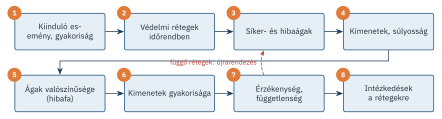
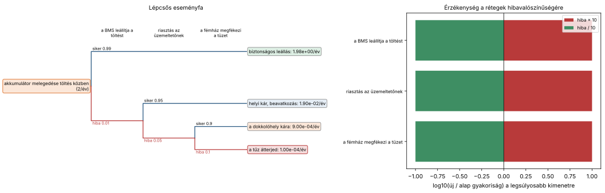

# Eseményfa-elemzés {#sec-esemenyfa}

::: {.cel title="Eszközkártya"}
- **Mire való?** Egy kiinduló eseményből előre követni, milyen kimenetekhez vezethet a folyamat attól függően, hogy az egymást követő védelmi rétegek (biztonsági funkciók, riasztások, emberi beavatkozások, gátak) működnek-e; a kimenetek gyakoriságának becslése.
- **Tanulási eredmény:** az eszközlap feldolgozása után képes leszel egy kiinduló eseményhez eseményfát szerkeszteni, kiszámítani a kimenetek gyakoriságát, és értékelni a védelmi rétegek hatását.
- **V-lépés:** 4–5. Architektúra és részletes tervezés (a védelmi rétegek tervezése), 8–9. Verifikáció és validáció (a rétegek próbái), üzemeltetés (vészhelyzeti tervezés).
- **Bemenet:** a kiinduló esemény és gyakorisága, a védelmi rétegek időrendben, a rétegek siker- vagy hibavalószínűsége (gyakran hibafából).
- **Kimenet:** eseményfa, a kimenetek gyakorisága és súlyossága, a legsúlyosabb kimenet érzékenysége a rétegekre.
- **Időigény:** egy kiinduló eseményre 1–3 óra.
- **Kézikönyv:** [16. fejezet](../../kezikonyv/fejezetek/16-megbizhatosag.html), 16.5. szakasz.
- **Továbbolvasás:** [@goldberg1994toolbox, 3.8. szakasz].
:::

## Mikor használd?

- **Ha egy jól ismert kiinduló eseménynek** (túlmelegedés, tömítetlenség, áramkimaradás, ütközés) többféle következménye lehet attól függően, hogy a védelmek működnek-e.
- **Védelmi rétegek tervezésekor**: hány réteg kell, és melyik javítása ér a legtöbbet? Ez a rétegezett védelem elemzésének alapja ([-@sec-stpa]. eszközlap és a kézikönyv 17. fejezete).
- **Erősség és korlát:** az eseményfa egyszerre dolgozik a siker és a hiba tartományában, és a végkimeneteket nem kell előre ismerni; korlátja, hogy egyetlen kiinduló eseményt vizsgál, és a részleges sikert nehezen tudja megkülönböztetni [@ericson2015].

## Lépések

{#fig-lepesek-esemenyfa width=100%}

1. **Határozd meg a kiinduló eseményt és a gyakoriságát** (például évente, a teljes flottára vagy egy rendszerre).
2. **Sorold fel a védelmi rétegeket időrendben**, ahogyan a folyamatban működésbe lépnek [@iec62502_2010].
3. **Rajzold meg az ágakat**: minden réteg egy elágazás siker és hiba ágra. Ha egy réteg csak az előző hibája esetén kérdéses, a fa lépcsős; ha minden ágban működésbe lép, teljes ($2^n$ sorozat).
4. **Írd le a kimeneteket**, és rendelj hozzájuk súlyosságot (a kockázati mátrix skáláján, [-@sec-kockazati-matrix]. eszközlap).
5. **Becsüld meg az ágak valószínűségét.** A rétegek hibavalószínűségét gyakran egy-egy hibafa adja ([-@sec-hibafa]. eszközlap).
6. **Számítsd ki a kimenetek gyakoriságát**: a kiinduló esemény gyakorisága szorozva az útvonal valószínűségeivel. Ellenőrzés: a kimenetek gyakoriságának összege a kiinduló esemény gyakorisága.
7. **Vizsgáld az érzékenységet és a függetlenséget**: mennyit változik a legsúlyosabb kimenet, ha egy réteg romlik vagy javul, és van-e a rétegeknek közös pontja (közös érzékelő, közös táp)?
8. **Javasolj intézkedést**: új réteg, jobb réteg, vagy a kiinduló esemény gyakoriságának csökkentése.

## Kidolgozott példa: a VárosiBringa akkumulátorának túlmelegedése

A VárosiBringa csapata a kockázatelemzésben azonosított akkumulátorveszélyre készített eseményfát (kézikönyv [16. fejezet](../../kezikonyv/fejezetek/16-megbizhatosag.html)). A kiinduló esemény évi két rendellenes melegedés töltés közben a teljes flottán; három lépcsős védelmi réteg következik.

| Sorozat | Útvonal | Kimenet | Gyakoriság [1/év] | Visszatérési idő |
|:--|:--|:--|--:|--:|
| S1 | a BMS leállítja a töltést (0,99) | biztonságos leállás | 1,98 | félévente |
| S2 | BMS hiba, riasztás (0,95) | helyi kár, beavatkozás | 0,019 | 53 év |
| S3 | BMS és riasztás hiba, a ház megfékezi (0,9) | a dokkolóhely kára | $9 \cdot 10^{-4}$ | 1100 év |
| S4 | minden réteg hibázik | a tűz átterjed | $1 \cdot 10^{-4}$ | 10 000 év |

: A VárosiBringa akkumulátor-túlmelegedésének eseményfája. {#tbl-esemenyfa-bringa tbl-colwidths="[9,36,23,16,16]"}

{#fig-esemenyfa width=100%}

**Tanulságok:**

- **A kiinduló esemény gyakori, a súlyos kimenet ritka.** Az évi két melegedésből a rétegek együtt tízezer évente egy tűzterjedést engednek; a rétegek nélkül ez évente kétszer fordulna elő.
- **Lépcsős fában minden réteg ugyanúgy hat.** A legsúlyosabb kimenet gyakorisága a rétegek hibavalószínűségének szorzatával arányos, ezért egy réteg tízszeres romlása tízszeres gyakoriságot jelent ([-@fig-esemenyfa]. ábra, jobb oldal). A rétegek közötti választást a javítás költsége és a függetlenség dönti el.
- **A függetlenség itt is kulcskérdés.** Ha a BMS és a riasztás ugyanazt a hőmérséklet-érzékelőt használja, a két réteg hibája nem független; a csapat ezért a riasztást külön érzékelőre tervezte.
- **A rétegek valószínűsége maga is elemzést kíván.** A BMS 0,99-es sikere gyártói adat; a csapat a riasztási lánc hibavalószínűségét hibafával becsülte.

## Sablon és notebook

- [esemenyfa_sablon.xlsx](../sablonok/esemenyfa_sablon.xlsx): kiinduló esemény gyakorisággal, legfeljebb négy védelmi réteg sikervalószínűséggel és adatforrással; lépcsős fa a kimenetek gyakoriságával, súlyosságával és visszatérési idejével; teljes fa mind a 16 sorozattal; összegellenőrzés. A VárosiBringa példájával kitöltve.
- [esemenyfa.ipynb](../notebookok/esemenyfa.ipynb) · [Megnyitás Google Colabban](esemenyfa.ipynb): a kimenetek gyakorisága, a fa kirajzolása, a legsúlyosabb kimenet érzékenysége a rétegekre (a [-@fig-esemenyfa]. ábra így készült).

## Előnyök és korlátok

| Előnyök | Korlátok |
|:--|:--|
| Egyszerre mutatja a siker és a hiba útjait [@ericson2015] | Egyetlen kiinduló eseményt vizsgál |
| A kimeneteket nem kell előre ismerni; a fa feltárja őket | A részleges sikert (például késleltetett beavatkozást) nem különbözteti meg |
| Szemléletesen mutatja a rétegezett védelem hatását | A rétegek függetlenségét feltételezi |
| Jól kapcsolható a hibafához (a rétegek valószínűsége) és a kockázati mátrixhoz | A rétegek sorrendje és feltételei hibásan is felírhatók |

: Az eseményfa-elemzés előnyei és korlátai. {tbl-colwidths="[50,50]"}

::: {.hiba}
- **Rossz sorrend.** A rétegeket abban a sorrendben kell felírni, ahogyan a folyamatban működésbe lépnek; különben az ágak feltételei hamisak.
- **Közös okú rétegek.** Két réteg, amely ugyanazon az érzékelőn vagy tápon alapul, valójában egy réteg.
- **A kiinduló esemény alulbecslése.** A ritka kiinduló esemény gyakoriságát gyakran optimistán becsülik; ez minden kimenetet arányosan torzít.
- **Csak a legsúlyosabb kimenet.** A közepes kimenetek (S2, S3) összesített költsége is lehet jelentős.
:::

## Mintapromptok

::: {.prompt title="Mintaprompt: védelmi rétegek és kimenetek"}
```text
Kiinduló esemény: [ESEMÉNY], rendszerünk: [LEÍRÁS].
Feladat: sorold fel időrendben azokat a védelmi rétegeket
(műszaki biztonsági funkciók, riasztások, emberi beavatkozások,
passzív gátak), amelyek a kiinduló esemény után működésbe
léphetnek, és vázold az eseményfa ágait és kimeneteit. Jelöld,
ha két rétegnek közös pontja lehet. Valószínűséget ne adj meg.
```
:::

::: {.prompt title="Mintaprompt: függetlenség vizsgálata"}
```text
Eseményfánk rétegei és megvalósításuk: [TÁBLÁZAT: réteg, érzékelő,
vezérlő, beavatkozó, táp, felelős ember].
Feladat: keresd meg a rétegek közös elemeit és lehetséges közös
okú meghibásodásait (érzékelő, táp, szoftver, karbantartás,
környezet), és javasolj módot a függetlenség növelésére
(diverzitás, elkülönítés).
```
:::

## Feladat

::: {.projekt title="6. projektlépés (választható): eseményfa"}
Saját projektedben válassz egy kiinduló eseményt, és készíts eseményfát legalább három védelmi réteggel. Becsüld meg a kimenetek gyakoriságát, vizsgáld meg a rétegek függetlenségét, és javasolj egy intézkedést, amely a legsúlyosabb kimenet gyakoriságát érdemben csökkenti.
:::
