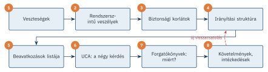
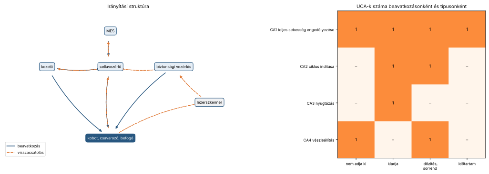

# STPA – rendszerelméleti veszélyelemzés {#sec-stpa}

::: {.cel title="Eszközkártya"}
- **Mire való?** A biztonság elemzése irányítási problémaként: mely beavatkozások (control actions) lehetnek veszélyesek, és miért adhatja ki őket egy irányító (szoftver, ember, szervezet); a hibátlan elemek veszélyes kölcsönhatásainak feltárása.
- **Tanulási eredmény:** az eszközlap feldolgozása után képes leszel felrajzolni egy rendszer irányítási struktúráját, azonosítani a veszélyes irányítási beavatkozásokat és azok okait, és biztonsági követelményeket levezetni.
- **V-lépés:** 3–4. Koncepció és architektúra (már a részletek előtt elvégezhető), 5. Részletes tervezés (a vezérlés, a kezelőfelület és az eljárások követelményei), 8. Verifikáció (forgatókönyv-alapú tesztek).
- **Bemenet:** a PHA veszélyei, a funkciómegosztás, a vezérlési architektúra, a kezelői feladatok (HTA), a kezelőfelület.
- **Kimenet:** veszteségek, veszélyek és biztonsági korlátok; irányítási struktúra; nem biztonságos beavatkozások (UCA); veszteséghez vezető forgatókönyvek; követelmények és intézkedések.
- **Időigény:** egy irányítási hurokra 4–8 óra csapatmunka.
- **Kézikönyv:** [17. fejezet](../../kezikonyv/fejezetek/17-biztonsag.html), 17.4. szakasz.
:::

## Mikor használd?

- **Szoftverrel irányított, sok szereplős rendszereknél**, ahol a balesetek nem csak alkatrészhibából, hanem az irányítás hiányosságaiból (hibás folyamatmodell, hiányzó visszacsatolás, rossz időzítés) fakadhatnak [@leveson2011].
- **Ember és automatika együttműködésénél**: a kezelő beavatkozásai ugyanúgy elemezhetők, mint a vezérlésé; a kezelő folyamatmodellje a helyzettudatosság megfelelője.
- **Korán**: az STPA a koncepció szintjén is elvégezhető, és követelményeket ad a részletes tervezésnek [@leveson2018].
- **Kiegészítőként**: az FMEA és a hibafa a hibaláncokat, az STPA a kölcsönhatásokat tárja fel; együtt teljesebb képet adnak ([-@sec-fmea]. és [-@sec-hibafa]. eszközlap).

## Lépések

{#fig-lepesek-stpa width=100%}

1. **Veszteségek**: mit nem engedhetünk meg (sérülés, termékhiba, termeléskiesés, környezeti kár)? A veszteségek az érdekelt felek értékeiből fakadnak [@leveson2018].
2. **Rendszerszintű veszélyek**: a rendszer olyan állapotai, amelyek bizonyos környezeti feltételek mellett veszteséghez vezetnek. A veszély a rendszer állapota, nem egy alkatrész hibája („a kobot a kezelő közelében túl gyorsan mozog”, nem „a szkenner elromlik”).
3. **Biztonsági korlátok**: minden veszélyhez egy korlát, amelyet a rendszernek be kell tartania.
4. **Irányítási struktúra**: az irányítók (szervezet, ember, szoftver), a beavatkozások lefelé és a visszacsatolások felfelé.
5. **A vizsgált beavatkozások listája** az irányítási struktúra lefelé mutató nyilaiból.
6. **Nem biztonságos beavatkozások**: minden beavatkozásra a négy kérdés: veszélyes-e, ha nem adják ki; ha kiadják; ha túl korán, túl későn vagy rossz sorrendben adják ki; ha túl sokáig tart, vagy túl korán áll le? A kontextus (mikor veszélyes) a megfogalmazás része.
7. **Forgatókönyvek**: miért adhatja ki az irányító a nem biztonságos beavatkozást (hibás folyamatmodell, hiányzó vagy hibás visszacsatolás, hibás algoritmus vagy eljárás), és miért nem hajtódhat végre egy helyes beavatkozás (késés, kommunikációs hiba, a beavatkozó hibája)?
8. **Követelmények és intézkedések** minden forgatókönyvre; ezek a verifikációs terv és a tesztesetek bemenetei.

## Kidolgozott példa: a KoboCella cellairányítása

A KoboCella csapata a PHA két vezérlésen múló veszélyére (ütközés, váratlan indulás) STPA-t végzett (kézikönyv [17. fejezet](../../kezikonyv/fejezetek/17-biztonsag.html)). Három veszteség (L1 sérülés, L2 hibás motor a vevőnél, L3 termeléskiesés), három veszély és hat elemből álló irányítási struktúra lett az alap. A négy vizsgált beavatkozásra kilenc nem biztonságos beavatkozás és nyolc forgatókönyv született ([-@fig-stpa]. ábra).

| UCA | Beavatkozás és típus | Kontextus | Veszély | Forgatókönyv → intézkedés |
|:--|:--|:--|:-:|:--|
| U1 | teljes sebesség, kiadja | a kezelő a közös térben van | H1 | a szkennermező karbantartás után rossz → mezőellenőrzés, napi próba |
| U2 | teljes sebesség, túl korán | a kezelő még nem hagyta el a zónát | H1 | a reakcióidő és a fékút nagyobb a tervezettnél → mérés a verifikációban |
| U5 | ciklus indítása, kiadja | a fedél nincs a helyén | H2 | a fedelet csak a kezelő ellenőrzi → befogóérzékelő |
| U7 | nyugtázás, kiadja | a hibás darab még nincs a selejtdobozban | H2 | a nyugtázás rutinmozdulat lett → fizikai cselekvés, érzékelő |
| U8 | vészleállítás, nem adja ki | vészhelyzet | H1 | a gomb nem érhető el a munkahelyről → második vészleállító |

: Részlet a KoboCella STPA-jából. {#tbl-stpa-kobo tbl-colwidths="[6,22,24,8,40]"}

{#fig-stpa width=100%}

**Tanulságok:**

- **Az okok nagy része nem alkatrészhiba.** A rosszul visszaállított szkennermező, a takarásban lévő belépési irány és a rutinná vált nyugtázás mind olyan forgatókönyv, amelyben minden elem a specifikációja szerint működik, mégis veszélyes állapot jön létre.
- **A folyamatmodell kulcsfogalom.** A U1 forgatókönyvében a biztonsági vezérlés „üresnek hiszi” a zónát; a U7-ben a kezelő „rendben lévőnek hiszi” a darabot. Mindkét esetben az irányító modellje tér el a valóságtól.
- **A lefedettségi mátrix a hiányokat is mutatja.** Két UCA-hoz (U3, U4) még nincs forgatókönyv, és több típusnál nincs UCA; ahol egy típus nem veszélyes, az indoklást is rögzíteni kell.
- **Az eredmények más eszközökbe épülnek.** A U1 intézkedése az FMEA F7 sorában, a U2 intézkedése a verifikációs tervben, a U7 intézkedése a kezelőfelület követelményeiben jelenik meg.

## Sablon és notebook

- [stpa_sablon.xlsx](../sablonok/stpa_sablon.xlsx): veszteségek, veszélyek és biztonsági korlátok kereszthivatkozás-ellenőrzéssel; irányítási struktúra elemekkel (típus, szint) és kapcsolatokkal; beavatkozások; UCA-lap a négy típus legördülő listájával és ellenőrzéssel (ismeretlen beavatkozás vagy veszély, hiányzó forgatókönyv); forgatókönyvek ok-kategóriákkal; lefedettségi mátrix és mutatók. A KoboCella példájával kitöltve.
- [stpa.ipynb](../notebookok/stpa.ipynb) · [Megnyitás Google Colabban](stpa.ipynb): az irányítási struktúra kirajzolása, lefedettségi mátrix, nyomonkövethetőségi ellenőrzés (veszteség ← veszély ← UCA ← forgatókönyv ← intézkedés), összesítés ok-kategóriák szerint (a [-@fig-stpa]. ábra így készült).

## Előnyök és korlátok

| Előnyök | Korlátok |
|:--|:--|
| Feltárja a hibátlan elemek veszélyes kölcsönhatásait [@leveson2011] | Az eredmény a struktúra és a forgatókönyvek teljességén múlik |
| A szoftvert, az embert és a szervezetet egy keretben vizsgálja | Elsősorban minőségi; valószínűséget nem ad |
| Korán, a részletek előtt is alkalmazható [@leveson2018] | Nagy rendszernél sok beavatkozás és UCA keletkezik; eszköztámogatás kell |
| Közvetlenül követelményekhez és tesztesetekhez vezet | Gyakorlatot kíván a veszélyek és a UCA-k helyes megfogalmazása |

: Az STPA előnyei és korlátai. {tbl-colwidths="[50,50]"}

::: {.hiba}
- **Alkatrészhiba a veszély helyén.** „A szkenner elromlik” nem rendszerszintű veszély, hanem egy lehetséges ok; a veszély a rendszer állapota.
- **Kontextus nélküli UCA.** „A kobot teljes sebességgel mozog” önmagában nem veszélyes; csak akkor, ha a kezelő a közös térben van.
- **Csak a szoftveres irányítók.** A kezelő és a szervezet (karbantartás, műszakvezetés) beavatkozásai is UCA-k lehetnek.
- **A visszacsatolások elhanyagolása.** A forgatókönyvek jelentős része abból fakad, hogy az irányító nem kap, késve kap vagy hibás információt kap.
:::

## Mintapromptok

::: {.prompt title="Mintaprompt: irányítási struktúra"}
```text
Rendszerünk: [LEÍRÁS], szereplői és vezérlőegységei: [LISTA].
Feladat: vázold az STPA irányítási struktúráját: irányítók
(szervezet, ember, szoftver), szabályozott folyamat, a
beavatkozások (lefelé) és a visszacsatolások (felfelé),
megnevezéssel. Jelöld, ahol egy irányítónak nincs
visszacsatolása a beavatkozása hatásáról.
```
:::

::: {.prompt title="Mintaprompt: nem biztonságos beavatkozások"}
```text
Veszélyeink: [H1…]. A vizsgált beavatkozás: [BEAVATKOZÁS],
irányító: [IRÁNYÍTÓ], cél: [CÉL].
Feladat: vizsgáld meg a négy STPA-típust (nem adja ki; kiadja;
túl korán / későn / rossz sorrendben; túl sokáig / túl korán
leáll). Mindegyiknél fogalmazd meg kontextussal, mikor veszélyes,
és melyik veszélyhez vezet; ha nem veszélyes, indokold. Ezután
mindegyik UCA-hoz adj legalább egy forgatókönyvet arra, miért
adhatná ki az irányító.
```
:::

## Feladat

::: {.projekt title="6. projektlépés (választható): STPA"}
Saját projektedben végezz STPA-t egy irányítási hurokra: legalább két veszteség és két rendszerszintű veszély, irányítási struktúra, legalább két beavatkozás vizsgálata a négy típus szerint, és legalább három forgatókönyv intézkedéssel. Mutasd meg, melyik forgatókönyv nem írható le egyetlen alkatrész meghibásodásával.
:::
