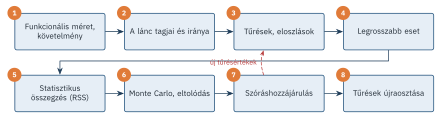
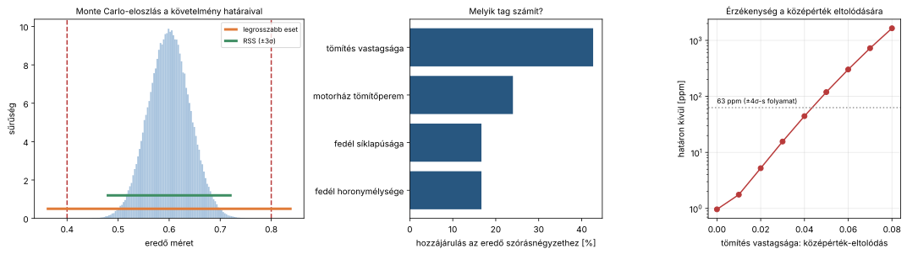

# Tűréslánc-számítás {#sec-turesek}

::: {.cel title="Eszközkártya"}
- **Mire való?** Egy funkcionálisan fontos méret (rés, átfedés, összenyomódás, helyzet) eredő tűrésének és szórásának számítása az alkatrészméretek tűréseiből; a tűrések ésszerű elosztása a funkció és a költség között.
- **Tanulási eredmény:** az eszközlap feldolgozása után képes leszel egy tűrésláncot legrosszabb esetre és statisztikusan kiszámítani, és eldönteni, melyik alkatrész tűrésén érdemes változtatni.
- **V-lépés:** 5. Részletes tervezés (rajzok, tűrésmegadás), 6. Megvalósítás (beszállítói követelmények), 7. Integráció (illesztési problémák elemzése).
- **Bemenet:** a funkcionális követelmény határai, a méretlánc tagjai a névleges értékkel, a tűréssel és az iránnyal, a gyártási folyamatok képessége (eloszlás, középérték).
- **Kimenet:** legrosszabb eset és statisztikus eredő tűrés, a határon kívüli arány, $C_p$ és $C_{pk}$, a tagok szóráshozzájárulása, javaslat a tűrések újraosztására.
- **Időigény:** egy négy-hat tagú láncra 1–2 óra.
- **Kézikönyv:** [18. fejezet](../../kezikonyv/fejezetek/18-robusztus.html), 18.2. szakasz.
- **Továbbolvasás:** [@goldberg1994toolbox, 4.2–4.3. szakasz].
:::

## Mikor használd?

- **Ha egy összeállítás működése** egy résen, illesztésen vagy összenyomódáson múlik, és ez több alkatrész méretéből adódik.
- **Ha a tűréseket meg kell adni vagy szűkíteni kell**: a szigorúbb tűrés drágább, ezért csak ott érdemes szűkíteni, ahol a lánc érzékeny rá.
- **Ha illesztési hiba jelentkezik** a gyártásban vagy az integrációban, és meg kell találni, melyik alkatrész a fő ok.
- A tűréslánc-számítás a méretek és tűrések ellenőrzésének eszköze; a szabványos méretezés és tűrésmegadás ennek előfeltétele [@chase1991; @asmey145_2018].

## Lépések

{#fig-lepesek-turesek width=100%}

1. **Határozd meg a funkcionális méretet és a követelményt** (alsó és felső határ).
2. **Írd fel a láncot**: azokat a méreteket, amelyek összeadódva vagy kivonódva adják a funkcionális méretet, az irányukkal (érzékenységükkel) együtt. Nemlineáris láncnál az érzékenység a parciális derivált.
3. **Add meg a tűréseket és az eloszlásokat**: a normális eloszlású tagnál, hogy a tűrés hány szórásnak felel meg; a középérték várható eltolódását is.
4. **Számíts legrosszabb esetet**: $T_Z = \sum |a_i| T_i$ [@chase1991].
5. **Számíts statisztikusan (RSS)**: $\sigma_Z = \sqrt{\sum a_i^2 \sigma_i^2}$; ebből $C_p$, $C_{pk}$ és a határon kívüli arány [@chase1991].
6. **Ellenőrizd Monte Carlo-szimulációval**, különösen eltolt középértéknél, nem normális tagoknál vagy kevés tagnál; vizsgáld meg a középérték-eltolódás hatását.
7. **Határozd meg a szóráshozzájárulásokat**: melyik tag felel az eredő szórás legnagyobb részéért.
8. **Oszd újra a tűréseket**: ott szűkíts, ahol a hozzájárulás nagy és a szűkítés olcsó; ahol a hozzájárulás kicsi, ott lazíthatsz.

## Kidolgozott példa: a KoboCella fedéltömítésének összenyomódása

A tömítés akkor zár megbízhatóan, ha összenyomódása 0,40 és 0,80 mm között van (kézikönyv [18. fejezet](../../kezikonyv/fejezetek/18-robusztus.html)).

| Tag | Névleges [mm] | Tűrés [mm] | Irány | Hozzájárulás a szórásnégyzethez |
|:--|--:|--:|:-:|--:|
| tömítés vastagsága | 2,50 | ±0,08 | + | 43% |
| fedél horonymélysége | 2,20 | ±0,05 | − | 17% |
| motorház tömítőperemének magassága | 0,30 | ±0,06 | + | 24% |
| fedél síklapúsági eltérése | 0,00 | ±0,05 | − | 17% |
| **összenyomódás** | **0,60** | WC ±0,24; RSS ±0,12 | | |

: A tömítés összenyomódásának tűréslánca. A tűrések ±3σ-nak felelnek meg. {#tbl-tureslanc tbl-colwidths="[36,16,22,8,18]"}

A legrosszabb eset (0,36–0,84 mm) nem teljesíti a követelményt; a statisztikus számítás szerint az összenyomódás szórása 0,041 mm, $C_p = C_{pk} = 1{,}63$, a határon kívüli arány kb. 1 ppm. A Monte Carlo-szimuláció ezt megerősíti ([-@fig-turesek]. ábra).

{#fig-turesek width=100%}

**Tanulságok:**

- **A legrosszabb eset és a statisztikus számítás más döntéshez vezet.** A legrosszabb esethez minden tűrést a 0,83-szorosára kellene szűkíteni; a statisztikus számítás szerint a jelenlegi tűrések elegendők, ha a feltevések teljesülnek.
- **A feltevéseket fenn kell tartani.** A tömítés vastagságának 0,04 mm-es középérték-eltolódása mellett a kiesés még kb. 44 ppm, 0,05 mm-nél már 119 ppm. A csapat ezért a beszállítónál statisztikai folyamatszabályozást kötött ki ([-@sec-kontrollkartya]. eszközlap).
- **A legnagyobb hozzájáruló a tömítés.** Ha a követelmény szigorodna, a tömítés tűrésének szűkítése érne a legtöbbet.
- **Az eloszlás megválasztása is számít.** Ha a síklapúsági eltérés a tűrésmezőn belül egyenletes eloszlású, az eredő szórás 0,047 mm-re nő, a kiesés kb. 8 ppm-re.

## Sablon és notebook

- [turesek_sablon.xlsx](../sablonok/turesek_sablon.xlsx): legfeljebb 15 tag névleges értékkel, tűréssel, érzékenységgel, eloszlással (normális vagy egyenletes) és középérték-eltolással; eredmények: legrosszabb eset, RSS, eredő szórás és középérték, $C_p$, $C_{pk}$, határon kívüli arány, a legrosszabb esethez szükséges tűrésszűkítés. A KoboCella példájával kitöltve.
- [turesek.ipynb](../notebookok/turesek.ipynb) · [Megnyitás Google Colabban](turesek.ipynb): legrosszabb eset, RSS, egymillió elemű Monte Carlo-szimuláció, szóráshozzájárulás, a középérték-eltolódás hatása, az eloszlás megválasztásának hatása (a [-@fig-turesek]. ábra így készült).

## Előnyök és korlátok

| Előnyök | Korlátok |
|:--|:--|
| A legrosszabb eset garantált, egyszerű számítás | A legrosszabb eset sok tagnál túl szigorú, drága tűréseket követel |
| Az RSS reálisabb képet ad nagy darabszámnál [@chase1991] | Az RSS függetlenséget, normális eloszlást és központos folyamatot feltételez |
| A Monte Carlo tetszőleges eloszlást és nemlineáris láncot kezel | A szimuláció csak annyira jó, amennyire a bemenő eloszlások |
| A szóráshozzájárulás megmutatja, hol érdemes szűkíteni | A geometriai tűrések (alak, helyzet) láncba illesztése szakértelmet kíván |

: A tűréslánc-számítás módszereinek előnyei és korlátai. {tbl-colwidths="[50,50]"}

::: {.hiba}
- **Rossz irány.** Egy tag előjelének eltévesztése a névleges értéket és a hozzájárulásokat is elrontja; rajzolj vektorláncot.
- **RSS kis darabszámnál.** Néhány darabos gyártásnál a statisztikus érvelés nem érvényes; ott a legrosszabb esettel kell számolni.
- **Elfelejtett geometriai tűrés.** A síklapúság, a merőlegesség vagy a pozíciótűrés gyakran a lánc jelentős tagja.
- **A beszállítói folyamatképesség ellenőrzése nélküli RSS.** A statisztikus méretezés feltételeit szerződésben és méréssel is biztosítani kell.
:::

## Mintapromptok

::: {.prompt title="Mintaprompt: a méretlánc felírása"}
```text
Az összeállítás leírása: [LEÍRÁS, alkatrészek, illeszkedő felületek].
A funkcionális méret: [MÉRET, követelmény].
Feladat: segíts felírni a méretláncot: mely alkatrészméretek
(beleértve a geometriai tűréseket, például síklapúság, pozíció)
befolyásolják a funkcionális méretet, milyen előjellel. Jelöld,
ha a lánc nemlineáris, vagy ha egy méret több helyen is szerepel.
Számszerű tűréseket ne adj meg.
```
:::

::: {.prompt title="Mintaprompt: tűrésújraosztás"}
```text
Tűrésláncunk tagjai a tűréssel, a szóráshozzájárulással és a
tűrés szűkítésének becsült költségével: [TÁBLÁZAT].
A követelmény: [HATÁROK], a jelenlegi eredmény: [EREDMÉNY].
Feladat: javasolj tűrésújraosztást, amely a követelményt a
legkisebb költségnövekedéssel teljesíti, és indokold. Az új
értékeket a sablonnal ellenőrizni fogjuk.
```
:::

## Feladat

::: {.projekt title="6. projektlépés (választható): tűréslánc"}
Ha projektedben van funkcionálisan fontos méretlánc, számítsd ki legrosszabb esetre, RSS szerint és Monte Carlo-szimulációval, határozd meg a szóráshozzájárulásokat, és javasolj tűrésújraosztást. Ha nincs méretlánc, alkalmazd ugyanezt egy időláncra (például a ciklusidő összetevőire) vagy egy energiamérlegre.
:::
