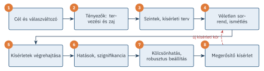
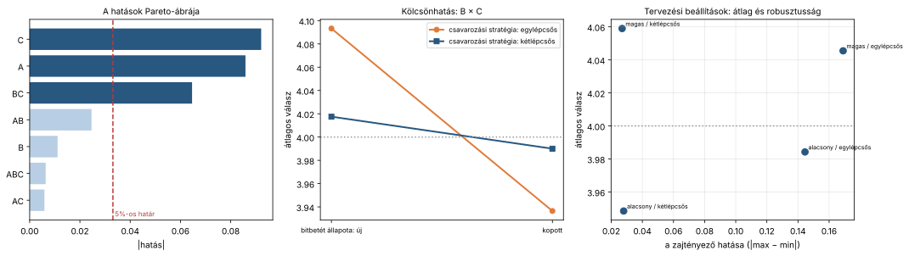

# Kísérlettervezés (DoE) {#sec-doe}

::: {.cel title="Eszközkártya"}
- **Mire való?** Néhány tényező hatásának és kölcsönhatásainak hatékony feltárása tervezett kísérletekkel; robusztus beállítás keresése, amelynél a zajtényezők hatása a legkisebb.
- **Tanulási eredmény:** az eszközlap feldolgozása után képes leszel teljes vagy részleges faktoros kísérletet megtervezni, kiszámítani a fő- és kölcsönhatásokat, és a robusztus beállítást kiválasztani.
- **V-lépés:** 5. Részletes tervezés (paraméterek beállítása, robusztus tervezés), 6. Megvalósítás (folyamatbeállítás), üzemeltetés (folyamatjavítás).
- **Bemenet:** a vizsgált válasz (mérhető jellemző), a tényezők és szintjeik, a tervezési és a zajtényezők megkülönböztetése, a mérési módszer.
- **Kimenet:** főhatások és kölcsönhatások becslése szignifikanciával, kölcsönhatási ábrák, robusztus beállítás, megerősítő kísérlet terve.
- **Időigény:** a tervezés 1–2 óra; a végrehajtás a kísérlet jellegétől függ (a $2^3$ terv két ismétléssel 16 futás).
- **Kézikönyv:** [18. fejezet](../../kezikonyv/fejezetek/18-robusztus.html), 18.4. szakasz.
- **Továbbolvasás:** [@goldberg1994toolbox, 7.5. szakasz].
:::

## Mikor használd?

- **Ha több tényező befolyásolhat egy jellemzőt**, és nem tudjuk, melyik számít és hogyan hatnak együtt. A kísérlettervezés a tényezők hatásának és kölcsönhatásainak meghatározására szolgál a lehető legkevesebb kísérlettel [@montgomery2017].
- **Robusztus tervezésnél**: ha a gyártásban vagy a használatban ingadozó zajtényezők (kopás, hőmérséklet, anyag) hatását tervezési beállítással akarjuk semlegesíteni [@phadke1989].
- **Folyamatjavításnál** (DMAIC elemzési és javítási szakasza, [-@sec-pdca-8d-dmaic]. eszközlap).
- **Nem** helyettesíti a fizikai megértést: a tényezők és szintek kiválasztása szakértői tudást kíván.

## Lépések

{#fig-lepesek-doe width=100%}

1. **Rögzítsd a célt és a választ**: mit akarunk elérni (célérték, kisebb szórás), és mit mérünk (mértékegység, mérési pontosság).
2. **Válaszd ki a tényezőket**, és különítsd el a **tervezési** (szabadon beállítható) és a **zajtényezőket** (ingadozó, nem vagy drágán szabályozható) [@taguchi2005].
3. **Határozd meg a szinteket és a tervet**: két szinten $2^k$ teljes faktoros terv; sok tényezőnél részfaktoros terv [@montgomery2017].
4. **Tervezd meg a sorrendet és az ismétléseket**: véletlen sorrend az időben változó zavarok ellen, ismétlés a kísérleti hiba becsléséhez, blokkosítás az ismert zavaró tényezők ellen [@montgomery2017].
5. **Hajtsd végre a kísérleteket** a terv szerint, és rögzítsd az eltéréseket.
6. **Becsüld a hatásokat**: főhatás = átlag a felső szinten − átlag az alsó szinten; a kölcsönhatások ugyanígy a szorzatoszlopokból. A hatások standard hibája $2s/\sqrt{N}$, ahol $s$ a kísérleti hiba szórása, $N$ a mérések száma.
7. **Értelmezd a kölcsönhatásokat, és válassz robusztus beállítást**: a tervezési és a zajtényező közötti kölcsönhatás megmutatja, melyik beállításnál a legkisebb a zaj hatása; a középértéket egy másik tervezési tényezővel lehet a célértékre hangolni.
8. **Végezz megerősítő kísérletet** a kiválasztott beállításban.

## Kidolgozott példa: a KoboCella csavarozási nyomatéka

A csapat $2^3$ teljes faktoros kísérletet végzett két ismétléssel: A végső fordulatszám (alacsony, magas), B csavarozási stratégia (egylépcsős, kétlépcsős), C bitbetét állapota (új, kopott; zajtényező). A válasz a mért nyomaték, a célérték 4,0 Nm (kézikönyv [18. fejezet](../../kezikonyv/fejezetek/18-robusztus.html)).

| Hatás | Becslés [Nm] | t-érték | Szignifikáns (5%)? |
|:--|--:|--:|:-:|
| A fordulatszám | +0,086 | 5,98 | igen |
| B stratégia | −0,011 | −0,77 | nem |
| C bitbetét (zaj) | −0,092 | −6,41 | igen |
| A×B | +0,025 | 1,71 | nem |
| B×C | +0,065 | 4,50 | igen |
| A×C, A×B×C | < 0,01 | < 0,5 | nem |

: A $2^3$ kísérlet hatásai ($s = 0{,}029$ Nm, 8 szabadsági fok, a hatások standard hibája 0,014 Nm). {#tbl-doe-kobo tbl-colwidths="[30,22,22,26]"}

{#fig-doe width=100%}

**Tanulságok:**

- **A zajtényező hatása semlegesíthető.** Egylépcsős stratégiánál a kopott bitbetét 0,157 Nm-rel csökkenti a nyomatékot, kétlépcsősnél csak 0,028 Nm-rel: a B×C kölcsönhatás szignifikáns, és a stratégiának önmagában nincs hatása az átlagra.
- **Két tervezési tényező, két szerep.** A stratégia a zajérzékenységet, a fordulatszám a középértéket állítja. A két kétlépcsős beállítás átlaga a célérték két oldalán van (3,95 és 4,06 Nm), ezért a csapat köztes fordulatszámot választott, és ezt megerősítő kísérlettel ellenőrizte.
- **Az egyszerre egy tényező módszere tévútra vitt volna.** Ha a csapat a stratégiákat csak új bitbetéttel hasonlította volna össze, a különbséget (4,09 és 4,02 Nm) a fordulatszámmal kiegyenlíthetőnek, a stratégia megválasztását pedig mellékesnek ítélte volna. Hogy a kétlépcsős stratégia a kopásra szinte érzéketlen, azt csak a kölcsönhatás mutatta meg.
- **Az ismétlés tette lehetővé a szignifikancia megítélését.** Ismétlés nélkül a kísérleti hibát nem lehetett volna becsülni.

## Sablon és notebook

- [doe_sablon.xlsx](../sablonok/doe_sablon.xlsx): tényezők és szintek (tervezési vagy zaj), a $2^3$ terv kódolt szintjeivel, véletlen sorrenddel és legfeljebb három ismétléssel; hatások, a kísérleti hiba, standard hiba, t-érték és szignifikancia; kétszintű kölcsönhatási táblák; diagram. A KoboCella példájával kitöltve.
- [doe.ipynb](../notebookok/doe.ipynb) · [Megnyitás Google Colabban](doe.ipynb): hatások és p-értékek, Pareto-ábra, kölcsönhatási ábra, a tervezési beállítások összevetése átlag és zajérzékenység szerint (a [-@fig-doe]. ábra így készült).

## Előnyök és korlátok

| Előnyök | Korlátok |
|:--|:--|
| Kevés kísérlettel sok információ [@montgomery2017] | A tényezők és szintek rossz megválasztása félrevezet |
| Feltárja a kölcsönhatásokat | Két szint csak lineáris hatást mutat; görbületet nem |
| A zajtényezők kezelésével robusztus beállítás tervezhető [@phadke1989] | Sok tényezőnél a teljes terv költséges; a részfaktoros terv összemossa a hatásokat |
| Statisztikailag megalapozott döntés | A kísérleti körülmények gondos szabályozását kívánja |

: A kísérlettervezés előnyei és korlátai. {tbl-colwidths="[50,50]"}

::: {.hiba}
- **Egyszerre egy tényező.** A kölcsönhatások rejtve maradnak, és a kísérletek száma sem kevesebb.
- **Sorrend szerinti futtatás.** Ha a beállításokat a táblázat sorrendjében futtatjuk, az időben változó hatás (melegedés, kopás) összemosódik egy tényező hatásával.
- **Ismétlés nélküli kísérlet** szignifikanciavizsgálattal: a hiba nem becsülhető (vagy csak feltevésekkel).
- **A zajtényező kihagyása.** Ha a kopást vagy a hőmérsékletet nem vesszük be tényezőként, a laborban talált optimum az üzemben nem lesz robusztus.
:::

## Mintapromptok

::: {.prompt title="Mintaprompt: kísérleti terv"}
```text
Vizsgált jellemző: [VÁLASZ, célérték, mérési mód]. Lehetséges
befolyásoló tényezők: [LISTA].
Feladat: segíts kiválasztani 3–4 tényezőt, és különítsd el a
tervezési és a zajtényezőket indoklással. Javasolj két szintet
mindegyikre, a tervet (teljes vagy részfaktoros), az ismétlések
számát, a véletlen sorrendet és a lehetséges blokkosítást.
Számszerű eredményt ne találj ki.
```
:::

::: {.prompt title="Mintaprompt: az eredmények értelmezése"}
```text
A 2^k kísérlet hatásai, t-értékei és a kölcsönhatási táblák: [TÁBLÁZAT].
Tervezési tényezők: [..], zajtényezők: [..], célérték: [..].
Feladat: értelmezd a szignifikáns hatásokat és kölcsönhatásokat,
és javasolj robusztus beállítást: melyik tervezési tényező
csökkenti a zaj hatását, és melyikkel hangolható a középérték.
Javasolj megerősítő kísérletet. Ne számolj újra.
```
:::

## Feladat

::: {.projekt title="6. projektlépés (választható): kísérlettervezés"}
Saját projektedben tervezz egy legalább háromtényezős faktoros kísérletet a legfontosabb teljesítményjellemzőre: válasz, tényezők (tervezési és zaj), szintek, terv, ismétlések, véletlen sorrend. Ha a kísérlet elvégezhető (akár szimulációs modellel), értékeld a sablonnal vagy a notebookkal, és javasolj robusztus beállítást.
:::
