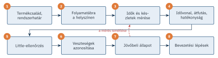
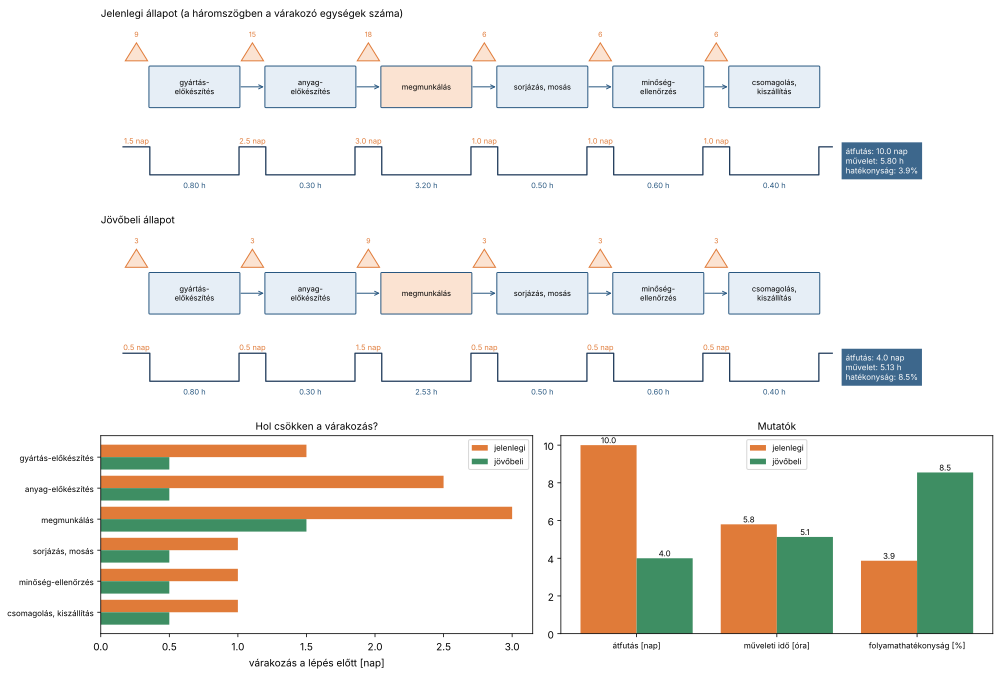

# Folyamatábra és értékáram-térkép {#sec-folyamatabra-vsm}

::: {.cel title="Eszközkártya"}
- **Mire való?** Egy termék, rendelés vagy ügyfél útjának feltérképezése a folyamaton át: a lépések és kapcsolataik, a lépések közötti várakozás és készlet, a műveleti és az átfutási idő, valamint a veszteségek láthatóvá tétele.
- **Tanulási eredmény:** az eszközlap feldolgozása után képes leszel folyamatábrát és értékáram-térképet készíteni, azonosítani a nem értékteremtő lépéseket, és a Little-törvénnyel ellenőrizni az átfutási időt.
- **V-lépés:** 6. Megvalósítás (a gyártó- vagy szolgáltatófolyamat tervezése); 1. Probléma és működési koncepció (a jelenlegi folyamat feltárása); 9. Üzemeltetés (folyamatos fejlesztés).
- **Bemenet:** a vizsgált termékcsalád és a rendszerhatár, helyszíni megfigyelés, mért műveleti idők, a lépések előtt várakozó egységek száma, a napi kibocsátás.
- **Kimenet:** folyamatábra, jelenlegi és jövőbeli értékáram-térkép, átfutási idő, folyamathatékonyság, a veszteségek listája és a fejlesztési javaslatok.
- **Időigény:** a jelenlegi állapot felvétele egy termékcsaládra fél–egy nap a helyszínen; a jövőbeli állapot egy közös workshop.
- **Kézikönyv:** [19. fejezet](../../kezikonyv/fejezetek/19-folyamatelemzes.html), 19.1. és 19.6. szakasz.
- **Továbbolvasás:** [@goldberg1994toolbox, 7.15. és 7.16. szakasz].
:::

## Mikor használd?

- **Ha meg kell érteni, hogyan működik egy folyamat** a valóságban, és nem csak a szabályzat szerint. A folyamatábra a folyamat lépéseit és azok kapcsolatát teszi láthatóvá; a csoportban készült ábra a résztvevők közös értelmezését rögzíti, és segít kiszűrni a nem értékteremtő lépéseket [@rother1999].
- **Ha az átfutási idő hosszú**, és nem tudni, hol vesz el az idő. Az értékáram-térkép alsó idővonala a várakozást és a műveleti időt külön mutatja [@rother1999].
- **Ha a munka áramlását akarod javítani egy üzemben vagy irodában**: a munkafolyamat-elemzés a folyamatábra különleges esete, amelyben a dolgozók és a vezetés együtt vizsgálják a munkafolyamatot a teljesítmény és a munka minőségének javítására [@rother1999].
- **Kevésbé alkalmas**, ha a folyamat sok döntési ponttal, kivétellel és résztvevővel dolgozik; ott a BPMN-modell a jobb eszköz ([-@sec-bpmn]. eszközlap).

## Lépések

{#fig-lepesek-folyamatabra-vsm width=100%}

1. **Jelöld ki a termékcsaládot és a rendszerhatárt**: melyik termék vagy rendelés útját követed, honnan hová. A Little-törvény csak akkor használható ellenőrzésre, ha a három mennyiséget ugyanarra a határra méred.
2. **Rajzold fel a folyamatábrát a helyszínen**, a folyamatot a kiszállítás felől visszafelé végigjárva [@rother1999]. Kezdd a fő lépésekkel (felülről lefelé tagolt ábra), és csak ott részletezz, ahol a vizsgálat megkívánja [@rother1999]. A lépéseket jelöld szimbólummal: művelet, ellenőrzés, szállítás, tárolás, várakozás.
3. **Mérd az időket és a készleteket**: minden lépés műveleti idejét (ebből a beállítást), és a lépés előtt várakozó egységek számát. Az adatokat megfigyelésből és kérdezéssel gyűjtsd, ne a működési tervből, amely azt mutatja, hogyan kellene a folyamatnak működnie [@rother1999].
4. **Rajzold meg az idővonalat**: a várakozás a lépés előtti egységek számának és a napi kibocsátásnak a hányadosa. Az átfutási idő a várakozások összege, a folyamathatékonyság a műveleti idő és az átfutási idő hányadosa.
5. **Ellenőrizd a Little-törvénnyel**: a folyamatban lévő összes egység és a napi kibocsátás hányadosa adja az átlagos átfutást [@little2011]. Nagy eltérés adathibát vagy eltérő rendszerhatárt jelez.
6. **Azonosítsd a veszteségeket** Ohno hét kategóriájával: túltermelés, várakozás, szállítás, felesleges feldolgozás, készlet, felesleges mozgás, hibás termék [@ohno1988].
7. **Tervezd meg a jövőbeli állapotot**: hol lehet a lépéseket összekapcsolni, a rendeléskiadást a szűk keresztmetszethez kötni, a beállítást rövidíteni, a sorozatot csökkenteni [@rother1999].
8. **Vezesd be fokozatosan**: a változtatást előbb kis területen vagy egy műszakban próbáld ki, a hibák kijavítása után vezesd be szélesebb körben, majd rajzold fel az új folyamatot, és frissítsd a működési dokumentációt [@rother1999]. A változtatás után ismételd meg a mérést.

## Kidolgozott példa: egy ForgácsTech-rendelés értékárama

A ForgácsTech csapata egy jellemző rendelés útját követte a gyártáselőkészítéstől a kiszállításig ([-@tbl-vsm-forgacs]. táblázat). Egy átlagos napon 60 rendelés van folyamatban, és naponta 6 készül el; az üzem két műszakban, napi 15 órát dolgozik.

| Lépés | Műveleti idő [óra] | Várakozás előtte [nap] | Várakozó rendelés | Érték a vevőnek |
|:--|--:|--:|--:|:--|
| gyártáselőkészítés | 0,8 | 1,5 | 9 | szükséges |
| anyag-előkészítés | 0,3 | 2,5 | 15 | értékteremtő |
| megmunkálás (0,8 óra beállítással) | 3,2 | 3,0 | 18 | értékteremtő |
| sorjázás, mosás | 0,5 | 1,0 | 6 | értékteremtő |
| minőségellenőrzés | 0,6 | 1,0 | 6 | szükséges |
| csomagolás, kiszállítás | 0,4 | 1,0 | 6 | szükséges |
| **összesen** | **5,8** | **10,0** | **60** | |

: A ForgácsTech egy rendelésének jelenlegi értékárama. {#tbl-vsm-forgacs tbl-colwidths="[36,16,18,15,15]"}

Az átfutás 10 munkanap (150 óra), a folyamathatékonyság $5{,}8/150 = 3{,}9\%$, az értékteremtőnek minősített lépések aránya 2,7%. A Little-törvény szerint $60/6 = 10$ nap: a térkép következetes. A jövőbeli állapotban a rendeléskiadás a megmunkáló központ kapacitásához kötött (legfeljebb 24 rendelés van folyamatban), az anyagot a kiadáskor foglalják le, és a SMED-del 8 percre rövidült átállás fele akkora sorozatokat enged ([-@sec-oee]. eszközlap). Az átfutás 4 napra csökken, a folyamathatékonyság 8,5%-ra nő ([-@fig-folyamatabra-vsm]. ábra).

{#fig-folyamatabra-vsm width=100%}

**Tanulságok:**

- **Az idő a várakozásban vész el.** A műveleti idő 5,8 óráról alig 5,1 órára csökken, a nyereség szinte teljesen a várakozás csökkenéséből jön.
- **A leghosszabb várakozás a szűk keresztmetszet előtt van.** A megmunkáló központ előtti 3 napos sor a kapacitás- és az OEE-elemzés kiindulópontja ([-@sec-kapacitas]. és [-@sec-oee]. eszközlap).
- **Az anyagra várás szervezési kérdés.** Az anyag-előkészítés előtti 2,5 nap nem kapacitáshiányból, hanem abból fakad, hogy a beszerzés csak a kiadás után indul.
- **A Little-törvény olcsó ellenőrzés.** Ha a lépésenként becsült várakozások összege és az $I/R$ hányados eltér, előbb az adatokat kell tisztázni.

## Sablon és notebook

- [folyamatabra_vsm_sablon.xlsx](../sablonok/folyamatabra_vsm_sablon.xlsx): legfeljebb 15 lépés szimbólummal, erőforrással, műveleti és beállítási idővel, várakozással, várakozó egységekkel és értékbesorolással; összesítés (átfutás, folyamathatékonyság, értékteremtő arány, Little-ellenőrzés, a leghosszabb várakozás helye), lépésenkénti diagram; „Veszteségek” lap Ohno hét veszteségével; „Jövőbeli” lap és összevetés. A ForgácsTech példájával kitöltve.
- [folyamatabra_vsm.ipynb](../notebookok/folyamatabra_vsm.ipynb) · [Megnyitás Google Colabban](folyamatabra_vsm.ipynb): a két állapot összesítése, Little-ellenőrzés lépésenként is, egyszerűsített értékáram-térkép lépcsős idővonallal, összevetés (a [-@fig-folyamatabra-vsm]. ábra így készült).

## Előnyök és korlátok

| Előnyök | Korlátok |
|:--|:--|
| Egyszerű, a helyszínen kézzel is elkészíthető, közös nyelvet teremt [@rother1999] | Egy pillanatfelvétel; a változékony folyamatot egy átlagos nap nem írja le |
| A várakozást és a készletet láthatóvá teszi, ezért az átfutás fő okait mutatja | Az elágazó, sok döntési pontot tartalmazó folyamatokat nehezen kezeli |
| A jelenlegi és a jövőbeli állapot összevetése a fejlesztés irányát adja [@rother1999] | Egy termékcsaládra készül; sok termékcsaládnál a közös erőforrásokat külön kell vizsgálni |
| A Little-törvénnyel ellenőrizhető | Az elkészítés időigényes, és csoportmunkát kíván [@rother1999] |

: A folyamatábra és az értékáram-térkép előnyei és korlátai. {tbl-colwidths="[50,50]"}

::: {.hiba}
- **Íróasztal mellett rajzolt térkép.** Az előírt folyamat és a valóságos folyamat eltér; a térképet a helyszínen kell felvenni.
- **Túl részletes első ábra.** A kezdeti részletesség elveszi a figyelmet a fő áramlásról; előbb a fő lépések kellenek.
- **A várakozás elhagyása.** Ha csak a műveleteket rajzoljuk, a térkép éppen a legfontosabbat, az átfutás nagy részét hagyja ki.
- **Minden lépés „értékteremtő”.** Az ellenőrzés, a szállítás és a tárolás a vevő szemében legfeljebb szükséges; az őszinte besorolás mutatja meg a fejlesztési lehetőséget.
:::

## Mintapromptok

::: {.prompt title="Mintaprompt: a folyamatábra felvétele"}
```text
A folyamat leírása, ahogy a résztvevők elmondták: [LEÍRÁS].
Az áramló egység: [EGYSÉG]; a rendszerhatár: [HONNAN–HOVÁ].
Feladat: készíts belőle folyamatlépés-listát a folyamat sorrendjében,
és jelöld mindegyiknél a szimbólumot (művelet, ellenőrzés, szállítás,
tárolás, várakozás) és a végrehajtót. Jelöld, hol hiányzik információ,
és milyen kérdést tegyünk fel a helyszíni bejáráson. Időadatot ne
találj ki: azokat mérni fogjuk.
```
:::

::: {.prompt title="Mintaprompt: veszteségek és jövőbeli állapot"}
```text
Jelenlegi értékáram-térképünk lépésenként (műveleti idő, várakozás,
várakozó egységek, értékbesorolás): [TÁBLÁZAT]. Napi kibocsátás: [R].
Feladat: (1) sorold a megfigyelt problémákat Ohno hét veszteségének
kategóriáiba; (2) javasolj legfeljebb öt változtatást a jövőbeli
állapotra, és mindegyiknél jelöld, melyik várakozást csökkenti és
milyen feltevésre épül. A hatást a sablonnal fogjuk kiszámolni.
```
:::

## Feladat

::: {.projekt title="7. projektlépés (első rész): folyamatábra és értékáram"}
Rajzold fel projekted megvalósító folyamatának (gyártás, szerelés, szolgáltatás vagy ügyintézés) folyamatábráját, vedd fel a jelenlegi állapot értékáram-térképét mért vagy becsült adatokkal, ellenőrizd a Little-törvénnyel, gyűjtsd össze a veszteségeket, és tervezd meg a jövőbeli állapotot. Jelöld, mely adatok mértek és melyek becsültek.
:::
