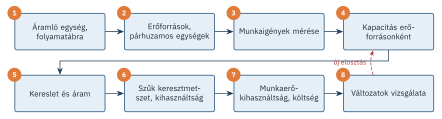
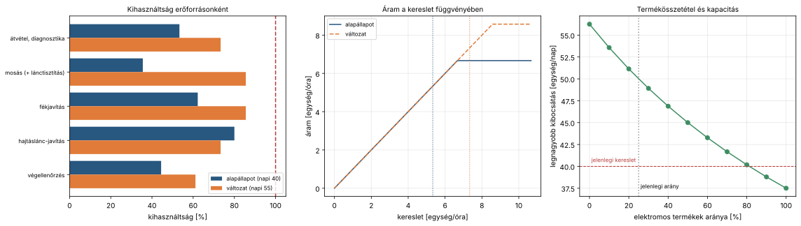

# Kapacitás és szűk keresztmetszet {#sec-kapacitas}

::: {.cel title="Eszközkártya"}
- **Mire való?** Egy folyamat erőforrásainak kapacitása, a szűk keresztmetszet, a folyamat árama, az erőforrások és a munkaerő kihasználtsága, valamint az egységnyi munkaerőköltség kiszámítása; változatok (csúcsidőszak, átcsoportosítás, bővítés) összevetése.
- **Tanulási eredmény:** az eszközlap feldolgozása után képes leszel kiszámítani egy folyamat erőforrásainak kapacitását és kihasználtságát, azonosítani a szűk keresztmetszetet, és javaslatot tenni a kapacitásbővítésre.
- **V-lépés:** 6. Megvalósítás (a folyamat méretezése); 4. Architektúra (a gyártó- vagy szolgáltatórendszer koncepcióinak összevetése); 9. Üzemeltetés (bővítési döntések).
- **Bemenet:** folyamatábra, erőforrásonként a párhuzamos egységek száma és az egy egységre jutó munkaigény, a kereslet, a munkaidő, több terméktípusnál a termékösszetétel.
- **Kimenet:** kapacitás erőforrásonként, szűk keresztmetszet, áram, kihasználtság, ciklusidő, munkatartalom, átlagos munkaerő-kihasználtság, munkaerőköltség egységenként.
- **Időigény:** egy öt-tíz erőforrású folyamatra az adatgyűjtés után 1–2 óra.
- **Kézikönyv:** [19. fejezet](../../kezikonyv/fejezetek/19-folyamatelemzes.html), 19.2–19.3. szakasz.
:::

## Mikor használd?

- **Ha el kell dönteni, elég-e a folyamat kapacitása** egy várható keresletre, és ha nem, hol kell bővíteni.
- **Ha egy beruházási javaslatról kell dönteni** (új gép, új munkatárs): a nem szűk keresztmetszeten végzett bővítés nem növeli a kibocsátást [@goldratt1984].
- **Ha a munkaerőköltséget vagy a létszámot kell megtervezni**: a kihasználatlan időt is ki kell fizetni [@cachon2013, 4. fejezet].
- **Ha több terméktípus osztozik az erőforrásokon**: a szűk keresztmetszet a termékösszetételtől függ [@cachon2013, 3. fejezet].
- **Kevésbé alkalmas** a várakozás és az átfutás becslésére erősen ingadozó érkezéseknél; arra a sorbanállási modell kell ([-@sec-sorbanallas]. eszközlap).

## Lépések

{#fig-lepesek-kapacitas width=100%}

1. **Határozd meg az áramló egységet, és rajzold fel a folyamatábrát** ([-@sec-folyamatabra-vsm]. eszközlap).
2. **Sorold fel az erőforrásokat**, és add meg, hány egység (dolgozó vagy gép) dolgozik párhuzamosan mindegyiken ($m_i$).
3. **Mérd vagy becsüld a munkaigényt**: mennyi ideig tart egy egység feldolgozása az erőforráson ($p_i$). Több terméktípusnál terméktípusonként.
4. **Számítsd ki a kapacitást**: $K_i = m_i/p_i$ [@cachon2013, 3. fejezet].
5. **Hasonlítsd össze a keresletet és a kapacitást**: az áram $R = \min\{D, \min_i K_i\}$; ha a kereslet nagyobb, a folyamat kapacitáskorlátos.
6. **Azonosítsd a szűk keresztmetszetet, és számítsd ki a kihasználtságot**: $u_i = R/K_i$. Több terméktípusnál a származtatott kihasználtság az összesített igény és a rendelkezésre álló idő hányadosa [@cachon2013, 3. fejezet].
7. **Számítsd ki a munkaerő-mutatókat**: ciklusidő $CT = 1/R$, munkatartalom $\sum p_i$, átlagos munkaerő-kihasználtság $\sum p_i / (CT \cdot \sum m_i)$, közvetlen munkaerőköltség egységenként $\sum m_i \cdot \text{órabér} / R$ [@cachon2013, 4. fejezet].
8. **Vizsgálj változatokat**: csúcsidőszak, feladatok átcsoportosítása, egy erőforrás bővítése, más termékösszetétel. Minden változtatás után keresd meg újra a szűk keresztmetszetet.

## Kidolgozott példa: a VárosiBringa javítóműhelye

A műhelybe naponta 40 kerékpár érkezik egy 7,5 órás műszakban. A [-@tbl-kapacitas-bringa]. táblázat az alapállapotot mutatja.

| Erőforrás | $m$ | $p$ [perc] | Kapacitás [db/h] | Kihasználtság |
|:--|--:|--:|--:|--:|
| átvétel, diagnosztika | 1 | 6 | 10,0 | 53% |
| mosás | 1 | 4 | 15,0 | 36% |
| fékjavítás | 2 | 14 | 8,6 | 62% |
| **hajtáslánc-javítás** | 1 | 9 | **6,7** | **80%** |
| végellenőrzés | 1 | 5 | 12,0 | 44% |

: A javítóműhely kapacitása napi 40 kerékpárnál. {#tbl-kapacitas-bringa tbl-colwidths="[34,10,14,20,22]"}

A szűk keresztmetszet a hajtáslánc-javítás (napi 50 kerékpár). A folyamat keresletkorlátos, az áram 5,33 db/h, a ciklusidő 11,25 perc. A munkatartalom 38 perc, a létszám 6, az átlagos munkaerő-kihasználtság $38/(11{,}25 \cdot 6) = 56{,}3\%$. Óránként 4000 forintos munkaerőköltséggel (példaérték) egy kerékpár közvetlen munkaerőköltsége 4500 Ft, amiből csak 2533 Ft a tényleges munkatartalom.

A nyári csúcsban napi 55 kerékpár várható. Az alapállapotban a műhely kapacitáskorlátos lenne (napi 50), és egy második mosó nem segítene. Ha a lánctisztítást (3 perc) a mosáshoz csoportosítják, a szűk keresztmetszet a mosás és a fékjavítás 8,6 db/h-val; a csúcsigény kiszolgálható, a munkaerő-kihasználtság 77%-ra nő, az egységnyi munkaerőköltség 3273 Ft-ra csökken ([-@fig-kapacitas]. ábra). A műhely valójában kétféle kerékpárt javít: a „Többtermékes” lap szerint a 30 hagyományos és 10 elektromos kerékpár mellett a hajtáslánc-javítás származtatott kihasználtsága 80%, és ha az elektromos kerékpárok aránya 80% fölé nőne, napi 40 kerékpár sem lenne kiszolgálható.

{#fig-kapacitas width=100%}

**Tanulságok:**

- **A szűk keresztmetszet határozza meg a kibocsátást.** A mosó bővítése a csúcsban semmit sem érne; a feladatok átcsoportosítása beruházás nélkül megoldja a problémát.
- **A kihasználatlan idő költség.** A munkaerőköltség egységenként nem a munkatartalomtól, hanem a ciklusidőtől és a létszámtól függ.
- **A magas kihasználtságnak ára van.** A csúcsváltozatban a két szűk keresztmetszet 86%-on dolgozik; ingadozó érkezésnél a várakozás itt már jelentős lehet ([-@sec-sorbanallas]. eszközlap).
- **A termékösszetétel a kapacitás része.** Ha nő a munkaigényesebb termékek aránya, a kapacitás csökken, akkor is, ha a darabszám nem változik.

## Sablon és notebook

- [kapacitas_sablon.xlsx](../sablonok/kapacitas_sablon.xlsx): „Alap” és „Változat” lap legfeljebb 12 erőforrással (típus: dolgozó vagy gép), kapacitás, szűk keresztmetszet, kihasználtság, kihasználatlan idő, munkaerő-kihasználtság, egységnyi munkaerőköltség, kihasználtsági diagram; „Többtermékes” lap legfeljebb 4 terméktípusra a származtatott kihasználtsággal és a legnagyobb kibocsátással. A VárosiBringa példájával kitöltve.
- [kapacitas.ipynb](../notebookok/kapacitas.ipynb) · [Megnyitás Google Colabban](kapacitas.ipynb): a két változat és a „csúcs átcsoportosítás nélkül” eset elemzése, a származtatott kihasználtság, a legnagyobb kibocsátás a termékösszetétel függvényében (a [-@fig-kapacitas]. ábra így készült).

## Előnyök és korlátok

| Előnyök | Korlátok |
|:--|:--|
| Egyszerű, gyors, kevés adatot igényel | Átlagokkal számol; az ingadozás okozta várakozást nem mutatja |
| Egyértelműen megmutatja, hol érdemes bővíteni [@goldratt1984] | Feltételezi, hogy a munkaigények ismertek és stabilak |
| A munkaerőköltséget a ciklusidővel kapcsolja össze [@cachon2013, 4. fejezet] | A beállítási időt és a sorozatnagyságot külön kell kezelni |
| Több terméktípusra is kiterjeszthető | A dolgozók közötti rugalmas átcsoportosítást csak változatokkal lehet vizsgálni |

: A kapacitáselemzés előnyei és korlátai. {tbl-colwidths="[50,50]"}

::: {.hiba}
- **Bővítés a nem szűk keresztmetszeten.** A leglátványosabb vagy a legtöbbet panaszkodó erőforrás bővítése gyakran nem növeli a kibocsátást.
- **100%-os kihasználtságra tervezés.** Ingadozó érkezésnél a teljes kihasználtság közelében a várakozás gyorsan nő [@hopp2008].
- **A munkaigény és a kapacitás összekeverése.** Két párhuzamos dolgozó nem felezi a munkaigényt, hanem kétszerezi a kapacitást; a munkatartalom változatlan.
- **Elfelejtett beállítási idő.** Ha a gép sorozatok között átáll, a kapacitás a sorozatnagyságtól is függ ([-@sec-oee]. eszközlap).
:::

## Mintapromptok

::: {.prompt title="Mintaprompt: az erőforrások és munkaigények összegyűjtése"}
```text
A folyamatunk lépései és az ott dolgozók: [LEÍRÁS].
Feladat: készíts erőforráslistát a kapacitáselemzéshez: erőforrás,
típus (dolgozó vagy gép), párhuzamos egységek száma, és milyen
méréssel határozzuk meg az egységnyi munkaigényt. Jelöld, ha egy
dolgozó több lépésen is dolgozik, mert az erőforrás-hozzárendelést
ilyenkor pontosítani kell. Számadatot ne becsülj.
```
:::

::: {.prompt title="Mintaprompt: bővítési változatok"}
```text
Kapacitáselemzésünk eredménye: [TÁBLÁZAT: erőforrás, m, p,
kapacitás, kihasználtság]; a kereslet most [D], a csúcsban [D2].
Feladat: javasolj legfeljebb négy változatot a csúcsigény
kiszolgálására (átcsoportosítás, létszám, műszakidő, gép), és
mindegyiknél jelöld, melyik erőforrás lesz az új szűk keresztmetszet,
és milyen kockázattal jár. A számokat a sablonnal ellenőrizzük.
```
:::

## Feladat

::: {.projekt title="7. projektlépés (második rész): kapacitás és szűk keresztmetszet"}
Határozd meg projekted megvalósító folyamatának erőforrásait, kapacitását és szűk keresztmetszetét a várható keresletnél és egy csúcsigénynél. Számítsd ki a munkaerő-kihasználtságot, és vizsgálj meg legalább két változatot a szűk keresztmetszet feloldására.
:::
