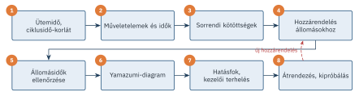
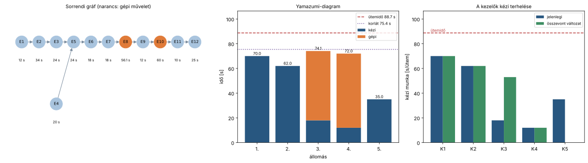

# Ütemidő és sorkiegyenlítés {#sec-sorkiegyenlites}

::: {.cel title="Eszközkártya"}
- **Mire való?** Egy szerelősor vagy más ütemezett folyamat ütemidejének kiszámítása, a műveletek állomásokhoz és kezelőkhöz rendelése úgy, hogy egyik állomás se lépje túl az ütemidőt (és a hatékonysági tartalékot), és a munka egyenletesen oszoljon el.
- **Tanulási eredmény:** az eszközlap feldolgozása után képes leszel kiszámítani az ütemidőt, a műveleteket állomásokhoz rendelni, és meghatározni a sor egyensúlyi veszteségét.
- **V-lépés:** 6. Megvalósítás (a sor és a munkahelyek kialakítása); 4. Architektúra (az állomások számának és az automatizálás mértékének megválasztása); 9. Üzemeltetés (átrendezés keresletváltozáskor).
- **Bemenet:** a kereslet és a rendelkezésre álló idő ugyanarra az időszakra, a tervezett berendezéshatékonyság, a műveletelemek ideje és típusa (kézi vagy gépi), a sorrendi kötöttségek.
- **Kimenet:** ütemidő és ciklusidő-korlát, állomásidők, Yamazumi-diagram, elméleti minimális állomásszám, kiegyenlítési hatásfok, a sor kapacitása, a kezelők terhelése.
- **Időigény:** tíz-húsz műveletelemre az időmérés után 1–2 óra.
- **Kézikönyv:** [19. fejezet](../../kezikonyv/fejezetek/19-folyamatelemzes.html), 19.4. szakasz.
:::

## Mikor használd?

- **Ha egy új szerelősort vagy cellát tervezel**, és el kell dönteni, hány állomás és hány kezelő kell.
- **Ha változik a kereslet**: új ütemidőhöz a műveleteket újra kell osztani.
- **Ha egy állomás rendszeresen feltorlódik**, vagy egyes kezelők túlterheltek, mások várakoznak.
- **Ha kézi és gépi műveletek keverednek**: a Yamazumi-diagram megmutatja, hol végezhet a kezelő más munkát a gépi idő alatt.
- **Kevésbé alkalmas** erősen változó termékösszetételű, egyedi gyártásnál; ott a kapacitáselemzés és az ütemezés a megfelelő eszköz ([-@sec-kapacitas]. és [-@sec-gantt]. eszközlap).

## Lépések

{#fig-lepesek-sorkiegyenlites width=100%}

1. **Számítsd ki az ütemidőt**: a rendelkezésre álló termelési idő és a kereslet hányadosa ugyanarra az időszakra [@rother1999]. Ha a berendezések hatékonyságára tartalékot tervezel, a ciklusidő-korlát az ütemidő és a tervezett OEE szorzata.
2. **Bontsd a munkát műveletelemekre**, és mérd az idejüket. Jelöld, melyik kézi és melyik gépi; a gépi elem ahhoz a berendezéshez kötött, amelyen fut.
3. **Rögzítsd a sorrendi kötöttségeket**: mely elemeknek kell megelőzniük egy adott elemet. Rajzold fel a sorrendi gráfot.
4. **Rendeld a műveleteket állomásokhoz**: a sorrendi kötöttségek betartásával, úgy, hogy az állomásidő ne lépje túl a korlátot. Kézzel vagy heurisztikával; a rangsorolt pozíciós súly módszere például mindig azt az elemet osztja ki, amelynek saját és összes utódjának együttes ideje a legnagyobb [@scholl2006].
5. **Ellenőrizd az állomásidőket**: az ütemidőhöz, a korláthoz, és számítsd ki az elméleti minimumot: $N_{\min} = \lceil \sum t_j / TT \rceil$.
6. **Rajzold meg a Yamazumi-diagramot**: állomásonként a kézi és a gépi idő egymásra rakva, vízszintes vonallal az ütemidő és a korlát.
7. **Számítsd ki a hatásfokot és a kezelői terhelést**: $\eta = \sum t_j / (N \cdot c)$; a kezelők kézi terhelése az ütemidőhöz képest.
8. **Rendezd át, és próbáld ki**: vond össze vagy oszd szét a feladatokat, majd ellenőrizd az elrendezést és a kezelők terhelését, mielőtt bevezeted ([-@sec-tlx-sus]. eszközlap).

## Kidolgozott példa: a KoboCella-sor

A motorszerelő sor évi 3450 órában évi 140 ezer motort gyárt, az ütemidő 88,7 s; a tervezett 85%-os OEE miatt a ciklusidő-korlát 75,4 s (kézikönyv [6. fejezet](../../kezikonyv/fejezetek/06-kovetelmenyek.html)). A sor 12 műveletelemből áll; a [-@tbl-sor-kobo]. táblázat az öt állomást mutatja.

| Állomás | Műveletelemek | Kézi [s] | Gépi [s] | Állomásidő [s] | Kezelő |
|:--|:--|--:|--:|--:|:--|
| 1. állórész-előszerelés | E1–E3 | 70 | – | 70,0 | K1 |
| 2. rotor beszerelése | E4–E6 | 62 | – | 62,0 | K2 |
| 3. KoboCella | E7–E8 | 18 | 56,1 | **74,1** | K3 |
| 4. elektromos teszt | E9–E10 | 12 | 60 | 72,0 | K4 |
| 5. csomagolás | E11–E12 | 35 | – | 35,0 | K5 |

: A KoboCella-sor jelenlegi kiegyenlítése. {#tbl-sor-kobo tbl-colwidths="[26,18,12,12,18,14]"}

A munkatartalom 313,1 s; az ütemidőre elméletileg 4, a korlátra 5 állomás kell. Mind az öt állomás a korlát alatt van, a szűk keresztmetszet a KoboCella (74,1 s, a tartalék mindössze 1,3 s), a hatásfok 84,5%, a sor kapacitása 48,6 motor/óra az igényelt 40,6 mellett. A rangsorolt pozíciós súly heurisztika a korlátra és az ütemidőre is öt állomást ad: a négyállomásos elméleti minimumot a sorrendi kötöttségek és a berendezésekhez kötött gépi műveletek nem engedik elérni. A létszámot ezért a kezelői feladatok összevonásával lehet csökkenteni: ha a KoboCella kezelője átveszi a címkézést és a csomagolást, terhelése 53 s (az ütemidő 60%-a), a kezelők száma négy, a munkaerő-kihasználtság 44%-ról 56%-ra nő ([-@fig-sorkiegyenlites]. ábra).

{#fig-sorkiegyenlites width=100%}

**Tanulságok:**

- **Az ütemidő és a ciklusidő-korlát nem ugyanaz.** Ha a berendezések hatékonysága 85%, az állomásidőnek az ütemidő 85%-ánál kisebbnek kell lennie; ezzel a korláttal már öt állomás az elméleti minimum.
- **A szűk keresztmetszet tartaléka kicsi.** A KoboCella ciklusidejének bármilyen romlása a sor kibocsátását veszélyezteti, ezért a ciklusidőt a gyártásban is követni kell.
- **A gépi idő a kezelőnek tartalék.** A Yamazumi-diagram a kézi és a gépi időt szétválasztva mutatja meg, hogy a létszám csökkenthető anélkül, hogy az állomásokat átrendeznénk.
- **Az összevonás emberi tényezőket is érint.** A kezelő felügyeleti feladata, a zavarelhárítás és a gyaloglás nem jelenik meg a kézi időben; a változtatás előtt a terhelést mérni kell.

## Sablon és notebook

- [sorkiegyenlites_sablon.xlsx](../sablonok/sorkiegyenlites_sablon.xlsx): ütemidő és ciklusidő-korlát; legfeljebb 30 műveletelem idővel, típussal, két megelőzővel, állomás- és kezelő-hozzárendeléssel, sorrendi ellenőrzéssel; „Állomások” lap legfeljebb 8 állomással, a mutatókkal és Yamazumi-diagrammal; „Kezelők” lap a kezelők terhelésével és a munkaerő-kihasználtsággal. A KoboCella-sor példájával kitöltve.
- [sorkiegyenlites.ipynb](../notebookok/sorkiegyenlites.ipynb) · [Megnyitás Google Colabban](sorkiegyenlites.ipynb): sorrendi gráf, a jelenlegi hozzárendelés ellenőrzése, rangsorolt pozíciós súly heurisztika a korlátra és az ütemidőre (a gépi elemeket a megelőző kézi elemmel együtt kezeli), a kezelői összevonás hatása (a [-@fig-sorkiegyenlites]. ábra így készült).

## Előnyök és korlátok

| Előnyök | Korlátok |
|:--|:--|
| A vevői igényből indul, így a sor kapacitása a kereslethez igazodik [@rother1999] | Determinisztikus időkkel számol; a műveleti idők szórását és a zavarokat nem kezeli |
| A Yamazumi-diagram szemléletes, a kezelőkkel közösen is használható | A heurisztika nem garantál optimumot; nagy feladatokra pontos módszerek is léteznek [@scholl2006] |
| Megmutatja az elméleti minimumot és a kiegyenlítés hatásfokát | Több termékváltozatnál (vegyes sor) a változatok eltérő munkatartalmát külön kell kezelni |
| A kézi és a gépi idő szétválasztása létszámtervezést is lehetővé tesz | A munkahelyi elrendezés, a gyaloglás és az ergonómia csak külön vizsgálattal jelenik meg |

: Az ütemidő-számítás és a sorkiegyenlítés előnyei és korlátai. {tbl-colwidths="[50,50]"}

::: {.hiba}
- **Az ütemidő és a ciklusidő összekeverése.** Az ütemidő a vevői igényből adódik, a ciklusidő a folyamat tényleges teljesítménye; a sornak az ütemidőnél gyorsabbnak kell lennie a veszteségek miatt.
- **Eltérő időszakok.** A rendelkezésre álló időt és a keresletet ugyanarra az időszakra kell venni, és a rendelkezésre álló időből a tervezett szüneteket le kell vonni.
- **A sorrendi kötöttségek figyelmen kívül hagyása.** A papíron kiegyenlített sor a valóságban nem működik, ha egy művelet a megelőzője előtt kerül sorra.
- **Átlagidővel méretezett szűk keresztmetszet.** Ha egy állomás ideje erősen ingadozik, az átlag a korlát alatt lehet, a sor mégis gyakran megáll.
:::

## Mintapromptok

::: {.prompt title="Mintaprompt: műveletelemek és sorrendi kötöttségek"}
```text
A szerelési folyamat leírása: [LEÍRÁS, alkatrészek, lépések].
Feladat: bontsd műveletelemekre, amelyek külön időzíthetők és
egy-egy állomáshoz rendelhetők. Mindegyiknél jelöld, kézi vagy gépi,
és sorold fel a közvetlen megelőzőit. Jelöld azokat az elemeket,
amelyek egy adott berendezéshez kötöttek. Időket ne adj meg:
azokat mérni fogjuk.
```
:::

::: {.prompt title="Mintaprompt: átrendezési javaslat"}
```text
Sorunk adatai: ütemidő [TT] s, ciklusidő-korlát [C] s; műveletelemek
idővel, típussal, megelőzőkkel, a jelenlegi állomás- és kezelő-
hozzárendeléssel: [TÁBLÁZAT].
Feladat: javasolj legfeljebb két átrendezést (állomás vagy kezelői
feladat), amely csökkenti a létszámot vagy növeli a tartalékot a
szűk keresztmetszeten. Mindegyiknél nevezd meg, mely sorrendi
kötöttségeket és milyen ergonómiai kérdéseket kell ellenőrizni.
```
:::

## Feladat

::: {.projekt title="7. projektlépés (harmadik rész, választható): sorkiegyenlítés"}
Ha projektedben ütemezett, ismétlődő folyamat van (szerelősor, csomagolás, ügyintézési lépéssor), számítsd ki az ütemidőt, bontsd a munkát műveletelemekre, készíts Yamazumi-diagramot a jelenlegi vagy tervezett hozzárendelésről, és javasolj átrendezést. Az összevont feladatok terhelését becsüld meg vagy mérd.
:::
