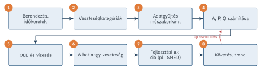
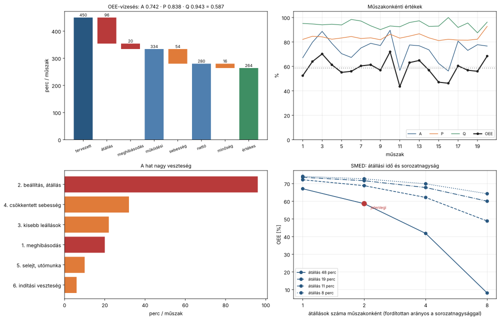

# OEE-számítás {#sec-oee}

::: {.cel title="Eszközkártya"}
- **Mire való?** Egy berendezés teljes eszközhatékonyságának (OEE) számítása a rendelkezésre állás, a teljesítmény és a minőség szorzataként; a hat nagy veszteség számszerűsítése, az OEE-vízesés, a beállításiidő-csökkentés (SMED) hatásának becslése; a munkára vonatkozó párja, az OLE.
- **Tanulási eredmény:** az eszközlap feldolgozása után képes leszel kiszámítani egy berendezés OEE-mutatóját és veszteségösszetevőit, és a veszteségek alapján fejlesztési prioritást kijelölni.
- **V-lépés:** 6. Megvalósítás (a gyártórendszer teljesítménykövetelményeinek ellenőrzése); 8. Validáció (a berendezés átvétele üzemi körülmények között); 9. Üzemeltetés (folyamatos fejlesztés, karbantartás).
- **Bemenet:** műszakonként a tervezett üzemidő, az átállások és a meghibásodások ideje, a kisebb leállások ideje, a legyártott, a jó és az indításkor selejtté vált darabok száma, az ideális ciklusidő.
- **Kimenet:** A, P, Q és OEE műszakonként és az időszakra, a hat nagy veszteség percben, OEE-vízesés, SMED-változatok, OLE.
- **Időigény:** az adatgyűjtés egy–négy hét; a kiértékelés 1 óra.
- **Kézikönyv:** [19. fejezet](../../kezikonyv/fejezetek/19-folyamatelemzes.html), 19.5. és 19.7. szakasz; a rendelkezésre állás megbízhatósági háttere: [16. fejezet](../../kezikonyv/fejezetek/16-megbizhatosag.html).
:::

## Mikor használd?

- **Ha egy berendezés teljesítményét kell követni** és javítani: az OEE a teljes körű hatékony karbantartás (TPM) mérőszáma, és a hat nagy veszteség csökkentésére irányítja a figyelmet [@nakajima1988].
- **Ha egy követelmény hatékonysági tartalékot ír elő** (például a KoboCella 85%-os tervezett OEE-je), és ellenőrizni kell, teljesül-e.
- **Ha el kell dönteni, melyik veszteség csökkentésével kezdjük**: átállás, meghibásodás, sebesség vagy selejt.
- **Ha a munkaszervezés veszteségeit akarod feltárni**: az OLE ugyanezt a logikát alkalmazza a munkára [@braglia2021ole].
- **Kevésbé alkalmas** gépek, üzemek vagy cégek összehasonlítására, valamint pufferekkel tagolt folyamatok egészének jellemzésére: a mutató egy gépre vonatkozik, kis sorozatú egyedi gyártásban kevésbé hasznos, pufferekkel tagolt folyamatokban pedig át kell értelmezni [@muchiri2008].

## Lépések

{#fig-lepesek-oee width=100%}

1. **Jelöld ki a berendezést és az időkereteket**: a tervezett üzemidő a műszakidő a tervezett szünetek és a tervezett leállások nélkül. Határozd meg az ideális ciklusidőt (a gép névleges vagy bizonyítottan elérhető legjobb ciklusideje).
2. **Rögzítsd a veszteségkategóriákat** Nakajima hat nagy vesztesége szerint: meghibásodás; beállítás, átállás; üresjárat és kisebb leállások; csökkentett sebesség; selejt és utómunka; indítási veszteség [@nakajima1988]. Döntsd el, milyen hosszú leállás számít kisebb leállásnak.
3. **Gyűjtsd az adatokat műszakonként**, ha lehet, gépi adatgyűjtéssel: a kézzel rögzített kisebb leállások gyakran kimaradnak, és az OEE értéke az adatok pontosságán múlik [@muchiri2008].
4. **Számítsd ki a tényezőket**: $A$ = működési idő / tervezett üzemidő; $P$ = ideális ciklusidő × legyártott darab / működési idő; $Q$ = jó darab / legyártott darab.
5. **Számítsd ki az OEE-t, és rajzold meg a vízesést**: $\text{OEE} = A \cdot P \cdot Q$ = a jó darabok ideális ideje / tervezett üzemidő. Az időszaki értéket az összegekből számold, ne a műszakonkénti arányok átlagából.
6. **Rangsorold a hat nagy veszteséget** percben, és vizsgáld meg, melyik tényező okozza a műszakok közötti szórást.
7. **Válassz fejlesztési akciót**: a legnagyobb veszteségre (átállásnál SMED, meghibásodásnál megelőző karbantartás, sebességnél és kisebb leállásnál okfeltárás, selejtnél folyamatszabályozás). Becsüld meg a hatását.
8. **Kövesd az eredményt**: a gép saját korábbi értékeihez hasonlítva, trenddiagramon.

## Kidolgozott példa: a ForgácsTech megmunkáló központja

A ForgácsTech az MES első ütemében gépi adatgyűjtést vezetett be. A megmunkáló központ 20 műszakjának adatait a sablon tartalmazza; a tervezett üzemidő műszakonként 450 perc, az ideális ciklusidő 4 perc. A [-@tbl-oee-forgacs]. táblázat az egy műszakra jutó veszteségeket mutatja.

| Veszteség | Csoport | Perc / műszak | Arány |
|:--|:--|--:|--:|
| 1. meghibásodás | állásidő | 20 | 4,4% |
| 2. beállítás, átállás | állásidő | 96 | 21,3% |
| 3. üresjárat, kisebb leállások | sebesség | 22 | 4,9% |
| 4. csökkentett sebesség | sebesség | 32 | 7,1% |
| 5. selejt és utómunka | minőség | 10 | 2,2% |
| 6. indítási veszteség | minőség | 6 | 1,3% |
| értékes idő | | 264 | 58,7% |

: A megmunkáló központ veszteségei 20 műszak átlagában. {#tbl-oee-forgacs tbl-colwidths="[38,20,20,22]"}

Az időszakra $A = 0{,}742$, $P = 0{,}838$, $Q = 0{,}943$, az OEE $0{,}587$. A műszakonkénti OEE 0,44 és 0,72 között szóródik; az eltérés nagyobbik részét (az OEE logaritmusának szórásnégyzetéből 87%-ot) a rendelkezésre állás okozza: a három átállásos és a meghibásodásos műszakok a leggyengébbek ([-@fig-oee]. ábra). A SMED után 8 perces átállással és változatlan sorozatnagysággal az OEE 0,727 lenne; négy átállással (fele akkora sorozatokkal) 0,699, a gép előtti készlet és várakozás pedig a felére csökken. A ForgácsTech a második változatot választotta, mert célja a határidő-tartás.

{#fig-oee width=100%}

A VárosiBringa javítóműhelyének három szerelőjére az OLE 0,72, 0,83 és 0,63; az összesített érték 0,72. A harmadik szerelőnél a várakozás (60 perc) és az utómunka is nagyobb: az okot az alkatrész-ellátásban és a betanításban kell keresni, nem a szerelőben.

**Tanulságok:**

- **A legnagyobb veszteség nem mindig a legláthatóbb.** A meghibásodást mindenki észreveszi, de itt az átállás ötször annyi időt visz el.
- **Az összegekből számolj.** A műszakonkénti arányok átlaga eltérhet az időszaki értéktől, ha a műszakok tervezett ideje vagy darabszáma különbözik.
- **A SMED megtakarítása kétféleképpen használható fel.** Kapacitásra (nagyobb OEE) vagy rugalmasságra (kisebb sorozat, rövidebb átfutás); a döntés a cél függvénye.
- **Az OEE a saját fejlődést méri.** A ForgácsTech a gép korábbi értékeihez hasonlít, nem iparági átlagokhoz.

## Sablon és notebook

- [oee_sablon.xlsx](../sablonok/oee_sablon.xlsx): „Adatok” lap legfeljebb 40 műszakkal, műszakonkénti és időszaki A, P, Q, OEE, adatellenőrzés, trenddiagram; „Veszteségek” lap a hat nagy veszteséggel és OEE-vízeséssel; „SMED” lap átállási változatokkal (OEE, sorozatnagyság, gép előtti készlet); „OLE” lap a munkaerő-hatékonysággal. A ForgácsTech és a VárosiBringa példájával kitöltve.
- [oee.ipynb](../notebookok/oee.ipynb) · [Megnyitás Google Colabban](oee.ipynb): műszakonkénti és időszaki számítás, a hat nagy veszteség, a szórás felbontása a három tényezőre, SMED-változatok rácsa, OLE (a [-@fig-oee]. ábra így készült).

## Előnyök és korlátok

| Előnyök | Korlátok |
|:--|:--|
| Egyetlen, könnyen érthető mutató, amely három veszteségcsoportra bontható [@nakajima1988] | Egy gépre vonatkozik; a gépek egymásra hatását nem mutatja [@muchiri2008] |
| A vízesés és a hat nagy veszteség a fejlesztési prioritást is kijelöli | A három tényezőt egyenlő súllyal kezeli [@muchiri2008] |
| Gépi adatgyűjtéssel folyamatosan követhető | Az eredmény az adatgyűjtés pontosságán és a veszteségek osztályozásán múlik [@muchiri2008] |
| A munkára (OLE) és más erőforrásokra is kiterjeszthető [@braglia2021ole] | Üzemek közötti összehasonlításra nem alkalmas: nincs mindenhol érvényes viszonyítási érték [@muchiri2008] |

: Az OEE-számítás előnyei és korlátai. {tbl-colwidths="[50,50]"}

::: {.hiba}
- **Optimista ideális ciklusidő.** Ha az ideális ciklusidő a ténylegesen elérhetőnél lassabb, a P tényező mesterségesen nagy, és a sebességveszteség rejtve marad.
- **A tervezett üzemidő manipulálása.** Ha az átállást „tervezett leállásnak” minősítjük, eltűnik a mutatóból, pedig a SMED éppen ezt csökkentené.
- **Arányok átlagolása.** Az időszaki OEE-t az összegekből kell számítani.
- **Az OEE mint rangsor.** A dolgozók vagy műszakok rangsorolása a mutató torzításához vezet; a cél a veszteségek feltárása.
:::

## Mintapromptok

::: {.prompt title="Mintaprompt: veszteségkategóriák kialakítása"}
```text
Berendezésünk: [GÉP, termékek, műszakrend]. A jelenleg rögzített
állásidő-okok: [LISTA].
Feladat: rendeld a rögzített okokat Nakajima hat nagy veszteségének
kategóriáihoz, jelöld, melyik ok nem sorolható be egyértelműen, és
javasolj határt a kisebb leállásokra. Javasolj egyszerű adatgyűjtési
módot (gépi jel vagy kezelői rögzítés) mindegyik kategóriára.
```
:::

::: {.prompt title="Mintaprompt: fejlesztési akció a legnagyobb veszteségre"}
```text
OEE-elemzésünk eredménye: A = [A], P = [P], Q = [Q]; a hat nagy
veszteség percben műszakonként: [TÁBLÁZAT]. Célunk: [CÉL, például
rövidebb átfutás vagy nagyobb kapacitás].
Feladat: javasolj fejlesztési akciót a két legnagyobb veszteségre,
indokold, hogy a célhoz melyik illeszkedik jobban, és nevezd meg,
milyen adat kell a hatás ellenőrzéséhez. A hatást a sablon SMED
lapjával vagy a notebookkal számoljuk ki.
```
:::

## Feladat

::: {.projekt title="7. projektlépés (negyedik rész): OEE vagy hatékonysági mutató"}
Számítsd ki projekted megvalósító folyamatának egy kritikus berendezésére az OEE-t (mért vagy reálisan becsült adatokkal), rajzold meg a vízesést, rangsorold a hat nagy veszteséget, és becsüld meg egy fejlesztési akció hatását. Ha a folyamatban nincs gép, a munka hatékonyságát (OLE) vagy egy analóg időfelbontást (például szolgáltatásban a fizetett idő és a valóban értékteremtő idő arányát) számítsd ki.
:::
