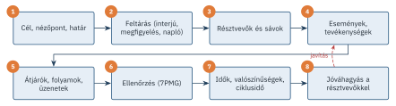
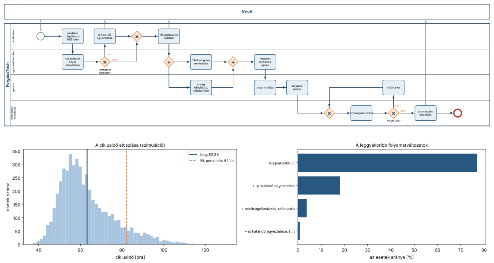

# BPMN-modellezés {#sec-bpmn}

::: {.cel title="Eszközkártya"}
- **Mire való?** Egy több résztvevős folyamat lépéseinek, döntési pontjainak, párhuzamos ágainak és üzenetváltásainak szabványos (BPMN 2.0) leírása; a modell szerkezeti ellenőrzése, átlagos ciklusidejének kiszámítása és szimulációja.
- **Tanulási eredmény:** az eszközlap feldolgozása után képes leszel egy több résztvevős folyamatot szabályos BPMN-diagramon ábrázolni, és a modellt a minőségi irányelvek szerint ellenőrizni.
- **V-lépés:** 6. Megvalósítás (a megvalósító folyamat tervezése); 1. Probléma és működési koncepció (a jelenlegi folyamat feltárása); 3. Követelmények (az informatikai támogatás követelményeinek forrása); 9. Üzemeltetés (folyamatbányászat, fejlesztés).
- **Bemenet:** a modell célja és nézőpontja, a feltárás eredményei (interjúk, megfigyelés, dokumentumok, eseménynapló), a résztvevők és szerepek, a tevékenységek ideje és a döntési ágak valószínűsége.
- **Kimenet:** jelenlegi és jövőbeli BPMN-modell, szerkezeti ellenőrzés, átlagos ciklusidő és eloszlás, BPMN 2.0 XML-fájl, gyakorló eseménynapló.
- **Időigény:** egy 10–20 tevékenységes modell feltárás után 2–4 óra; a jóváhagyás egy workshop.
- **Kézikönyv:** [20. fejezet](../../kezikonyv/fejezetek/20-bpmn.html).
:::

## Mikor használd?

- **Ha a folyamatban több szervezeti egység vagy külső partner vesz részt**, és az átadások, az üzenetek és a döntési pontok okozzák a gondot.
- **Ha a folyamathoz informatikai támogatás készül**: a modell megmutatja, mely lépéseket kell a rendszernek támogatnia, és milyen adatok keletkeznek [@dumas2018, 3. fejezet].
- **Ha a jelenlegi és a jövőbeli működést kell összevetni**, és a változást az érintettekkel jóvá kell hagyatni.
- **Ha a folyamat átfutását modellből kell becsülni**: a folyamatáram-elemzés és a szimuláció a modellre épül [@dumas2018, 7. fejezet].
- **Kevésbé alkalmas** az egyetlen anyagáram idővonalának és készleteinek bemutatására; arra az értékáram-térkép a jobb ([-@sec-folyamatabra-vsm]. eszközlap).

## Lépések

{#fig-lepesek-bpmn width=100%}

1. **Határozd meg a modell célját, nézőpontját és határát**: kinek készül, mit kell megmutatnia, mi indítja és mi zárja a folyamatot.
2. **Tárd fel a folyamatot** legalább két módszerrel: dokumentumelemzés, megfigyelés, eseménynapló, interjú, workshop [@dumas2018, 5. fejezet].
3. **Jelöld ki a résztvevőket és a sávokat**: önálló szervezet vagy külső partner külön medence, a szervezeten belüli szerepek sávok.
4. **Vedd fel az eseményeket és a tevékenységeket**: egy indító és egy záró esemény, a tevékenységek „ige + tárgy” névvel [@mendling2010].
5. **Kösd össze az elemeket**: szekvenciafolyam a résztvevőn belül, üzenetfolyam a medencék között; kizáró átjáró a döntésekhez, párhuzamos átjáró az egyszerre futó ágakhoz, minden elágazáshoz azonos típusú összefutással [@omg2011bpmn].
6. **Ellenőrizd a modellt** a hét modellezési irányelv szerint: kevés elem, kevés ág egy elemen, egy indító és egy záró esemény, strukturált modell, VAGY átjáró kerülése, ige + tárgy nevek, 50 elem fölött alfolyamatok [@mendling2010].
7. **Rendelj időt és valószínűséget**, és számítsd ki az átlagos ciklusidőt: soros lépéseknél összeg, kizáró ágaknál súlyozott átlag, párhuzamos ágaknál maximum, ismétlésnél $T/(1-r)$ [@dumas2018, 7. fejezet]. Ha az eloszlás vagy az erőforrás-versengés is számít, szimulálj.
8. **Hagyasd jóvá a résztvevőkkel**, és javítsd a modellt a visszajelzések szerint.

## Kidolgozott példa: a ForgácsTech rendelésteljesítési folyamata

A jövőbeli modell 12 tevékenységet, 4 sávot és a vevőt mint külső résztvevőt tartalmaz (kézikönyv [20. fejezet](../../kezikonyv/fejezetek/20-bpmn.html)). A sablon „Elemek” és „Kapcsolatok” lapja a modell 21 elemét és 26 folyamát rögzíti; a szerkezeti ellenőrzés hibát nem talál. A folyamatáram-elemzés blokkjait a [-@tbl-bpmn-blokkok]. táblázat mutatja.

| Blokk | Típus | Idő [óra] |
|:--|:--|--:|
| rendelés rögzítése, kapacitás-ellenőrzés | soros | 2,5 |
| határidő-egyeztetés (20%: 24 óra) | XOR | 4,8 |
| visszaigazolás | soros | 0,5 |
| CAM-program (6 óra) ∥ anyag (4 óra) | ÉS | 6,0 |
| kiadás (várakozás a gépre), megmunkálás, sorjázás | soros | 33,0 |
| minőségellenőrzés (8,1 óra), 5%-ban 2 órás utómunka | ismétlés | 8,6 |
| csomagolás, kiszállítás | soros | 7,9 |
| **összesen** | | **63,3** |

: A jövőbeli folyamat folyamatáram-elemzése (az idők a várakozást is tartalmazzák). {#tbl-bpmn-blokkok tbl-colwidths="[60,18,22]"}

Az átlagos ciklusidő 63,3 óra, napi 15 munkaórával 4,2 munkanap, összhangban az értékáram-térkép jövőbeli állapotával ([-@sec-folyamatabra-vsm]. eszközlap). A visszaigazolásig tartó szakasz a jelenlegi 26,6 óráról 7,8 órára rövidül. A szimuláció szerint az átlag mellett az eloszlás is fontos: a 90. percentilis 82 óra, mert a határidő-egyeztetés és az utómunka egyes rendeléseket jelentősen késleltet ([-@fig-bpmn]. ábra). A notebook a modellt BPMN 2.0 XML-fájlba exportálja; a fájl a bpmn.io szerkesztőjében megnyitható.

{#fig-bpmn width=100%}

**Tanulságok:**

- **A párhuzamosítás azonnal nyer.** A CAM-program és az anyag-előkészítés egyidejű indítása 4 órát takarít meg rendelésenként.
- **Az átlag nem elég a határidő vállalásához.** A vállalásnál a ciklusidő eloszlásának felső részével kell számolni.
- **A modell táblázatban is karbantartható.** Az elem- és kapcsolatlistából a szerkezeti hibák képlettel is kiszűrhetők, és a modell szabványos fájlba exportálható.
- **A szimuláció itt nem modellezi a sorokat.** A gép előtti várakozást átlagos értékként tartalmazza; a sorok dinamikájához sorbanállási modell kell ([-@sec-sorbanallas]. eszközlap).

## Sablon és notebook

- [bpmn_sablon.xlsx](../sablonok/bpmn_sablon.xlsx): „Sávok”, „Elemek” (legfeljebb 60 elem típussal, sávval, oszloppal, idővel, feladattípussal, a be- és kimenő folyamok számával, szerkezeti ellenőrzéssel), „Kapcsolatok” (legfeljebb 90 folyam, a medencék közötti szabály ellenőrzésével), „Ellenőrzés” (a 7PMG szempontjai és egy minimális formai ellenőrzés), „Folyamatáram” (blokkos ciklusidő-számítás feladat, XOR, ÉS és ismétlés blokkokkal; jelenlegi és jövőbeli változat). A ForgácsTech példájával kitöltve.
- [bpmn.ipynb](../notebookok/bpmn.ipynb) · [Megnyitás Google Colabban](bpmn.ipynb): szerkezeti ellenőrzés gráfként, BPMN 2.0 XML export diagramadatokkal (`folyamat.bpmn`), Monte Carlo ciklusidő-szimuláció, eseménynapló generálása (`esemenynaplo.csv`, a [-@sec-folyamatbanyaszat]. eszközlap bemenete) és a folyamatváltozatok gyakorisága (a [-@fig-bpmn]. ábra így készült).

## Előnyök és korlátok

| Előnyök | Korlátok |
|:--|:--|
| Szabványos, széles körben ismert jelölés, eszközök között cserélhető [@omg2011bpmn; @iso19510_2013] | A gazdag elemkészlet miatt könnyű túlbonyolítani; a modellezőnek fegyelem kell [@mendling2010] |
| A résztvevők és az átadások jól láthatók | A modell a folyamat logikáját mutatja, az időt és a készletet csak kiegészítő adatokkal |
| A modellből ciklusidő számítható és szimuláció építhető [@dumas2018, 7. fejezet] | A jelenlegi modell csak annyira jó, amennyire a feltárás; a szabályzat szerinti modell félrevezet |
| Végrehajtható modellként munkafolyamat-motorban is futtatható [@omg2011bpmn] | A végrehajtható modellhez sokkal több részlet kell, mint a megértéshez |

: A BPMN-modellezés előnyei és korlátai. {tbl-colwidths="[50,50]"}

::: {.hiba}
- **Szekvenciafolyam két medence között.** A medencék közötti kapcsolat mindig üzenetfolyam; a szekvenciafolyam csak egy résztvevőn belül futhat.
- **Párosítatlan átjárók.** A párhuzamos ágat ÉS átjáróval kell összefuttatni; ha kizáróval zárjuk, a folyamat a modell szerint többször folytatódik.
- **Döntés átjáró nélkül.** Ha egy feladatból feltétel nélkül két folyam indul, az párhuzamos végrehajtást jelent, nem döntést.
- **Leírás helyett ige nélküli címkék.** A „számla” vagy „ellenőrzés” név nem mondja meg, mi történik; „számla rögzítése”, „méretek ellenőrzése” a jó.
- **Egyetlen nagy modell.** 50 elem fölött a modell áttekinthetetlen; alfolyamatokra kell bontani.
:::

## Mintapromptok

::: {.prompt title="Mintaprompt: folyamatleírásból BPMN-modell, két lépésben"}
```text
Szerepkör: tapasztalt folyamatelemző és BPMN 2.0 modellező vagy.
Cél: az alábbi leírásból a folyamat JELENLEGI (as-is) állapotának
BPMN 2.0 modellje, optimalizálás és kiegészítés nélkül.
Leírás: [FOLYAMATLEÍRÁS]

1. lépés (most): NE készíts még modellt. Foglald össze, hogyan
értelmezed a leírás szerkezetét, és sorold fel: résztvevők (medencék,
sávok), indító és záró esemény(ek), tevékenységek („ige + tárgy”),
döntési pontok (XOR, ÉS), üzenetek a résztvevők között, dokumentumok.
Tegyél fel tisztázó kérdést minden kétértelmű vagy hiányos pontra,
és kérd a jóváhagyásomat.
2. lépés (a jóváhagyás után): készítsd el a modellt táblázatként
(elemek: azonosító, típus, név, sáv; kapcsolatok: honnan, hová,
típus, feltétel), vagy kérésre érvényes BPMN 2.0 XML-ként egyedi
azonosítókkal és helyes sourceRef/targetRef hivatkozásokkal.
```
:::

::: {.prompt title="Mintaprompt: modell és eseménynapló összevetése"}
```text
Szerepkör: folyamatbányászati szakértő vagy.
Bemenetek: (1) a dokumentált folyamatmodell elem- és kapcsolatlistája:
[MODELL]; (2) eseménynapló-kivonat (eset, tevékenység, időbélyeg,
erőforrás): [NAPLÓ].
Feladat: (1) párosítsd a napló tevékenységeit a modell elemeivel;
(2) sorold fel a modellben nem szereplő tevékenységeket, a kimaradó
lépéseket és a modelltől eltérő sorrendeket, esetszámmal együtt;
(3) javasolj módosítást a modellen, és jelöld, mely következtetést
kell a teljes naplón gyakoriságszámítással ellenőrizni.
Ne tételezz fel okot, amelyre a napló nem ad bizonyítékot.
```
:::

## Feladat

::: {.projekt title="7. projektlépés (ötödik rész): BPMN-modell"}
Készítsd el projekted megvalósító folyamatának BPMN 2.0 modelljét legalább három résztvevővel (medencével vagy sávval) és legalább tíz tevékenységgel, egy BPMN-szerkesztőben (például a bpmn.io webes szerkesztőjében) vagy a sablonnal és a notebookkal. Ellenőrizd a 7PMG szerint, rendelj a tevékenységekhez időt, és számítsd ki az átlagos ciklusidőt. Ha nyelvi modellt használsz, a kétlépcsős munkamenetet kövesd, és dokumentáld, mit javítottál a generált modellen.
:::
