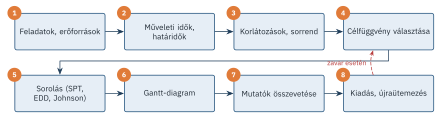
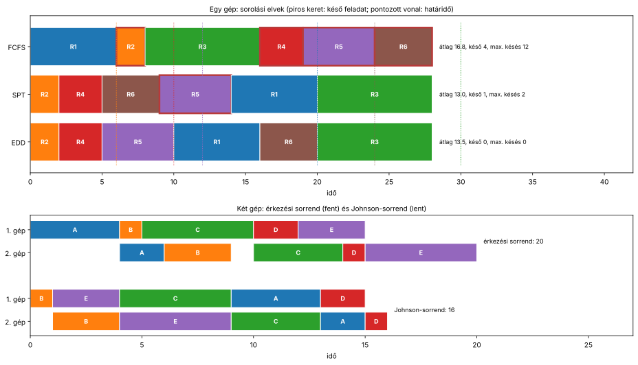

# Gantt-diagram és ütemezés {#sec-gantt}

::: {.cel title="Eszközkártya"}
- **Mire való?** Munkafeladatok sorrendjének és időzítésének meghatározása egy vagy több erőforráson; az ütemterv ábrázolása Gantt-diagrammal; a sorolási elvek összevetése az átlagos átfutás, a késések és a teljes átfutás szerint.
- **Tanulási eredmény:** az eszközlap feldolgozása után képes leszel munkafeladatokat ütemezni egy vagy több erőforráson, Gantt-diagramon ábrázolni, és az ütemtervet a szokásos mutatókkal értékelni.
- **V-lépés:** 6. Megvalósítás (a gyártás és a szolgáltatás napi irányítása); 9. Üzemeltetés. A projektek ütemezésére is használható ([-@sec-wbs]. eszközlap).
- **Bemenet:** a munkafeladatok listája műveleti időkkel, határidőkkel és érkezési sorrenddel; az erőforrások; a sorrendi és erőforrás-korlátozások; a célfüggvény.
- **Kimenet:** ütemterv (sorrend, kezdési és befejezési idők), Gantt-diagram, mutatók (átlagos átfutás, késő feladatok, legnagyobb és teljes késedelem, teljes átfutás).
- **Időigény:** egy műszak vagy nap ütemezése az adatok birtokában 15–30 perc.
- **Kézikönyv:** [21. fejezet](../../kezikonyv/fejezetek/21-utemezes.html), 21.2. szakasz.
:::

## Mikor használd?

- **Ha több munkafeladat osztozik egy szűk erőforráson**, és el kell dönteni, milyen sorrendben kerüljenek sorra.
- **Ha a határidő-tartás vagy az átfutás a gond**, és meg kell mutatni, mit érne egy másik sorolási elv.
- **Ha két egymást követő műveleti egység között várakozás keletkezik** (például megmunkálás és mérés): a Johnson-eljárás ilyenkor optimális sorrendet ad [@johnson1954].
- **Ha az ütemtervet közérthetően kell bemutatni** a műhelyben vagy a vezetőknek: a Gantt-diagram több mint száz éve a termelésirányítás alapeszköze [@wilson2003].
- **Kevésbé alkalmas** sok gépes műhelyrendszer optimális ütemezésére; ott célalgoritmus (heurisztika, egészértékű vagy kényszerprogramozás) kell [@pinedo2022].

## Lépések

{#fig-lepesek-gantt width=100%}

1. **Sorold fel a munkafeladatokat és az erőforrásokat**: mit, min kell elvégezni.
2. **Add meg a műveleti időket és a határidőket** ugyanabban az időegységben, a tervezés kezdetétől mérve.
3. **Rögzítsd a korlátozásokat**: időbeli (legkorábbi kezdés, megszakíthatóság), kizárási (közös erőforrás) és sorrendi (egy feladat egy másik eredményére vár) [@lakatos_termelesi, 6.1. szakasz].
4. **Válaszd ki a célfüggvényt**: átlagos átfutás, legnagyobb késedelem, késő feladatok száma, teljes átfutás vagy átállási veszteség.
5. **Sorolj**: egy gépen SPT az átlagos átfutásra, EDD a legnagyobb késedelemre optimális; két egymást követő gépen a Johnson-eljárás a teljes átfutásra: a legkisebb műveleti idejű feladat az elejére kerül, ha az első gépen van, a végére, ha a másodikon [@lakatos_termelesi, 6.3. szakasz].
6. **Rajzold meg a Gantt-diagramot**: soronként egy erőforrás, a téglalapok hossza a műveleti idő.
7. **Vesd össze a mutatókat**: melyik sorrend mit nyer és mit veszít.
8. **Add ki az ütemtervet, és ütemezz újra**, ha zavar (meghibásodás, sürgős rendelés, anyaghiány) lép fel.

## Kidolgozott példa: a ForgácsTech megmunkáló központja

A megmunkáló központra hat rendelés vár (kézikönyv [21. fejezet](../../kezikonyv/fejezetek/21-utemezes.html)). A [-@tbl-gantt-forgacs]. táblázat a négy sorolási elv eredményét mutatja.

| Sorolás | Sorrend | Átlagos átfutás [óra] | Késő | Legnagyobb késedelem [óra] | Teljes késedelem [óra] |
|:--|:--|--:|--:|--:|--:|
| FCFS | R1, R2, R3, R4, R5, R6 | 16,8 | 4 | 12 | 27 |
| SPT | R2, R4, R6, R5, R1, R3 | 13,0 | 1 | 2 | 2 |
| EDD | R2, R4, R5, R1, R6, R3 | 13,5 | 0 | 0 | 0 |
| CR | R5, R2, R1, R4, R3, R6 | 15,5 | 3 | 6 | 11 |

: Sorolási elvek egy gépen. {#tbl-gantt-forgacs tbl-colwidths="[10,30,15,9,18,18]"}

A teljes keresés (720 sorrend) igazolja, hogy az SPT az átlagos átfutásra, az EDD a legnagyobb késedelemre optimális. A megmunkálás után a darabok a 3D mérőgépre kerülnek; öt rendelésnél a Johnson-sorrend (B, E, C, A, D) a teljes átfutást 20 óráról 16 órára rövidíti, ami egyben az alsó korlát ([-@fig-gantt]. ábra).

{#fig-gantt width=100%}

**Tanulságok:**

- **A sorrend ingyen van.** Ugyanazokkal a gépekkel és időkkel a késések száma négyről nullára csökken.
- **Minden szabály más célt szolgál.** Az SPT az átfutást, az EDD a határidőt védi; ha mindkettő fontos, a MES-ütemező EDD-vel indul, és az egyforma határidejűeket SPT szerint rendezi.
- **A Johnson-eljárás a második gép üresjáratát csökkenti.** A rövid első műveletű feladattal kezd, hogy a második gép hamar munkát kapjon.
- **A kritikus arány érzékeny a tervezés kezdetére.** A CR dinamikus helyzetekre való; statikus listánál nem feltétlenül jobb az EDD-nél.

## Sablon és notebook

- [gantt_sablon.xlsx](../sablonok/gantt_sablon.xlsx): „Egy gép” lap legfeljebb 20 feladattal, mind az öt sorolás (FCFS, SPT, EDD, CR, kézi) befejezési idejével, késedelmével és összesítő mutatóival, a választott sorolás ütemtervével és időrácsos Gantt-diagramjával; „Két gép (Johnson)” lap legfeljebb 15 feladattal, Johnson- és érkezési sorrendű ütemtervvel, alsó korláttal és időráccsal. A ForgácsTech példájával kitöltve.
- [gantt.ipynb](../notebookok/gantt.ipynb) · [Megnyitás Google Colabban](gantt.ipynb): a sorolások összevetése, teljes keresés kis feladatszámnál az optimum igazolására, Johnson-eljárás, Gantt-diagramok (a [-@fig-gantt]. ábra így készült).

## Előnyök és korlátok

| Előnyök | Korlátok |
|:--|:--|
| A Gantt-diagram közérthető, a műhelyben is használható [@wilson2003] | Nagy feladatszámnál áttekinthetetlen; a függőségeket nem mutatja jól |
| A sorolási elvek egyszerűek, gyorsak, egy gépen bizonyítottan optimálisak egy-egy célra [@lakatos_termelesi, 6.3. szakasz] | Egyetlen célfüggvényre optimálisak; több cél egyidejű kezelése kompromisszumot kíván |
| A Johnson-eljárás két gépre optimális, kézzel is alkalmazható [@johnson1954] | Három vagy több gépre és műhelyrendszerre a feladat általában NP-nehéz [@pinedo2022] |
| A sablonnal és a notebookkal a változatok gyorsan összevethetők | Determinisztikus időkkel számol; a zavarokra újraütemezéssel kell válaszolni |

: A Gantt-diagram és a sorolási elvek előnyei és korlátai. {tbl-colwidths="[50,50]"}

::: {.hiba}
- **Rossz időegység vagy kezdőpont.** A határidőket és a műveleti időket azonos egységben, ugyanattól a kezdőponttól kell mérni.
- **Átállási idő elhagyása.** Ha a sorrendtől függő átállás jelentős, a sorolási elvek eredménye félrevezető; az átállást is be kell építeni a modellbe.
- **Egyszer elkészített, soha nem frissített ütemterv.** Az ütemterv a zavarok után azonnal elavul; az újraütemezés szabályait előre rögzíteni kell.
- **Optimalizálás a szűk keresztmetszeten kívül.** A nem szűk keresztmetszetű gép sorrendjének finomítása keveset ér; a figyelmet a korlátozó erőforrásra kell fordítani.
:::

## Mintapromptok

::: {.prompt title="Mintaprompt: ütemezési feladat megfogalmazása"}
```text
A helyzet leírása: [ERŐFORRÁSOK, RENDELÉSEK, HATÁRIDŐK, SZOKÁSOK].
Feladat: fogalmazd meg ütemezési feladatként: munkafeladatok,
műveletek, erőforrások, korlátozások (időbeli, kizárási, sorrendi)
és a célfüggvény. Jelöld, melyik adat hiányzik, és milyen
egyszerűsítést javasolsz (például egy gép vagy két gép egymás után).
Ütemtervet ne készíts: azt a sablonnal számoljuk ki.
```
:::

::: {.prompt title="Mintaprompt: ütemterv magyarázata a műhelynek"}
```text
Az ütemterv és a mutatók: [TÁBLÁZAT: sorrend, kezdés, befejezés,
határidő, késedelem; összevetés más sorolással].
Feladat: írj rövid, közérthető magyarázatot a műszakvezetőnek arról,
miért ez a sorrend, mit nyerünk vele az érkezési sorrendhez képest,
és mi a teendő, ha egy sürgős rendelés érkezik vagy a gép leáll.
A számokat ne változtasd meg.
```
:::

## Feladat

::: {.projekt title="7. projektlépés (választható): ütemezés"}
Ha projektedben több feladat osztozik egy erőforráson, készíts ütemtervet egy jellemző napra vagy műszakra legalább két sorolási elvvel, rajzold meg a Gantt-diagramot, és indokold a választott sorrendet. Ha a folyamatban két egymást követő szűk erőforrás van, alkalmazd a Johnson-eljárást.
:::
