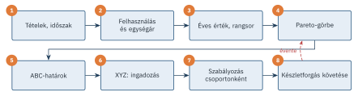
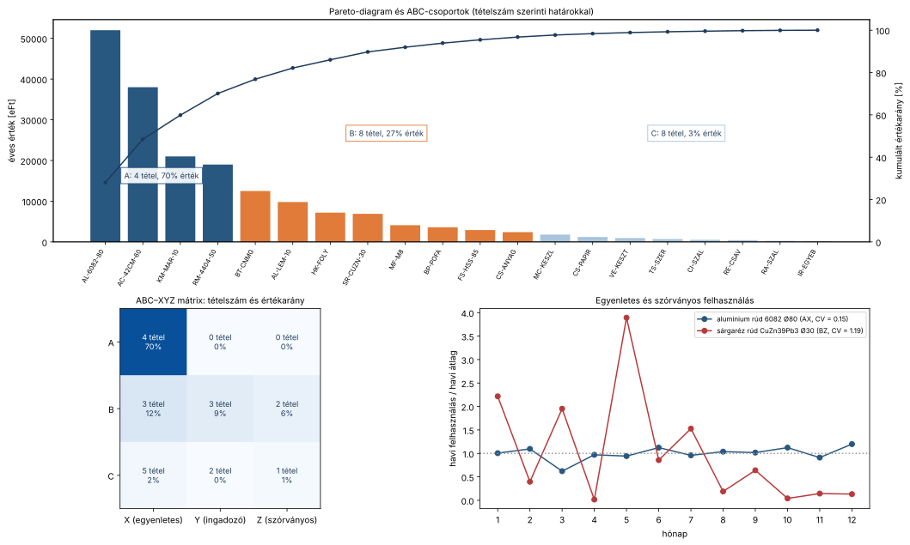

# ABC-elemzés és készlethatékonyság {#sec-abc}

::: {.cel title="Eszközkártya"}
- **Mire való?** A készlettételek csoportosítása éves felhasználási értékük (ABC) és felhasználásuk ingadozása (XYZ) szerint, hogy a készletgazdálkodás figyelme és a szabályozás szigorúsága a tétel jelentőségéhez igazodjon; a készletforgás és a készlethatékonyság mérése.
- **Tanulási eredmény:** az eszközlap feldolgozása után képes leszel elvégezni egy készlet ABC- és XYZ-elemzését, és a csoportokhoz eltérő készletgazdálkodási szabályt rendelni.
- **V-lépés:** 6. Megvalósítás (a logisztikai és beszerzési folyamat tervezése); 9. Üzemeltetés (készletcsökkentés, folyamatos fejlesztés).
- **Bemenet:** a tételek listája egységárral és (lehetőleg havi bontású) felhasználással egy évre; a havi készletértékek.
- **Kimenet:** Pareto-görbe, ABC- és XYZ-besorolás, ABC–XYZ mátrix javasolt szabályozással, fordulatszám, készletnapok, 1000 Ft forgalomra jutó készlet.
- **Időigény:** az adatok kigyűjtése után 1 óra.
- **Kézikönyv:** [21. fejezet](../../kezikonyv/fejezetek/21-utemezes.html), 21.5. szakasz.
:::

## Mikor használd?

- **Ha sok a tétel, és kevés az idő**: az ABC-elemzés megmutatja, mely kevés tételre érdemes a figyelmet összpontosítani [@silver2016].
- **Ha a készlet sok pénzt köt le**, és el kell dönteni, hol érdemes csökkenteni.
- **Ha egységes szabályozás helyett differenciáltat akarsz** (nyilvántartás, felülvizsgálat gyakorisága, rendelési mód, biztonsági készlet).
- **Ha a készletforgást vagy a készletnapokat kell követni**, vagy egy fejlesztés hatását kimutatni.
- **Kevésbé alkalmas** önmagában a kritikus, de olcsó tételek kezelésére: ezeket kritikusság szerint külön is meg kell jelölni.

## Lépések

{#fig-lepesek-abc width=100%}

1. **Határold le a tételek körét és az időszakot**: például az összes anyag- és szerszámtétel egy évre.
2. **Gyűjtsd ki a felhasználást és az egységárat**, lehetőleg havi bontásban.
3. **Számítsd ki az éves értéket**, és rendezd a tételeket csökkenő sorrendbe.
4. **Rajzold meg a Pareto-görbét**: a kumulált értékarányt a kumulált tételarány függvényében.
5. **Jelöld ki az ABC-határokat**: tételszám szerint (a könyv példáiban 20–40–40%) vagy érték szerint (a kumulált érték 80 és 95%-áig); a határ a vállalati körülményekhez igazítható.
6. **Sorold XYZ-csoportokba a tételeket** a havi felhasználás relatív szórása szerint (például X ≤ 0,5 < Y ≤ 1,0 < Z).
7. **Rendelj szabályozást a csoportokhoz**: az A tételeknél pontos előrejelzés, gyakori felülvizsgálat, rendeléshez kötött beszerzés; a C tételeknél egyszerű nyilvántartás, nagyobb rendelési tételek, keretrendelés.
8. **Kövesd a készletforgást**: fordulatszám = éves felhasználás / átlagos készlet; készletnapok = napok száma / fordulatszám [@silver2016].

## Kidolgozott példa: a ForgácsTech anyag- és szerszámkészlete

A sablon 20 tétel havi felhasználását tartalmazza (kézikönyv [21. fejezet](../../kezikonyv/fejezetek/21-utemezes.html)). A [-@tbl-abc-forgacs]. táblázat a tételszám szerinti besorolást foglalja össze.

| Csoport | Tételek | Tételarány | Éves érték [MFt] | Értékarány | XYZ |
|:--|--:|--:|--:|--:|:--|
| A | 4 | 20% | 130,0 | 70% | 4 X |
| B | 8 | 40% | 49,4 | 27% | 3 X, 3 Y, 2 Z |
| C | 8 | 40% | 6,0 | 3% | 5 X, 2 Y, 1 Z |
| **összesen** | **20** | | **185,4** | | |

: A ForgácsTech tételeinek ABC–XYZ-besorolása. {#tbl-abc-forgacs tbl-colwidths="[16,12,14,18,14,26]"}

Az érték szerinti határokkal (80/95%) az A csoport hat tételre bővül (a forgácsolóbetét és az alumíniumlemez is A lesz), és 82%-ot fed le; a határon lévő tételeknél a kritikusság és a beszerzési idő dönt. Az átlagos készlet 31,1 MFt, a fordulatszám 6,0/év, a készlet 38,5 munkanapnyi felhasználás, 1000 Ft forgalomra 168 Ft készlet jut ([-@fig-abc]. ábra).

{#fig-abc width=100%}

**Tanulságok:**

- **Kevés tétel, sok pénz.** Négy tétel (három rúdanyag és a keményfém marószár) adja az érték 70%-át: a készletcsökkentést itt érdemes kezdeni.
- **Az A tételek egyenletesek.** Mind a négy AX: rendeléshez vagy ütemtervhez kötött beszerzéssel, kis biztonsági készlettel kezelhetők; a MES-ben bevezetett anyaglefoglalás pontosan ezt teszi.
- **A szórványos tételek más logikát kívánnak.** A BZ és CZ tételeknél (sárgaréz rúd, befogó pofák, mérőcsap-készlet) a rendelésre beszerzés vagy a tudatos biztonsági készlet a kérdés.
- **A besorolás alapja számít.** A tételszám és az érték szerinti határok a határ közelében más eredményt adnak; a választást dokumentálni kell.

## Sablon és notebook

- [abc_sablon.xlsx](../sablonok/abc_sablon.xlsx): „Tételek” lap legfeljebb 60 tétellel és 12 havi felhasználással (éves mennyiség és érték, relatív szórás, rang, ABC, XYZ); „Pareto” lap a sorrenddel, kumulált arányokkal, választható besorolási alappal és módosítható határokkal, Pareto-diagrammal; „Összesítés” lap csoportonkénti összesítéssel, ABC–XYZ mátrixszal és javasolt szabályozással; „Készlethatékonyság” lap havi készletértékekkel, fordulatszámmal és készletnapokkal. A ForgácsTech példájával kitöltve.
- [abc.ipynb](../notebookok/abc.ipynb) · [Megnyitás Google Colabban](abc.ipynb): Pareto-görbe, a két besorolási alap összevetése, XYZ és ABC–XYZ mátrix, készletforgás és egy készletcsökkentési változat (a [-@fig-abc]. ábra így készült).

## Előnyök és korlátok

| Előnyök | Korlátok |
|:--|:--|
| Egyszerű, gyors, kevés adatot igényel [@silver2016] | Csak az értéket nézi; a kritikusságot, a beszerzési időt és az avulást nem |
| A figyelmet a kevés, nagy értékű tételre irányítja | A csoporthatárok önkényesek; a határ közeli tételek besorolása vitatható |
| Az XYZ-dimenzióval a szabályozás módja is kijelölhető | A múltbeli felhasználásra épül; új vagy kifutó tételeknél félrevezető |
| A készletforgás a Little-törvénnyel közvetlenül átfutássá alakítható | Az értékalapot (bekerülési vagy eladási ár) következetesen kell választani |

: Az ABC–XYZ-elemzés előnyei és korlátai. {tbl-colwidths="[50,50]"}

::: {.hiba}
- **Darabszám szerinti rendezés.** Az ABC az éves felhasználási értéken alapul, nem a darabszámon vagy az egységáron.
- **Egyszeri elemzés.** A felhasználás változik; a besorolást rendszeresen (például évente) frissíteni kell.
- **Az olcsó, de kritikus tétel elhanyagolása.** Egy C tétel hiánya is leállíthatja a termelést; a kritikus tételeket külön jelölni kell.
- **Eltérő értékalap a forgalomban és a készletben.** A fordulatszámhoz mindkettőt ugyanazon az áron kell mérni.
:::

## Mintapromptok

::: {.prompt title="Mintaprompt: differenciált szabályozás javaslata"}
```text
ABC–XYZ-elemzésünk eredménye: [TÁBLÁZAT: tétel, csoport, éves érték,
CV, beszerzési idő, kritikusság].
Feladat: javasolj csoportonként készletszabályozást (felülvizsgálat
gyakorisága, rendelési mód, biztonsági készlet logikája, nyilvántartás
pontossága), és jelöld azokat a tételeket, amelyeknél a kritikusság
vagy a beszerzési idő miatt a csoportjától eltérő kezelés indokolt.
Számszerű készletszintet ne adj meg.
```
:::

::: {.prompt title="Mintaprompt: adattisztítás az elemzés előtt"}
```text
A tételtörzs és a felhasználási adatok kivonata: [ADATOK].
Feladat: keresd meg az elemzést torzító hibákat: ismétlődő vagy
összevonandó tételek, eltérő mértékegységek, hiányzó vagy kiugró árak,
egyszeri nagy felhasználások. Mindegyikhez javasolj kezelést, és jelöld,
mely döntés kíván szakmai jóváhagyást.
```
:::

## Feladat

::: {.projekt title="7. projektlépés (választható): ABC-elemzés és készlethatékonyság"}
Ha projektedben készlet van (anyag, alkatrész, késztermék, de akár egy szolgáltatás fogyóeszközei), készíts ABC–XYZ-elemzést legalább 15 tételre, javasolj csoportonkénti szabályozást, és számítsd ki a fordulatszámot és a készletnapokat. Szolgáltatásnál a készlet helyett a vevői sorbanállást is elemezheted ([-@sec-sorbanallas]. eszközlap).
:::
