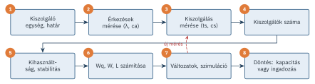
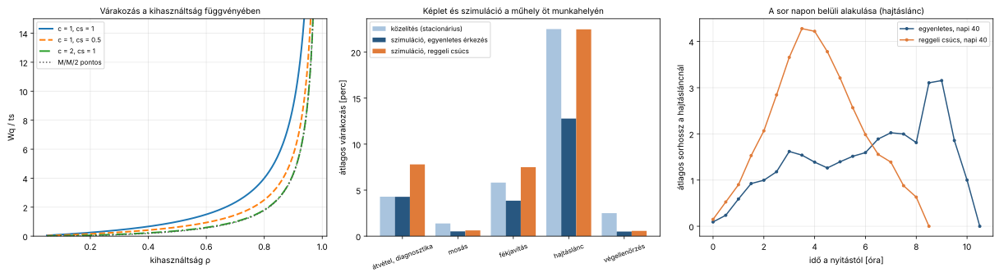

# Sorbanállási modellek {#sec-sorbanallas}

::: {.cel title="Eszközkártya"}
- **Mire való?** Egy kiszolgáló egység (gép, munkahely, pult, ügyfélszolgálat) várakozási idejének, sorhosszának és kihasználtságának becslése az érkezések, a kiszolgálás és a kiszolgálók száma alapján; a kapacitásbővítés és a változékonyság csökkentésének összevetése.
- **Tanulási eredmény:** az eszközlap feldolgozása után képes leszel egyszerű sorbanállási modellel kiszámítani a várakozási időt, a sorhosszt és a kihasználtságot, és meghatározni a szükséges kiszolgálói kapacitást.
- **V-lépés:** 6. Megvalósítás (a kapacitás méretezése); 4. Architektúra (a kiszolgálók számának és az automatizálás mértékének megválasztása); 8. Validáció (szolgáltatási szint ellenőrzése); 9. Üzemeltetés.
- **Bemenet:** érkezési intenzitás és az érkezések közötti idő relatív szórása; átlagos kiszolgálási idő és relatív szórása; a kiszolgálók száma.
- **Kimenet:** kihasználtság, a várakozás valószínűsége, átlagos várakozás és átfutás, átlagos sor- és rendszerhossz, változatok összevetése.
- **Időigény:** a mérések után 30–60 perc; szimulációval néhány óra.
- **Kézikönyv:** [21. fejezet](../../kezikonyv/fejezetek/21-utemezes.html), 21.3–21.4. szakasz.
:::

## Mikor használd?

- **Ha a kapacitás átlagban elég, mégis sorok alakulnak ki**: a várakozást az ingadozás és a kihasználtság együtt okozza [@hopp2008].
- **Ha el kell dönteni, hány kiszolgáló kell** egy adott várakozási célhoz (például legfeljebb 15 perc átlagos várakozás).
- **Ha egy fejlesztés hatását kell becsülni**: több kapacitás vagy kisebb ingadozás (időpontfoglalás, szabványos munka, kisebb sorozatok)?
- **Ha szolgáltatásban a vevő a sorban vár**, és a várakozás a szolgáltatás minőségének része.
- **Kevésbé alkalmas** erősen időben változó érkezésekre, véges időtávra és összetett útvonalakra; ezekhez diszkrét eseményű szimuláció kell [@law2015].

## Lépések

{#fig-lepesek-sorbanallas width=100%}

1. **Határold le a kiszolgáló egységet**: mi a „kliens” (munkadarab, kerékpár, ügyfél), mi a kiszolgáló, hol kezdődik és végződik a sor.
2. **Mérd az érkezéseket**: az érkezési intenzitást ($\lambda$) és az érkezések közötti idő relatív szórását ($c_a$); véletlenszerű (Poisson) érkezésnél $c_a \approx 1$.
3. **Mérd a kiszolgálást**: az átlagos kiszolgálási időt ($t_s$) és a relatív szórását ($c_s$).
4. **Add meg a kiszolgálók számát** ($c$).
5. **Számítsd ki a kihasználtságot**: $\rho = \lambda t_s / c$; ha $\rho \geq 1$, a sor korlátlanul nő.
6. **Számítsd ki a jellemzőket**: M/M/c esetben pontosan (Erlang C), általános eloszlásoknál közelítéssel; egy kiszolgálónál Kingman közelítésével: $W_q \approx \frac{c_a^2 + c_s^2}{2} \cdot \frac{\rho}{1-\rho} \cdot t_s$ [@kingman1961; @hopp2008]. Ellenőrizd a Little-törvénnyel: $L = \lambda W$ [@lakatos_termelesi, 8.3. szakasz].
7. **Vizsgálj változatokat**: több kiszolgáló, rövidebb kiszolgálás, kisebb ingadozás; ha a napon belüli lefolyás is számít, szimulálj.
8. **Dönts**: kapacitást bővítesz, vagy az ingadozást csökkented; a döntést a mért adatokkal ismételten ellenőrizd.

## Kidolgozott példa: a VárosiBringa javítóműhelye

A műhely szűk keresztmetszete a hajtáslánc-javítás: óránként 5,33 kerékpár érkezik, a javítás átlagosan 9 perc, a kihasználtság 80% (kézikönyv [21. fejezet](../../kezikonyv/fejezetek/21-utemezes.html)). A [-@tbl-sorbanallas-bringa]. táblázat a sablon „Változatok” lapjának eredménye.

| Változat | $\rho$ | $c$ | $c_a$ | $c_s$ | $W_q$ [perc] | $L$ |
|:--|--:|--:|--:|--:|--:|--:|
| hajtáslánc, M/M/1 | 0,80 | 1 | 1 | 1 | 36,0 | 4,0 |
| hajtáslánc, mért kiszolgálási szórás | 0,80 | 1 | 1 | 0,5 | 22,5 | 2,8 |
| fékjavítás, 2 szerelő | 0,62 | 2 | 1 | 1 | 9,3 | 2,1 |
| mosás + lánctisztítás, nyári csúcs | 0,86 | 1 | 1 | 1 | 41,5 | 5,9 |
| fékjavítás, nyári csúcs | 0,86 | 2 | 1 | 1 | 38,7 | 6,4 |
| mosás, csúcs, időpontfoglalással | 0,86 | 1 | 0,5 | 0,5 | 10,4 | 2,1 |

: A javítóműhely várakozási ideje különböző helyzetekben (G/G/c közelítés). {#tbl-sorbanallas-bringa tbl-colwidths="[40,10,8,8,8,13,13]"}

A két szerelős fékjavításnál a közelítés (9,3 perc) jól egyezik az M/M/2 pontos értékével (8,8 perc). A teljes műhely diszkrét eseményű szimulációja szerint a hajtáslánc előtti átlagos várakozás egyenletes érkezésnél mintegy 13 perc: a műhely minden reggel üresen nyit, és a megelőző munkahelyek kisimítják az érkezéseket. Ha a kerékpárok 60%-a az első három órában érkezik, a délelőtti sor felhalmozódik, és a várakozás csaknem kétszeresére nő ([-@fig-sorbanallas]. ábra).

{#fig-sorbanallas width=100%}

**Tanulságok:**

- **A kihasználtság közelében a várakozás robbanásszerűen nő.** 80%-ról 86%-ra emelkedve a várakozás 36 percről 42 percre nő, 95%-nál a kiszolgálási idő 19-szerese lenne.
- **A változékonyság csökkentése kapacitásnövelés nélkül is hat.** A szabványos munka (kisebb $c_s$) és az időpontfoglalás (kisebb $c_a$) a csúcsban a mosásnál 41 percről 10 percre csökkenti a várakozást.
- **A párhuzamos kiszolgálók egyesítése előnyös.** Két szerelő közös sorral azonos kihasználtságnál kevesebbet várakoztat, mint két külön sor [@cachon2013].
- **A napon belüli lefolyás más képet adhat.** A stacionárius képlet a hosszú távú átlagot adja; a nyitás utáni és a csúcsidőszaki sorokat a szimuláció mutatja meg.

## Sablon és notebook

- [sorbanallas_sablon.xlsx](../sablonok/sorbanallas_sablon.xlsx): „M-M-c” lap pontos M/M/c számítással (Erlang C, P0, $L_q$, $W_q$, $W$, $L$, a várakozási időhatár túllépésének valószínűsége, Little-ellenőrzés); „Változatok” lap legfeljebb 20 helyzettel, G/G/c közelítéssel és figyelmeztetésekkel; „Kihasználtság” lap a várakozás–kihasználtság görbével. A VárosiBringa példájával kitöltve.
- [sorbanallas.ipynb](../notebookok/sorbanallas.ipynb) · [Megnyitás Google Colabban](sorbanallas.ipynb): pontos és közelítő képletek összevetése, a teljes műhely diszkrét eseményű szimulációja egyenletes és reggeli csúcsos érkezéssel, a sor napon belüli alakulása (a [-@fig-sorbanallas]. ábra így készült).

## Előnyök és korlátok

| Előnyök | Korlátok |
|:--|:--|
| Kevés adatból gyors, jól értelmezhető becslés [@lakatos_termelesi, 8.3. szakasz] | Stacionárius állapotot feltételez: hosszú távon állandó intenzitásokat és $\rho < 1$-et |
| Megmutatja a kihasználtság és a változékonyság hatását [@hopp2008] | A közelítések nagy kihasználtságnál pontosak, kicsinél és összetett hálózatokban kevésbé |
| A Little-törvénnyel a mérések könnyen ellenőrizhetők [@little1961] | Az érkezések és a kiszolgálás szórását mérni kell; a feltételezett exponenciális eloszlás túlbecsülhet |
| A szimuláció tetszőleges részletezettségre kiterjeszthető [@law2015] | A szimuláció adat- és időigényes, eredménye több futás statisztikai értékelését kívánja |

: A sorbanállási modellek előnyei és korlátai. {tbl-colwidths="[50,50]"}

::: {.hiba}
- **Méretezés 100%-os kihasználtságra.** Ingadozó érkezésnél a sor korlátlanul nő; a szűk keresztmetszeten tartalék kell.
- **Mértékegység-keveredés.** Az intenzitás óránként, a kiszolgálási idő percben: a képletekben egységesíteni kell.
- **Exponenciális eloszlás feltételezése mérés nélkül.** Szabványos munkánál a kiszolgálási idő szórása sokkal kisebb, a várakozás kisebb lesz a becsültnél.
- **Átlagos nap, átlagos óra.** Ha az érkezések napon belül erősen ingadoznak, a napi átlagból számolt várakozás félrevezető.
:::

## Mintapromptok

::: {.prompt title="Mintaprompt: a sorbanállási modell kiválasztása"}
```text
A rendszer leírása: [ÉRKEZÉSEK, KISZOLGÁLÓK, MÉRT ADATOK, NAPI LEFOLYÁS].
Feladat: (1) írd le a rendszert Kendall-jelöléssel, és indokold;
(2) jelöld, mely feltevés (stacionaritás, független érkezések,
végtelen sor) teljesül és melyik nem; (3) javasold, elég-e a képlet,
vagy szimuláció kell, és milyen mérésekre van szükség a döntéshez.
Számot ne becsülj: a számítást a sablonnal végezzük.
```
:::

::: {.prompt title="Mintaprompt: változatok értelmezése a döntéshozónak"}
```text
Sorbanállási elemzésünk változatai: [TÁBLÁZAT: változat, ρ, c, ca, cs,
Wq, L]. Célunk: [SZOLGÁLTATÁSI CÉL, például átlagos várakozás ≤ 15 perc].
Feladat: foglald össze közérthetően, melyik változat teljesíti a célt,
mennyibe kerülhet (kapacitás vagy szervezési változtatás), milyen
kockázatokkal jár, és mit kell mérni a bevezetés után.
A számokat ne változtasd meg.
```
:::

## Feladat

::: {.projekt title="7. projektlépés (választható): sorbanállás"}
Ha projektedben kiszolgáló egység van (gép, munkahely, pult), mérd vagy becsüld az érkezéseket és a kiszolgálást, számítsd ki a várakozást a jelenlegi helyzetre és legalább két változatra (kapacitás, ingadozás), és értelmezd, melyik a hatékonyabb beavatkozás.
:::
