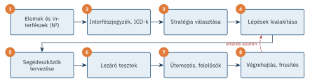
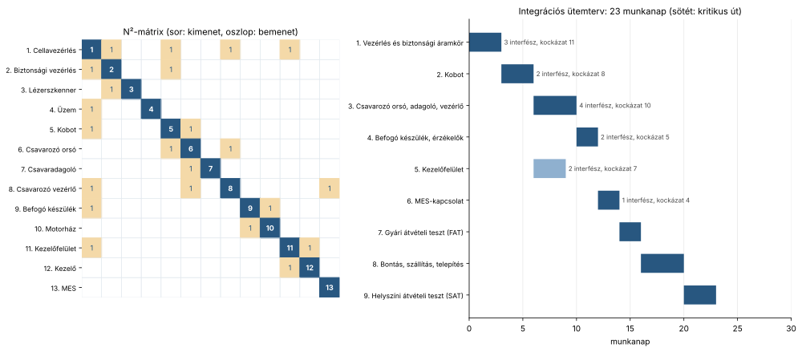

# Integrációs terv és interfészmátrix {#sec-integracios-terv}

::: {.cel title="Eszközkártya"}
- **Mire való?** Az integráció megtervezése: az elemek és az interfészek nyilvántartása, az N²-mátrix, az integrációs lépések (mi kerül össze, milyen segédeszközzel, milyen teszt zárja, ki a felelős), az ütemezés és a terv ellenőrzése.
- **Tanulási eredmény:** az eszközlap feldolgozása után képes leszel interfészjegyzéket és integrációs tervet készíteni, integrációs stratégiát választani, és minden lépéshez segédeszközt és ellenőrzést rendelni.
- **V-lépés:** 7. Integráció. Tervezése a koncepciónál kezdődik, és a részletes tervezés során finomodik.
- **Bemenet:** a rendszer felépítése (termékfa), az N²-diagram ([-@sec-n2-dsm]. eszközlap), az interfészkövetelmények, az elemek várható elkészülése, a rendelkezésre álló teszteszközök.
- **Kimenet:** interfészjegyzék az ICD-k állapotával, N²-mátrix, integrációs lépések lezáró tesztekkel, ütemterv kritikus úttal, a terv ellenőrzésének eredménye.
- **Időigény:** egy 10–15 elemes rendszer első terve 2–4 óra; a terv az integráció végéig élő dokumentum.
- **Kézikönyv:** [22. fejezet](../../kezikonyv/fejezetek/22-integracio.html).
- **Továbbolvasás:** [@nasa2016seh, 5.2. szakasz és H függelék].
:::

## Mikor használd?

- **Ha a rendszer több, külön fejlesztett vagy beszerzett elemből áll**, és az elemeket valakinek össze kell raknia és működőképességüket igazolnia kell.
- **Ha az elemeket több beszállító vagy csapat készíti**: az interfészek megállapodást kívánnak, amelyet az interfészvezérlő dokumentum (ICD) rögzít [@dau2001].
- **Ha az elemek különböző időpontokban készülnek el**, és el kell dönteni, mit lehet már integrálni, és mit kell addig helyettesítővel (csonkkal, szimulátorral) pótolni.
- **Ha a rendszert a gyártónál összerakják, majd szétszedve a helyszínre szállítják**: a gyári és a helyszíni átvételi teszt (FAT és SAT) is az integrációs terv része.
- **Kevésbé szükséges** egyetlen beszállítótól származó, kész, egyben szállított termék esetén; ott elég az átvételi teszt.

## Lépések

{#fig-lepesek-integracios-terv width=100%}

1. **Gyűjtsd össze az elemeket és az interfészeket.** Az N²-diagram átlójába az elemek kerülnek, a cellákba a köztük haladó anyag, energia, információ vagy erőhatás ([-@sec-n2-dsm]. eszközlap). Az ember (a kezelő) és a környezet (az üzem) is elem.
2. **Készítsd el az interfészjegyzéket.** Minden interfészhez azonosító, a két elem, az irány, a típus, a tartalom, a dokumentum (ICD) és az állapota, a felelős és a kockázat tartozik. Az interfészkövetelmény-dokumentum (IRD) a követelményeket, az ICD a megvalósítást rögzíti [@dau2001].
3. **Válassz stratégiát.** Egyszerre, alulról felfelé, felülről lefelé vagy szálanként; a választást a rendszer szerkezete, a kockázatok, az elemek elkészülése és a segédeszközök határozzák meg [@iso15288_2023, 6.4.8. szakasz; @incose2023seh].
4. **Alakítsd ki a lépéseket.** Mi kerül hozzá, mely interfészek válnak ellenőrizhetővé. Egy interfész csak olyan lépésben ellenőrizhető, amikor mindkét eleme már a rendszerben van.
5. **Tervezd meg a segédeszközöket.** Csonkok és meghajtók a még hiányzó elemek helyett, szimulátorok, teszteszközök, mérőműszerek.
6. **Rendelj minden lépéshez lezáró tesztet.** A következő lépés csak akkor kezdődik, ha a teszt sikeres; így a hiba a legutóbb hozzáadott elemben vagy interfészében keresendő.
7. **Ütemezz, és jelöld ki a felelősöket.** A lépések előzményeiből a kritikus út módszerével számold ki a legkorábbi kezdéseket és a tartalékokat [@kelley1959].
8. **Hajtsd végre, és frissítsd a tervet.** Eltérés esetén javítsd az ICD-t vagy az elemet, ismételd meg a lépés tesztjét, és vezesd át a változást a terven.

## Kidolgozott példa: a KoboCella integrációja

A kézikönyv nyolc fő interfészét ([22. fejezet](../../kezikonyv/fejezetek/22-integracio.html)) a csapat a részletes tervezés során a cellavezérlés hat belső kapcsolatával egészítette ki; a teljes jegyzék 13 elemet és 14 interfészt tartalmaz. Az N²-mátrix szerint a cellavezérléshez hat interfész kapcsolódik, a többi elemhez legfeljebb három ([-@fig-integracios-terv]. ábra). A terv kilenc lépésből áll: hat integrációs lépés, a gyári átvételi teszt, a bontás, szállítás és telepítés, végül a helyszíni átvételi teszt ([-@tbl-integracios-lepesek]. táblázat).

| Lépés | Hozzáadott elemek | Interfészek | Segédeszköz | Lezáró teszt | Előzmény | Nap |
|:--|:--|--:|:--|:--|:--|--:|
| 1. Vezérlés és biztonsági áramkör | cellavezérlés, biztonsági vezérlés, lézerszkenner, üzemi betáplálás | 3 | I/O-szimulátor | T1: vészleállítás, védőmező | – | 3 |
| 2. Kobot | kobot | 2 | tömegpróbatest a csavarozó helyett | T2: mozgás, védett leállítás | 1 | 3 |
| 3. Csavarozó | orsó, adagoló, vezérlő | 4 | kalibrált nyomatékmérő | T3: nyomaték és szög | 2 | 4 |
| 4. Befogó, érzékelők | befogó készülék, motorház | 2 | mintadarabok a tűrésmező szélein | T4: pozicionálás | 3 | 2 |
| 5. Kezelőfelület | kezelőfelület, kezelő | 2 | kezelői próbaforgatókönyv | T5: kezelői feladatok | 2 | 3 |
| 6. MES-kapcsolat | MES | 1 | MES-tesztpéldány | T6: adatátvitel | 4, 5 | 2 |
| 7. FAT | – | – | – | ciklusidő, minőség, biztonság | 6 | 2 |
| 8. Bontás, szállítás, telepítés | – | – | – | bekötési ellenőrzés | 7 | 4 |
| 9. SAT | – | – | – | háromműszakos próbaüzem | 8 | 3 |

: A KoboCella integrációs lépései. {#tbl-integracios-lepesek tbl-colwidths="[18,22,9,17,17,9,8]"}

{#fig-integracios-terv width=100%}

A terv ellenőrzése a 14 interfészből 13-at talált rendben; az I-07 interfész (csavarozó vezérlő → MES) ICD-je még csak tervezet volt. A kézikönyvben leírt eltérés éppen itt jelentkezett: a T6 teszten derült ki, hogy a nyomatékadat formátuma a két oldalon eltér. A kritikus út módszere szerint a teljes integráció 23 munkanap; a kezelőfelület lépésének 3 nap tartaléka van, mert párhuzamosan végezhető a csavarozó és a befogó integrálásával, minden más lépés a kritikus úton van. A T6 egynapos megismétlése ezért a helyszíni átvételt is egy nappal csúsztatta.

**Tanulságok:**

- **A jegyzék előre jelzi a kockázatot.** Ha az integráció indulása előtt minden ICD-t jóváhagyatnak, a T6 hibája a tervezőasztalon derül ki, nem a cellánál.
- **A sok kapcsolattal rendelkező elem korán kell.** A cellavezérlésre hat interfész épül, ezért került az első lépésbe; a biztonsági áramkör pedig azért, mert minden további lépés csak működő biztonsági funkciókkal végezhető biztonságosan.
- **Egy lépésre kevés új interfész jusson.** Egyszerre integrálva 14 interfészt kellene egyetlen lépésben ellenőrizni; a tervben legfeljebb négy kerül egy lépésre, így a hiba gyorsan behatárolható.
- **A tartalék megmutatja, hol van mozgástér.** A kritikus úton lévő, kockázatos lépésekhez érdemes előre segédeszközt készíteni.

## Sablon és notebook

- [integracios_terv_sablon.xlsx](../sablonok/integracios_terv_sablon.xlsx): „Elemek” lap legfeljebb 15 elemmel és integrálási lépésükkel; „Interfészek” lap legfeljebb 30 interfésszel, legördülő elem-, irány- és állapotválasztással, automatikus ellenőrzéssel (nincs lépéshez rendelve, túl korai lépés, ICD nincs jóváhagyva); „N2” lap az automatikusan előálló N²-mátrixszal; „Lépések” lap legfeljebb 20 lépéssel, előzményekből számolt kezdéssel és befejezéssel, 30 napos időráccsal; „Összesítés” lap a terv lefedettségével és a lépésenkénti interfészszám és kockázat diagramjával. A KoboCella példájával kitöltve.
- [integracios_terv.ipynb](../notebookok/integracios_terv.ipynb) · [Megnyitás Google Colabban](integracios_terv.ipynb): a terv ellenőrzése, N²-mátrix és kapcsolatszám, kapcsolatokon alapuló sorrendjavaslat, kritikus út számítása, a lépések csúszásának hatása (a [-@fig-integracios-terv]. ábra így készült).

## Előnyök és korlátok

| Előnyök | Korlátok |
|:--|:--|
| Az interfészek kezelése láthatóvá válik; a hiányzó vagy jóvá nem hagyott ICD az integráció előtt kiderül | A jegyzék csak azt tartalmazza, amit felismertek; a nem tervezett kölcsönhatások (hő, rezgés, elektromágneses zavar) kimaradhatnak |
| A lépésenkénti teszt a hibát a legutóbb hozzáadott elemre szűkíti | A sok lépés és a segédeszközök időt és pénzt igényelnek |
| Az N²-mátrix a sorrend kialakítását is segíti [@eppinger2012] | A kapcsolatszám önmagában nem dönt; a biztonság, a kockázat és az elemek elkészülése gyakran felülírja |
| A kritikus út megmutatja, melyik lépés csúszása veszélyezteti a határidőt [@kelley1959] | Determinisztikus időkkel számol; a tesztek ismétlésének valószínűségét külön kell becsülni |

: Az integrációs terv és az interfészmátrix előnyei és korlátai. {tbl-colwidths="[50,50]"}

::: {.hiba}
- **Rajz az ICD helyett.** A két oldal rajza nem rögzíti a megállapodást a mértékegységekről, a tűrésekről, az időzítésről és a hibahelyzetek kezeléséről.
- **Az ember és a környezet kihagyása.** A kezelő és az üzem (energia, padló, hálózat) is elem; interfészeik ugyanúgy hibát okozhatnak.
- **Észrevétlen „big bang”.** Ha a segédeszközök nem készülnek el, a lépéseket csak akkor lehet elvégezni, amikor minden elem megérkezett, és a terv egyszerre integrálássá válik.
- **Teszt nélküli lépés.** Lezáró ellenőrzés nélkül a hibák összeadódnak, és a következő lépésben már nem tudni, honnan erednek.
- **Egyszer elkészített terv.** Az elemek késése és a teszteltérések után a sorrendet felül kell vizsgálni.
:::

## Mintapromptok

::: {.prompt title="Mintaprompt: interfészek feltárása"}
```text
A rendszer elemei és működése: [ELEMEK LISTÁJA, RÖVID MŰKÖDÉSLEÍRÁS].
Feladat: sorold fel a lehetséges interfészeket táblázatban (A elem,
B elem, irány, típus: mechanikai, energetikai, adat és jel, ember–gép,
biztonsági, környezeti; mi halad át). Külön jelöld azokat, amelyek
két beszállító vagy csapat között vannak, és azokat, ahol a hibahelyzet
kezelését is rögzíteni kell. Ne találj ki új elemet; ha hiányt látsz,
kérdezz rá.
```
:::

::: {.prompt title="Mintaprompt: integrációs terv kritikája"}
```text
Az integrációs terv: [LÉPÉSEK: hozzáadott elemek, interfészek,
segédeszköz, lezáró teszt, előzmény, időtartam].
Feladat: vizsgáld meg a tervet. Van-e olyan interfész, amelyet olyan
lépésben ellenőriznénk, amikor egyik eleme még hiányzik? Melyik
lépésre jut túl sok új interfész? Hol hiányzik segédeszköz? Mely
lépések kockázatosak és a kritikus úton vannak? Javaslataidat
indokold; az időtartamokat ne változtasd meg.
```
:::

## Feladat

::: {.projekt title="8. projektlépés (választható): integrációs terv"}
Készíts interfészjegyzéket saját rendszeredhez az N²-diagram alapján, válassz integrációs stratégiát, és bontsd legalább öt lépésre a segédeszközökkel, a lezáró tesztekkel és az előzményekkel. Ellenőrizd a tervet a sablonnal: minden interfész legyen lépéshez rendelve, és jelöld, melyik ICD hiányzik még. Számold ki a kritikus utat, és nevezd meg a két legkockázatosabb lépést.
:::
