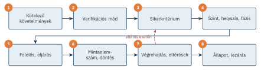
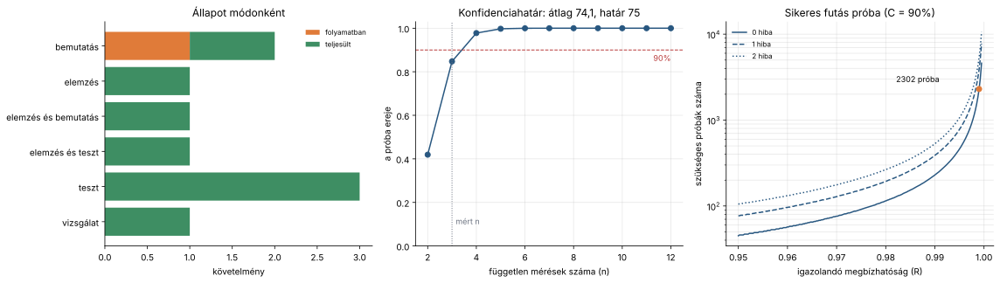

# Követelmény-verifikációs mátrix {#sec-rvm}

::: {.cel title="Eszközkártya"}
- **Mire való?** A verifikáció megtervezése és követése: minden kötelező követelményhez sikerkritérium, verifikációs mód, szint, helyszín, felelős, eljárás, eredmény és állapot; az eltérések naplózása; a statisztikai döntési szabály (konfidenciahatár, sikeres futás próba) meghatározása.
- **Tanulási eredmény:** az eszközlap feldolgozása után képes leszel követelmény-verifikációs mátrixot készíteni sikerkritériummal, verifikációs móddal és szinttel, és mennyiségi követelményhez statisztikai döntési szabályt rendelni.
- **V-lépés:** a követelmények meghatározásakor indul (3. lépés), a verifikációban (8. lépés) teljesedik ki.
- **Bemenet:** a jóváhagyott követelmények (azonosító, szöveg, forrás, verifikációs mód), a verifikációs terv, a rendelkezésre álló létesítmények és segédeszközök.
- **Kimenet:** kitöltött mátrix sikerkritériumokkal és eredményekkel, eltérésnapló, a verifikáció állapota és lezárhatósága, mintaelemszám-terv.
- **Időigény:** 20–30 követelmény mátrixának első változata 2–3 óra; a verifikáció végéig folyamatosan frissül.
- **Kézikönyv:** [23. fejezet](../../kezikonyv/fejezetek/23-verifikacio.html).
- **Továbbolvasás:** [@goldberg1994toolbox, 6.1. és 6.5. szakasz; @nasa2016seh, 5.3. szakasz és D függelék].
:::

## Mikor használd?

- **Már a követelmények alapvonalba helyezésekor**: ha egy követelményhez nem rendelhető verifikációs mód és sikerkritérium, a követelmény nem verifikálható, és újra kell fogalmazni ([-@sec-kovetelmeny-iras]. eszközlap).
- **A verifikációs terv elkészítésekor**: a mátrix megmutatja, mely követelményekhez kell drága létesítmény, segédeszköz vagy hosszú teszt, és ezek mikor esedékesek [@engel2010].
- **A tesztek alatt és után**: az állapot, az eltérések és az eredménydokumentumok egy helyen követhetők.
- **Átadás előtt**: a verifikáció akkor zárható le, ha minden követelményre van objektív bizonyíték vagy eltérési engedély, és minden eltérés lezárult.
- **Kevésbé szükséges** néhány követelményes, egyszerű feladatnál; ott egy ellenőrzőlista is elég, de a sikerkritériumokat akkor is rögzíteni kell.

## Lépések

{#fig-lepesek-rvm width=100%}

1. **Gyűjtsd össze a kötelező követelményeket.** Csak a „kell” követelmények kerülnek a mátrixba, egyedi azonosítóval és a forrásdokumentum megjelölésével [@ecss2018ver].
2. **Válassz verifikációs módot.** Vizsgálat, elemzés, bemutatás vagy teszt, esetleg ezek kombinációja; a teszt adja a legrészletesebb adatot, de a legdrágább [@iso29148_2018; @incose2023seh].
3. **Rögzítsd a sikerkritériumot.** Mi számít teljesülésnek: mintaelemszám, körülmények, döntési szabály. A kritériumot a teszt előtt kell rögzíteni.
4. **Add meg a szintet, a helyszínt és a fázist.** Komponens, alrendszer vagy rendszer; labor, gyári vagy helyszíni átvétel; és jelöld, kell-e a követelményt minden legyártott példány átvételekor is ellenőrizni.
5. **Jelöld ki a felelőst, és rendeld hozzá az eljárást.** Az eljárás lépésenként leírja a konfigurációt, a mérőeszközöket, a lépéseket, a biztonsági előírásokat és az eltérések kezelését.
6. **Határozd meg a mintaelemszámot és a döntési szabályt.** Mennyiségi követelménynél konfidenciahatárral [@montgomery2020sqc], nagy megbízhatóságú követelménynél sikeres futás próbával [@oconnor2012].
7. **Hajtsd végre, és naplózd az eltéréseket.** Eltérésnél állj meg, készíts eltérésjelentést, és döntsd el, hogy a termék vagy az eljárás, a környezet, a mérőeszköz hibás.
8. **Kövesd az állapotot, és zárd le a verifikációt.** Az eredmény dokumentuma kerüljön a mátrixba; a lezárás feltétele, hogy minden követelmény teljesült vagy eltérési engedélyt kapott, és nincs nyitott eltérés.

## Kidolgozott példa: a KoboCella verifikációja

A KoboCella mátrixa kilenc követelményt tartalmaz ([23. fejezet](../../kezikonyv/fejezetek/23-verifikacio.html)). A helyszíni átvétel után nyolc teljesült, a típusváltás bemutatása (R-12) folyamatban van, mert a második motortípus csak később érkezik. A verifikáció során három eltérésjelentés készült ([-@tbl-rvm-elteresek]. táblázat).

| Eltérés | Követelmény | Leírás | Ok | Intézkedés és ismételt verifikáció |
|:--|:--|:--|:--|:--|
| E-01 | R-01 ciklusidő | FAT: 77,4 s a 75 s helyett | termékhiba | a kobot pályájának átírása; SAT: 74,1 s, felső határ 74,7 s |
| E-02 | R-09 MES-adatok | a MES hibás nyomatékértéket tárolt | termékhiba | az I-07 ICD pontosítása, a fogadó oldal átalakítása; FAT-ismétlés: 10/10 egyezés |
| E-03 | R-03 nyomaték | a nyomatékmérő kalibrálása a teszt napján lejárt | mérőeszköz | kalibrált mérőeszközzel megismételt mérés; a termék nem érintett |

: A KoboCella eltérésnaplója. {#tbl-rvm-elteresek tbl-colwidths="[9,15,26,12,38]"}

Az E-03 jól mutatja, miért kell az okot elkülöníteni: a hiba nem a termékben, hanem a verifikációban volt, ezért nem kellett a cellán változtatni, csak a mérést megismételni.

Az R-01 döntési szabálya a műszakátlagokból számolt egyoldali felső konfidenciahatár: 73,8, 74,0 és 74,5 s műszakátlagból a 95%-os felső határ 74,7 s, így a követelmény teljesül. A notebook a próba erejét is kiszámolja: a három műszakkal végzett próba 85% valószínűséggel nyilvánította volna megfelelőnek a ténylegesen 74,1 s átlagú cellát, 90%-os erőhöz négy műszak kellett volna. Az R-03 megbízhatósági része (egy kötés legalább 0,999 valószínűséggel megfelelő, 90%-os konfidenciaszinten) 2302 hibátlan kötést kíván; ha egy hiba megengedett, 3889-et, kettőnél 5321-et ([-@fig-rvm]. ábra). A próbaüzem 8096 hibátlan kötése 0,9997 megbízhatóságot igazol.

{#fig-rvm width=100%}

**Tanulságok:**

- **A sikerkritérium a követelmény kiegészítése.** A „legfeljebb 75 s” csak a mintaelemszámmal, a körülményekkel és a döntési szabállyal együtt verifikálható.
- **A mintaelemszámot az erő alapján kell választani.** Egy sikeres próba is lehetett szerencsés; a terv megmutatja, mennyi esély volt a helyes döntésre.
- **Az eltérés oka dönti el a teendőt.** Termékhibánál javítás vagy eltérési engedély, eljárás- vagy eszközhibánál ismétlés.
- **A nyitott tétel is információ.** Az R-12 nyitott állapota jelzi, hogy a verifikáció nem zárható le, és rögzíti, mi hiányzik.

## Sablon és notebook

- [rvm_sablon.xlsx](../sablonok/rvm_sablon.xlsx): „Mátrix” lap legfeljebb 40 követelménnyel, legördülő móddal, szinttel és állapottal, automatikus sor-ellenőrzéssel; „Eltérések” lap legfeljebb 20 eltérésjelentéssel; „Állapot” lap módonkénti és állapotonkénti összesítéssel, lezárhatósági ellenőrzéssel és diagrammal; „Statisztika” lap egyoldali konfidenciahatárral, közelítő mintaelemszámmal és sikeres futás próbával. A KoboCella példájával kitöltve.
- [rvm.ipynb](../notebookok/rvm.ipynb) · [Megnyitás Google Colabban](rvm.ipynb): állapotösszesítés, konfidenciahatár, a próba ereje a nem centrális *t*-eloszlással, a szükséges mintaelemszám, sikeres futás próba és binomiális számítás hibás próbák esetére (a [-@fig-rvm]. ábra így készült).

## Előnyök és korlátok

| Előnyök | Korlátok |
|:--|:--|
| Minden kötelező követelményhez egyértelmű bizonyítékot rendel; a hiányok korán láthatók | Csak azt verifikálja, ami a követelményekben szerepel; a hiányzó követelményt nem pótolja (ez a validáció feladata) |
| Az állapot és az eltérések egy helyen követhetők, a lezárhatóság egyértelmű | Sok követelménynél táblázatban nehezen kezelhető; követelménykezelő eszköz kell |
| A statisztikai döntési szabály átláthatóvá teszi a bizonyíték erejét | A *t*-próba közel normális eloszlást és független méréseket feltételez [@montgomery2020sqc] |
| A sikeres futás próba egyszerűen megadja a szükséges próbaszámot | Nagy megbízhatóságnál a próbaszám gyakorlatilag kivitelezhetetlen; elemzéssel kell kiegészíteni [@oconnor2012] |

: A követelmény-verifikációs mátrix előnyei és korlátai. {tbl-colwidths="[50,50]"}

::: {.hiba}
- **Utólag megfogalmazott sikerkritérium.** Ha a kritérium az eredmény ismeretében születik, a verifikáció nem bizonyít semmit.
- **„Teszt” minden sorban.** A verifikációs mód választása mérlegelés: a vizsgálat és az elemzés sokszor elegendő és olcsóbb.
- **Egymást követő ciklusok független mintaként kezelése.** Az egymást követő mérések összefüggnek; a konfidenciahatár így túl szűk lesz. Független egységeket (műszakot, napot, példányt) kell mintaként használni.
- **Eltérés szóbeli lezárása.** Minden eltéréshez jelentés, ok, intézkedés és ismételt verifikáció tartozik.
- **Teljesült állapot eredménydokumentum nélkül.** A sablon jelzi, ha a „teljesült” sorban nincs hivatkozott jegyzőkönyv.
:::

## Mintapromptok

::: {.prompt title="Mintaprompt: sikerkritériumok megfogalmazása"}
```text
Követelmények: [AZONOSÍTÓ, SZÖVEG, VERIFIKÁCIÓS MÓD].
Feladat: minden követelményhez javasolj sikerkritériumot: mi a mért
jellemző, milyen körülmények között, hány mérés vagy próba, mi a
döntési szabály (például egyoldali konfidenciahatár vagy hibátlan
próbák száma). Jelöld, ha a verifikációs mód nem illik a
követelményhez, és indokold. A követelmények szövegét ne változtasd
meg.
```
:::

::: {.prompt title="Mintaprompt: eltérés elemzése"}
```text
Eltérés: [MI TÖRTÉNT, MELYIK KÖVETELMÉNY, MILYEN TESZT, MÉRT ÉRTÉKEK,
A TESZTKONFIGURÁCIÓ ÉS A MÉRŐESZKÖZÖK ADATAI].
Feladat: segíts eldönteni, hogy termékhibáról vagy az eljárás, a
környezet, a mérőeszköz, a végrehajtás hibájáról van-e szó. Sorold
fel, milyen ellenőrzésekkel lehet a lehetőségeket szétválasztani,
és milyen ismételt verifikáció kell az egyes esetekben. Ne állapíts
meg okot bizonyíték nélkül.
```
:::

## Feladat

::: {.projekt title="8. projektlépés: verifikációs terv"}
Készíts követelmény-verifikációs mátrixot legalább nyolc kötelező követelménnyel, sikerkritériumokkal, módokkal, szintekkel és felelősökkel. Egy mennyiségi követelményhez határozd meg a döntési szabályt konfidenciahatárral, és a notebookkal számold ki, hány független mérés kell 90%-os erőhöz. Egy megbízhatósági követelményhez add meg a sikeres futás próba szükséges próbaszámát.
:::
