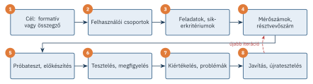
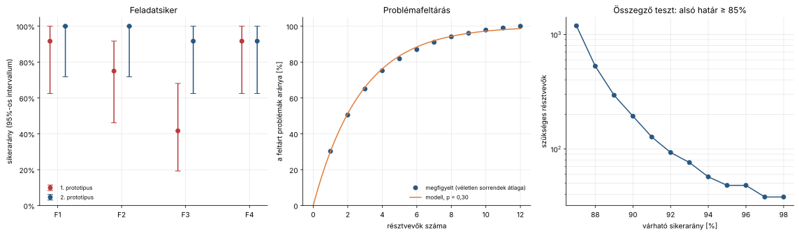

# Használhatósági teszt {#sec-hasznalhatosagi-teszt}

::: {.cel title="Eszközkártya"}
- **Mire való?** Annak vizsgálata, hogy a rendszert a meghatározott felhasználók a céljaik elérésére mennyire hatásosan, hatékonyan és elégedetten használják; a használhatósági problémák feltárása; a validáció egyik fő eszköze.
- **Tanulási eredmény:** az eszközlap feldolgozása után képes leszel használhatósági tesztet megtervezni és lebonyolítani, kiértékelni a sikerességet, az időt és a hibákat, és a mintaelemszám korlátait figyelembe venni.
- **V-lépés:** 9. Validáció; formatív változata már a részletes tervezésben (makettel, prototípussal) alkalmazható.
- **Bemenet:** a működési forgatókönyvek, a felhasználói csoportok és a használati környezet leírása, a célértékek (például sikerarány, célidő), a tesztelendő makett, prototípus vagy termék.
- **Kimenet:** feladatonkénti sikerarány intervallummal, feladatidők, SUS-pontszám, a feltárt problémák súlyossággal, javaslatok és a résztvevőszám indoklása.
- **Időigény:** tervezés fél–egy nap; résztvevőnként 30–60 perc; kiértékelés fél–egy nap.
- **Kézikönyv:** [24. fejezet](../../kezikonyv/fejezetek/24-validacio.html), 24.3. szakasz; [11. fejezet](../../kezikonyv/fejezetek/11-emberkozpontu.html).
- **Továbbolvasás:** [@nasa2016seh, 5.4. szakasz].
:::

## Mikor használd?

- **Ha a rendszernek emberi felhasználója van**, és a siker azon múlik, hogy a felhasználók segítség nélkül, hiba nélkül, elfogadható idő alatt elvégzik a feladataikat [@iso9241_11_2018].
- **A tervezés közben (formatív teszt)**: makettel vagy prototípussal, hogy a problémák még olcsón javíthatók legyenek [@iso9241_210_2019].
- **A validációban (összegző teszt)**: egy MOE vagy célérték (például az, hogy a 65 év felettiek első kölcsönzéseinek legalább 85%-a segítség nélkül sikerüljön) teljesülésének értékelésére.
- **Két változat összevetésére**: ugyanazokkal a feladatokkal és mérőszámokkal.
- **Kevésbé alkalmas** a ritka, veszélyes helyzetek vizsgálatára; azokhoz szimulátor, feladatelemzés vagy emberi megbízhatósági elemzés kell ([-@sec-hta]. eszközlap).

## Lépések

{#fig-lepesek-hasznalhatosagi-teszt width=100%}

1. **Döntsd el a teszt célját.** Formatív teszt: a problémák feltárása; összegző teszt: a célértékek igazolása. A kettő eltérő résztvevőszámot és mérőszámokat kíván.
2. **Határozd meg a felhasználói csoportokat**, és csoportonként válassz résztvevőket. A résztvevők a felhasználói népességet képviseljék, ne a fejlesztőcsapatot [@rubin2008; @iso9241_210_2019].
3. **Írd meg a feladatokat** a működési forgatókönyvekből, sikerkritériummal és célidővel. A feladat a célt mondja meg, ne a lépéseket („kölcsönözz egy kerékpárt vendégként”, nem „nyomd meg a Vendég gombot”) [@rubin2008].
4. **Válaszd ki a mérőszámokat, és tervezd meg a résztvevők számát.** Hatásosság: sikerarány, hibák; hatékonyság: idő; elégedettség: SUS [@brooke1996]. Formatív tesztnél a problémafeltárás modellje [@nielsen1993], összegző tesztnél a sikerarány intervalluma [@agresti1998] adja a résztvevőszámot.
5. **Végezz próbatesztet**, és készítsd elő a környezetet: eszközök, rögzítés, a moderátor forgatókönyve, a beleegyező nyilatkozat.
6. **Teszteld és figyeld meg a résztvevőket.** Rögzítsd a sikert, az időt, az elakadásokat; a hangos gondolkodás feltárja az okokat. A moderátor ne segítsen, csak ha a résztvevő végleg elakadt (ilyenkor a feladat sikertelen).
7. **Értékeld ki az eredményeket.** Feladatonkénti sikerarány intervallummal, mértani átlagos idő, SUS-átlag; a problémák listája súlyossággal és azzal, kik találkoztak velük.
8. **Javíts, és teszteld újra.** A javított változat új tesztje igazolja, hogy a javítás működik, és nem okozott új problémát.

## Kidolgozott példa: a VárosiBringa alkalmazásának prototípusai

A VárosiBringa csapata a kölcsönző alkalmazás első prototípusát 12 résztvevővel tesztelte: három egyetemistával, három idősebb lakóval, három turistával és három gyengénlátó felhasználóval ([11. fejezet](../../kezikonyv/fejezetek/11-emberkozpontu.html)). A négy feladat a működési koncepció forgatókönyveiből származott; a vendégként történő kölcsönzés célideje a követelményből adódott (legfeljebb 3 perc). Az eredményeket a [-@tbl-hasznalhatosag-bringa]. táblázat mutatja.

| Feladat | Siker | 95%-os intervallum | Idő (mértani átlag) | Célidő |
|:--|--:|:--|--:|--:|
| F1 kölcsönzés regisztrált felhasználóként | 11/12 | 62–100% | 77 s | 90 s |
| F2 dokkoló keresése szabad hellyel | 9/12 | 46–92% | 48 s | 60 s |
| F3 kölcsönzés vendégként | 5/12 | 19–68% | 161 s | 180 s |
| F4 visszaadás | 11/12 | 62–100% | 44 s | 60 s |
| összesen | 36/48 | 61–85% | | |

: Az első prototípus feladatsikerei és -idői (a sikerarány intervalluma módosított Wald-módszerrel). {#tbl-hasznalhatosag-bringa tbl-colwidths="[38,10,20,18,14]"}

A SUS-átlag 64,0 lett (95%-os intervallum 55,2–72,7), az átlagnak tekintett 68 alatt [@sauro2016]. A teszt nyolc problémát tárt fel; a két súlyos a vendégfizetés következő lépésének érthetetlensége (hat résztvevő) és a szabad dokkolóhelyek kizárólag színnel való jelölése (mindhárom gyengénlátó résztvevő). Az észlelés átlagos valószínűsége $p = 29/96 = 0{,}30$; a modell szerint 12 résztvevő a problémák mintegy 99%-át, öt résztvevő 83%-át tárta volna fel ([-@fig-hasznalhatosag]. ábra). A javított második prototípusnál ugyanazok a résztvevők 46/48 feladatot teljesítettek, a SUS-átlag 79,0-ra (74,2–83,7) nőtt; a résztvevőnkénti különbség átlaga +15,0 pont.

{#fig-hasznalhatosag width=100%}

**Tanulságok:**

- **Kis mintán a problémák feltárhatók, az arányok nem igazolhatók.** A 12 fős teszt szinte minden problémát megtalált, de a vendégkölcsönzés sikerarányának intervalluma 19–68%: arra elég, hogy a feladat egyértelműen rossz, arra nem, hogy egy 90%-os célérték teljesülését igazolja.
- **A csoportok számítanak.** A szabad helyek jelölésének problémája csak a gyengénlátó résztvevőknél jelentkezett; nélkülük a teszt nem tárta volna fel.
- **Az összegző teszt drága.** Ha a várható sikerarány 89%, a 85%-os cél igazolásához mintegy 300 résztvevő kell; a VárosiBringa ezért az üzemi naplóból validálta a C3 célkitűzést ([24. fejezet](../../kezikonyv/fejezetek/24-validacio.html)).
- **A mértani átlag és a célidő együtt értelmezendő.** A vendégkölcsönzés mértani átlagos ideje a célidő alatt van, de ez csak a sikeres résztvevőkre vonatkozik; a célidőn belül sikeres résztvevők aránya mindössze 33%.

## Sablon és notebook

- [hasznalhatosagi_teszt_sablon.xlsx](../sablonok/hasznalhatosagi_teszt_sablon.xlsx): „Résztvevők” (legfeljebb 30, csoporttal és SUS-pontszámmal), „Feladatok” (legfeljebb 8, sikerkritériummal és célidővel), „Eredmények” (siker és idő résztvevőnként és feladatonként), „Problémák” (legfeljebb 30 probléma súlyossággal és résztvevő-mátrixszal) és „Összesítés” lap (sikerarány módosított Wald-intervallummal, mértani átlagos idő, célidőn belüli arány, SUS-átlag *t*-intervallummal, az észlelés valószínűsége és a feltárt hányad becslése). Az első prototípus adataival kitöltve. A SUS-pontszám kiszámításához a NASA-TLX és SUS sablonja használható ([-@sec-tlx-sus]. eszközlap).
- [hasznalhatosagi_teszt.ipynb](../notebookok/hasznalhatosagi_teszt.ipynb) · [Megnyitás Google Colabban](hasznalhatosagi_teszt.ipynb): a mérőszámok intervallumokkal, a megfigyelt és a modell szerinti problémafeltárás, a résztvevőszám tervezése formatív és összegző tesztre, két prototípus összevetése (a [-@fig-hasznalhatosag]. ábra így készült).

## Előnyök és korlátok

| Előnyök | Korlátok |
|:--|:--|
| Valódi felhasználók valószerű feladatokon: a problémák okai is láthatók [@rubin2008] | A laboratóriumi helyzet eltér a valós használattól (zaj, sietség, időjárás, motiváció) |
| Kis résztvevőszámmal is feltárja a gyakori problémákat [@nielsen1993; @virzi1992] | A ritka problémák és a ritka felhasználói csoportok problémái kimaradhatnak |
| Szabványos mérőszámok: a változatok és a célértékek összevethetők [@iso9241_11_2018] | Az arányok igazolásához nagy minta kell; kis mintán az intervallumok szélesek [@sauro2016] |
| A SUS rövid, megbízható és nagy összehasonlító adatbázisra támaszkodik [@sauro2016] | A SUS a felhasználó észlelését méri, nem a teljesítményét; a kettő eltérhet |

: A használhatósági teszt előnyei és korlátai. {tbl-colwidths="[50,50]"}

::: {.hiba}
- **A fejlesztők vagy a kollégák mint résztvevők.** Ők ismerik a rendszert, ezért nem akadnak el ott, ahol a valódi felhasználó.
- **Lépéseket megadó feladatleírás.** Ha a feladat megmondja, mit kell megnyomni, a teszt a navigációt nem vizsgálja.
- **A moderátor segít.** A segítséggel befejezett feladat sikertelen; ha ezt nem rögzítik, a sikerarány túl kedvező lesz.
- **Az öt résztvevő mint törvény.** Az öt résztvevő csak akkor tárja fel a problémák nagy részét, ha az észlelés valószínűsége elég nagy, és a felhasználói csoportok hasonlóak; csoportonként kell résztvevőket bevonni.
- **Százalékok intervallum nélkül.** Kis mintán a „92%-os sikerarány” 62–100% is lehet; az intervallumot mindig közölni kell.
:::

## Mintapromptok

::: {.prompt title="Mintaprompt: feladatok megfogalmazása"}
```text
A rendszer és a felhasználói csoportok: [LEÍRÁS]. Működési
forgatókönyvek: [FORGATÓKÖNYVEK].
Feladat: fogalmazz 4–6 tesztfeladatot használhatósági teszthez. Minden
feladat a felhasználó célját írja le, ne a lépéseket; adj hozzá
sikerkritériumot és célidőt, és jelöld, melyik forgatókönyvből és
melyik felhasználói csoport számára fontos. A célidőket jelöld
feltételezésként, ha a követelmények nem adják meg őket.
```
:::

::: {.prompt title="Mintaprompt: megfigyelések rendezése problémalistává"}
```text
Megfigyelési jegyzetek résztvevőnként: [JEGYZETEK].
Feladat: rendezd a megfigyeléseket problémákba. Minden problémához
adj rövid leírást, az érintett feladatot, a súlyosság javaslatát
(kritikus, súlyos, közepes, kisebb) indoklással, és sorold fel, mely
résztvevőknél jelentkezett. Ne vonj össze különböző okú problémákat,
és ne találj ki megfigyelést, amely a jegyzetekben nem szerepel.
```
:::

## Feladat

::: {.projekt title="9. projektlépés: validációs terv"}
Készíts validációs tervet a fő érdekelt csoportokkal végzendő próbára: a MOE-k mérési módjával, legalább négy tesztfeladattal sikerkritériummal és célidővel, felhasználói csoportonként tervezett résztvevőkkel. Indokold a résztvevők számát a problémafeltárás modelljével, és mutasd meg a notebookkal, hány résztvevő kellene egy célérték összegző teszttel való igazolásához. Ha van makett vagy prototípus, végezz legalább öt résztvevővel formatív tesztet, és értékeld a sablonnal.
:::
