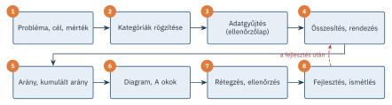
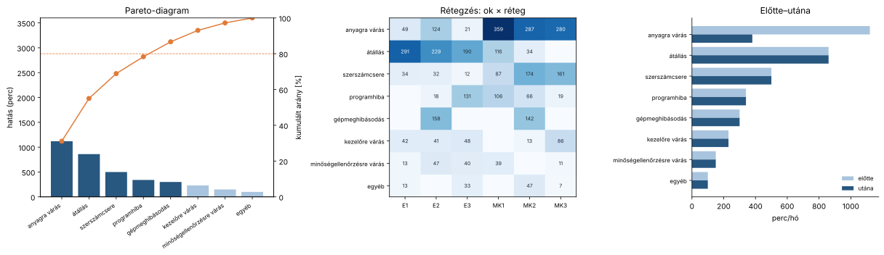

# Pareto-diagram {#sec-pareto-diagram}

::: {.cel title="Eszközkártya"}
- **Mire való?** Problémák, hibák vagy okok rangsorolása gyakoriság, időtartam vagy költség szerint; a hatás nagy részét adó „kevés lényeges” ok kiválasztása; a fejlesztés hatásának bemutatása.
- **Tanulási eredmény:** az eszközlap feldolgozása után képes leszel Pareto-diagramot készíteni, kiválasztani a „kevés lényeges” okot, és rétegzéssel elkülöníteni a források hatását.
- **V-lépés:** 9. Üzemeltetés és folyamatos fejlesztés; a verifikáció és a validáció eltéréseinek elemzésére is használható.
- **Bemenet:** eseménynapló vagy ellenőrzőlap (mi, mikor, hol, mekkora hatással), egységes kategóriák, a választott mérték (darab, perc, Ft).
- **Kimenet:** rangsorolt okok arányokkal és kumulált aránnyal, Pareto-diagram, rétegzett összesítés, a fejlesztési célpont kijelölése.
- **Időigény:** meglévő naplóból 30–60 perc; adatgyűjtéssel néhány nap–hét.
- **Kézikönyv:** [25. fejezet](../../kezikonyv/fejezetek/25-uzemeltetes.html), 25.3. szakasz.
- **Továbbolvasás:** [@goldberg1994toolbox, 5.5. és 5.6. szakasz].
:::

## Mikor használd?

- **Ha sok különböző probléma vagy ok van**, és el kell dönteni, melyikkel érdemes először foglalkozni [@montgomery2020sqc].
- **Ha a hatás nagy része feltehetően kevés okból ered**: a tapasztalat szerint gyakran ez a helyzet („kevés lényeges és sok kevésbé lényeges”) [@montgomery2020sqc].
- **Fejlesztés előtt és után**, azonos mértékkel és időszakkal: a változás és az új első ok látható.
- **Rétegzéssel együtt** (gép, műszak, termék, beszállító szerint), ha a különbségek a forrásra utalnak [@montgomery2020sqc].
- **Kevésbé alkalmas**, ha a kategóriák átfedők vagy rosszul meghatározottak, illetve ha egy ritka, de súlyos esemény (például balesetveszély) a fontos: a súlyosságot külön kell értékelni ([-@sec-kockazati-matrix]. eszközlap).

## Lépések

{#fig-lepesek-pareto-diagram width=100%}

1. **Fogalmazd meg a problémát és a célt, és válaszd meg a mértéket.** Rendelkezésre állási cél esetén időtartam, zavarás esetén gyakoriság, gazdasági döntésnél költség.
2. **Rögzítsd a kategóriákat** egyértelműen, átfedés nélkül; az „egyéb” kategória legyen kicsi.
3. **Gyűjtsd az adatokat** ellenőrzőlappal vagy informatikai naplóból, meghatározott időszakra [@ishikawa1982].
4. **Összesítsd és rendezd** a kategóriákat a mérték szerint csökkenő sorrendbe.
5. **Számold ki az arányokat és a kumulált arányt.**
6. **Rajzold meg a diagramot**: oszlopok a hatással, vonal a kumulált aránnyal; jelöld a „kevés lényeges” okokat.
7. **Rétegezz, és ellenőrizd**, hogy a rangsor más mértékkel vagy más rétegekben is ugyanaz-e.
8. **Indítsd el a fejlesztést**, és a változás után ismételd meg az elemzést.

## Kidolgozott példa: a ForgácsTech állásideje

A MES egy hónap alatt 135 állásidő-eseményt rögzített, összesen 3600 percet ([25. fejezet](../../kezikonyv/fejezetek/25-uzemeltetes.html)). Az időtartam szerinti Pareto-elemzést a [-@tbl-pareto-forgacs]. táblázat és a [-@fig-pareto]. ábra mutatja.

| Rang | Ok | Perc | Arány | Kumulált | Események |
|--:|:--|--:|--:|--:|--:|
| 1 | anyagra várás | 1120 | 31,1% | 31,1% | 38 |
| 2 | átállás | 860 | 23,9% | 55,0% | 22 |
| 3 | szerszámcsere | 500 | 13,9% | 68,9% | 25 |
| 4 | programhiba | 340 | 9,4% | 78,3% | 12 |
| 5 | gépmeghibásodás | 300 | 8,3% | 86,7% | 6 |
| 6 | kezelőre várás | 230 | 6,4% | 93,1% | 14 |
| 7 | minőségellenőrzésre várás | 150 | 4,2% | 97,2% | 10 |
| 8 | egyéb | 100 | 2,8% | 100,0% | 8 |

: A ForgácsTech havi állásideje okok szerint. {#tbl-pareto-forgacs tbl-colwidths="[8,34,12,12,16,18]"}

{#fig-pareto width=100%}

**Tanulságok:**

- **Három ok adja az állásidő 69%-át.** A 80%-os határig öt ok kell; a sor vége (kezelőre várás, minőségellenőrzés, egyéb) együtt is csak 13%.
- **A mérték megváltoztatja a sorrendet.** Gyakoriság szerint a szerszámcsere a második, a gépmeghibásodás az utolsó: a ritka, de hosszú meghibásodások az időtartam szerint fontosak, a gyakori, rövid zavarok a kezelőket terhelik.
- **A rétegzés a forrásra mutat.** Az anyagra várás 83%-a a megmunkáló központokon (MK1–MK3) keletkezett, ahol a rendelések átsorolása gyakori; az átállás inkább az esztergákon jelentős. Ez már az okok elemzésének irányát is kijelöli ([-@sec-halszalka]. eszközlap).
- **A fejlesztés után új első ok jön.** Az anyagra várás 380 percre csökkentése után az átállás került az élre; a Pareto-elemzést rendszeresen meg kell ismételni.

## Sablon és notebook

- [pareto_sablon.xlsx](../sablonok/pareto_sablon.xlsx): „Napló” (ellenőrzőlap, legfeljebb 400 esemény, legördülő okokkal), „Okok” (legfeljebb 15 ok, opcionális súllyal, automatikus rangsorral), „Pareto” (rangsorolt okok, arányok, kumulált arány, A osztály, kombinált oszlop- és vonaldiagram) és „Rétegzés” lap (hatás rétegenként és okonként, halmozott diagram). A ForgácsTech egy havi naplójával kitöltve.
- [pareto.ipynb](../notebookok/pareto.ipynb) · [Megnyitás Google Colabban](pareto.ipynb): Pareto időtartam, gyakoriság és súlyozott hatás szerint, rétegzés hőtérképpel, előtte–utána összevetés (a [-@fig-pareto]. ábra így készült).

## Előnyök és korlátok

| Előnyök | Korlátok |
|:--|:--|
| Egyszerű, közérthető, a fejlesztési erőforrásokat a legfontosabb okokra irányítja [@montgomery2020sqc] | A rangsor a kategóriák meghatározásától és a mértéktől függ |
| A meglévő naplókból gyorsan elkészíthető | A gyakoriság nem azonos a súlyossággal; a ritka, súlyos eseményeket külön kell kezelni |
| Az előtte–utána összevetés láthatóvá teszi a fejlesztés hatását | Okot nem bizonyít: csak megmutatja, hol érdemes keresni; a gyökérokot más eszközök tárják fel |
| Rétegzéssel a források is elkülöníthetők [@montgomery2020sqc] | Rövid időszakban a véletlen ingadozás eltorzíthatja a sorrendet |

: A Pareto-diagram előnyei és korlátai. {tbl-colwidths="[50,50]"}

::: {.hiba}
- **Nagy „egyéb” kategória.** Ha az „egyéb” a legnagyobb oszlopok között van, a kategóriák rosszul vannak meghatározva.
- **Átfedő kategóriák.** Egy esemény két kategóriába is beleillik („gépmeghibásodás” és „szerszámtörés”), és a kezelők eltérően sorolják be; a kategóriákat meghatározásokkal és példákkal kell rögzíteni.
- **Rossz mérték.** Darabszám szerinti Pareto rendelkezésre állási célhoz félrevezető lehet.
- **Egyszeri elemzés.** A fejlesztés után a sorrend megváltozik; a Pareto-elemzés a folyamatos fejlesztés visszatérő lépése.
:::

## Mintapromptok

::: {.prompt title="Mintaprompt: kategóriarendszer kialakítása"}
```text
Szabad szöveges hibaleírások a naplóból: [LEÍRÁSOK, LEGALÁBB 50].
Feladat: javasolj 6–10 egymást kizáró kategóriát, mindegyikhez egy
mondatos meghatározással és két példával a fenti leírásokból.
Jelöld azokat a leírásokat, amelyek több kategóriába is illenének,
és javasolj szabályt a besorolásukra. Az „egyéb” kategóriába a
leírások legfeljebb 10%-a kerüljön.
```
:::

::: {.prompt title="Mintaprompt: a Pareto-eredmény értelmezése"}
```text
Pareto-táblázat: [OK, HATÁS, ARÁNY, KUMULÁLT ARÁNY]; rétegzés:
[RÉTEG × OK TÁBLÁZAT]; a mérték: [PERC / DARAB / FT].
Feladat: írj rövid értelmezést a vezetői megbeszélésre: mely okokra
összpontosítsunk, mit mutat a rétegzés, és milyen további adat kell
a gyökérok feltárásához. Ne állíts okot az adatokon túl; a számokat
ne változtasd meg.
```
:::

## Feladat

::: {.projekt title="Választható feladat: Pareto-elemzés"}
Ha projektedben van olyan folyamat vagy szolgáltatás, amelyhez hibák, panaszok vagy állásidők tartoznak, gyűjts vagy becsülj adatokat legalább hat kategóriára, készíts Pareto-diagramot két különböző mértékkel, és rétegezd az adatokat egy jellemző szerint. Fogalmazd meg, melyik okkal foglalkoznál először, és miért.
:::
