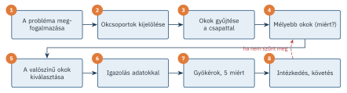
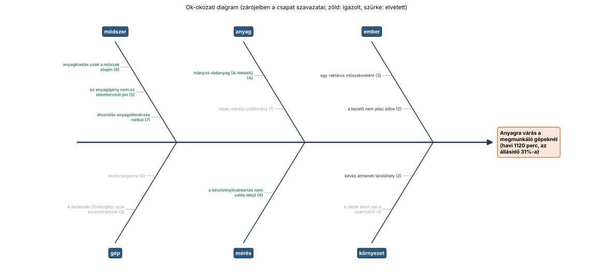

# Ok-okozati (halszálka-) diagram {#sec-halszalka}

::: {.cel title="Eszközkártya"}
- **Mire való?** Egy probléma (hatás) lehetséges okainak összegyűjtése és rendszerezése okcsoportok szerint, csapatmunkában; a valószínű okok kiválasztása és adatokkal való igazolása; a mélyebb okok feltárása 5 miért elemzéssel.
- **Tanulási eredmény:** az eszközlap feldolgozása után képes leszel csapatban ok-okozati diagramot készíteni, és a lehetséges okok közül adatokkal kiválasztani a valódiakat.
- **V-lépés:** 9. Üzemeltetés és folyamatos fejlesztés; a verifikációs és validációs eltérések okainak keresésére, valamint a tervezési szakasz kockázatelemzésére is használható.
- **Bemenet:** mérhető formában megfogalmazott probléma, a folyamatot ismerő csapat, adatok (napló, Pareto-elemzés, mérések).
- **Kimenet:** ok-okozati diagram, a lehetséges okok listája szavazatokkal és igazolási állapottal, a gyökérok és az intézkedés.
- **Időigény:** a diagram 60–90 perces csapatülés; az okok igazolása napok–hetek.
- **Kézikönyv:** [25. fejezet](../../kezikonyv/fejezetek/25-uzemeltetes.html), 25.3. szakasz.
- **Továbbolvasás:** [@goldberg1994toolbox, 7.2. szakasz].
:::

## Mikor használd?

- **Ha egy problémának sok lehetséges oka van**, és a csapat tagjai különböző okokra gyanakszanak [@ishikawa1982].
- **A Pareto-elemzés után**: a kiválasztott első ok mélyebb okainak keresésére ([-@sec-pareto-diagram]. eszközlap).
- **A 8D és a DMAIC elemzési lépésében** a gyökérok feltárására ([-@sec-pdca-8d-dmaic]. eszközlap).
- **Ha a csapatnak közös képet kell kialakítania** a problémáról: a diagram a tudást láthatóvá és rendezetté teszi [@ishikawa1982].
- **Kevésbé alkalmas** összetett, sok kölcsönhatású rendszerhibák elemzésére; ott a hibafa ([-@sec-hibafa]. eszközlap) vagy a rendszerelméleti elemzés ([-@sec-stpa]. eszközlap) kell.

## Lépések

{#fig-lepesek-halszalka width=100%}

1. **Fogalmazd meg a problémát mérhetően**: mi, hol, mikor, mekkora mértékben (például „anyagra várás a megmunkáló gépeknél, havi 1120 perc”).
2. **Jelöld ki az okcsoportokat.** Gyártásban gyakran: ember, gép, módszer, anyag, mérés, környezet; szolgáltatásban például: ügyfél, munkatárs, eljárás, rendszer, környezet.
3. **Gyűjtsd össze a lehetséges okokat a csapattal**, ítélkezés nélkül; minden ok a megfelelő csoportba kerül.
4. **Kérdezz rá a mélyebb okokra** („miért?”): az okok gyakran egy szinttel lejjebb válnak kezelhetővé.
5. **Válaszd ki a valószínű okokat**, például szavazással; ez a csapat véleménye, nem bizonyíték.
6. **Igazold vagy vesd el az okokat adatokkal**: napló, rétegzés, mérés, kísérlet [@ishikawa1982].
7. **Az igazolt okra végezz 5 miért elemzést**, amíg olyan okhoz nem érsz, amelyre intézkedés tervezhető.
8. **Tervezz intézkedést, és kövesd a hatását**; ha a probléma nem szűnik meg, a vizsgálandó okok a következő jelöltek.

## Kidolgozott példa: anyagra várás a ForgácsTechnél

A Pareto-elemzés szerint az állásidő legnagyobb oka az anyagra várás volt ([-@sec-pareto-diagram]. eszközlap). A csapat (termelésvezető, két műszakvezető, a raktáros, a logisztikai vezető és egy kezelő) 12 lehetséges okot gyűjtött hat csoportban ([-@fig-halszalka]. ábra). A szavazás után az okokat adatokkal ellenőrizték: öt okot igazoltak, négyet elvetettek, hármat további vizsgálatra jelöltek.

{#fig-halszalka width=100%}

Az igazolt okok közül a legerősebb a módszer csoportban volt: a MES-napló szerint a márciusi 17 átsorolásból 11 után keletkezett várakozás, és a várakozások 64%-a átsorolás után jelentkezett. Az 5 miért elemzés ([-@tbl-5miert]. táblázat) a gyökérokot a folyamatok összekötésének hiányára vezette vissza.

| Lépés | Kérdés | Válasz | Bizonyíték |
|--:|:--|:--|:--|
| 1 | Miért vár a gép anyagra? | Az átsorolt rendelés anyaga nincs kikészítve. | MES-napló |
| 2 | Miért nincs kikészítve? | Az anyagot csak a műszak elején, az akkori sorrend szerint adják ki. | kiadási napló |
| 3 | Miért csak a műszak elején? | A raktáros a műszak elején kapja meg a listát, közben nem kap értesítést. | interjú |
| 4 | Miért nem kap értesítést? | A MES ütemezője átsoroláskor nem küld anyagigényt. | a MES beállításai |
| 5 | Miért nem küld? | Az anyagkiadás nem volt része a bevezetett folyamatnak. | a jövőbeli BPMN-modell |

: Az 5 miért elemzés. {#tbl-5miert tbl-colwidths="[8,26,44,22]"}

**Tanulságok:**

- **A szavazás nem bizonyíték.** A „darabolás szűk keresztmetszet” három szavazatot kapott, de a fűrészgép kihasználtsága 52% volt, így az okot elvetették.
- **A mélyebb ok gyakran a folyamatok határán van.** Sem a raktár, sem a termelés nem hibázott a saját szabályai szerint; a hiány a két folyamat összekötésében volt, ami a BPMN-modellben sem szerepelt ([-@sec-bpmn]. eszközlap).
- **A vizsgálandó okokat meg kell őrizni.** Ha az intézkedés után a várakozás nem csökken eléggé, a „kevés átmeneti tárolóhely” és a „kezelő nem jelez előre” a következő jelöltek.

## Sablon és notebook

- [halszalka_sablon.xlsx](../sablonok/halszalka_sablon.xlsx): „Csoportok” (legfeljebb 8 okcsoport), „Okok” (a probléma és legfeljebb 40 lehetséges ok mélyebb okkal, szavazattal, igazolási állapottal és bizonyítékkal), „Összesítés” (okcsoportonként, diagrammal), „Diagram” (halszálka-elrendezés automatikusan, zölddel az igazolt okok) és „5 miért” lap. A ForgácsTech példájával kitöltve.
- [halszalka.ipynb](../notebookok/halszalka.ipynb) · [Megnyitás Google Colabban](halszalka.ipynb): az ok-okozati diagram automatikus rajzolása a táblázatból, a szavazatok összesítése és az okok rangsora (a [-@fig-halszalka]. ábra így készült).

## Előnyök és korlátok

| Előnyök | Korlátok |
|:--|:--|
| Egyszerű, a csapat tudását rendezetten láthatóvá teszi [@ishikawa1982] | A lehetséges okok listája a csapat tudásán múlik; ami senkinek nem jut eszébe, kimarad |
| Az okcsoportok segítenek, hogy egyetlen terület se maradjon ki | A kölcsönhatásokat és a több ok együttes hatását nem ábrázolja [@ishikawa1982] |
| Az 5 miért elemzéssel a kezelhető mélyebb okokig vezet | Az 5 miért egyetlen láncot követ; több párhuzamos ok esetén félrevezethet |
| A Pareto-elemzéssel és az adatokkal együtt erős eszköz | Adatokkal való igazolás nélkül csak vélemények gyűjteménye |

: Az ok-okozati diagram előnyei és korlátai. {tbl-colwidths="[50,50]"}

::: {.hiba}
- **Homályos probléma.** A „rossz a minőség” nem elemezhető; a probléma legyen mérhető, és egy hatásra vonatkozzon.
- **Megoldások az okok helyén.** A „nincs elég raktáros” megoldási javaslat; az ok: „a raktári kiadások a műszak elejére torlódnak”.
- **A legtöbb szavazatot kapott ok mint gyökérok.** A gyökérokot adatokkal kell igazolni.
- **Hibáztatás.** Az „ember” csoport nem a bűnös keresésére szolgál; az emberi hiba mögött rendszerint a munkakörnyezet és a folyamat okai állnak ([-@sec-hta]. eszközlap; kézikönyv [13. fejezet](../../kezikonyv/fejezetek/13-emberi-hiba.html)).
:::

## Mintapromptok

::: {.prompt title="Mintaprompt: lehetséges okok kiegészítése"}
```text
Probléma: [MÉRHETŐ PROBLÉMALEÍRÁS]. A csapat eddigi okai csoportonként:
[TÁBLÁZAT]. A folyamat rövid leírása: [LEÍRÁS].
Feladat: javasolj csoportonként legfeljebb három további lehetséges
okot, amely a listából hiányzik, és mindegyikhez írd le, milyen adattal
lehetne igazolni vagy elvetni. Jelöld, ha egy javasolt ok valójában
megoldási ötlet. Ne állítsd, hogy bármelyik ok a gyökérok.
```
:::

::: {.prompt title="Mintaprompt: 5 miért ellenőrzése"}
```text
Az 5 miért lánc: [KÉRDÉSEK ÉS VÁLASZOK, BIZONYÍTÉKOKKAL].
Feladat: vizsgáld meg a láncot. Van-e olyan lépés, ahol a válasz nem
következik az előzőből, vagy több ok is lehetséges? Melyik válaszhoz
hiányzik bizonyíték? Hol ágazik el a lánc? Javasolj ellenőrző kérdést
minden gyenge lépéshez.
```
:::

## Feladat

::: {.projekt title="Választható feladat: ok-okozati elemzés"}
Válassz egy problémát a projektedből (például a Pareto-elemzés első okát vagy egy verifikációs eltérést). Készíts ok-okozati diagramot legalább öt okcsoporttal és tizenkét lehetséges okkal, jelöld a csapat szavazatait, és írd le, hogyan igazolnád vagy vetnéd el a három legvalószínűbb okot. Végezz 5 miért elemzést a legerősebb okra.
:::
